# Ray Data 详解

> 代码基准：`ray-project/ray` commit `97f7eec`，版本 `3.0.0.dev0`，主体代码位于 `python/ray/data/`。
> 本文所有源码引用均标注 `文件路径:行号`，行号在此 commit 下逐一核对。`_internal` 下的实现细节变动频繁，读到与你手上代码不一致处，以你的代码为准。

## 目录

- [0. 引言：读这篇文档前你该知道什么](#0-引言读这篇文档前你该知道什么)
  - [0.1 Ray Data 是什么](#01-ray-data-是什么)
  - [0.2 和 Spark 的定位差异](#02-和-spark-的定位差异)
  - [0.3 它站在 Ray Core 的肩膀上](#03-它站在-ray-core-的肩膀上)
  - [0.4 版本与代码基准](#04-版本与代码基准)
  - [0.5 阅读路线图](#05-阅读路线图)
- [1. 全景图：一条 pipeline 的完整旅程](#1-全景图一条-pipeline-的完整旅程)
  - [1.1 贯穿全章的示例](#11-贯穿全章的示例)
  - [1.2 四层架构](#12-四层架构)
  - [1.3 惰性执行：Dataset 方法只在攒算子](#13-惰性执行dataset-方法只在攒算子)
  - [1.4 触发点：谁真正按下"执行"按钮](#14-触发点谁真正按下执行按钮)
  - [1.5 从逻辑计划到物理计划：三步](#15-从逻辑计划到物理计划三步)
  - [1.6 流式 vs BSP：为什么不"map 全跑完再跑下一个"](#16-流式-vs-bsp为什么不map-全跑完再跑下一个)
  - [1.7 例外：AllToAll 是全屏障](#17-例外alltoall-是全屏障)
  - [1.8 示例 pipeline 的物理拓扑](#18-示例-pipeline-的物理拓扑)
  - [1.9 关键文件导航表](#19-关键文件导航表)
- [2. 核心抽象与数据结构](#2-核心抽象与数据结构)
  - [2.1 Block：Ray Data 的最小数据单位](#21-blockray-data-的最小数据单位)
  - [2.2 RefBundle：算子之间流通的货币](#22-refbundle算子之间流通的货币)
  - [2.3 Dataset / LogicalPlan / _ExecutionCache](#23-dataset-logicalplan-_executioncache)
  - [2.4 DataContext：会跟着任务跑的全局配置](#24-datacontext会跟着任务跑的全局配置)
  - [2.5 Expression：可分析的计算 IR](#25-expression可分析的计算-ir)
- [3. 从 API 到 LogicalPlan](#3-从-api-到-logicalplan)
  - [3.1 一套基类，两种身份](#31-一套基类两种身份)
  - [3.2 LogicalOperator 家族](#32-logicaloperator-家族)
  - [3.3 一个 Dataset 方法到底做了什么](#33-一个-dataset-方法到底做了什么)
  - [3.4 LogicalPlan](#34-logicalplan)
  - [3.5 惰性边界：什么时候真的开始算](#35-惰性边界什么时候真的开始算)
  - [3.6 链式调用对应的 plan 文本](#36-链式调用对应的-plan-文本)
- [4. 逻辑优化器：Rule 体系](#4-逻辑优化器rule-体系)
  - [4.1 优化器框架：Optimizer 与 Rule](#41-优化器框架optimizer-与-rule)
  - [4.2 Ruleset：声明依赖，拓扑排序](#42-ruleset声明依赖拓扑排序)
  - [4.3 算子融合：本章重点](#43-算子融合本章重点)
  - [4.4 各类下推规则](#44-各类下推规则)
  - [4.5 规则汇总表](#45-规则汇总表)
- [5. Planner：LogicalPlan → PhysicalPlan](#5-plannerlogicalplan-physicalplan)
  - [5.1 分发机制：一张表 + 一次后序遍历](#51-分发机制一张表-一次后序遍历)
  - [5.2 MapTransformer：UDF 的封装链](#52-maptransformerudf-的封装链)
  - [5.3 各 planner 函数速览](#53-各-planner-函数速览)
- [6. PhysicalOperator 协议与 MapOperator 实现](#6-physicaloperator-协议与-mapoperator-实现)
  - [6.1 协议逐项拆解](#61-协议逐项拆解)
  - [6.2 `DataOpTask` / `MetadataOpTask`：把 Ray task 包成可轮询对象](#62-dataoptask-metadataoptask把-ray-task-包成可轮询对象)
  - [6.3 `MapOperator` 基类](#63-mapoperator-基类)
  - [6.4 `TaskPoolMapOperator` vs `ActorPoolMapOperator`](#64-taskpoolmapoperator-vs-actorpoolmapoperator)
  - [6.5 Actor 自动伸缩](#65-actor-自动伸缩)
  - [6.6 其他基础算子速览](#66-其他基础算子速览)
  - [6.7 `OpRuntimeMetrics`：一份数据，三个消费者](#67-opruntimemetrics一份数据三个消费者)
- [7. StreamingExecutor：调度循环的心脏](#7-streamingexecutor调度循环的心脏)
  - [7.1 为什么需要流式执行器](#71-为什么需要流式执行器)
  - [7.2 Topology 与 OpState](#72-topology-与-opstate)
  - [7.3 调度主循环](#73-调度主循环)
  - [7.4 线程模型与输出](#74-线程模型与输出)
  - [7.5 卡死检测与自动伸缩](#75-卡死检测与自动伸缩)
  - [7.6 执行选项](#76-执行选项)
  - [7.7 回调机制](#77-回调机制)
- [8. 资源管理、背压与内存](#8-资源管理背压与内存)
  - [8.1 ExecutionResources：资源的四个维度](#81-executionresources资源的四个维度)
  - [8.2 ResourceManager：全局资源账本](#82-resourcemanager全局资源账本)
  - [8.3 ReservationOpResourceAllocator：为什么不能"先到先得"](#83-reservationopresourceallocator为什么不能先到先得)
  - [8.4 三个默认背压策略](#84-三个默认背压策略)
  - [8.5 block 大小与动态切块](#85-block-大小与动态切块)
  - [8.6 spilling 与 OOM：两种截然不同的失败](#86-spilling-与-oom两种截然不同的失败)
- [9. Shuffle 与聚合](#9-shuffle-与聚合)
  - [9.1 为什么 shuffle 是分水岭](#91-为什么-shuffle-是分水岭)
  - [9.2 两大流派总览](#92-两大流派总览)
  - [9.3 sort-based 路径：经典 exchange 框架](#93-sort-based-路径经典-exchange-框架)
  - [9.4 hash-based 路径 V1：常驻 aggregator actor](#94-hash-based-路径-v1常驻-aggregator-actor)
  - [9.5 Shuffle V2：把 actor 换回无状态 task](#95-shuffle-v2把-actor-换回无状态-task)
  - [9.6 聚合](#96-聚合)
  - [9.7 Join](#97-join)
  - [9.8 GPU shuffle](#98-gpu-shuffle)
  - [9.9 CombineShuffles 规则：相邻 shuffle 能合并](#99-combineshuffles-规则相邻-shuffle-能合并)
  - [9.10 实践小结](#910-实践小结)
- [10. 读写路径与消费侧](#10-读写路径与消费侧)
  - [10.1 V1 Datasource：一个 ReadTask 干三件事](#101-v1-datasource一个-readtask-干三件事)
  - [10.2 V2 三段式读](#102-v2-三段式读)
  - [10.3 读并行度是怎么定的](#103-读并行度是怎么定的)
  - [10.4 写路径](#104-写路径)
  - [10.5 checkpoint：长作业的断点续跑](#105-checkpoint长作业的断点续跑)
  - [10.6 消费侧：iter_batches 的 prefetch 流水线](#106-消费侧iter_batches-的-prefetch-流水线)
  - [10.7 split 与 streaming_split](#107-split-与-streaming_split)
  - [10.8 章末：「我要读 X」路径表](#108-章末我要读-x路径表)
- [11. 可观测性、调优与排错](#11-可观测性调优与排错)
  - [11.1 先分清两个 `stats`](#111-先分清两个-stats)
  - [11.2 `ds.stats()` 逐字段解读](#112-dsstats-逐字段解读)
  - [11.3 `ds.explain()`](#113-dsexplain)
  - [11.4 进度条](#114-进度条)
  - [11.5 IssueDetector 框架](#115-issuedetector-框架)
  - [11.6 导出到外部系统](#116-导出到外部系统)
  - [11.7 常见问题诊断手册](#117-常见问题诊断手册)
  - [11.8 调优旋钮速查表（完整版）](#118-调优旋钮速查表完整版)
  - [11.9 源码导航索引](#119-源码导航索引)
  - [11.10 收尾：Ray Data 的四个取舍](#1110-收尾ray-data-的四个取舍)

---

## 0. 引言：读这篇文档前你该知道什么

### 0.1 Ray Data 是什么

Ray Data 是 Ray 生态里的分布式数据处理库。它的定位很窄也很清晰：**ML 训练/推理的"最后一公里"数据管道**——把对象存储里的 Parquet/图片/JSONL 读出来，做完解码、裁剪、tokenize、特征化，再喂给 GPU 上的模型，最后把结果写回去。

它不是通用 SQL 数仓。你在 Ray Data 里找不到成熟的 CBO（cost-based optimizer，基于代价的优化器）、找不到 catalog 级别的事务、也找不到几十种 join 算法。它有的是另一组东西：算子级别的资源异构调度、Python 原生 UDF、以及一套按 block（数据块）粒度流动的执行引擎。

### 0.2 和 Spark 的定位差异

这是最容易混淆的一点，值得单独说清。

| 维度 | Spark | Ray Data |
| --- | --- | --- |
| 执行模型 | BSP（Bulk Synchronous Parallel，批量同步并行）：stage 之间是硬屏障 | 流式（streaming）：算子间靠队列衔接，同时在跑 |
| 主要场景 | ETL、SQL 分析、宽依赖聚合 | CPU 预处理 + GPU 推理/训练的异构流水线 |
| 资源模型 | executor 同质，一份 CPU 配额吃到底 | 每个算子独立声明 `num_cpus` / `num_gpus` / actor 池大小 |
| 运行时 | JVM（PySpark 需跨进程序列化） | 纯 Python + Arrow，无 JVM |
| 用户代码 | DataFrame/SQL 为主，UDF 是二等公民 | Python 函数/类就是一等公民 |

核心差异其实只有一句：**Spark 假设所有 stage 用同一种资源，Ray Data 假设不是。** 一条 `read → preprocess(CPU) → infer(GPU) → write` 的管道里，如果按 BSP 跑，GPU 会在预处理阶段全程空转——这台机器上最贵的东西闲着。Ray Data 的整个设计都是为了消掉这段空转。

反过来说，如果你的作业是纯 CPU 的大规模 shuffle/join，Ray Data 并不比 Spark 有优势，甚至更弱：一旦碰到 AllToAll 算子（shuffle、sort），它的流水线优势就消失了（见 1.7）。

### 0.3 它站在 Ray Core 的肩膀上

理解 Ray Data 的关键分工：**Ray Data 只负责"计划"和"调度"，执行、存储、容错全部借给 Ray Core。**

- **存储**：一个 block 是一张 `pyarrow.Table` 或 `pandas.DataFrame`（`python/ray/data/block.py:55`），它以 `ObjectRef[Block]` 的形式存在 Ray 的 plasma object store 里。Ray Data 在算子之间传递的从来不是数据本体，而是引用的包装 `RefBundle`（`python/ray/data/_internal/execution/interfaces/ref_bundle.py:48`）。
- **执行**：每个算子的并行度落在 Ray task（无状态函数）或 Ray actor（有状态类）上。`TaskPoolMapOperator` 提交 task，`ActorPoolMapOperator` 维护一个 actor 池。
- **容错**：Ray Data 自己不做 checkpoint 也不做重算逻辑（有一个可选的 checkpoint 机制，但不是主路径）。block 丢了就靠 Ray Core 的 lineage reconstruction（血缘重建）——Ray Core 记得这个 object 是哪个 task 产出的，重跑那个 task 即可。

所以 Ray Data 的代码量看起来不大却能跑分布式，因为最难的三件事都不在它身上。它真正自己写的东西是：一个逻辑/物理计划器（约 20 个算子 + 10 条优化规则），和一个单线程事件循环调度器（`StreamingExecutor`）。**这两块是本文的重点。**

### 0.4 版本与代码基准

- 仓库：`/root/code/ray`，版本 `3.0.0.dev0`（`python/ray/_version.py:3`），commit `97f7eec`。
- 主体代码：`python/ray/data/`。
- **`_internal` 下的一切都会变。** 本文引用的行号在此 commit 下逐一核对过，但 Ray Data 内部重构非常频繁。两个已经发生的例子，读旧文档时要特别注意：
  1. **`ExecutionPlan` 已经不存在了。** 网上大量资料（以及 Ray 2.x 的源码）里 `Dataset` 持有一个 `ExecutionPlan`（`_internal/plan.py`），由它持有 `LogicalPlan` 并提供 `execute()` / `execute_to_iterator()`。**在此 commit 中 `python/ray/data/_internal/plan.py` 这个文件根本不存在**，`ExecutionPlan` 这个符号在整个 `python/ray/data/` 里搜不到。取而代之的是：`Dataset` 直接持有 `LogicalPlan`，加上一个轻量的 `_ExecutionCache`（`dataset.py:8759`）负责缓存结果。
  2. **`read_parquet` 默认走 DataSourceV2。** 老的 `Read` 逻辑算子在 Parquet 路径上已是死代码，见 1.8。

### 0.5 阅读路线图

全文共 12 章：0 引言、1 全景图、2 核心抽象与数据结构（Block / RefBundle / DataContext / Expression）、3 从 API 到 LogicalPlan、4 逻辑优化器（Rule 体系与算子融合）、5 Planner、6 PhysicalOperator 协议与 MapOperator、7 StreamingExecutor 调度循环、8 资源管理、背压与内存、9 Shuffle 与聚合、10 读写路径与消费侧、11 可观测性、调优与排错。

按你的目的挑路径：

- **想调优线上作业**（吞吐上不去、OOM、GPU 打不满）：
  第 1 章（建立坐标系）→ 第 7 章（调度循环：谁决定了什么时候派任务）→ 第 8 章（资源上限、背压、object store 内存与 spill）→ 第 11 章（`ds.stats()` 判读、指标、排错 checklist）。
- **想改引擎**（加优化规则、改调度策略、加物理算子）：
  第 2 章（先把 Block / RefBundle 这些流动单位搞清楚）→ 第 3、4 章（逻辑计划怎么建、Rule 体系怎么跑、融合规则的守卫条件）→ 第 5、6 章（Planner 查表、`PhysicalOperator` 协议、`MapOperator` 的 task/actor 两种实现）→ 第 7 章（事件循环）→ 第 8 章（资源与背压）。
- **想接一个新数据源**：
  第 2 章（Block 与 Arrow 布局，决定你该产出什么）→ 第 5 章（planning 函数怎么把你的逻辑算子变成物理算子）→ 第 10 章（`Datasource` / `Datasink` 接口、DataSourceV2 的 `ListFiles` + `Scanner` 分工、消费侧迭代器）。

第 1 章对所有人都是必读——它是后面所有章节的坐标系。

---

## 1. 全景图：一条 pipeline 的完整旅程

### 1.1 贯穿全章的示例

```python
ds = ray.data.read_parquet("s3://bucket/data/")            # ①
ds = ds.map_batches(preprocess, batch_size=1024)           # ②
ds = ds.map_batches(Infer, concurrency=4, num_gpus=1)      # ③
ds.write_parquet("s3://bucket/out/")                       # ④
```

四行代码，语义上是"读 → CPU 预处理 → GPU 推理 → 写"。接下来我们把这四行拆开，一层一层看它变成了什么。

> 顺便一个 gotcha：`concurrency=` 参数在 Ray 2.51 起已被标记弃用，推荐改用 `compute=ActorPoolStrategy(size=4)`。传 `concurrency` 会打一条 warning（`python/ray/data/_internal/util.py:650-655`）。本文沿用 `concurrency` 只是为了贴近现存代码风格。

### 1.2 四层架构

类比：Ray Data 的分层和编译器几乎一一对应。API 层是源码，逻辑计划是 AST，物理计划是目标指令序列，执行器是 CPU。

```
┌────────────────────────────────────────────────────────────────────────────────┐
│ ① API 层 —— 用户看得见的东西                                （第 3 章展开）      │
│    Dataset                        python/ray/data/dataset.py:266               │
│    ray.data.read_parquet()        python/ray/data/read_api.py:1370             │
│    DataContext（配置快照）         python/ray/data/context.py:579               │
└──────────────────────────────┬─────────────────────────────────────────────────┘
                               │ 每个 transform 新建一个 LogicalOperator，挂在旧 DAG 上
                               ▼
┌────────────────────────────────────────────────────────────────────────────────┐
│ ② 逻辑计划层 —— "要做什么"                                  （第 3 章展开）      │
│    LogicalPlan     _internal/logical/interfaces/logical_plan.py:10             │
│    LogicalOperator _internal/logical/interfaces/logical_operator.py:16         │
│    ListFiles / ReadFiles / MapBatches / Write / Sort / Join ...                │
│                    _internal/logical/operators/*.py                            │
└──────────────────────────────┬─────────────────────────────────────────────────┘
                               │ get_execution_plan()   _internal/logical/optimizers.py:90
                               │   1. LogicalOptimizer   （6 条规则，下推类）  第 4 章
                               │   2. Planner.plan()     _internal/planner/planner.py:265  第 5 章
                               │   3. PhysicalOptimizer  （4 条规则，含算子融合）第 4 章
                               ▼
┌────────────────────────────────────────────────────────────────────────────────┐
│ ③ 物理计划层 —— "怎么做"                                    （第 6 章展开）      │
│    PhysicalPlan     _internal/logical/interfaces/physical_plan.py:11           │
│    PhysicalOperator _internal/execution/interfaces/physical_operator.py:521    │
│    InputDataBuffer / TaskPoolMapOperator / ActorPoolMapOperator /              │
│    AllToAllOperator / LimitOperator / JoinOperator                             │
│                     _internal/execution/operators/*.py                          │
└──────────────────────────────┬─────────────────────────────────────────────────┘
                               │ executor.execute(dag, ...)   dataset.py:8361
                               ▼
┌────────────────────────────────────────────────────────────────────────────────┐
│ ④ 流式执行层 —— 真正跑起来                            （第 7、8 章展开）         │
│    StreamingExecutor（后台线程 + 事件循环）                                     │
│                     _internal/execution/streaming_executor.py:107              │
│    Topology / OpState  _internal/execution/streaming_executor_state.py:57 / 315│
│    ResourceManager     _internal/execution/resource_manager.py                 │
│    BackpressurePolicy  _internal/execution/backpressure_policy/                │
└──────────────────────────────┬─────────────────────────────────────────────────┘
                               ▼
                Ray Core：task / actor / plasma object store / lineage
```

调试时有个非常好用的入口：`ds.explain()`（`dataset.py:7810`）会把这四层里的三层——原始逻辑计划、优化后逻辑计划、原始物理计划、优化后物理计划——全部打出来。写本章的所有结论都可以用它交叉验证。

### 1.3 惰性执行：Dataset 方法只在攒算子

`Dataset` 的构造函数只有五个参数，其中最重要的一个就是 `LogicalPlan`（`dataset.py:350-382`）：

```python
def __init__(
    self,
    logical_plan: LogicalPlan,      # 逻辑计划 DAG 的根节点包装
    context: DataContext,           # 创建时冻结的配置快照
    in_stats: DatasetStats,
    cache: Optional["_ExecutionCache"] = None,
    dataset_name: Optional[str] = None,
):
    self._logical_plan = logical_plan
    self._context = context
    # ...
    self._cache = cache if cache is not None else _ExecutionCache()   # :368
```

注意这里**没有任何 block、没有任何 ObjectRef**。`Dataset` 本质上是一个"计划的句柄"。

`map_batches` 的真实实现在 `map_batches_internal`（`dataset.py:933`），公开的 `map_batches`（`dataset.py:629`）只是加了一层参数校验。它做的事情浓缩成三步（`dataset.py:999-1016`）：

```python
map_batches_op = MapBatches(                                   # :999
    fn,
    input_dependencies=[self._logical_plan.dag],                # :1001 把旧 DAG 当作输入
    batch_size=batch_size,
    can_modify_num_rows=udf_modifying_row_count,
    min_rows_per_bundled_input=min_rows_per_bundled_input,      # :1006 由 batch_size 推出，见下
    compute=compute,                                           # :1011 Task 池还是 Actor 池
    ray_remote_args=ray_remote_args,                            # :1013 num_cpus/num_gpus/...
)
logical_plan = LogicalPlan(map_batches_op, self.context)        # :1015 新根节点
return Dataset._from_parent(self, logical_plan)                 # :1016 新 Dataset，共享 context/cache
```

两个细节值得记住：

- `min_rows_per_bundled_input` 直接来自 `batch_size`（`dataset.py:966-969`）：`batch_size=None` 或 `"auto"` 时它是 `None`，否则就等于 `batch_size`。**这个字段后面会决定算子能不能融合**（1.8）。
- 计算策略由 `get_compute_strategy()` 推导（`_internal/util.py:592`）。传函数 → `TaskPoolStrategy`；传可调用类 → `ActorPoolStrategy`。`concurrency=4` 配一个类会得到 `ActorPoolStrategy(size=4)`（`_internal/util.py:686-687`）。传类却指定 `compute="tasks"` 会直接报错（`_internal/util.py:629-637`）。

`LogicalPlan` 本身薄到可以整段读完（`_internal/logical/interfaces/logical_plan.py`，全文 57 行）：

```python
class LogicalPlan(Plan):                                     # :10
    def __init__(self, dag: LogicalOperator, context: "DataContext"):
        super().__init__(context)
        self._dag = dag                                      # :15 只存一个根节点

    def require_preserve_order(self) -> bool:                 # :39
        return any(isinstance(op, Zip) for op in self.dag.post_order_iter())

    def initial_num_blocks(self) -> Optional[int]:            # :52
        return self.dag.estimated_num_outputs()
```

它没有 `execute()`。这就是 0.4 提到的重构结果：执行入口全部搬到了 `Dataset` 上。

### 1.4 触发点：谁真正按下"执行"按钮

`Dataset` 上只有两个真正的执行方法，其他所有消费型 API 都是它们的包装：

| 方法 | 位置 | 行为 |
| --- | --- | --- |
| `_execute()` | `dataset.py:8379` | 跑到底，把所有输出合并成一个 `RefBundle` 返回 |
| `_execute_to_iterator()` | `dataset.py:8465` | 返回一个 `RefBundle` 迭代器，边跑边给 |

两者共用 `_execute_dag()`（`dataset.py:8338`），它就是"计划 → 执行"的那道门：

```python
def _execute_dag(self, executor, preserve_order=False) -> "OutputIterator":
    from ray.data._internal.logical.optimizers import get_execution_plan   # :8349
    record_operators_usage(self._logical_plan.dag)
    physical_plan, callbacks = get_execution_plan(self._logical_plan)      # :8353 优化+planning
    dag = physical_plan.dag
    stats = self._initial_stats()
    if preserve_order or self._logical_plan.require_preserve_order():      # :8358 Zip 强制保序
        executor._options.preserve_order = True
    return executor.execute(dag, initial_stats=stats, callbacks=callbacks) # :8361
```

executor 在 `_create_executor()`（`dataset.py:8305`）里现场 new 出来，**每次执行一个新的**（`dataset.py:8318`）。

各个用户 API 落到哪一边：

- `iter_batches` / `iter_rows` / `iterator()`（`dataset.py:6725` / `6705` / `6693`）→ `DataIteratorImpl` → `_execute_to_iterator()`。流式，第一批数据到手就返回。
- `take(limit)`（`dataset.py:4476`）→ `self.limit(limit).iter_rows()`，拿够 `limit` 行就 break，然后 `_synchronize_progress_bar()` 强制关掉 executor。
- `materialize()`（`dataset.py:7706`）→ `copy._execute()`（`:7744`），跑完后把结果包成一个 `InputData` 源算子，返回 `MaterializedDataset`（`:7760-7771`）。
- `count()`（`dataset.py:4602`）→ 先试 `initial_num_blocks() == 0` 和元数据快路径（Parquet 可以直接读 footer 拿行数，`:4623-4625`）；不行才构造 `Count(Project(exprs=[], ...))` 走一遍执行（`:4629-4643`）。**`Project(exprs=[])` 是关键**：只数行不搬数据。
- `write_*`（如 `write_parquet`，`dataset.py:4812`）→ 全部汇入 `write_datasink()`（`dataset.py:6600`）。

写路径是唯一一个"看起来像 transform、实际是 consumption"的 API，值得贴出来（`dataset.py:6640-6672`）：

```python
write_op = Write(                                          # :6640
    datasink,
    input_dependencies=[self._logical_plan.dag],           # :6642 挂在现有 DAG 顶上
    ray_remote_args=ray_remote_args,
    compute=TaskPoolStrategy(concurrency),
)
logical_plan = LogicalPlan(write_op, self.context)         # :6646
try:
    if isinstance(datasink, _FileDatasink):
        datasink.on_write_start()                          # :6654 SaveMode 检查 / 建目录
        # ...
    self._write_ds = Dataset._from_parent(self, logical_plan).materialize()  # :6662 ← 在这里跑
    iter_, stats, _ = self._write_ds._execute_to_iterator()                  # :6664 只是取写结果
    write_results = []
    for bundle in iter_:
        res = ray.get(bundle.block_refs)
        write_results.append(_gen_datasink_write_result(res))
    combined_write_result = WriteResult.combine(*write_results)              # :6672
    # ... datasink.on_write_complete(combined_write_result)                  # :6680
except Exception as e:
    datasink.on_write_failed(e)                            # :6683
    raise
```

真正的触发点是 `:6662` 那个 `.materialize()`。`Write` 算子的输出 block 里装的不是数据，而是每个文件的写入结果（行数、字节数、路径），所以 `:6668` 的 `ray.get` 是安全的——它不会把整个数据集拉回 driver。

**没有触发点，什么都不会跑。** `ds = ds.map_batches(...)` 写一百遍也只是在内存里链了一百个 `LogicalOperator`。

### 1.5 从逻辑计划到物理计划：三步

`get_execution_plan()`（`_internal/logical/optimizers.py:90-110`）全文只有 20 行，但它是整个计划系统的枢纽：

```python
def get_execution_plan(logical_plan) -> Tuple[PhysicalPlan, List["ExecutionCallback"]]:
    # 1. Logical -> Logical (Optimized)
    optimized_logical_plan = LogicalOptimizer().optimize(logical_plan)   # :101
    # 2. 把优化结果写回调用方的 plan（原地改）
    logical_plan._dag = optimized_logical_plan.dag                       # :104
    # 3. Logical (Optimized) -> Physical
    physical_plan, callbacks = create_planner().plan(optimized_logical_plan)  # :107
    # 4. Physical -> Physical (Optimized)
    return PhysicalOptimizer().optimize(physical_plan), callbacks        # :110
```

两套规则集（`optimizers.py:31-49`）：

- **逻辑规则（下推类）**：`LimitPushdownRule`、`ProjectionPushdown`、`PredicatePushdown`、`CombineShuffles`、`CombineDownloads`、`PushdownCountFiles`。目标是"少读数据"——把列裁剪、行过滤、limit 推到最靠近数据源的地方。
- **物理规则**：`InheritTargetMaxBlockSizeRule`、`SetReadParallelismRule`、`FuseOperators`、`ConfigureMapTaskMemoryUsingOutputSize`。目标是"少搬数据"——决定并行度、block 大小、以及最重要的算子融合。

另外还有两条只跑一次、不进循环的规则，在 `LogicalOptimizer._post_optimize`（`optimizers.py:69-79`）里：`CommonSubExprElimination` 和 `DeriveListFilesPushdown`。这十条规则的逐条拆解、`Rule` 基类协议与不动点迭代逻辑放在**第 4 章**。

中间那步 `Planner.plan()`（`_internal/planner/planner.py:265`）就是一张查表：逻辑算子类型 → planning 函数（`planner.py:237-257`）。`ReadFiles → plan_read_files_op`、`ListFiles → plan_list_files_op`、`AbstractUDFMap → plan_udf_map_op`、`Write → plan_write_op`，共 19 条。**第 5 章**会把这张表和几个关键 planning 函数走一遍。

### 1.6 流式 vs BSP：为什么不"map 全跑完再跑下一个"

先给类比。BSP 像是**工厂里的批次生产**：一整批零件全部完成打磨，才推到下一道工序的车间。流式像是**流水线**：第一个零件打磨完就立刻传给下一站，两站同时在干活。

对于同质资源，两者的总吞吐差别不大（甚至 BSP 更好，因为局部性更强、调度开销更低）。但一旦上下游资源类型不同，差别就是天壤之别：

```
BSP（Spark 风格）：stage 之间是硬屏障
时间 ─────────────────────────────────────────────────────────────────────▶
CPU  ██████████████████████████░░░░░░░░░░░░░░░░░░░░░░░░░  读+预处理，之后全程闲置
GPU  ░░░░░░░░░░░░░░░░░░░░░░░░░░█████████████████████████  前半段最贵的卡在空转
                              ↑ 屏障：所有 batch 落盘后才启动 GPU stage
     总耗时 = T_cpu + T_gpu

Ray Data 流式：算子并发，靠 outqueue/inqueue + 背压衔接
时间 ─────────────────────────────────────────────────────────────────────▶
CPU  █████████████████████████████████████░░░░░░░░░░░░░░  持续供数直到读完
GPU  ░░░░░███████████████████████████████████████████████  预热后一直有活
         ↑ 第一个 block 产出即启动 GPU
     总耗时 ≈ max(T_cpu, T_gpu) + 预热
```

这就是核心收益：**CPU 算子和 GPU 算子同时在跑**。在真实的批量推理作业里，`T_cpu` 和 `T_gpu` 往往同量级，流式模型直接把墙钟时间砍掉接近一半，同时 GPU 利用率从 ~50% 提到 ~90%。

实现上，"流式"落在 `StreamingExecutor`（`_internal/execution/streaming_executor.py:107`）里。它是一个 `threading.Thread` 子类，`execute()`（`:185`）负责搭好拓扑并启动后台线程，`run()`（`:424`）在后台线程里死循环调 `_scheduling_loop_step()`（`:500`）。每一步做三件事（`:503-506` 的注释直接写明了）：

1. `process_completed_tasks()`（`:518`）—— `ray.wait()` 收割完成的 task，把产出 block 塞进算子的 outqueue。
2. `select_operator_to_run()`（`:535`）—— 在资源上限和背压策略允许的范围内，挑一个算子。
3. `topology[op].dispatch_next_task()`（`:548`）—— 给它派一个新任务。

拓扑本身就是一张 `Dict[PhysicalOperator, OpState]`（`streaming_executor_state.py:57`），由 `build_streaming_topology()`（`:549`）通过 DFS 建起来，关键就一行——**把上游的 outqueue 接成下游的 inqueue**（`:581`）：

```python
inqueues = []
for parent in op.input_dependencies:
    parent_state = setup_state(parent)
    inqueues.append(parent_state.output_queue)   # :581 队列直连，这就是"流"
op_state = OpState(op, inqueues)
```

注意调度循环是**单线程**的。所有资源决策都由这一个线程串行做出，不存在多个调度器抢资源的问题。代价是这个线程不能被阻塞——所以有 `_metadata_fetcher`（`:174`）把 `ray.get(meta_refs)` 挪到另一个后台线程去。

调度循环的完整拆解（算子选择的排序逻辑、`OpState` 状态机、任务收割）见**第 7 章**；资源上限、三种背压策略和 object store 内存/spill 见**第 8 章**。

### 1.7 例外：AllToAll 是全屏障

流式模型有个硬边界：**需要看到全部数据才能产出第一个结果的算子，天然无法流式化。** shuffle、sort、全局 groupby 都是这一类。

`AllToAllOperator`（`_internal/execution/operators/base_physical_operator.py:105`）把这件事写得很直白。它的 `_add_input_inner()` 只是往 buffer 里堆（`:171-175`），真正的计算全在 `all_inputs_done()` 里（`:177-206`）：

```python
def all_inputs_done(self) -> None:                              # :177
    ctx = TaskContext(task_idx=self._next_task_index, op_name=self.name, ...)
    input_bundles = self._input_buffer.to_list()                # :187 攒齐了才动
    output_buffer, self._stats = self._bulk_fn(input_bundles, ctx)  # :188 一次性算完
    self._output_buffer = FIFOBundleQueue(output_buffer)         # :189
    # ...
```

`has_next()`（`:208`）返回 `len(self._output_buffer) > 0`——在 `all_inputs_done()` 被调用之前，这个 buffer 永远是空的。于是 `sort()` / `random_shuffle()` / `repartition()` 会把流水线切成两段：屏障之前的所有算子跑完，屏障之后的算子才开始。**GPU 在屏障期间会空转。**

实践含义：如果你的管道里有 `ds.random_shuffle()` 夹在 CPU 和 GPU 之间，先怀疑这里。多数情况下可以换成局部 shuffle（`iter_batches(local_shuffle_buffer_size=...)`）避免全屏障。hash shuffle、push-based shuffle、sort 与聚合的具体实现见**第 9 章**。

### 1.8 示例 pipeline 的物理拓扑

先说结论，再解释为什么。示例代码优化后的物理拓扑是：

```mermaid
flowchart LR
    A["InputDataBuffer<br/>[Input]<br/><i>装的是待列举的路径</i>"]
    B["TaskPoolMapOperator<br/>[ListFiles]<br/><i>supports_fusion=False</i>"]
    C["TaskPoolMapOperator<br/>[ReadFilesParquetV2]"]
    D["TaskPoolMapOperator<br/>[MapBatches&#40;preprocess&#41;]<br/><i>min_rows=1024</i>"]
    E["ActorPoolMapOperator<br/>[MapBatches&#40;Infer&#41;]<br/><i>size=4, num_gpus=1</i>"]
    F["TaskPoolMapOperator<br/>[Write]"]
    A --> B --> C --> D --> E --> F
```

这里有三个可能与预期不符的地方，逐个说清。

**① 为什么是 `ListFiles → ReadFiles` 而不是一个 `Read`？**

因为 `read_parquet` 在此 commit 下默认走 DataSourceV2。`DEFAULT_USE_DATASOURCE_V2 = env_bool("RAY_DATA_USE_DATASOURCE_V2", True)`（`context.py:112`，字段声明在 `context.py:941`），默认 **True**。`read_parquet`（`read_api.py:1370`）在 `:1602-1603` 分岔：

```python
ctx = DataContext.get_current()
if ctx.use_datasource_v2:
```

V2 分支构造 `ParquetDatasourceV2`（`read_api.py:1673`）并调 `_read_datasource_v2()`（`read_api.py:1687`，定义在 `read_api.py:434`）。后者搭出一条**两算子链**（`read_api.py:570-602`）：

```python
list_files_op = ListFiles(                      # :570 列举文件，产出 FileManifest block
    paths=list(datasource.paths),
    file_indexer=indexer,
    filesystem=datasource.filesystem,
    # ...
)
read_op = ReadFiles(                            # :583 消费 manifest，真正读数据
    datasource_name=datasource.name,            # :584 → "ParquetV2"
    scanner=scanner,
    schema=schema,
    parallelism=parallelism,
    compute=compute_strategy,
    input_dependencies=[list_files_op],          # :591
)
logical_plan = LogicalPlan(read_op, context)     # :596
return Dataset(logical_plan=logical_plan, context=context, in_stats=stats)  # :598
```

`ReadFiles._name` 由 `f"ReadFiles{self.datasource_name}"` 拼出（`_internal/logical/operators/read_operator.py:293`），所以是 `ReadFilesParquetV2`。测试里有一条断言可以直接印证（`python/ray/data/tests/test_execution_optimizer_advanced.py:399`）：

```
"ListFiles[ListFiles] -> ReadFiles[ReadFilesParquetV2] -> MapBatches[MapBatches(<lambda>)]"
```

老的 `Read` 逻辑算子（`read_operator.py:43`）和 `read_datasource()` 分支在 `read_api.py:1714` / `1730` 依然存在，但除非你显式设 `RAY_DATA_USE_DATASOURCE_V2=0`，Parquet 路径不会走到那里。V1/V2 两条读路径的完整对比放在**第 10 章**。

**`ListFiles` 为什么不和 `ReadFiles` 融合？** 因为它明确关掉了融合（`_internal/planner/plan_list_files_op.py:136-138`）：

```python
# Don't fuse into the downstream ``ReadFiles`` — listing and reading
# have different resource profiles.
supports_fusion=False,
```

列举文件是纯 metadata 操作，快到几乎免费；读文件是重 IO。绑在一起会让 backpressure 把读任务饿死。它还额外把限流关掉了（`plan_list_files_op.py:140`：`map_op.throttling_disabled = lambda: True`）。

**② 为什么 read 和 `preprocess` 没有融合？**

这一点和常见说法相反，值得说透。`FuseOperators`（`_internal/logical/rules/operator_fusion.py:60`）的总闸是 `_can_fuse()`（`:269`）；对两个 map 算子，它进一步调 `_can_fuse_map_ops()`（`:785`），里面有这条守卫（`:814-831`）：

```python
if (
    upstream_op.can_modify_num_rows
    # 历史兼容：MapBatches 即便会改行数也允许融合（见 PR #60756）
    and not isinstance(upstream_op, MapBatches)
) and downstream_op.min_rows_per_bundled_input is not None:
    logger.debug(f"... Skipping fusion")
    return False
```

代入我们的例子：

- 上游 `ReadFiles.can_modify_num_rows` 是 `field(init=False, default=True)`（`read_operator.py:272`），且它不是 `MapBatches` → 第一个条件成立。
- 下游 `MapBatches(preprocess, batch_size=1024)` 的 `min_rows_per_bundled_input = 1024`（由 `dataset.py:966-969` 推出）→ 第二个条件成立。
- **结果：不融合。**

规则的注释解释了理由（`operator_fusion.py:800-812`）：融合 `Read → MapBatches(batch_size=大)` 会让读算子被迫按大 batch 攒数据，**严重降低读的并行度**。宁可多一次 object store 往返。

测试对此有精确断言（`python/ray/data/tests/test_operator_fusion.py:396-443`），`upstream_batch_size` 和 `downstream_batch_size` 全为 `None` 时是：

```
InputDataBuffer[Input] -> TaskPoolMapOperator[ReadRange->MapBatches(<lambda>)->MapBatches(<lambda>)]
```

任一个指定了 `batch_size` 就变成：

```
InputDataBuffer[Input] -> TaskPoolMapOperator[ReadRange] -> TaskPoolMapOperator[MapBatches(<lambda>)->MapBatches(<lambda>)]
```

所以：**去掉 `batch_size=1024`，read 和 preprocess 就会融合。** 那时拓扑变成：

```mermaid
flowchart LR
    A["InputDataBuffer[Input]"]
    B["TaskPoolMapOperator<br/>[ListFiles]"]
    C["TaskPoolMapOperator<br/>[ReadFilesParquetV2-&gt;MapBatches&#40;preprocess&#41;]<br/><i>融合：读完直接在同一个 task 里预处理</i>"]
    E["ActorPoolMapOperator<br/>[MapBatches&#40;Infer&#41;]"]
    F["TaskPoolMapOperator<br/>[Write]"]
    A --> B --> C --> E --> F
```

融合后的算子名是简单拼接：`name = up_op.name + "->" + down_op.name`（`operator_fusion.py:562`）。这也是为什么你在日志里会看到 `ReadParquet->Map(<lambda>)->MapBatches(<lambda>)->FlatMap(<lambda>)->Filter(<lambda>)` 这种长串。

融合的收益：省掉一次 `ray.put` + 一次 `ray.get` + 一次 plasma 落盘。对小 block 密集的管道，这是显著的。

**③ 为什么 GPU 那个算子融不进来？**

`Infer` 是个类，`concurrency=4` → `ActorPoolStrategy(size=4)`，物理上是 `ActorPoolMapOperator`。物理类型白名单本身是允许 `TaskPool → ActorPool` 的（`operator_fusion.py:289-299`），`_fuse_compute_strategy()`（`:502-525`）也放行 Task→Actor。真正卡住它的是 `ray_remote_args` 检查（`operator_fusion.py:337-338` → `are_op_remote_args_compatible()` `:836` → `are_remote_args_compatible()` `:861`）：

```python
if prev_args != remote_args:      # :874
    return False
```

比较的是**规范化后的整个字典**，`_canonicalize()`（`:880-892`）只补三个默认值——`num_cpus` 缺省为 1、`num_gpus` 缺省为 0、`resources` 里的 0/None 项删掉。于是：

- 上游 preprocess：`{"num_cpus": 1, "num_gpus": 0, "resources": {}}`
- 下游 Infer：`{"num_cpus": 1, "num_gpus": 1, "resources": {}}`

不等，且 `num_gpus` 不在 `INHERITABLE_REMOTE_ARGS = ["scheduling_strategy", "label_selector"]`（`:54`）里（只有这两个 key 允许下游省略并继承上游）→ 拒绝融合。

**这正是我们想要的。** 融合意味着两个算子在同一个 Ray worker 里跑，也就意味着共享同一份资源声明。把 CPU 预处理塞进一个占了整块 GPU 的 actor 里，等于让 GPU 陪着 CPU 一起等——恰好是流式模型要消灭的那种浪费。所以"GPU 算子独立成一个物理算子"不是遗漏，是设计。

测试用例 `test_read_map_batches_operator_fusion_incompatible_remote_args`（`test_operator_fusion.py:147-198`）参数化覆盖了这种情形，其中就有 `({"num_cpus": 2}, {"num_gpus": 2})` 这一对（`:155`）。反过来，Task→Actor 且 remote args 一致时确实会融合（`test_operator_fusion.py:226-246`）。

**④ 为什么 `Write` 也没融进 Actor 池？**

同一条白名单（`operator_fusion.py:289-299`）要求**上游必须是 `TaskPoolMapOperator`**。上游是 `ActorPoolMapOperator` 时直接返回 `False`。所以 `Write` 必然独立成一个 `TaskPoolMapOperator[Write]`（名字在 `_internal/planner/plan_write_op.py:141`）。

融合规则的全部守卫条件、`_fuse_compute_strategy()` 的取舍矩阵、以及 Map→AllToAll 这条特殊融合路径，**第 4 章**会逐条过。

### 1.9 关键文件导航表

| 模块 | 路径（相对仓库根） | 职责 |
| --- | --- | --- |
| Dataset API | `python/ray/data/dataset.py` | `Dataset` 类（`:266`）。所有 transform 方法构造 `LogicalOperator`；`_execute()`（`:8379`）/ `_execute_to_iterator()`（`:8465`）/ `_execute_dag()`（`:8338`）是唯一执行入口；`_ExecutionCache`（`:8759`）缓存结果与元数据 |
| 读 API | `python/ray/data/read_api.py` | `read_parquet`（`:1370`）等全部 `read_*` / `from_*`；`_read_datasource_v2()`（`:434`）搭 `ListFiles → ReadFiles` 链 |
| 执行计划 | ~~`python/ray/data/_internal/plan.py`~~ | **此 commit 已不存在。** `ExecutionPlan` 被拆解：计划归 `LogicalPlan`，缓存归 `_ExecutionCache`，执行入口归 `Dataset` |
| 逻辑计划 | `python/ray/data/_internal/logical/` | `interfaces/`：`Plan`（`plan.py:9`）、`LogicalPlan`（`logical_plan.py:10`）、`LogicalOperator`（`logical_operator.py:16`）、`PhysicalPlan`（`physical_plan.py:11`）。`operators/`：约 20 个逻辑算子。`optimizers.py:90` 的 `get_execution_plan()` 是枢纽。`rules/`：10 条优化规则，`rules/operator_fusion.py:60` 的 `FuseOperators` 最值得读 |
| 物理规划 | `python/ray/data/_internal/planner/` | `planner.py:265` 的 `Planner.plan()` + `:237` 的查表；`plan_udf_map_op.py`、`plan_read_files_op.py`、`plan_list_files_op.py`、`plan_write_op.py` 等每类算子一个 planning 函数；`exchange/` 放 shuffle/sort 的实现 |
| 物理执行 | `python/ray/data/_internal/execution/` | `streaming_executor.py:107` 的 `StreamingExecutor`（事件循环在 `:500`）；`streaming_executor_state.py` 的 `Topology`（`:57`）/ `OpState`（`:315`）/ `build_streaming_topology()`（`:549`）；`operators/` 放物理算子；`interfaces/physical_operator.py:521` 是 `PhysicalOperator` 基类；`resource_manager.py` + `backpressure_policy/` 管资源与背压 |
| 全局配置 | `python/ray/data/context.py` | `DataContext`（`:579`）——一个巨型 dataclass，`get_current()`（`:1178`）取全局单例。`Dataset` 创建时会 `copy()` 一份快照，之后改全局不影响已有 Dataset。常调的：`target_max_block_size`（默认 128MiB，`:76`）、`read_op_min_num_blocks`（默认 200，`:110`）、`use_datasource_v2`（默认 True，`:112`）、`execution_options` |
| 数据表示 | `python/ray/data/block.py` | `Block = Union[pyarrow.Table, pandas.DataFrame]`（`:55`）；`Schema`（`:59`）；`DataBatch`（`:94`，UDF 看到的类型）；`BlockMetadata`（`:315`）；`BlockAccessor`（`:413`，屏蔽 Arrow/Pandas 差异的统一访问层） |
| 统计与观测 | `python/ray/data/_internal/stats.py` | `DatasetStats` / `DatasetStatsSummary` / `_StatsManager`。`ds.stats()`（`dataset.py:7774`）的数据来源；executor 侧的组装在 `streaming_executor.py:479` 的 `_generate_stats()`。注意别和公开模块 `python/ray/data/stats.py`（`DatasetSummary`，做数据画像的）搞混 |

两个立刻能用上的调试工具：

- `ds.explain()`（`dataset.py:7810`）——打印逻辑计划、优化后逻辑计划、物理计划、优化后物理计划四段。想验证"到底融合了没有"，这是最快的路。
- `ds.stats()`（`dataset.py:7774`）——执行后才有内容（未执行返回空串）。每个算子的 task 数、block 数、wall time、CPU time、UDF time、每块行数/字节数分布、spill 字节数。**注意它的 docstring 示例已过期**（含一个当前代码里根本不输出的 `Peak heap memory usage` 行），逐字段解读见第 11 章。

第 2 章先把在这些层之间流动的东西讲清楚——`Block`、`RefBundle`、`DataContext` 和 Expression 体系；第 3、4 章再回到逻辑计划，把 `LogicalOperator` 的构建与优化规则拆开来看。

---

## 2. 核心抽象与数据结构

这一章是全文的词汇表。Ray Data 的执行引擎说到底只做一件事：**把一堆"数据的引用 + 描述"在算子之间搬来搬去，只在真正需要计算的那一刻才把数据拉进 worker 进程**。要理解这个设计，必须先分清五个抽象各自站在哪一层：

| 抽象 | 中文 | 流通层 | 一句话 |
|---|---|---|---|
| `Block` | 数据块 | Ray object store（plasma） | 真正的数据，一个 Arrow Table 或 pandas DataFrame |
| `BlockMetadata` | 块元数据 | driver 调度线程 | 数据的"体检报告"，不含数据本身 |
| `RefBundle` | 引用包 | 算子输入/输出队列 | 一组 `(ObjectRef[Block], BlockMetadata)` + 所有权标记 |
| `Dataset` / `LogicalPlan` | 数据集 / 逻辑计划 | 用户 API 层 | 一个 handle，只描述"要算什么"，不含数据 |
| `DataContext` | 数据上下文 | 进程内单例 + 随任务序列化 | 全局配置，driver 与 worker 一致 |
| `Expr` | 表达式 | 逻辑计划内部 | 可分析、可下推、可向量化的计算 IR |

---

### 2.1 Block：Ray Data 的最小数据单位

#### 2.1.1 Block 是什么，为什么不是 Row

`Block`（数据块）不是一个类，而是一个类型别名：

```python
# python/ray/data/block.py:55
Block = Union["pyarrow.Table", "pandas.DataFrame"]
```

也就是说，一个 block 就是一张**表**——几千到几百万行的二维数据，被序列化后放进 Ray 的 object store。整个 Dataset 就是若干个 `ObjectRef[Block]` 的集合。

为什么以 block 而不是 row 为单位？两个理由：

- **分摊 Ray task 开销**。一个 Ray task 的调度 + 序列化 + RPC 成本大约在百微秒量级。如果一行数据一个 task，开销会淹没计算本身。128 MiB 的 block（默认值，见 `DEFAULT_TARGET_MAX_BLOCK_SIZE`，`python/ray/data/context.py:76`）让这份固定开销被上百万行摊薄。
- **列式向量化**。Arrow Table 是列式内存布局，`filter`、算术、聚合都能走 SIMD 化的 `pyarrow.compute` kernel，比逐行 Python 循环快一到两个数量级。

块类型由 `BlockType` 枚举标识（`python/ray/data/block.py:78`），只有 `ARROW` 和 `PANDAS` 两种。

#### 2.1.2 BlockAccessor：统一的访问门面

Block 是"裸"的 Arrow Table 或 DataFrame，没有包装类。这是有意的——这样 block 可以直接作为 Ray object 存储，零拷贝读取（注释里点明了这一点，`python/ray/data/block.py:414`）。但代价是：引擎代码没地方挂方法。

解决办法是 `BlockAccessor`（块访问器）：一个**外挂的门面（facade）**，`BlockAccessor.for_block(block)` 根据运行时类型分派到具体实现：

```python
# python/ray/data/block.py:650
@staticmethod
def for_block(block: Block) -> "BlockAccessor[T]":
    if isinstance(block, (pyarrow.Table, pyarrow.RecordBatch)):
        return ArrowBlockAccessor(block)          # Arrow 后端
    elif isinstance(block, pandas.DataFrame):
        return PandasBlockAccessor(block)         # pandas 后端
    elif isinstance(block, bytes):
        return ArrowBlockAccessor.from_bytes(block)  # Arrow IPC 字节流
    # ... list / 其他类型直接报错
```

关键方法可以分成四组：

- **度量**：`num_rows()`、`size_bytes()`、`schema()`、`get_metadata()`（`python/ray/data/block.py:555`）
- **切分与取行**：`slice(start, end, copy)`、`take(indices)`、`iter_rows(public_row_format)`
- **列操作**：`select` / `drop` / `rename_columns` / `upsert_column` / `fill_column`
- **格式转换**：`to_arrow()` / `to_pandas()` / `to_numpy()` / `to_batch_format(fmt)`

`to_batch_format` 是用户 API 与内部表示的桥：`map_batches(batch_format="numpy")` 最终就落在这里。

```python
# python/ray/data/block.py:520
def to_batch_format(self, batch_format: Optional[str]) -> DataBatch:
    if batch_format is None:
        return self.to_block()          # 原样返回，零拷贝
    elif batch_format == "default" or batch_format == "native":
        return self.to_default()        # TableBlockAccessor 里固定为 pandas
    elif batch_format == "pandas":
        return self.to_pandas()
    elif batch_format == "pyarrow":
        return self.to_arrow()
    elif batch_format == "numpy":
        return self.to_numpy()          # 用户层默认（DEFAULT_BATCH_FORMAT）
    # ...
```

另外两个静态入口值得记住：`builder()` 返回该块类型对应的 `BlockBuilder`；`batch_to_block(batch, block_type)`（`python/ray/data/block.py:580`）把用户 UDF 返回的 dict / DataFrame 转回 block——注意它默认走 Arrow，只有 Arrow 转换抛 `ArrowConversionError` 时才回退到 pandas。

#### 2.1.3 两个后端与公共基类

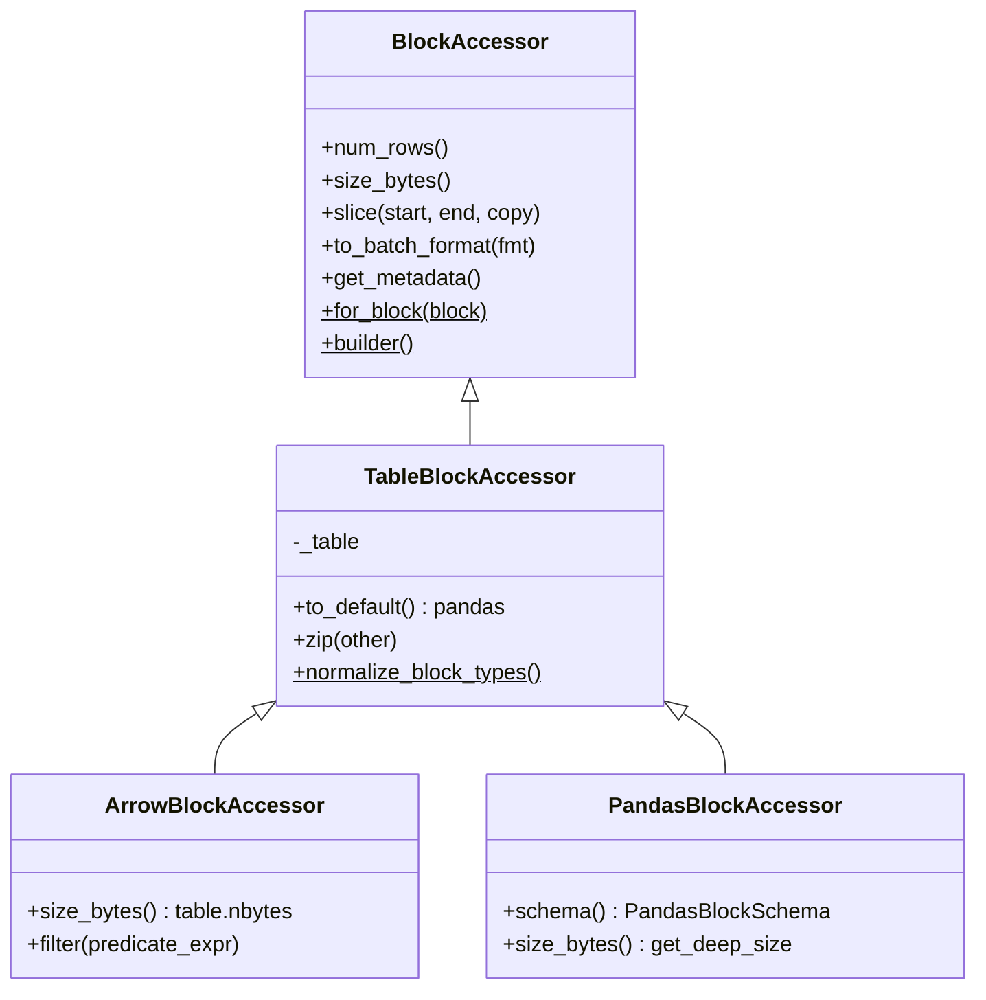

- `TableBlockAccessor`（`python/ray/data/_internal/table_block.py:168`）持有 `self._table`，实现与后端无关的逻辑：`zip`、`to_cudf`、跨后端类型归一化。
- `ArrowBlockAccessor`（`python/ray/data/_internal/arrow_block.py:212`）是**默认后端**。`size_bytes()` 直接返回 `table.nbytes`（`arrow_block.py:360`），O(1)。
- `PandasBlockAccessor`（`python/ray/data/_internal/pandas_block.py:498`）的 `size_bytes()` 要递归遍历对象图估算深层大小（`pandas_block.py:657` 起的 `get_deep_size`），明显更贵——这也是 Arrow 作为默认后端的理由之一。pandas 没有 Arrow 的 schema 对象，于是自带一个 `PandasBlockSchema` 数据类（`pandas_block.py:488`），只有 `names` 和 `types` 两个字段。

**pandas block 什么时候出现？** 三种情况：

1. `ray.data.from_pandas()` 且 `DataContext.enable_pandas_block` 为 `True`（默认，`python/ray/data/read_api.py:4080`）——直接把用户的 DataFrame 当 block 用，零转换。
2. UDF 返回的 dict 里含 Arrow 无法表达的值，`batch_to_block` 回退到 pandas（`block.py:618`）。
3. 用户显式 `map_batches(batch_format="pandas")` 并原样返回 DataFrame，且 `batch_to_block_arrow_format` 被关掉。

#### 2.1.4 BlockMetadata / BlockStats：为什么必须与数据分离

这是理解整个执行引擎最关键的一点。

调度器跑在 driver 的一个线程上。它要回答的问题是：这个算子的输出队列里堆了多少字节？该不该给下游多派一个 task？内存要爆了吗？这些问题的答案**全部**只需要"数据有多大、多少行"，完全不需要数据本身。如果调度器为了知道一个 block 有多大而 `ray.get()` 它，就会把整个集群的数据拉到 driver——那不叫分布式系统。

所以元数据被独立成两层：

```python
# python/ray/data/block.py:290
@dataclass(frozen=True)
class BlockStats:
    num_rows: Optional[int]                       # 行数
    size_bytes: Optional[int]                     # 近似字节数
    exec_stats: Optional[BlockExecStats]          # 该 block 的生成耗时/节点
    task_exec_stats: Optional[TaskExecWorkerStats] = None

# python/ray/data/block.py:315
@dataclass(frozen=True)
class BlockMetadata(BlockStats):
    input_files: Optional[Tuple[str, ...]] = None  # tuple 以便 hash

# python/ray/data/block.py:349
@dataclass(frozen=True)
class BlockMetadataWithSchema(BlockMetadata):
    schema: Optional[Schema] = None
```

三层拆分不是过度设计，每一层都有具体用途：

- `BlockStats` 是 worker 上报的最小集合，`to_stats()`（`block.py:330`）把 metadata 降级成它，用于统计聚合。
- `BlockMetadata` 加上 `input_files`，让 `Dataset.input_files()` 和 checkpoint 能追溯来源。
- `BlockMetadataWithSchema` 才带 schema。schema 是**每个算子的所有 block 共享**的，重复携带很浪费——所以它单独一层，而且序列化时 Arrow schema 会被压成 IPC 字节流，反序列化时走一个 LRU 缓存：

```python
# python/ray/data/block.py:336
@functools.lru_cache(maxsize=128)
def _read_arrow_schema_cached(schema_bytes: bytes) -> "pa.Schema":
    # 调度线程热路径：每个完成的 task 都带回一份 schema 字节。
    # 宽 schema（几百列 + ArrowTensorType 扩展类型）解析可能吃掉大量调度器 CPU。
    return pa.ipc.read_schema(pa.BufferReader(schema_bytes))
```

这段注释是元数据分离思想的最好注脚：连"反序列化 schema"这一步都会成为调度器瓶颈，何况 `ray.get` 数据本身。

`BlockMetadata` 由 worker 侧在产出 block 时同步计算（`BlockAccessor.get_metadata()`，`block.py:555`），随 task 返回值一起回到 driver。driver 从此只碰元数据。

#### 2.1.5 BlockBuilder 体系：把行流攒成块

算子拿到的输入常常是"一行一行"或"一小批一小批"，但输出必须是尺寸合适的 block。`BlockBuilder`（构建器）负责这个累积过程。接口很小（`python/ray/data/_internal/block_builder.py:6`）：`add(item)` 加一行、`add_block(block)` 加一整块、`num_rows()`、`get_estimated_memory_usage()`、`build()`。

核心实现是 `TableBlockBuilder`（`python/ray/data/_internal/table_block.py:51`），它维护**两个缓冲区**：

- `self._columns`：未压实（uncompacted）的 Python 值，按列名存成 list
- `self._tables`：已经压实成表的列表

`add()` 把一行拆进各列的 list，然后检查是否该压实：

```python
# python/ray/data/_internal/table_block.py:156
def _compact_if_needed(self) -> None:
    assert self._columns
    if self._uncompacted_size.size_bytes() < MAX_UNCOMPACTED_SIZE_BYTES:
        return                                    # 还没到阈值，继续攒 Python 对象
    block = self._table_from_pydict(self._columns)  # 一次性转成 Arrow/pandas 表
    self.add_block(block)                           # 挪进 _tables
    self._uncompacted_size = SizeEstimator()
    self._columns.clear()
    self._num_compactions += 1
    self._num_uncompacted_rows = 0
```

`MAX_UNCOMPACTED_SIZE_BYTES` 默认等于 `DEFAULT_TARGET_MAX_BLOCK_SIZE`（128 MiB，`table_block.py:46`）。`build()` 时把 `_tables` 和最后一批 `_columns` 拼起来（`table_block.py:130`）。这个两级缓冲的意义是：逐行 append 到 Arrow 表非常慢，攒够一批再一次性转换要快得多。

`DelegatingBlockBuilder`（`python/ray/data/_internal/delegating_block_builder.py:9`）在这之上加一层类型推断：第一次 `add_block` 时看输入是什么后端就用什么 builder；如果只是 `add(dict)`，则默认 `ArrowBlockBuilder`（`delegating_block_builder.py:25`）——又一次体现 Arrow 是默认后端。空 block 会被单独记在 `_empty_block` 里，避免从空列表推断出错误类型。

真正决定"什么时候切块"的是 `BlockOutputBuffer`（`python/ray/data/_internal/output_buffer.py:53`），它包着一个 `DelegatingBlockBuilder`，用 `has_next()` / `next()` 对外提供"块流"语义。超过目标大小 1.5 倍（`MAX_SAFE_BLOCK_SIZE_FACTOR`，`context.py:88`）时会按行比例切片，余下部分留在 buffer 里：

```python
# python/ray/data/_internal/output_buffer.py:199
elif self._exceeded_block_size_slice_limit(accessor):
    num_bytes_per_row = accessor.size_bytes() / accessor.num_rows()
    target_num_rows = max(1, math.ceil(self._max_bytes_per_block() / num_bytes_per_row))
```

留 1.5 倍余量是为了保证**最后一块至少有目标大小的一半**，避免产生一堆碎块。

#### 2.1.6 Tensor 扩展类型：让 Arrow 装得下张量

ML 场景的列不是 int 和 string，而是 `(224, 224, 3)` 的图像、`(768,)` 的 embedding。Arrow 原生没有"N 维定长张量"这种列类型——`list<list<list<float>>>` 能存，但丢失 shape 信息、每层都有 offset 开销、也无法零拷贝还原成 `np.ndarray`。

`python/ray/data/_internal/tensor_extensions/arrow.py` 用 Arrow 的 ExtensionType 机制补上这一块：

- `ArrowTensorType`（`arrow.py:701`）：定长张量，底层存 `pa.list_(dtype)` + shape 元数据。用 int32 offset，**单列超过 2 GiB 会溢出**。
- `ArrowTensorTypeV2`（`arrow.py:732`）：同样语义，底层换成 `pa.large_list`（int64 offset），突破 2 GiB。由 `arrow_fixed_shape_tensor_format` 控制，**默认 V2**（`context.py:565`）。
- `ArrowTensorArray`（`arrow.py:827`）：对应的 array 实现，`from_numpy()` 可以从连续 ndarray 零拷贝构造。
- `ArrowVariableShapedTensorArray`（`arrow.py:1282`）：变长张量（例如未 resize 的图片批）。表示为一个 struct，含 `data`（拉平的变长 list）和 `shape`（每个元素的形状）两个字段——注释在 `arrow.py:1314` 讲得很清楚。

pandas 侧的对应物是 `TensorDtype` / `TensorArray`（`python/ray/data/_internal/tensor_extensions/pandas.py`）。`DataContext.enable_tensor_extension_casting`（`context.py:947`）控制是否自动把 DataFrame 里的 ndarray 列升级成扩展列。

---

### 2.2 RefBundle：算子之间流通的货币

#### 2.2.1 它是什么

```python
# python/ray/data/_internal/execution/interfaces/ref_bundle.py:34
@dataclass(frozen=True, slots=True)
class BlockEntry:
    ref: ObjectRef[Block]        # 数据在 object store 里的引用
    metadata: BlockMetadata      # 数据的体检报告

# python/ray/data/_internal/execution/interfaces/ref_bundle.py:48
@dataclass(frozen=True)
class RefBundle:
    blocks: Tuple[BlockEntry, ...]                       # 一组 block
    schema: Optional["Schema"]                           # 整包共享一份 schema
    owns_blocks: bool                                    # 能否主动释放
    slices: Optional[Tuple[Optional[BlockSlice], ...]] = None   # 行级切片视图
    output_split_idx: Optional[int] = None               # split 算子用
```

注意 `blocks` 的元素类型：早期版本是裸的 `(ObjectRef, BlockMetadata)` 二元组，现在必须显式包成 `BlockEntry`，`__post_init__` 会用断言拒绝旧形状（`ref_bundle.py:109`）。另外 `size_bytes` 是**强制**的——不知道大小的 block 不允许进入 bundle（`ref_bundle.py:137`），因为调度器和背压全靠它。

`slices` 是一层零拷贝的行级视图：`RefBundle.slice(needed_rows)`（`ref_bundle.py:253`）把一个包切成"前 N 行"和"剩下的"，**不动 object store 里的数据**，只改 offset。`size_bytes()` 对部分切片按行数比例估算（`ref_bundle.py:194`）。`limit` 之类的算子靠这个避免物化。

#### 2.2.2 为什么不直接传 ObjectRef

三个理由，都很实际：

1. **调度需要元数据**。裸 `ObjectRef` 不带行数和字节数，调度器就得 `ray.get`。
2. **需要表达"这几个 block 必须一起消费"**。shuffle 之后一个 partition 可能落成多个 block；一个 reduce task 必须同时拿到它们才能算对。`RefBundle` 就是这个"原子消费单元"。类比：`RefBundle` 是一个**快递包裹**，里面可能一件也可能多件货，但派送时不能拆开。
3. **需要所有权语义**。见下一节。

`RefBundle` 是 frozen dataclass，还自定义了 `__eq__` / `__hash__`（`ref_bundle.py:371`、`:390`）。注意 schema 的比较用的是 `is` 和 `id()`——注释解释了原因：完整 schema 相等性检查在调度热路径上太贵。

#### 2.2.3 owns_blocks 与内存回收

`owns_blocks` 借用了 C++ 智能指针的语义（注释在 `ref_bundle.py:57`）：`True` 类似 `unique_ptr`——只有当前算子持有这批 block，不再需要时可以尽早"注销"；`False` 类似 `shared_ptr`——别人也在用，不能碰。

**外部传入的 block 一律不拥有**。`from_pandas` / `from_arrow` / `from_numpy` 共用的基类明确写了原因：

```python
# python/ray/data/_internal/logical/operators/from_operators.py:52
# `owns_blocks` is False because this op may be shared by multiple Datasets.
object.__setattr__(self, "input_data", [
    RefBundle([BlockEntry(input_blocks[i], input_metadata[i])],
              owns_blocks=False,
              schema=input_metadata[i].schema)
    for i in range(len(input_blocks))
])
```

用户手上还握着那个 DataFrame，同一个源算子还可能被多个 Dataset 复用——Ray Data 无权销毁。`merge_ref_bundles`（`ref_bundle.py:336`）合并时取**全体的与**：只要有一个不拥有，合并结果就不拥有。

这里有一个**容易被旧资料误导的点**：`destroy_if_owned` 这个名字暗示它会主动删对象，但在当前代码里它已经不做实际释放了：

```python
# python/ray/data/_internal/execution/interfaces/ref_bundle.py:202
def destroy_if_owned(self) -> None:
    """Records that these blocks are no longer needed for memory tracing.

    Objects are reclaimed by Ray reference counting once no references remain;
    this only records the deallocation for memory tracing / leak reporting.
    """
    for block_ref in self.block_refs:
        trace_deallocation(block_ref, "RefBundle.destroy_if_owned")
```

`trace_deallocation`（`python/ray/data/_internal/memory_tracing.py:38`）只在 `DataContext.trace_allocations` 打开时才向一个记账 actor 上报，用于泄漏排查。真正的回收交给 **Ray Core 的引用计数**：调用点在 task 完成时丢弃对输入 bundle 的引用（`python/ray/data/_internal/execution/interfaces/op_runtime_metrics.py:1230`），Python 对象被 GC 后 object store 里的副本自然被回收。

内存**计量**则由 `BlockRefCounter`（`python/ray/data/_internal/execution/block_ref_counter.py:9`）承担。它给每个 block 注册一个 Ray Core 的 out-of-scope 回调，在"所有 Python ObjectRef 都被 GC 且所有接收它作为参数的 task 都完成"时触发，把字节数从生产算子的账上扣掉：

```python
# python/ray/data/_internal/execution/block_ref_counter.py:39
def on_block_produced(self, block_ref, size_bytes, producer_id) -> None:
    # ...
    self._bytes_by_producer[producer_id] += size_bytes
    def _on_object_freed(id_bytes: bytes) -> None:
        # 回调线程里扣账；clear() 之后的迟到回调会被 _registered_ids 挡掉
        self._bytes_by_producer[producer_id] -= size_bytes
    registered = self._add_callback_fn(block_ref, _on_object_freed)
```

`block_ref_counter.py:68` 的 TODO 恰好说明了 `owns_blocks` 的另一个用途：非本 worker 拥有的 block（例如 materialized dataset 传进 `streaming_split`）注册回调会抛 `ValueError`，未来可能要用 `owns_blocks` 来跳过。

#### 2.2.4 一张图：队列里只有引用

```
  Driver 进程（调度线程）                      Ray Object Store（plasma，可能跨多节点）
  ─────────────────────────────                ─────────────────────────────────────────
                                                
  OpState(ReadParquet).output_queue             ┌──────────────────────────┐
  ┌──────────────────────────────┐              │ obj#a1  Arrow Table      │
  │ RefBundle                    │              │   1,048,576 rows / 96MB  │
  │  blocks[0] BlockEntry        │              └──────────────────────────┘
  │    ref ─────────────────────────────────────────►  obj#a1                
  │    metadata                  │              ┌──────────────────────────┐
  │      num_rows   = 1048576    │              │ obj#a2  Arrow Table      │
  │      size_bytes = 100663296  │              │   524,288 rows / 48MB    │
  │      input_files = ("s3://…")│              └──────────────────────────┘
  │  blocks[1] BlockEntry        │                      ▲                    
  │    ref ─────────────────────────────────────────────┘                    
  │  schema  = id:int64, img:…   │              ┌──────────────────────────┐
  │  owns_blocks = True          │              │ obj#b7 (下游 Map 输出)   │
  │  slices  = (None, None)      │              └──────────────────────────┘
  └──────────────────────────────┘                      ▲
             │  pop()                                   │
             ▼                                          │
  OpState(MapBatches).input_queue                       │
  ┌──────────────────────────────┐                      │
  │ RefBundle (同一批 ref)       │  ── submit task ──►  worker 进程
  │  owns_blocks = True          │      ray.get(ref) 只发生在这里
  └──────────────────────────────┘      产出 obj#b7 ────┘

  关键：队列里搬动的只有几百字节的 ref + metadata。
        实际的 96MB/48MB 数据从未进入 driver 内存。
```

算子输出队列的实现是 `OpBufferQueue`（`python/ray/data/_internal/execution/streaming_executor_state.py:209`），挂在 `OpState.output_queue` 上（`streaming_executor_state.py:334`）。它维护 `num_blocks` 和 `memory_usage` 累加值——全部来自 metadata，读取是 O(1)。

---

### 2.3 Dataset / LogicalPlan / _ExecutionCache

#### 2.3.1 Dataset 只是一个 handle

```python
# python/ray/data/dataset.py:350
def __init__(
    self,
    logical_plan: LogicalPlan,          # 要算什么
    context: DataContext,               # 用什么配置算
    in_stats: DatasetStats,             # 上游统计
    cache: Optional["_ExecutionCache"] = None,   # 算过的结果
    dataset_name: Optional[str] = None,
):
    self._logical_plan = logical_plan
    self._context = context
    self._in_stats = in_stats
    self._cache = cache if cache is not None else _ExecutionCache()
    # ...
    self._current_executor: Optional["Executor"] = None
```

`Dataset` 对象里**没有一个字节的用户数据**。`ds.map_batches(f)` 只是构造一个新的 `LogicalPlan`，通过 `Dataset._from_parent`（`dataset.py:385`）复制父 Dataset 的 context、stats 和 cache。这就是 Ray Data 的"惰性"：所有变换都是在往逻辑 DAG 上贴节点。

`LogicalPlan`（`python/ray/data/_internal/logical/interfaces/logical_plan.py:10`）继承自极薄的 `Plan` 基类（`plan.py:9`），只持有一个 `dag` 根节点（`LogicalOperator`）和一个 `context`。它提供的都是**纯元数据查询**：`sources()`、`has_lazy_input()`、`require_preserve_order()`、`input_files()`、`initial_num_blocks()`——注意最后一个走的是 `dag.estimated_num_outputs()`，也就是不执行就估算块数。

> **与旧版本的重要差异**：如果你读过 Ray 2.x 的资料，会记得一个 `ExecutionPlan` 类（`_internal/plan.py`），负责持有 `LogicalPlan` 并缓存 `_snapshot_bundle` / `_snapshot_stats` / `_snapshot_operator`。在本文基准（commit `97f7eec`）里，**这个类已经不存在了**。它的职责被拆成两半：逻辑计划直接挂在 `Dataset._logical_plan` 上，缓存则收敛进 `_ExecutionCache`。下文按现状描述。

#### 2.3.2 _ExecutionCache：两层缓存与失效判定

```python
# python/ray/data/dataset.py:8759
class _ExecutionCache:
    def __init__(self):
        # --- Bundle 层（来自 eager 执行 _execute()）---
        self._operator: Optional["LogicalOperator"] = None   # 缓存对应的 DAG 根算子
        self._bundle: Optional[RefBundle] = None             # 完整结果
        # --- Metadata 层（来自流式迭代耗尽后回填）---
        self._num_rows: Optional[int] = None
        self._size_bytes: Optional[int] = None
        self._schema: Optional["Schema"] = None
        # --- 其他 ---
        self._stats: Optional[DatasetStats] = None
```

**失效判定极其简单**：只比较 DAG 根算子是否还是同一个。

```python
# python/ray/data/dataset.py:8792
def _cache_is_fresh(self, dag: "LogicalOperator") -> bool:
    # 只有当前逻辑计划以同一个算子结尾时，缓存才新鲜。
    # 否则计划变了，schema、行数等都可能变。
    return self._operator == dag
```

于是行为可以一句话概括：

- **会复用**：对同一个 `Dataset` 对象反复调 `count()` / `schema()` / `take()`——DAG 根没变，`get_bundle()` 直接命中。
- **会重算**：任何 `ds2 = ds.map(...)` 产生的新 Dataset，DAG 根变了，`_cache_is_fresh` 返回 `False`；虽然 `_from_parent` 浅拷了 cache，但读不到（所有 setter 也会先 `_clear_dag_dependent_cache()`）。
- **两层的分工**：`_execute()` 全量执行后填 bundle 层；流式迭代走 `_CacheMetadataIterator`，只有在**完全耗尽**迭代器时才把 `num_rows` / `size_bytes` / `schema` 回填 metadata 层（`dataset.py:8752`）。所以流式消费一半就退出，什么都不会被缓存。
- **`_stats` 例外**：`get_stats()` 刻意不检查新鲜度，"为了行为上的向后兼容"（`dataset.py:8805`）。

#### 2.3.3 execute 与 execute_to_iterator

两条消费路径共用 `_execute_dag()`（`dataset.py:8338`）——它做优化（`get_execution_plan(self._logical_plan)`，把逻辑 DAG 编译成物理 DAG）然后启动 executor，返回一个 `RefBundle` 迭代器。区别在于怎么消费这个迭代器：

**`_execute(preserve_order=False)`**（`dataset.py:8379`）—— 全量物化：

```python
with self._create_executor() as executor:
    bundles = self._execute_dag(executor, preserve_order=preserve_order)
    bundle = RefBundle.merge_ref_bundles(list(bundles))   # 抽干，合成一个大 bundle
    executor.get_stats().set_uuid_recursive(self._uuid)
# ... 收集 spill 统计 ...
self._cache.set_bundle(self._logical_plan.dag, bundle)
self._cache.set_stats(stats)
```

`list(bundles)` 是关键：把所有输出攒下来，峰值内存 = 全部结果。它还有一条快捷路径：如果 DAG 根是已物化的源算子（`from_pandas` 之类），跳过执行直接返回 `output_data()`（`dataset.py:8398`）。`materialize()`（`dataset.py:7706`）就是深拷一份 Dataset、调 `_execute()`、再用结果构造一个以 `InputData` 为源的 `MaterializedDataset`。

**`_execute_to_iterator(capture_executor=True)`**（`dataset.py:8465`）—— 流式产出：

```python
cached_bundle = self._cache.get_bundle(self._logical_plan.dag)
if cached_bundle is not None:
    return iter([cached_bundle]), self._cache.get_stats(), None   # 缓存命中，executor 为 None

executor = self._create_executor()
bundle_iter = self._build_bundle_iterator(executor)

# 强制拉取第一个 bundle，好让 executor.get_stats() 有内容可缓存
gen = iter(bundle_iter)
try:
    bundle_iter = itertools.chain([next(gen)], gen)
except StopIteration:
    pass
self._cache.set_stats(executor.get_stats())
```

它把迭代器原样交给调用方，边算边给。`iter_batches`、`iter_torch_batches`、`write_parquet` 走的都是这条路——峰值内存只受背压和 buffer 限制，与结果总量无关。`capture_executor` 决定是否把 executor 挂到 `self._current_executor` 上以便 GC 时正确关闭。

**选择规则**：需要完整结果（`take_all`、`materialize`、给下游 shuffle 当输入）用 `_execute`；只要顺序遍历一遍（训练喂数据、写文件）用 `_execute_to_iterator`。

---

### 2.4 DataContext：会跟着任务跑的全局配置

#### 2.4.1 单例 + 显式序列化传播

`DataContext`（`python/ray/data/context.py:579`）是一个大 dataclass，进程内以模块级全局变量做单例：

```python
# python/ray/data/context.py:1178
@staticmethod
def get_current() -> "DataContext":
    global _default_context
    with _context_lock:
        if _default_context is None:
            _default_context = DataContext()
        return _default_context
```

很多人困惑的是：**为什么在 driver 上改了 `DataContext.get_current().target_max_block_size`，远端 worker 里也生效？** 这里没有魔法，机制分两步：

1. **创建 Dataset 时封存（seal）**。`read_api.py` 等入口会 `DataContext.get_current().copy()`，把当前配置快照进 `Dataset._context`（`read_api.py:4088` 附近）。docstring 明确警告：Dataset 创建之后再改就不生效了（`context.py:584`）。
2. **执行时随 task 参数序列化过去，在 worker 上装回单例**。`DataContext` 是普通 dataclass，可以被 cloudpickle。map task 的入口把它作为形参接收，然后用上下文管理器装成 worker 进程的当前单例：

```python
# python/ray/data/_internal/execution/operators/map_operator.py:820
with DataContext.current(data_context), TaskContext.current(ctx):
    map_transformer.override_target_max_block_size(ctx.target_max_block_size_override)
    retry_on = data_context.retried_map_errors
    # ...
```

`DataContext.current()`（`context.py:1219`）是一个 `contextmanager`，进入时 `_set_current(context)`、退出时还原上一个。actor 池、shuffle task、read task 各有自己的装载点（`actor_pool_map_operator.py:687`、`shuffle_tasks.py:345`、`_internal/util.py:789`、`read_api.py:5549`）。

代码里还留了一条开发者纪律（`context.py:1201`）：内部组件不要用 `get_current()`，要用 Dataset 上捕获的那个 context 并显式传参——正是为了避免"到底是哪一份配置在生效"的歧义。

#### 2.4.2 最常用的字段

以下字段名和默认值均取自 `python/ray/data/context.py`（行号为字段声明处）：

| 字段 | 行号 | 默认值 | 作用 |
|---|---|---|---|
| `target_max_block_size` | 840 | 128 MiB | 读取与变换的目标最大块大小；`None` 表示不限。调小可降峰值内存，代价是 task 变多 |
| `target_min_block_size` | 841 | 1 MiB | 读取时避免产出比这更小的块；**优先级高于** `read_op_min_num_blocks` |
| `read_op_min_num_blocks` | 940 | 200 | 读算子最少产出多少块，决定读阶段并行度下限 |
| `min_parallelism` | 939 | 200 | 已废弃，用 `read_op_min_num_blocks` 代替 |
| `streaming_read_buffer_size` | 842 | 32 MiB | 流式读远端存储的缓冲区大小 |
| `execution_options` | 956 | `ExecutionOptions()` | 资源上限、`preserve_order`、`label_selector` 等执行期开关 |
| `_shuffle_strategy`（属性 `shuffle_strategy`） | 854 | `HASH_SHUFFLE` | shuffle 算法：`sort_shuffle_pull_based` / `sort_shuffle_push_based` / `hash_shuffle` / `shuffle_v2` / `gpu_shuffle` |
| `use_push_based_shuffle` | 852 | `False` | **已废弃**，设了会 warn 并强制走 `SORT_SHUFFLE_PUSH_BASED` |
| `enable_pandas_block` | 843 | `True` | `from_pandas` 是否保留 pandas 块（否则转 Arrow） |
| `enable_tensor_extension_casting` | 947 | `True` | 自动把 DataFrame 里的 ndarray 列升级成张量扩展列 |
| `arrow_fixed_shape_tensor_format` | 948 | `FixedShapeTensorFormat.V2` | 定长张量列的物理格式（V2 支持 >2 GiB） |
| `enable_progress_bars` | 960 | 非 CI 时 `True` | 全局进度条开关 |
| `enable_operator_progress_bars` | 962 | `True` | 每个算子单独一条进度条 |
| `max_errored_blocks` | 982 | `0` | 容忍多少个失败的 block 后才让整个 job 失败；`0` 表示零容忍 |
| `retried_io_errors` | 997 | 5 条 AWS 错误串 | 读写文件时命中这些错误串就重试（`INTERNAL_FAILURE` / `SLOW_DOWN` / `503` 等） |
| `retried_map_errors` | 978 | `False` | map task 的应用层错误重试白名单 |
| `max_map_retries` | 979 | `3` | 上一项对应的最大重试次数 |
| `max_consecutive_actor_init_deaths` | 977 | `0` | 容忍多少次连续的 actor 初始化崩溃（OOM/段错误） |
| `execution_no_progress_timeout_s` | 983 | 环境变量控制 | 多久没有进展就判定卡死 |
| `enable_auto_log_stats` | 953 | `False` | 执行完自动打印 stats |
| `trace_allocations` | 955 | `False` | 打开对象分配/释放追踪（很慢，仅调试用） |
| `enforce_schemas` | 1022 | `False` | 严格 schema 校验 |

完整调优表（含每个字段的调参建议、相互影响和对应环境变量）放在第 11 章。

---

### 2.5 Expression：可分析的计算 IR

#### 2.5.1 为什么需要一套表达式

`ds.filter(lambda row: row["price"] > 100)` 和 `ds.filter(expr=col("price") > lit(100))` 在语义上等价，但在优化器眼里是两种完全不同的东西：

- **lambda 是黑盒**。它是一个 Python 闭包，优化器无法知道它读了哪些列、做了什么比较。唯一可行的执行方式是：把每一行转成 dict，调一次 Python 函数，收集布尔结果。逐行 Python 调用 + dict 构造，且**必须先把整个文件读进来**。
- **表达式是白盒**。它是一棵可遍历的 AST。优化器能看出"只涉及 `price` 列，只做一次 `>` 比较"，于是可以：把谓词**下推**到 Parquet reader，让 row group 统计信息直接跳过整段数据；剩下的部分用 `pyarrow.compute` 做**向量化**求值，一次调用处理整块。

`Dataset.filter` 的签名同时接受两者（`python/ray/data/dataset.py:2033`），docstring 里的 tip 就是这个意思："If you use the `expr` parameter with a predicate expression, Ray Data optimizes your filter with native Arrow interfaces."

#### 2.5.2 节点类型

所有节点继承自 `Expr`（`python/ray/data/expressions.py:348`），frozen dataclass，唯一的公共字段是 `data_type`。节点类型由 `_ExprVisitor.visit` 的分派链完整枚举（`expressions.py:101`）：

| 节点类 | 行号 | 含义 |
|---|---|---|
| `ColumnExpr` | 974 | 列引用，`col("x")` 的产物 |
| `LiteralExpr` | 1026 | 字面量，`lit(5)` 的产物 |
| `BinaryExpr` | 1069 | 二元运算，带一个 `Operation` |
| `UnaryExpr` | 1121 | 一元运算（`NOT` / `IS_NULL` / `IS_NOT_NULL`） |
| `AliasExpr` | 1754 | 重命名，`expr.alias("y")` |
| `UDFExpr` | 1331 | Python UDF 节点（`@udf` 装饰器产出） |
| `PyArrowComputeUDFExpr` | 1415 | `UDFExpr` 子类，包着一个 `pyarrow.compute` 函数——**可以**下推 |
| `DownloadExpr` | 1736 | 从 URI 列下载字节 |
| `StarExpr` | 1823 | `*`，保留全部现有列 |
| `MonotonicallyIncreasingIdExpr` | 1852 | 单调递增 ID |
| `RandomExpr` / `UUIDExpr` | 1871 / 1909 | 随机数 / UUID |

运算种类集中在 `Operation` 枚举里（`expressions.py:49`）：算术 6 种、比较 6 种、布尔 3 种，加上 `IS_NULL` / `IS_NOT_NULL` / `IN` / `NOT_IN`。Python 运算符重载建在 `Expr` 基类上，所以 `(col("x") + lit(5)) * col("y")` 直接构造出嵌套的 `BinaryExpr` 树。

#### 2.5.3 两条求值路径

Ray Data 用 visitor 模式（访问者模式）对同一棵树做两种"降级（lowering）"：

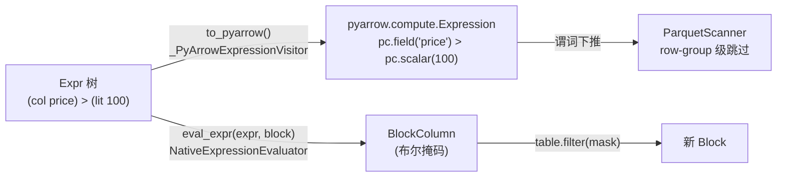

- **`Expr.to_pyarrow()`**（`expressions.py:388`）走 `_PyArrowExpressionVisitor`（`expressions.py:174`），把节点翻译成 `pyarrow.compute.Expression`：`ColumnExpr → pc.field(name)`、`LiteralExpr → pc.scalar(value)`、`BinaryExpr` 查 `_ARROW_EXPR_OPS_MAP`（`python/ray/data/_internal/planner/plan_expression/expression_evaluator.py:136`）。`UDFExpr`、`DownloadExpr`、`StarExpr`、`RandomExpr` 等直接抛 `TypeError`——它们没有 Arrow 对应物。
- **`eval_expr(expr, block)`**（`expression_evaluator.py:810`）走 `NativeExpressionEvaluator`（`expression_evaluator.py:582`），直接在一个 block 上求值，返回列或标量。`ArrowBlockAccessor.filter` 就是这么用的：

```python
# python/ray/data/_internal/arrow_block.py:532
def filter(self, predicate_expr: "Expr") -> "pyarrow.Table":
    if self._table.num_rows == 0:
        return self._table
    mask = eval_expr(predicate_expr, self._table)   # 整块求值，得到布尔掩码
    return self._table.filter(mask)                  # Arrow 原生 filter
```

第三个 visitor `_PyArrowConvertibilityVisitor`（`expressions.py:254`）只回答一个布尔问题："这棵树能不能降级到 PyArrow？"它**不构造任何 PyArrow 对象**，只看结构——因为它跑在优化器里，被频繁调用：

```python
# python/ray/data/expressions.py:400
def _is_pyarrow_convertible(self) -> bool:
    """...Used by predicate pushdown to decide whether a filter can be pushed into
    a datasource (which evaluates the predicate via PyArrow). UDFs and other
    Python only expressions are not convertible and must stay as a
    ``Filter`` operator that is evaluated in Python."""
    return _PyArrowConvertibilityVisitor().visit(self)
```

#### 2.5.4 优化器眼里的差别

谓词下推规则的做法很聪明：它不是"能下推就全下推、不能就全不推"，而是**沿顶层 AND 链拆开，逐个 conjunct 分桶**（`python/ray/data/_internal/logical/rules/predicate_pushdown.py:228`）：

```python
# python/ray/data/_internal/logical/rules/predicate_pushdown.py:277
split = cls._split_by_convertibility(predicate_expr)
if split.convertible is None:
    return filter_op                       # 一条都推不下去，原样保留 Filter
result_op = input_op.apply_predicate(split.convertible)   # 可下推部分塞进 Read
if split.residual is None:
    return result_op                       # 全部推下去了，Filter 节点消失
# 残余部分重新挂一个 Filter 在 Read 之上
return Filter(predicate_expr=split.residual, input_dependencies=[result_op])
```

于是三种写法的最终计划完全不同：

```python
import ray
from ray.data.expressions import col, lit

ds = ray.data.read_parquet("s3://bucket/sales")

# (a) lambda：优化器无法分析
ds.filter(lambda row: row["price"] > 100)
#   计划: Read(全部列, 全部 row group) -> Filter(python-udf)
#   代价: 读全量数据 + 逐行 Python 调用

# (b) 纯表达式：完全下推
ds.filter(expr=col("price") > lit(100))
#   计划: Read(pushdown: price > 100)          <- Filter 节点被消掉
#   代价: Parquet row-group 统计直接跳过整段数据

# (c) 混合：部分下推
ds.filter(expr=(col("price") > lit(100)) & my_udf(col("desc")))
#   计划: Read(pushdown: price > 100) -> Filter(my_udf(desc))
#   代价: 先靠可下推的那半砍掉大部分数据，UDF 只在剩下的行上跑
```

(c) 这种"部分下推"是表达式 IR 相比 lambda 最有价值的地方：你不需要为了拿到下推收益而放弃 UDF，优化器会自己把能推的那部分摘出来。

投影侧同理：`with_columns` / `select_columns` 接受表达式列表，由 `eval_projection`（`expression_evaluator.py:914`）统一求值，其中还做了 CSE（公共子表达式消除，见 `_eval_projection_without_cse` 与 `_drop_cse_temp_columns`，`expression_evaluator.py:824`、`:904`）——同一个子表达式在多个输出列里出现时只算一次。

---

## 3. 从 API 到 LogicalPlan

`ds.map_batches(f).filter(expr).limit(10)` 这一串链式调用里，没有任何一行读过数据。它们做的只有一件事：**往一棵算子树上再挂一个节点，然后把树包进一个新的 `Dataset` 返回**。这一章讲清这棵树的形状（`Operator` 基类体系）、树上有哪些节点（`LogicalOperator` 家族）、一次 API 调用具体做了什么，以及"惰性"到哪里结束。

### 3.1 一套基类，两种身份

Ray Data 的执行分两个阶段：先是**逻辑计划**（logical plan，"要做什么"），再翻译成**物理计划**（physical plan，"怎么做"）。这两套算子共享同一个抽象基类 `Operator`：

```python
# python/ray/data/_internal/logical/interfaces/operator.py:5
class Operator(ABC):
    """Abstract class for operators.

    Operators live on the driver side of the Dataset only.   # 只活在 driver 上
    """
    @property
    @abstractmethod
    def name(self) -> str: ...                # 展示名，如 "MapBatches(preprocess)"

    @property
    @abstractmethod
    def input_dependencies(self) -> List["Operator"]: ...   # 上游算子列表

    def post_order_iter(self) -> Iterator["Operator"]:      # 后序（先上游）遍历
        for op in self.input_dependencies:
            yield from op.post_order_iter()
        yield self
```

关键设计：**DAG 只用 `input_dependencies` 单向表达**。每个节点只知道自己的输入是谁，不知道谁消费自己。类比链表：只有 `prev` 指针，没有 `next`。所以整个 DAG 只需要持有根节点（最下游算子）就能反向遍历出全部。

`Operator.dag_str`（`operator.py:18`）把整条链拉平成一行字符串，形如 `InputDataBuffer[Input] -> TaskPoolMapOperator[ReadRange->Map(<lambda>)]`。这个属性不只是给人看的——优化器用它做**不动点判定**（见 4.1）。

> 注意：`output_dependencies`（下游依赖）**只存在于物理算子**上（`python/ray/data/_internal/execution/interfaces/physical_operator.py:566`、`:645`），逻辑算子层已经不再维护它。`logical_operator.py:107-108` 留了一行注释与一个空列表，仅为了保持状态导出（state export）的历史字段格式。原因很直接：逻辑算子是**不可变的 frozen dataclass**，维护双向指针会让每次重写都要修补两头；而物理算子是有状态、可变的，调度器需要沿着 `output_dependencies` 向下游做背压和资源核算。

两个身份的实现分别是：

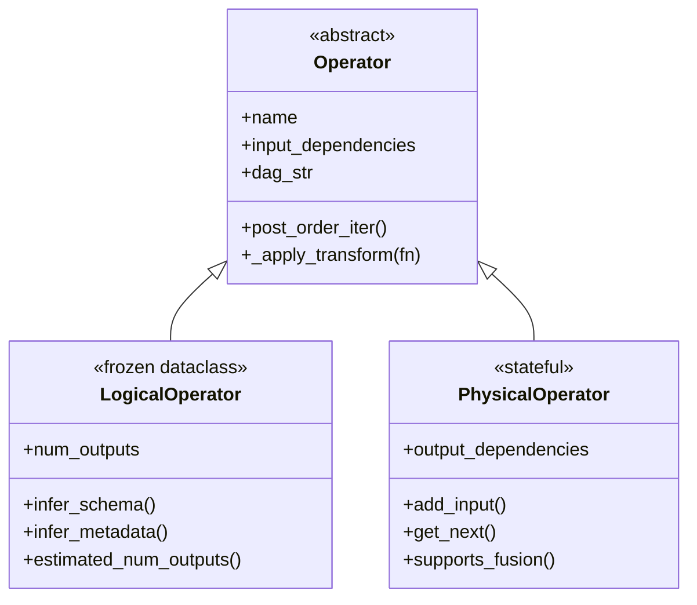

`LogicalOperator`（`logical_operator.py:15`）是 `@dataclass(frozen=True, repr=False, eq=False)`。不可变带来一个重要后果：优化器改写计划时不能原地修改，只能重建。基类提供了这套机械操作：

```python
# python/ray/data/_internal/logical/interfaces/logical_operator.py:70
def _apply_transform(self, transform):
    input_dependencies = self.input_dependencies
    transformed_inputs = [i._apply_transform(transform) for i in input_dependencies]
    if all(t is i for t, i in zip(transformed_inputs, input_dependencies)):
        target = self            # 上游一个都没变 → 复用自己，避免无意义的对象复制
    else:
        target = self._with_new_input_dependencies(transformed_inputs)
    return transform(target)     # 后序：先重写上游，再重写自己
```

几乎所有逻辑规则都是写一个 `transform(node) -> node` 函数，然后交给 `_apply_transform` 后序跑一遍。`_with_new_input_dependencies`（`:88`）优先用 `dataclasses.replace`，退化情况才 `copy.copy` + `object.__setattr__`。

除了主继承链，`LogicalOperator` 还定义了一组 **mixin 特征（trait）**，供优化器 `isinstance` 探测能力：

| Mixin | 位置 | 含义 |
|---|---|---|
| `SourceOperator` | `interfaces/source_operator.py:9` | 可作为 DAG 源头；`output_data()` 返回已知数据或 `None` |
| `LogicalOperatorSupportsProjectionPushdown` | `logical_operator.py:139` | 能**接收**列裁剪 |
| `LogicalOperatorSupportsPredicatePushdown` | `logical_operator.py:196` | 能**接收**谓词 |
| `LogicalOperatorSupportsPredicatePassThrough` | `logical_operator.py:228` | 允许谓词**穿过**自己（4 种行为，见 `PredicatePassThroughBehavior`，`:212`） |
| `LogicalOperatorPreservesSchema` | `logical_operator.py:155` | 输出 schema 等于唯一输入的 schema |
| `LogicalOperatorUnifiesInputSchemas` | `logical_operator.py:171` | 输出 schema 是各输入的并集（`Union`/`Mix`） |

### 3.2 LogicalOperator 家族

全部逻辑算子在 `python/ray/data/_internal/logical/operators/` 下，统一由 `operators/__init__.py` 导出。

**数据源类**（都是 `SourceOperator`，无输入依赖）
- `InputData`（`input_data_operator.py:16`）：直接持有一批 `RefBundle`。`materialize()` 的产物、以及 Ray Data 内部把已算好的块重新包成 Dataset 时用它。它 `is_lineage_serializable() == False`，因为里面是 `ObjectRef`。
- `Read`（`read_operator.py:43`）：V1 读取路径，持有 `Datasource`。注意它同时继承 `AbstractMap` —— 读也是一次 map，所以能和下游 map 融合。
- `ListFiles` / `ReadFiles`（`read_operator.py:428` / `:238`）：V2（DataSourceV2）读取路径拆成两段，`ListFiles` 负责列文件并产出 `FileManifest` 块，`ReadFiles` 消费 manifest 真正读数据。第 10 章详述。
- `AbstractFrom` 及其 5 个空壳子类 `FromItems` / `FromBlocks` / `FromNumpy` / `FromArrow` / `FromPandas`（`from_operators.py:32`、`:106-133`）：内存数据入口，行为全在基类里。

**一对一变换类**
- `AbstractOneToOne`（`one_to_one_operator.py:25`）：一进一出的基类，核心字段是 `can_modify_num_rows`（这个 UDF 会不会改变行数）。这个布尔值后面在 limit 下推和算子融合里反复被查。
- `Limit`（`:89`，`can_modify_num_rows=True`）、`Download`（`:133`，`can_modify_num_rows=False`）。
- `AbstractMap`（`map_operator.py:56`）：会被翻译成物理 `MapOperator` 的那一类，携带 `compute`（`TaskPoolStrategy` / `ActorPoolStrategy`）、`ray_remote_args`、`min_rows_per_bundled_input`、`per_block_limit`。
- `AbstractUDFMap`（`:128`）：`AbstractMap` + 一个用户函数 `fn`。它的 `_get_operator_name`（`:200`）负责把 UDF 名字拼进算子名 —— `MapBatches(preprocess)`、`Map(<lambda>)`、callable class 用类名、`Preprocessor` 方法直接用 Preprocessor 类名。
- 具体算子：`MapBatches`（`:231`）、`MapRows`（`:298`，展示名是 `Map(...)` 而非 `MapRows(...)`）、`Filter`（`:322`）、`Project`（`:377`）、`FlatMap`（`:514`）、`StreamingRepartition`（`:542`）。
- `Filter` 有两条互斥路径（`:339-346` 强制"恰好提供一个"）：`predicate_expr`（表达式）或 `fn`（Python 可调用）。`is_expression_based()`（`:355`）是后续谓词下推的准入门槛。
- `Project` 不是 `AbstractUDFMap` 而是直接的 `AbstractMap`，它承载一个 `Expr` 列表。`__post_init__`（`:397`）在输入 schema 已知时**提前展开 `star()`**，并在表达式里检测到 callable class UDF 时自动切到 `ActorPoolStrategy`（`:425`）。
- `Write`（`write_operator.py:19`）也是 `AbstractMap` —— 写出在 Ray Data 里就是一次 map。

**全局重分布类**
`AbstractAllToAll`（`all_to_all_operator.py:31`）下有 `RandomizeBlocks`（`:63`）、`RandomShuffle`（`:92`）、`Repartition`（`:136`）、`Sort`（`:184`）、`Aggregate`（`:219`）。它们额外带 `sub_progress_bar_names`（map/reduce 阶段各自一个进度条）。除 `Aggregate` 之外，其余四个都同时是 `LogicalOperatorPreservesSchema` + `PASSTHROUGH` 谓词穿透。

**多输入类**
`NAry`（`n_ary_operator.py:66`）下有 `Zip`（`:87`）、`Mix`（`:132`，带权重混采）、`Union`（`:183`）；`Join`（`join_operator.py:45`）也继承 `NAry`，固定两个输入。`Join.which_side_to_push_predicate`（`:149`）按 join 类型给出谓词能推向哪一侧（`_get_pushdown_rules`，`:200`：`INNER` 两侧都行，`FULL_OUTER` 一侧都不行）。

**其他**
`Count`（`count_operator.py:15`）产出单列 `__num_rows`；`StreamingSplit`（`streaming_split_operator.py:18`）是终端算子，不能再往上套东西（`Dataset._base_schema` 里对它有特判，`dataset.py:4660`）。

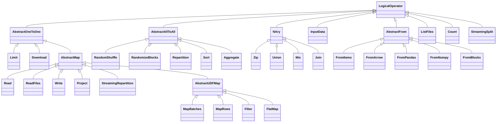

### 3.3 一个 Dataset 方法到底做了什么

以 `Dataset.map_batches` 为主例。公开方法（`dataset.py:629`）只做参数校验，然后委托给 `map_batches_internal`：

```python
# python/ray/data/dataset.py:891
_warn_on_ray_remote_args_fn(ray_remote_args_fn)   # 弃用告警
_warn_on_ray_remote_args(ray_remote_args)

use_gpus = num_gpus is not None and num_gpus > 0
if use_gpus and (batch_size is None or batch_size == "auto"):
    raise ValueError("You must provide `batch_size` to `map_batches` "
                     "when requesting GPUs. ...")   # 要 GPU 必须显式给 batch_size
if isinstance(batch_size, int) and batch_size < 1:
    raise ValueError("Batch size can't be negative or 0")
return self.map_batches_internal(fn, batch_size=batch_size, ...)
```

拆成两层的原因写在 `dataset.py:961-965` 的注释里：`map_groups` 内部要用 `batch_size=None` 调 `map_batches`，但那样就通不过上面的 GPU 校验，所以要一个不做校验的内部入口。

`map_batches_internal`（`:933`）的主体是"把用户参数归一化成算子字段"：

```python
# python/ray/data/dataset.py:966
if batch_size is None or batch_size == "auto":
    min_rows_per_bundled_input = None
else:
    min_rows_per_bundled_input = batch_size      # batch_size 变成"每个 bundle 至少多少行"

compute = get_compute_strategy(fn, fn_constructor_args=..., compute=compute,
                               concurrency=concurrency)   # callable class → ActorPool
if num_cpus is not None:  ray_remote_args["num_cpus"] = num_cpus
if num_gpus is not None:  ray_remote_args["num_gpus"] = num_gpus
if memory is not None:    ray_remote_args["memory"] = memory
ray_remote_args = _merge_named_ray_remote_args(ray_remote_args, label_selector=..., ...)
batch_format = _apply_batch_format(batch_format)
```

`min_rows_per_bundled_input` 和 `ray_remote_args` 这两个字段值得留意：它们正是第 4 章里**阻断算子融合**的两大元凶。

最后三行才是真正"建 plan"的部分：

```python
# python/ray/data/dataset.py:999
map_batches_op = MapBatches(
    fn,
    input_dependencies=[self._logical_plan.dag],   # ← 当前 plan 的根，成为新算子的输入
    batch_size=batch_size,
    can_modify_num_rows=udf_modifying_row_count,
    batch_format=batch_format, zero_copy_batch=zero_copy_batch,
    min_rows_per_bundled_input=min_rows_per_bundled_input,
    fn_args=fn_args, fn_kwargs=fn_kwargs,
    fn_constructor_args=fn_constructor_args, fn_constructor_kwargs=fn_constructor_kwargs,
    compute=compute, ray_remote_args_fn=ray_remote_args_fn, ray_remote_args=ray_remote_args,
)
logical_plan = LogicalPlan(map_batches_op, self.context)   # 以新算子为根建 plan
return Dataset._from_parent(self, logical_plan)            # 返回新 Dataset
```

**没有任何计算发生**。整个过程是纯 driver 端的对象构造：读一次 `self._logical_plan.dag`，new 一个 frozen dataclass，new 一个 `LogicalPlan`，new 一个 `Dataset`。`_from_parent`（`:385`）复制父 Dataset 的 context、in_stats、dataset_name，并**浅拷贝执行缓存**。

`Dataset.filter` 的表达式路径更短（`dataset.py:2196-2266`）：

```python
if expr is not None:
    _check_fn_params_incompatible("expr")     # expr 与 fn_args/fn_kwargs 互斥
    if isinstance(expr, str):
        warnings.warn("String expressions are deprecated ...", DeprecationWarning)
        predicate_expr = ExpressionEvaluator.parse_native_expression(expr)
    else:
        predicate_expr = expr                 # Expr 对象直接留着
    filter_compute = get_compute_strategy(fn=None, compute=compute, concurrency=concurrency)
else:
    warnings.warn("Use 'expr' instead of 'fn' when possible for performant filters.")
    ...                                       # lambda 路径：填 filter_fn
filter_op = Filter(predicate_expr=predicate_expr, fn=filter_fn,
                   input_dependencies=[input_op], ...)
logical_plan = LogicalPlan(filter_op, self.context)
return Dataset._from_parent(self, logical_plan)
```

`fn` 路径会直接打一条告警。原因在第 4 章：只有 `predicate_expr` 才能被下推进 reader，lambda 只能在内存里逐行跑。

`read_parquet`（`read_api.py:1370`）稍复杂，因为它要先构造 datasource。V2 路径（`read_api.py:1670-1697`）把 `ParquetDatasourceV2` 交给 `_read_datasource_v2`（`:434`），后者在 driver 上采样几个文件推断 schema（`:500-522`），然后建两个算子：

```python
# python/ray/data/read_api.py:570
list_files_op = ListFiles(paths=..., file_indexer=indexer, filesystem=...,
                          file_partitioner=partitioner, shuffle_config_factory=...)
read_op = ReadFiles(datasource_name=datasource.name, scanner=scanner, schema=schema,
                    parallelism=parallelism, ray_remote_args=ray_remote_args,
                    compute=compute_strategy, block_udf=block_udf,
                    input_dependencies=[list_files_op])
logical_plan = LogicalPlan(read_op, context)     # read_op 是根，list_files_op 是它的输入
return Dataset(logical_plan=logical_plan, context=context, in_stats=stats)
```

V1 路径最终走到 `read_datasource`（`:607`），构造单个 `Read` 算子（`:724`）。两条路径都在 driver 上真实做了一点 I/O（V2 采样文件、V1 调 `get_read_tasks(1)` 拿元数据），但没有读任何数据内容。

### 3.4 LogicalPlan

`LogicalPlan` 薄到几乎只是一个 `dag` 字段的包装：

```python
# python/ray/data/_internal/logical/interfaces/logical_plan.py:10
class LogicalPlan(Plan):
    def __init__(self, dag: LogicalOperator, context: "DataContext"):
        super().__init__(context)
        self._dag = dag              # 只存根节点

    @property
    def dag(self) -> LogicalOperator:
        return self._dag

    def sources(self) -> List[LogicalOperator]:
        if not any(self._dag.input_dependencies):     # 没有输入 → 自己就是源
            return [self._dag]
        sources = []
        for op in self._dag.input_dependencies:
            sources.extend(LogicalPlan(op, self.context).sources())   # 递归上溯
        return sources
```

它只提供几个纯元数据查询，全部不触发执行：`has_lazy_input()`（源头是否全是 `Read`）、`require_preserve_order()`（DAG 里有 `Zip` 就必须保序）、`input_files()`（`:45`，走 `dag.infer_metadata().input_files`）、`initial_num_blocks()`（`:52`，走 `dag.estimated_num_outputs()`）。

链式调用的增量构建就是不断"换根"：每个 `Dataset` 方法把当前 `plan.dag` 当作新算子的 `input_dependencies[0]`，再用新算子建一个新 `LogicalPlan`。旧 `LogicalPlan` 对象被丢掉，但它的 dag 节点被新节点引用着，所以整条链完整保留。这也意味着**同一个上游算子可以被多个 Dataset 共享**（`ds2 = ds.map(f)` 和 `ds3 = ds.filter(g)` 会共用同一个 `ds` 的 dag 节点）——frozen dataclass 让这件事天然安全。

### 3.5 惰性边界：什么时候真的开始算

> 这一版代码里**已经没有 `ExecutionPlan` 了**（`_internal/plan.py` 不存在，全仓库搜不到 `ExecutionPlan`）。惰性状态现在由 `LogicalPlan`（计划本身）+ `Dataset._cache`（`_ExecutionCache`，`dataset.py:8759`）两者共同承担。

执行的唯一入口是 `Dataset._execute_dag`（`dataset.py:8338`）：

```python
# python/ray/data/dataset.py:8349
from ray.data._internal.logical.optimizers import get_execution_plan
record_operators_usage(self._logical_plan.dag)
physical_plan, callbacks = get_execution_plan(self._logical_plan)   # 优化 + 翻译（第 4/5 章）
dag = physical_plan.dag
stats = self._initial_stats()
if preserve_order or self._logical_plan.require_preserve_order():
    executor._options.preserve_order = True
return executor.execute(dag, initial_stats=stats, callbacks=callbacks)
```

上层有两个消费者：`_execute()`（`:8379`，跑到底并合并成一个 `RefBundle`，写回缓存）和 `_execute_to_iterator()`（`:8465`，流式返回迭代器）。`_ExecutionCache` 用"根算子是否是同一个对象"（`_cache_is_fresh`，`:8792`）判断缓存有效性——plan 一变就整体失效。

触发点清单：

| 方法 | 位置 | 是否触发执行 |
|---|---|---|
| `map` / `map_batches` / `filter` / `flat_map` / `select_columns` / `with_columns` / `limit` / `sort` / `random_shuffle` / `repartition` / `union` / `zip` / `join` | `dataset.py` 各处 | **否**，纯累积 |
| `__repr__` / `__str__` | `:8210` | **否**，用 `schema(fetch_if_missing=False)` |
| `explain()` | `:7810` → `util.py:1966` | **否**，只做优化+翻译并打印 |
| `input_files()` | `:4795` | **否**，`plan.input_files()` 纯元数据 |
| `stats()` | `:7774` | **否**，未执行时返回空串 |
| `num_blocks()` | `:4751` | **否**，非 `MaterializedDataset` 直接抛 `NotImplementedError` |
| `schema()` | `:4689` → `_base_schema`，`:4648` | **视情况**：缓存或 `dag.infer_schema()` 命中则不执行；都拿不到且 `fetch_if_missing=True` 时执行 `self.limit(1)` |
| `count()` | `:4602` | **视情况**：`initial_num_blocks()==0` 或 `_meta_count()`（`:8267`，走 `infer_metadata`）命中则不执行；否则挂 `Count(Project(exprs=[]))` 并迭代 |
| `size_bytes()` | `:4771` | **视情况**：`infer_metadata().size_bytes` 或缓存命中则不执行，否则 `_execute()` |
| `take` / `take_all` / `take_batch` / `show` | `:4476` 起 | **是**（内部先 `limit(n)`，只算需要的部分） |
| `iter_rows` / `iter_batches` / `iter_torch_batches` / `to_pandas` / `to_arrow_refs` | `:6705` 起 | **是**，流式 |
| `aggregate` / `sum` / `min` / `max` / `mean` / `unique` | `:3810` 起 | **是** |
| `write_parquet` / `write_datasink` / … | `:4812`、`:6600` | **是** |
| `materialize()` | `:7706` | **是**，并把结果重新包成 `InputData` 源头 |
| `streaming_split()` | `:2629` | 返回时不执行，迭代 split 时执行 |

`count()` 这一条尤其值得记住：对纯 Parquet 读取，行数能从文件元数据直接得到（`Read._cached_output_metadata`，`read_operator.py:130`；V2 路径则靠 4.4 的 `PushdownCountFiles` 规则），此时 `count()` 是 O(1) 级别的；而一旦上面挂了 `map_batches`，`infer_metadata()` 返回 `None`，就必须真跑一遍。

### 3.6 链式调用对应的 plan 文本

`Dataset.explain()`（`dataset.py:7810`）打印四段：逻辑计划、优化后逻辑计划、物理计划、优化后物理计划。格式来自 `_format_operator_dag`（`dataset_repr.py:316`）——每行缩进 3 空格加 `+- `，`show_op_repr=True` 时用 `repr(op)` 即 `类名[name]`，否则只用 `name`。

下面这段输出是 `dataset.py:7810` 的 doctest 与 `python/ray/data/tests/test_consumption.py:443` 的断言里逐字给出的（4 步链：`range` → `map` → `filter` → `random_shuffle` → `map`）：

```text
-------- Logical Plan --------
MapRows[Map(<lambda>)]
+- RandomShuffle[RandomShuffle]
   +- Filter[Filter(<lambda>)]
      +- MapRows[Map(<lambda>)]
         +- Read[ReadRange]

-------- Logical Plan (Optimized) --------
MapRows[Map(<lambda>)]
+- RandomShuffle[RandomShuffle]
   +- Filter[Filter(<lambda>)]
      +- MapRows[Map(<lambda>)]
         +- Read[ReadRange]

-------- Physical Plan --------
TaskPoolMapOperator[Map(<lambda>)]
+- AllToAllOperator[RandomShuffle]
   +- TaskPoolMapOperator[Filter(<lambda>)]
      +- TaskPoolMapOperator[Map(<lambda>)]
         +- TaskPoolMapOperator[ReadRange]
            +- InputDataBuffer[Input]

-------- Physical Plan (Optimized) --------
TaskPoolMapOperator[Map(<lambda>)]
+- AllToAllOperator[ReadRange->Map(<lambda>)->Filter(<lambda>)->RandomShuffle]
   +- InputDataBuffer[Input]
```

几点值得注意：
- 根在最上面，越往下缩进越深的是**上游**。这与直觉相反，因为 DAG 只有 `input_dependencies` 指针。
- 逻辑计划和"优化后逻辑计划"完全一样——本例里没有可下推的表达式，所有逻辑规则都是 no-op。真正的收益全在**物理层的算子融合**：5 个物理算子被压成 2 个（`ReadRange->Map->Filter->RandomShuffle` 融进一个 `AllToAllOperator`）。
- 算子名里的 `->` 就是融合留下的痕迹，这是读 `ds.stats()` 输出时定位耗时的主要线索（见 4.3）。

---

## 4. 逻辑优化器：Rule 体系

上一章末尾那个例子已经透露了本章的主题：`Read → Map → Filter → RandomShuffle` 四个算子被压成一个 Ray task。这一章讲清优化器框架长什么样、算子融合的判定条件（这是**用户最容易踩坑**的地方），以及各类下推规则。

### 4.1 优化器框架：Optimizer 与 Rule

抽象只有两个类，加起来 50 行：

```python
# python/ray/data/_internal/logical/interfaces/optimizer.py:6
class Rule:
    def apply(self, plan: Plan) -> Plan:      # 一个规则 = plan → plan 的纯函数
        raise NotImplementedError

    @classmethod
    def dependencies(cls) -> List[Type["Rule"]]:   # 必须在我之前跑的规则
        return []

    @classmethod
    def dependents(cls) -> List[Type["Rule"]]:     # 必须在我之后跑的规则
        return []


# python/ray/data/_internal/logical/interfaces/optimizer.py:24
class Optimizer:
    @property
    def rules(self) -> List[Rule]: raise NotImplementedError

    def optimize(self, plan: Plan) -> Plan:
        previous_plan = plan
        while True:
            for rule in self.rules:
                plan = rule.apply(plan)            # 一轮：按序跑完全部规则
            # TODO: Eventually we should implement proper equality.
            # Using str to check equality seems brittle
            if plan.dag.dag_str == previous_plan.dag.dag_str:   # 不动点判定
                break
            previous_plan = plan
        return self._post_optimize(plan)
```

这是一个**不动点循环（fixed-point iteration）**：反复跑全部规则，直到 plan 不再变化。判定方式是比较 `dag_str` 字符串——源码里自己也承认这很脆弱（`:42-43` 的 TODO）。实际影响是：如果某个规则改了算子的内部字段但没改名字和拓扑，循环会误判为已收敛。这也解释了为什么很多规则要靠"返回原对象 `is` 相同"来表达 no-op。

`_post_optimize`（`:49`）是给"只能跑一次"的规则留的钩子。

两个阶段的优化器都在 `python/ray/data/_internal/logical/optimizers.py`：

```python
# python/ray/data/_internal/logical/optimizers.py:31
_LOGICAL_RULESET = Ruleset([
    LimitPushdownRule, ProjectionPushdown, PredicatePushdown,
    CombineShuffles, CombineDownloads, PushdownCountFiles,
])
_PHYSICAL_RULESET = Ruleset([
    InheritTargetMaxBlockSizeRule, SetReadParallelismRule,
    FuseOperators, ConfigureMapTaskMemoryUsingOutputSize,
])
```

`LogicalOptimizer._post_optimize`（`:69`）在循环外额外跑两条规则，注释说明了原因：

```python
# python/ray/data/_internal/logical/optimizers.py:69
def _post_optimize(self, plan: LogicalPlan) -> LogicalPlan:
    # CommonSubExprElimination is only supposed to run once
    # isolated from the optimizer rule loop as it applies to
    # a single Projection operator not a chain of operators.
    plan = CommonSubExprElimination().apply(plan)
    # Must run last, over the final plan: it derives each ``ListFiles``'
    # listing-time constraints from the scanner of the ``ReadFiles`` that
    # consumes it. ...
    return DeriveListFilesPushdown().apply(plan)
```

整个流水线由 `get_execution_plan`（`:90`）串起来，注释里写得很清楚——三步，实际代码里是四步：

```python
# python/ray/data/_internal/logical/optimizers.py:100
optimized_logical_plan = LogicalOptimizer().optimize(logical_plan)   # 1. 逻辑 → 逻辑
logical_plan._dag = optimized_logical_plan.dag                       # 2. 回写（供 stats/repr 使用）
physical_plan, callbacks = create_planner().plan(optimized_logical_plan)  # 3. 逻辑 → 物理
return PhysicalOptimizer().optimize(physical_plan), callbacks        # 4. 物理 → 物理
```

**逻辑规则作用在 `LogicalPlan` 上**（只有 `dag`），能做的是重写算子树的形状；**物理规则作用在 `PhysicalPlan` 上**（`interfaces/physical_plan.py`），它额外带一个 `op_map: Dict[PhysicalOperator, LogicalOperator]`。这个反查表是物理规则的关键——比如融合规则要判断两个物理 map 能不能合并，得回头看它们对应的逻辑算子的 `compute` 和 `ray_remote_args`。

### 4.2 Ruleset：声明依赖，拓扑排序

`Ruleset`（`python/ray/data/_internal/logical/ruleset.py:10`）就是一个"带依赖声明的规则列表"。规则不用关心自己排第几，只声明"谁必须在我前面/后面"，`Ruleset.__iter__`（`:43`）用 Kahn 算法拓扑排序：

```python
# python/ray/data/_internal/logical/ruleset.py:43
def __iter__(self) -> Iterator[Type[Rule]]:
    """... This method yields rules in dependency order. For example, if B depends on A,
    then this method yields A before B. ... Insertion order breaks ties among rules
    that are ready at the same time."""
    order, _ = self._topological_order()
    for node in order:
        yield node.rule
```

`_build_graph`（`:81`）同时读 `dependencies()` 和 `dependents()` 两个方向，并用 `seen_edges` 去重——因为同一条顺序约束可能被两端各声明一次，不去重会把入度算重。`add`（`:28`）在插入后调 `_contains_cycle()`（`:129`），成环就抛异常。

当前只有一条规则声明了依赖：

```python
# python/ray/data/_internal/logical/rules/limit_pushdown.py:46
@classmethod
def dependencies(cls) -> List[Type["Rule"]]:
    # Run ProjectionPushdown and PredicatePushdown first. A `Project`
    # (from `select_columns`, and from `read_parquet(columns=...)` which is
    # rewired to it) or a `Filter` sits directly above the read. If limit
    # pushdown runs first it slides the `Limit` in between that operator and
    # the read, after which projection/predicate pushdown can no longer
    # reach the read ...
    return [ProjectionPushdown, PredicatePushdown]
```

所以两个 ruleset 的**实际执行顺序**是（自己按 Kahn 算法推一遍即可验证）：

**逻辑阶段**
1. `ProjectionPushdown`
2. `PredicatePushdown`
3. `CombineShuffles`
4. `CombineDownloads`
5. `PushdownCountFiles`
6. `LimitPushdownRule`（被依赖推到最后）

——以上循环至不动点，然后 `_post_optimize` 单次跑 7. `CommonSubExprElimination`、8. `DeriveListFilesPushdown`。

**物理阶段**（无依赖声明，等于插入序）
1. `InheritTargetMaxBlockSizeRule`
2. `SetReadParallelismRule`
3. `FuseOperators`
4. `ConfigureMapTaskMemoryUsingOutputSize`

`get_logical_ruleset()` / `get_physical_ruleset()`（`optimizers.py:52`、`:57`）都标了 `@DeveloperAPI`，配合 `Ruleset.add/remove` 可以插自定义规则。

### 4.3 算子融合：本章重点

#### 为什么要融合

Ray Data 的每个物理算子边界都是一次 **object store 往返**。不融合时，`ReadParquet → MapBatches(preprocess)` 的数据流是：

```
                          ┌──────────── Ray object store ────────────┐
                          │                                          │
  ┌────────── task A ─────┴──┐                    ┌───────── task B ─┴─────────┐
  │  read parquet → block    │                    │  block ◄── 拉取 + 反序列化   │
  │            ↓             │                    │     ↓                      │
  │  序列化 → ray.put ────────┼──►  [ block ]  ────┼──►  preprocess(batch)      │
  └──────────────────────────┘      ▲             │     ↓                      │
                                    │             │  序列化 → ray.put ──────────┼──► [ block' ]
                            可能溢写到磁盘         └────────────────────────────┘
```

融合后，两个 UDF 在**同一个 task 里背靠背执行**，中间那个 block 从未离开 task 的堆内存：

```
  ┌──────────────────── task A（融合后）────────────────────┐
  │  read parquet → block → preprocess(batch) → block'     │
  │                  （纯内存传递，无序列化）                  │
  └────────────────────────────────────────────────────────┘
                              ↓
                        [ block' ]  ← 只有一次 ray.put
```

省下的是：一次序列化 + 一次 `ray.put`（可能触发溢写）+ 一次跨节点拉取 + 一次反序列化，以及一整份中间数据的 object store 占用。对 map 密集的 pipeline，这往往是最大的单项优化。

#### 融合规则的四趟扫描

`FuseOperators`（`python/ray/data/_internal/logical/rules/operator_fusion.py:60`）是**物理规则**，`apply` 按固定顺序做四趟：

```python
# python/ray/data/_internal/logical/rules/operator_fusion.py:63
def apply(self, plan: PhysicalPlan) -> PhysicalPlan:
    self._op_map = plan.op_map.copy()
    # TODO(xgui): Currently we have to fuse streaming_repartition before map fusion
    # because the result of map fusion loses the batch_size information.
    fused_dag = self._fuse_streaming_repartition_operators_in_dag(plan.dag)   # ① MapBatches->StreamingRepartition
    fused_dag = self._fuse_map_operators_in_dag(fused_dag)                    # ② Map->Map
    fused_dag = self._fuse_all_to_all_operators_in_dag(fused_dag)             # ③ Map->AllToAll
    fused_dag = self._fuse_map_into_shuffle_reduce_in_dag(fused_dag)          # ④ ShuffleReduce->Map
    self._remove_output_deps(fused_dag)     # 融合改了拓扑，重建物理算子的 output_dependencies
    self._update_output_deps(fused_dag)
    return PhysicalPlan(fused_dag, self._op_map, plan.context)
```

每趟的模式一样（如 `_fuse_map_operators_in_dag`，`:215`）：从根开始，只要"当前算子和它的唯一上游都是目标类型且 `_can_fuse` 通过"，就把两个合并成一个，然后**继续拿合并结果和新的上游比**（`while` 循环）；合不动了再递归上溯。所以 `Read->Map->Map->Map` 会一次性收敛成单个算子。

#### `_can_fuse`：逐条检查

`_can_fuse`（`:269`）是全部判定的汇总入口，按顺序：

**(1) 算子自身允许融合**（`:282`）
```python
if not up_op.supports_fusion() or not down_op.supports_fusion():
    return False
```
`PhysicalOperator.supports_fusion()` 默认返回 `False`（`physical_operator.py:1143`），`MapOperator` 系列默认 `True`。显式关掉的地方：`ListFiles` 的物理算子（`_internal/planner/plan_list_files_op.py:138`，注释："listing and reading have different resource profiles"）、checkpoint 相关的读算子（`_internal/planner/checkpoint/plan_read_op.py:92`）。

**(2) 物理类型组合白名单**（`:289`）
```python
# TaskPoolMapOperator -> TaskPoolMapOperator/ActorPoolMapOperator
# TaskPoolMapOperator -> AllToAllOperator
```
**上游必须是 task pool**。也就是说 actor → 任何 都不融合。

**(3) 上游没有额外切分**（`:304`）
```python
if up_op.get_additional_split_factor() > 1:
    return False
```
这个 split factor 由 `SetReadParallelismRule` 设置（见 4.4），用来把读任务的输出再切细以提高下游并行度——切细了就不能再融回去。

**(4) 逻辑类型组合白名单**（`:316`）
`AbstractMap → AbstractMap`（再走 `_can_fuse_map_ops`）、`AbstractMap → RandomShuffle`、`AbstractMap → Repartition(shuffle=True)`。注意 `Repartition(shuffle=False)`（split shuffle）**不融合**（`:326-332`）。

**(5) remote args 兼容**（`:337` → `are_op_remote_args_compatible`，`:836`）
```python
# python/ray/data/_internal/logical/rules/operator_fusion.py:849
for logical_op in (up_logical_op, down_logical_op):
    if isinstance(logical_op, AbstractMap) and logical_op.ray_remote_args_fn:
        return False        # 动态 args，plan 时无法判断兼容性
return are_remote_args_compatible(up_logical_op.ray_remote_args,
                                  down_logical_op.ray_remote_args)
```
`are_remote_args_compatible`（`:860`）先把两边归一化（`_canonicalize`，`:880`：缺省 `num_cpus=1`、`num_gpus=0`，清掉 `resources` 里的 0 值），然后除了 `INHERITABLE_REMOTE_ARGS = ["scheduling_strategy", "label_selector"]`（`:54`，下游没给才从上游继承）之外，**要求两个 dict 完全相等**。

> **这是最常见的踩坑点。** `ds.map_batches(f).map_batches(g, num_gpus=1)` 里，前者归一化后 `num_gpus=0`、后者 `num_gpus=1` → 不相等 → **不融合**。同理 `num_cpus`、`memory`、`resources`、`accelerator_type`、`runtime_env` 任何一项不同都会阻断。

**(6) `target_max_block_size` 兼容**（`:340` → `_can_merge_target_max_block_size`，`:527`）
两边都显式覆盖了才要求相等，一边为 `None` 则可合并（取非 `None` 的那个，`_get_merged_target_max_block_size`，`:542`）。

**(7) `StreamingRepartition` 专项**（`:346-373`）
下游是 `StreamingRepartition` 时，上游必须是 `MapBatches`；非 strict 模式无条件可融；strict 模式要求 `batch_size % target_num_rows_per_block == 0`（`batch_size="auto"` 在 plan 时未知，直接不融）。反过来 `StreamingRepartition` 作为上游一律不融（`:372`）。

**(8) `_can_fuse_map_ops`：compute 策略 + 行数语义**（`:785`）

`_fuse_compute_strategy`（`:502`）定义了 compute 策略的可融矩阵：

| 上游 → 下游 | 可融？ | 附加条件 |
|---|---|---|
| Task → Task | 是 | `up.size == down.size`（`:517`） |
| Task → Actor | 是 | 上游 `size` 若已设置，须等于下游 `max_size`（`:523`） |
| Actor → Task | 否 | `:512` 直接返回 `None` |
| Actor → Actor | 否 | 同上 |

`TaskPoolStrategy.size` 就是用户传的 `concurrency`。所以 **`ds.map_batches(f).map_batches(g, concurrency=4)` 会阻断融合**（一边 `size=None`，一边 `size=4`）。

然后是行数语义检查：

```python
# python/ray/data/_internal/logical/rules/operator_fusion.py:814
if (
    upstream_op.can_modify_num_rows
    # For historical consistency, we allow fusing `MapBatches` even if it
    # can modify the number of rows. Before #60448, `MapBatches` was
    # incorrectly marked as not modifying row counts, so it was always
    # fused. We preserve that behavior here to avoid regressions.
    and not isinstance(upstream_op, MapBatches)
) and downstream_op.min_rows_per_bundled_input is not None:
    logger.debug(f"Upstream operator '{upstream_op}' could be modifying # of input "
                 f"rows, while downstream operator '{downstream_op}' expects at least "
                 f"{downstream_op.min_rows_per_bundled_input} rows in a batch. "
                 f"Skipping fusion")
    return False
```

翻译一下：**如果上游可能大幅改变行数，而下游指定了 `batch_size`，就不融合。** 理由写在 `:800-812` 的注释里，有两条——融合会让上游的并行度被下游的 batch 边界绑死（`Read->MapBatches(batch_size=很大)` 会把 read 的并行度压垮），以及 `Filter->MapBatches(batch_size=N)` 会破坏 batch 语义。

`MapBatches` 被显式豁免，是为了兼容历史行为（PR #60448 之前 `MapBatches` 被错标为不改行数）。

`can_modify_num_rows=True` 的算子有：`Limit`、`Filter`、`FlatMap`、`Read`、`ReadFiles`、`Write`。所以下面这些组合都**不会融合**（`python/ray/data/tests/test_operator_fusion.py:313-332` 逐个断言了）：

```python
ray.data.read_parquet(p).map_batches(f, batch_size=1024)   # Read 可改行数 + 下游有 batch_size
ds.filter(fn).map_batches(f, batch_size=1024)              # Filter 同理
ds.flat_map(fn).map_batches(f, batch_size=1024)            # FlatMap 同理
```

而这些**会融合**：

```python
ray.data.read_parquet(p).map_batches(f)                    # 下游无 batch_size
ds.map_batches(f, batch_size=2).map_batches(g, batch_size=5)   # 上游是 MapBatches，豁免
ds.select_columns([...]).map_batches(f, batch_size=1024)   # Project 不改行数
```

#### 融合后的算子名

```python
# python/ray/data/_internal/logical/rules/operator_fusion.py:562
name = up_op.name + "->" + down_op.name
```

三处融合都用同一行（`:381`、`:416`、`:562`、`:722`）。所以 `ReadParquet->MapBatches(preprocess)->MapBatches(infer)` 这种名字就是**从上游到下游、按数据流方向**拼出来的。

这对读 `ds.stats()` 至关重要：stats 是**按物理算子**聚合的，融合后你只会看到一行 `ReadParquet->MapBatches(preprocess)->MapBatches(infer)` 的耗时，无法区分三段各占多少。想分开看，就得临时用 `num_cpus` 之类的不同 remote args 把融合打断（或直接读 `explain()` 确认当前的融合边界）。

融合的产物除了物理算子，还会**伪造一个逻辑算子塞回 `op_map`**（`:651-688`，注释自称 hacky）：如果下游是 `AbstractUDFMap` 就造一个同类的 `AbstractUDFMap`，否则造一个裸 `AbstractMap`，`can_modify_num_rows` 取两者的**或**（`:660`），`min_rows_per_bundled_input` 取两者的**最大值**（`_derive_bundle_min_num_rows`，`:692`）。这个假逻辑算子的唯一用途是让**下一轮融合**能继续判定。

#### Read 算子的特殊性

`Read` 和 `ReadFiles` 都继承 `AbstractMap`，物理上也都是普通的 `MapOperator`（`_internal/planner/plan_read_op.py:127`、`plan_read_files_op.py:78`），所以**读算子和下游 map 的融合走的是完全相同的代码路径**，没有任何特殊分支。这也是为什么 `ReadRange->Map(<lambda>)` 这种名字这么常见。

它的"特殊"体现在三处约束上：
- `can_modify_num_rows = True`（`read_operator.py:58`、`:272`），于是撞上第 (8) 条——下游有 `batch_size` 就不融。
- `SetReadParallelismRule` 可能给它设 split factor，撞上第 (3) 条。
- V2 路径的 `ListFiles → ReadFiles` 这一段被 `supports_fusion=False` 硬性隔开（`plan_list_files_op.py:136-138`），因为列文件是 I/O 密集、读数据是带宽密集，资源画像不同。

### 4.4 各类下推规则

#### `LimitPushdownRule` — limit 下推

`python/ray/data/_internal/logical/rules/limit_pushdown.py:26`

**是什么**：把 `Limit` 尽量往上游挪，让上游少产出数据；顺带做两件事——合并相邻 `Limit`，以及给读算子设 per-block limit。

**为什么有用**：`ds.map_batches(f).limit(10)` 如果不下推，`f` 要跑遍全部数据。下推成 `ds.limit(10).map_batches(f)` 后只处理 10 行。

**什么条件下生效**：`_push_limit_down`（`:168`）的循环条件是"上游是 `AbstractOneToOne` 且 `can_modify_num_rows == False`"：

```python
# python/ray/data/_internal/logical/rules/limit_pushdown.py:177
while isinstance(current_op, AbstractOneToOne) and not current_op.can_modify_num_rows:
    if isinstance(current_op, Project) and not current_op.is_idempotent():
        break     # 例如 monotonically_increasing_id：值依赖行位置，重排 limit 会改结果
    if isinstance(current_op, AbstractMap):
        min_rows = current_op.min_rows_per_bundled_input
        if min_rows is not None and min_rows > limit_op.limit:
            logger.info(f"Skipping push down of limit {limit_op.limit} through map ...")
            break     # batch 需要的行数比 limit 还多，推过去会破坏 batch 语义
    num_rows_preserving_ops.append(current_op)
    current_op = current_op.input_dependencies[0]
```

所以它**推不过** `Filter` / `FlatMap` / `Read` / 任何 all-to-all（`Sort`、`RandomShuffle`）。特殊处理：
- 相邻 `Limit` 合成 `Limit[min(n, m)]`（`apply` 里的 `transform`，`:73-79`）。
- 上游是 `Union` 时走 `_push_limit_into_union`（`:110`），给每个分支都插一个 `Limit`，同时**保留**外层 `Limit` 保证全局精确（`_branch_has_limit` 用来避免重复插）。
- 到底之后调 `_apply_per_block_limit_if_supported`（`:230`）：`Read` 设 `per_block_limit=limit`，`ReadFiles` 则通过 `scanner.push_limit(limit)`（要求 scanner 实现 `SupportsLimitPushdown`）；外层 `Limit` 仍然保留做精确截断。

极简示例：`ds.select_columns(["a"]).limit(5)` → `Limit` 穿过 `Project`（不改行数）落到读上面，读端拿到 per-block limit。

#### `PredicatePushdown` — 谓词下推

`python/ray/data/_internal/logical/rules/predicate_pushdown.py:49`

**是什么**：两趟。先 `_try_fuse_filters`（`:78`）把相邻 `Filter` 用 `&` 合成一个，再 `_try_push_down_predicate`（`:254`）把 `Filter` 往上推、最终推进 datasource。

**为什么有用**：`read_parquet(p).filter(expr=col("year") == 2024)` 下推后，Parquet reader 直接用 row-group 统计信息跳过整块数据——I/O 都不发生。

**什么条件下生效**：第一道门槛是 `_is_valid_filter_operator`（`:74`）：

```python
return isinstance(op, Filter) and op.is_expression_based()
```

**`fn=lambda` 的 filter 一律不下推**。这正是第 2 章里 `Expression` 与 UDF 之别的直接后果，也是 `Dataset.filter` 在 lambda 路径上打告警的原因（`dataset.py:2229`）。

推进 datasource（Case 1，`:268`）还要过一道"能不能降级成 PyArrow 表达式"的检查：

```python
# python/ray/data/_internal/logical/rules/predicate_pushdown.py:277
split = cls._split_by_convertibility(predicate_expr)   # 沿顶层 AND 链逐个分桶
if split.convertible is None:
    return filter_op                                   # 一个都推不了
result_op = input_op.apply_predicate(split.convertible)
if result_op is input_op:
    return filter_op                                   # datasource 返回自己 = 拒绝下推
if split.residual is None:
    return result_op                                   # 全推走了，Filter 消失
return Filter(predicate_expr=split.residual, input_dependencies=[result_op])  # 残余留在上面
```

`_split_by_convertibility`（`:228`）只拆**顶层 AND 链**，所以 `(a > 1) & udf(b)` 能拆成"推 `a > 1`、留 `udf(b)`"，而 `(a > 1) | udf(b)` 整体推不了。

穿过其他算子（Case 2，`:304`）由目标算子的 `predicate_passthrough_behavior()` 决定，4 种行为对应 4 段代码：
- `PASSTHROUGH`：`Limit`、`Sort`、`RandomShuffle`、`RandomizeBlocks`、`Repartition`、`StreamingRepartition` —— 原样穿过。
- `PASSTHROUGH_WITH_SUBSTITUTION`：`Project` —— 先过 `_can_push_filter_through_projection`（`:106`）体检（引用了被 select 掉的列、计算列、或改名前的旧名字，都拒绝），再用 `_substitute_predicate_columns`（`:193`）把新列名换回旧列名。
- `PUSH_INTO_BRANCHES`：`Union` —— 每个分支复制一份 `Filter`。
- `CONDITIONAL`：`Join` —— 由 `Join.which_side_to_push_predicate` 决定推哪边（`join_operator.py:149`）。

还有一条横切的守卫（`:300`）：谓词非幂等（含 `random()` / `uuid()` / `monotonically_increasing_id()`）时**只有 Case 1 允许**，其余一律不动，因为挪动位置会改变它看到的行集。

#### `ProjectionPushdown` — 列裁剪下推

`python/ray/data/_internal/logical/rules/projection_pushdown.py:339`

**是什么**：三趟（`apply`，`:349`）—— `_prune_aggregate_input`（在 `Aggregate` 下方插一个只保留必要列的 `Project`）→ `_try_fuse_projects`（合并相邻 `Project`）→ `_push_projection_into_read_op`（推进 reader）。

**为什么有用**：Parquet 是列存，只读 3 列和读 300 列的 I/O 量差两个数量级。

**什么条件下生效**：目标算子要实现 `LogicalOperatorSupportsProjectionPushdown` 且 `supports_projection_pushdown()` 为真（`:445`）。核心逻辑是"收集这个 `Project` 读了哪些输入列"：

```python
# python/ray/data/_internal/logical/rules/projection_pushdown.py:456
if current_project.has_star_expr():
    required_columns = None      # star 还没展开 → 输入 schema 未知 → 只能推"全部列"
else:
    required_columns = _collect_referenced_columns(current_project.exprs)
projection_map = None if required_columns is None else {n: n for n in required_columns}
projected_input_op = input_op.apply_projection(projection_map)
```

注意 `projection_map` 永远是**恒等映射**（`{name: name}`）——V2 读取层**不做改名**，改名一律由读上面的 `Project` 里的 `AliasExpr` 承担（`read_operator.py:333-343` 的注释解释了这么做是为了避免"上面用新名、下面用旧名"的 rebinding 麻烦）。

最后决定 `Project` 自身留不留（`:484`）：

```python
has_renames = any(isinstance(e, AliasExpr) for e in current_project.exprs)
all_col_refs = all(_is_col_expr(e) for e in _filter_out_star(current_project.exprs))
is_pure_prune = not has_renames and all_col_refs
if is_pure_prune:
    return projected_input_op     # 纯裁剪，Project 被完全吸收，消失
return Project(exprs=..., input_dependencies=[projected_input_op], ...)
```

`_prune_aggregate_input`（`:361`）值得单独一提：它给 `Aggregate` 下面插裁剪投影，但要求**每个聚合函数都是 `AggregateFnV2` 且能声明自己读哪一列**（`:385`，泛型 `AggregateFn` 可能读任意列，直接放弃），并且只在 `required` 是输入列的**真子集**时才插入（`:406`）——这个"真子集"条件同时保证了规则幂等，否则不动点循环不会收敛。

示例：`read_parquet(p).select_columns(["a", "b"])` → `Project` 是纯裁剪 → 完全消失，只剩一个列已裁剪的读算子。

#### `CommonSubExprElimination` — 公共子表达式消除

`python/ray/data/_internal/logical/rules/common_subexpr_elimination.py:393`

**是什么**：在**单个 `Project` 算子内部**，把重复出现的子表达式提取成隐藏临时列，先算一次，再被多处引用。注意作用域——它不做 DAG 层面的子图复用。

**为什么有用**：`with_columns(x=(a+b)*2, y=(a+b)/3)` 里 `a+b` 会被算两次；提取后只算一次。

**什么条件下生效**：由 `LogicalOptimizer._post_optimize` 单次调用（`optimizers.py:73`，注释："only supposed to run once ... as it applies to a single Projection operator not a chain of operators"）。`_try_optimize_project`（`:424`）的准入：

```python
if not isinstance(op, Project):          return op
if op.get_common_sub_exprs():            return op   # 已经处理过，不重入
candidates = _find_candidates(op.exprs)
if not candidates:                       return op
```

`_find_candidates`（`:97`）按**结构指纹**分组，跳过两类节点（`:117`）：`_IGNORED_CSE_ROOT_TYPES = (ColumnExpr, LiteralExpr, AliasExpr, StarExpr)`（叶子提取了也没收益），以及非幂等表达式（两个 `uuid()` 结构相同但语义上必须各算一次）。

产物是一个新 `Project`，重复子表达式作为 `_common_sub_exprs` 隐藏列（命名 `__ray_data_cse_{token}_{i}`，`map_operator.py:52` + `:150`），可见表达式被重写成读这些临时列。`Project.infer_schema`（`map_operator.py:489`）会先把隐藏列 append 进工作 schema，最后再把它们从输出里剔掉（`:507-509`）。

#### `SetReadParallelismRule` — 决定读算子切多少 task

`python/ray/data/_internal/logical/rules/set_read_parallelism.py:90`

**是什么**：**物理规则**。遍历 DAG 找 `Read` 逻辑算子（`:101-113`，注意只处理 V1 的 `Read`），算出实际并行度写回算子，必要时给物理算子设一个"输出再切分因子"。

**为什么有用**：并行度太低 → 块太大、OOM 且吃不满 CPU；太高 → 块太小、task 开销压过收益。

**什么条件下生效**：核心在 `compute_additional_split_factor`（`:23`），它调 `_autodetect_parallelism`（`_internal/util.py:136`），后者的四段启发式写在 docstring 里：

```
1) 默认 200（DataContext.read_op_min_num_blocks，util.py 的 DEFAULT_READ_OP_MIN_NUM_BLOCKS = 200）
2) target_min_block_size（默认 1 MiB）：块会小于这个值就降并行度
3) target_max_block_size（默认 128 MiB）：块会大于这个值就升并行度
4) 可用 CPU：吃不满就继续升（下限 avail_cpus * 2）
```

具体地（`_internal/util.py:192`、`:214`）：

```python
min_safe_parallelism      = max(1, int(mem_size / target_max_block_size))
max_reasonable_parallelism = max(1, int(mem_size / ctx.target_min_block_size))
parallelism = max(min(ctx.read_op_min_num_blocks, max_reasonable_parallelism),
                  min_safe_parallelism,
                  avail_cpus * 2)
```

如果 datasource 实际能给的 task 数（`estimated_num_blocks`）还是低于目标并行度，就再切：

```python
# python/ray/data/_internal/logical/rules/set_read_parallelism.py:82
if estimated_num_blocks < detected_parallelism and estimated_num_blocks > 0:
    k = math.ceil(detected_parallelism / estimated_num_blocks)
    estimated_num_blocks = estimated_num_blocks * k
    return detected_parallelism, reason, estimated_num_blocks, k    # k 就是 split factor
```

`k` 通过 `op.set_additional_split_factor(k)`（`:146`）落到物理算子上。**这个 `k > 1` 会直接阻断融合**（4.3 第 (3) 条），是"为什么我的 read 没和 map 融合"的另一个常见答案。

用户显式给的 `override_num_blocks` 会让 `parallelism != -1`，此时如果 task 数超过可用 CPU 的 4 倍且 ≥ 5000，规则会打 warning（`:61-75`）。

#### `InheritTargetMaxBlockSizeRule` — block 大小配置沿 DAG 传播

`python/ray/data/_internal/logical/rules/inherit_target_max_block_size.py:11`

**物理规则**，34 行，逻辑就一句话：从根往上游走，谁显式覆盖了 `target_max_block_size_override` 就以它为准继续往上传，没覆盖的就**继承下游的值**，直到遇到下一个覆盖者：

```python
# python/ray/data/_internal/logical/rules/inherit_target_max_block_size.py:23
if dag.target_max_block_size_override is not None:
    target_max_block_size = dag.target_max_block_size_override   # 我是新的传播源
elif target_max_block_size is not None:
    dag.override_target_max_block_size(target_max_block_size)    # 继承下游
for upstream_op in dag.input_dependencies:
    self._propagate_target_max_block_size_to_upstream_ops(upstream_op, target_max_block_size)
```

为什么要**从下游往上游**传：下游（比如 shuffle）需要更大的块以获得好的 I/O 性能，那么给它供货的上游算子就应该直接产出大块，而不是产小块再合并。它排在物理 ruleset 第一位，因为后面的 `SetReadParallelismRule` 和 `FuseOperators` 都要读这个值。

#### `ConfigureMapTaskMemoryUsingOutputSize` — 给 map task 估内存

`python/ray/data/_internal/logical/rules/configure_map_task_memory.py:70`

**物理规则**，排在最后。基类 `ConfigureMapTaskMemoryRule.apply`（`:17`）给每个 `MapOperator` 包一层 `ray_remote_args_fn`，在**任务提交时**动态注入 `memory`，且只在三个条件都满足时才注入（`:33-50`）：静态 args 里没有 `memory`、动态 args 里也没有、并且没有任何一处配置了 `PlacementGroupSchedulingStrategy`（注释解释：placement group 里没预留 memory 的话，注入 memory 会让任务永远调度不上）。

估值实现只有一行（`:71-86`）：

```python
return op.metrics.average_bytes_per_output
```

注释说明了取这个值的理由：假设处理过程中至少会产生一份数据拷贝，所以按"一个目标块大小"申请。它针对的是 `num_cpus=0.01` 或 `target_max_block_size=1GB` 这类极端配置下的 OOM。注意这是**运行时指标**，所以第一批 task 提交时它可能还是 `None`（不注入）。

#### V2 三段式读取相关的三条规则

- **`CombineDownloads`**（`combine_downloads.py:38`）：把连续的 `Download` 算子合成一个多列下载。`ds.with_column("b1", download("u1")).with_column("b2", download("u2"))` 会从两个算子变成一个 `uri_column_names=["u1","u2"]` 的算子。条件两条：`are_remote_args_compatible` 通过，且 `_are_filesystems_compatible`（`:16`）—— **`None` 与显式 filesystem 不互换**（`None` 意思是"运行时从 URI scheme 推断"），且比较失败时保守地不合并。合并后取**上游**的 `ray_remote_args` 和 `filesystem`（`:96-105` 解释：上游是继承语义下的超集）。

- **`PushdownCountFiles`**（`pushdown_count_files.py:31`）：把 `Count(ReadFiles(ListFiles))` 重写成 `MapBatches(count_rows, ListFiles)`，用 Parquet footer 的行数求和代替读数据。准入条件很严（`:51-104`）：根必须是 `Count`；下面最多隔一个 `Project`（不改行数）；`ReadFiles` 不能带 `block_udf`；scanner 必须是 `ArrowFileScanner` 且**没有任何减行下推**（`predicate` / `partition_predicate` / `limit` 全为 `None`，否则 footer 行数是高估）；reader 要实现 `SupportsMetadata` 并提供 `MetadataType.NUM_ROWS`。它还会重建 `ListFiles`——换成 `WholeFileChunker`、去掉 partitioner（`:97-104`），确保每个文件只被列一次，否则会重复计数。新算子用 `num_cpus=0.5`（`:49`，footer 读是网络密集不是 CPU 密集）。

- **`DeriveListFilesPushdown`**（`derive_list_files_pushdown.py:21`）：唯一的**收尾**规则，在所有逻辑规则之后单次运行。它从 `ReadFiles` 的 scanner 上读出最终的 `(predicate, projected_columns, limit)`，同步到上游 `ListFiles` 的同名字段。设计理由写在 `optimizers.py:74-78` 和它自己的 docstring 里：列文件阶段的剪枝**必须不强于**读阶段实际应用的剪枝，否则会漏数据；把这件事集中到最后做一次，就不用要求每条下推规则都记得同步 `ListFiles`。消费者不是 `ReadFiles` 时（例如被 `PushdownCountFiles` 改写过），约束会被清空（`:39`）。

#### `CombineShuffles` — 相邻 shuffle 合并

`python/ray/data/_internal/logical/rules/combine_shuffles.py:19`

`_combine`（`:39`）是五条 `isinstance` 配对规则，都要求上游恰好一个输入：

| 上游 → 下游 | 结果 |
|---|---|
| `Repartition → Repartition` | 单个 `Repartition`，`shuffle = 上游 or 下游`（`:47`） |
| `StreamingRepartition → StreamingRepartition` | 单个，`strict = 上游 or 下游`（`:56`） |
| `Repartition → Aggregate` | 只留 `Aggregate`（聚合自己会重分区，前面那次白做，`:65`） |
| `StreamingRepartition → Repartition` | 只留 `Repartition`（`:72`） |
| `Sort → Sort` | 只留下游 `Sort`（`:80`） |

前一次重分布的结果会被后一次完全覆盖，所以直接丢掉。

### 4.5 规则汇总表

| 规则 | 阶段 | 一句话效果 | 被什么阻断 |
|---|---|---|---|
| `ProjectionPushdown` | 逻辑 ① | 合并相邻 `Project`，把列裁剪推进 reader；在 `Aggregate` 下插裁剪投影 | datasource 不支持列裁剪；`star()` 未展开（输入 schema 未知）时只能推"全部列"；`Aggregate` 里有非 `AggregateFnV2` 的聚合；非幂等表达式会被重复求值时不合并 |
| `PredicatePushdown` | 逻辑 ② | 合并相邻 `Filter`，把谓词推进 reader 或穿过下游算子 | **`filter(fn=lambda)` 完全不参与**；谓词无法降级成 PyArrow 表达式（残余留在上面）；datasource 返回自身表示拒绝；`Project` 体检不过（引用被裁掉的列/计算列/旧列名）；`FULL_OUTER` join；非幂等谓词 |
| `CombineShuffles` | 逻辑 ③ | 相邻 shuffle/repartition/sort 合成一个 | 只覆盖 5 种固定配对；上游有多个输入 |
| `CombineDownloads` | 逻辑 ④ | 连续 `Download` 合成一次多列下载 | `ray_remote_args` 不兼容；filesystem 不同（含 `None` vs 显式）；filesystem 比较抛异常 |
| `PushdownCountFiles` | 逻辑 ⑤ | `count()` 改为读 Parquet footer 行数 | 根不是 `Count`；有 `block_udf`；scanner 上有谓词/分区谓词/limit；reader 不支持 `NUM_ROWS` 元数据 |
| `LimitPushdownRule` | 逻辑 ⑥ | `Limit` 上移；相邻 `Limit` 取 min；给 reader 设 per-block limit | `can_modify_num_rows=True` 的算子（`Filter`/`FlatMap`/`Read`）；all-to-all 算子；非幂等 `Project`；下游 `min_rows_per_bundled_input > limit` |
| `CommonSubExprElimination` | 逻辑（收尾，单次） | 单个 `Project` 内重复子表达式提取成隐藏临时列 | 已处理过的 `Project`；候选只有列/字面量/别名/star；非幂等表达式 |
| `DeriveListFilesPushdown` | 逻辑（收尾，单次） | 把 `ReadFiles` scanner 的剪枝状态同步到上游 `ListFiles` | 消费者不是 `ReadFiles` 时清空约束 |
| `InheritTargetMaxBlockSizeRule` | 物理 ① | `target_max_block_size` 从下游往上游传播 | 上游自己显式覆盖了就成为新的传播源 |
| `SetReadParallelismRule` | 物理 ② | 定 `Read` 的并行度；不足时设输出 split factor | 只处理 V1 `Read`（V2 的 `ReadFiles` 不走这条）；`InputDataBuffer` 跳过 |
| `FuseOperators` | 物理 ③ | 合并背靠背的 map / map+shuffle / shuffle-reduce+map | `supports_fusion()` 为假（`ListFiles`、checkpoint 读）；上游是 actor pool；上游有 split factor；`ray_remote_args` 不完全相等（`num_gpus`/`num_cpus`/`memory`/`resources`…）；任一方有 `ray_remote_args_fn`；`concurrency` 不匹配；两边都覆盖了不同的 `target_max_block_size`；上游可改行数（非 `MapBatches`）且下游有 `batch_size`；`Repartition(shuffle=False)`；`StreamingRepartition` 作为上游 |
| `ConfigureMapTaskMemoryUsingOutputSize` | 物理 ④ | 按平均输出块大小为 map task 注入 `memory` | 用户已指定 `memory`（静态或动态）；配置了 `PlacementGroupSchedulingStrategy`；运行时指标尚未产生（返回 `None`） |

一句话总结这一章：**逻辑规则决定"少读多少数据"，物理规则决定"少落多少盘"**。前者的开关几乎全在"你用的是 `Expression` 还是 Python 函数"，后者的开关几乎全在"你有没有给某个算子单独指定资源或并发"。

---

## 5. Planner：LogicalPlan → PhysicalPlan

第 4 章结束时，我们手里是一棵**优化过的逻辑计划（LogicalPlan）**——它只说"要做什么"，不说"怎么做"。Planner 的职责就是把这棵树翻译成**物理计划（PhysicalPlan）**：一棵由 `PhysicalOperator` 组成的、可以真正提交 Ray task 的 DAG。

Planner 本身很薄。用一个类比：它像编译器的**指令选择（instruction selection）**阶段——按节点类型查表，一个逻辑节点换成一个（或几个）物理节点，不做任何全局重写。真正的物理层优化（算子融合等）留给后面的 physical optimizer。源码注释把这点写得很明白：

```python
# python/ray/data/_internal/planner/planner.py:230-235
class Planner:
    """The planner to convert optimized logical to physical operators.

    Note that planner is only doing operators conversion. Physical optimization work is
    done by physical optimizer.
    """
```

### 5.1 分发机制：一张表 + 一次后序遍历

分发表是一个类属性字典 `_DEFAULT_PLAN_FNS`，键是逻辑算子类型，值是 `plan_xxx_op` 函数：

```python
# python/ray/data/_internal/planner/planner.py:237-259
    _DEFAULT_PLAN_FNS = {
        Read: plan_read_op,                      # V1 读
        ReadFiles: plan_read_files_op,           # V2 读（三段式的第二段）
        ListFiles: plan_list_files_op,           # V2 读（第一段：列文件）
        InputData: plan_input_data_op,
        Write: plan_write_op,
        AbstractFrom: plan_from_op,              # from_pandas / from_numpy ...
        Filter: plan_filter_op,                  # 注意：Filter 必须排在 AbstractUDFMap 之前
        AbstractUDFMap: plan_udf_map_op,         # map / map_batches / flat_map
        AbstractAllToAll: plan_all_to_all_op,    # sort / shuffle / repartition / aggregate
        Mix: plan_mix_op,
        Union: plan_union_op,
        Zip: plan_zip_op,
        Limit: plan_limit_op,
        Count: plan_count_op,
        Project: plan_project_op,
        StreamingRepartition: plan_streaming_repartition_op,
        Join: plan_join_op,
        StreamingSplit: plan_streaming_split_op,
        Download: plan_download_op,
    }
    # Operators that support checkpoint filtering. Subclasses can override.
    _CHECKPOINT_FILTER_OPS = (Read, ReadFiles)
```

查表用的是 `isinstance` 而不是精确类型匹配，所以**字典的插入顺序就是匹配优先级**：

```python
# python/ray/data/_internal/planner/planner.py:427-448
def find_plan_fn(logical_op, plan_fns) -> Optional[PlanLogicalOpFn]:
    # TODO: This implementation doesn't account for type hierarchies conflicts or
    # multiple inheritance.
    for op_type, plan_fn in plan_fns.items():
        if isinstance(logical_op, op_type):   # 第一个匹配的类型胜出
            return plan_fn
    return None
```

这解释了为什么 `Filter` 要写在 `AbstractUDFMap` 前面——`Filter` 是 `AbstractUDFMap` 的子类，若顺序反了就永远进不到 `plan_filter_op`。

遍历本体是一个**后序递归（post-order）**：先递归规划所有输入依赖，再规划自己，天然实现"自底向上构造"。

```python
# python/ray/data/_internal/planner/planner.py:319-362（节选）
    def _plan_recursively(self, logical_op, data_context):
        op_map: Dict[PhysicalOperator, LogicalOperator] = {}
        # Plan the input dependencies first.
        physical_children = []
        for child in logical_op.input_dependencies:
            physical_child, child_op_map = self._plan_recursively(child, data_context)
            physical_children.append(physical_child)
            op_map.update(child_op_map)

        plan_fn = self.get_plan_fn(logical_op)
        physical_op = plan_fn(logical_op, physical_children, data_context)  # 三参数统一签名

        # 一个逻辑算子可能展开成多个物理算子（如 hash shuffle → Map + Reduce），
        # 这里从返回的顶层物理算子向上游回溯，把所有"还没认领逻辑父亲"的节点
        # 都登记到 op_map，供后续 optimizer / stats 反查。
        queue = [physical_op]
        while queue:
            curr_physical_op = queue.pop()
            if curr_physical_op._logical_operators:
                continue
            curr_physical_op.set_logical_operators(logical_op)
            op_map[curr_physical_op] = logical_op
            queue.extend(curr_physical_op.input_dependencies)
        op_map[physical_op] = logical_op
        return physical_op, op_map
```

所有 plan 函数共享同一个签名 `PlanLogicalOpFn = (LogicalOperatorType, List[PhysicalOperator], DataContext) -> PhysicalOperator`（`planner.py:85-87`），这是分发能"查表即调用"的前提。

`get_plan_fn` 还有一层覆盖：开启 checkpoint 时，`Read` / `ReadFiles` / `Write` 会被换成带 checkpoint 过滤/写入的变体（`planner.py:304-317` 与 `planner.py:390-406`），先查 checkpoint 表，再回落到默认表。

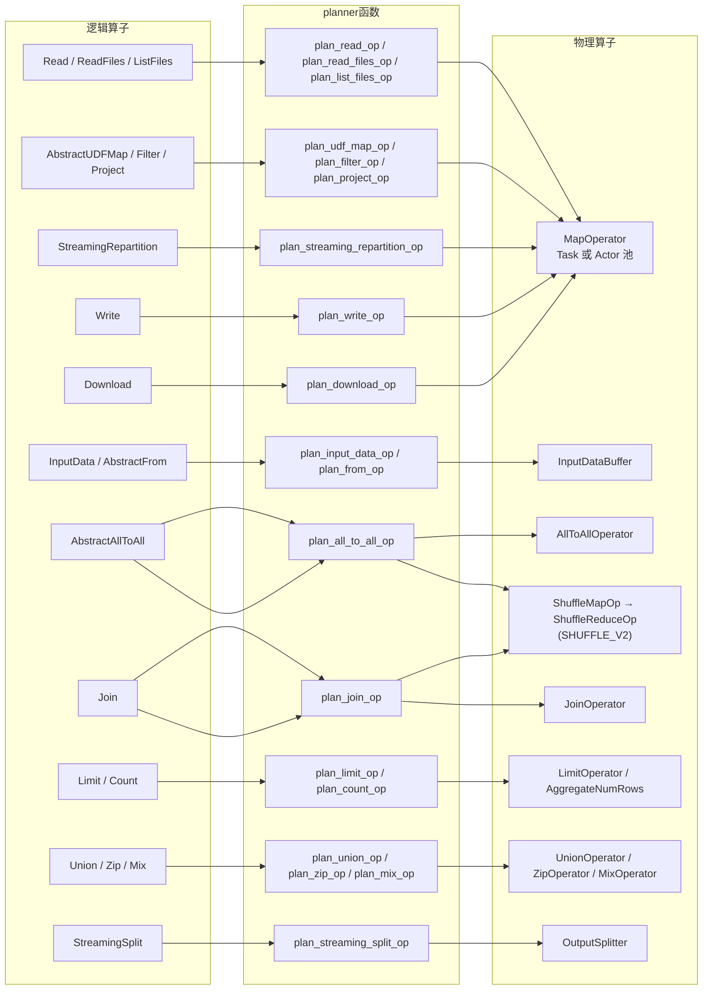

值得注意的一点：**绝大多数逻辑算子最终都落到同一个物理算子 `MapOperator`**。读、写、map、filter、project、download、streaming repartition 全都是 `MapOperator.create(...)`，区别只在于塞进去的 `MapTransformer` 不同。这就是下一节的主角。

### 5.2 MapTransformer：UDF 的封装链

#### 5.2.1 问题：阻抗不匹配

用户写 UDF 时的视角有三种：

- `map(fn)` —— `fn` 收一个 row（`Dict[str, Any]`），返回一个 row；
- `map_batches(fn)` —— `fn` 收一个 batch（pandas `DataFrame` / `pyarrow.Table` / `Dict[str, np.ndarray]`），返回 batch，**也允许返回 generator**；
- 内部算子（读/写/project）—— 直接处理 Block。

但算子之间流通的单位只有一种：**Block（块）**。所以中间必须有一层适配器，负责 `Block → Row/Batch` 的拆解和 `Row/Batch → Block` 的重组。这层就是 `MapTransformFn`，而把若干 `MapTransformFn` 串成流水线的容器就是 `MapTransformer`。

#### 5.2.2 三种粒度与类型标记

粒度用一个枚举标记（**输入类型**，input type）：

```python
# python/ray/data/_internal/execution/operators/map_transformer.py:86-92
class MapTransformFnDataType(Enum):
    """An enum that represents the input/output data type of a MapTransformFn."""
    Block = 0
    Row = 1
    Batch = 2
```

三个具体子类各自只做两件事——`_pre_process`（把上游 Block 流拆成自己要的粒度）和 `_post_process`（把结果重新塑形成 Block 流）：

| 子类 | 文件位置 | `input_type` | `_pre_process` | `_post_process` |
|---|---|---|---|---|
| `RowMapTransformFn` | `map_transformer.py:369-395` | `Row` | `_RowBasedIterator(blocks)` 逐行拆 | `_shape_blocks` |
| `BatchMapTransformFn` | `map_transformer.py:428-477` | `Batch` | `batch_blocks(...)` 按 `batch_size`/`batch_format` 切批 | `_shape_blocks` |
| `BlockMapTransformFn` | `map_transformer.py:480-527` | `Block` | 恒等（基类 `_pre_process`，`:147-148`） | `_shape_blocks`，或 `disable_block_shaping=True` 时原样透传 |

基类把三步固化在 `__call__` 里，子类无需重复：

```python
# python/ray/data/_internal/execution/operators/map_transformer.py:156-164
    def __call__(self, blocks, ctx, report_custom_op_stats=_noop_report_custom_op_stats):
        batches = self._pre_process(blocks)                              # Block → Row/Batch/Block
        results = self._apply_transform(ctx, batches, report_custom_op_stats)  # 调用户 fn
        return self._post_process(results)                               # → Block
```

`input_type` 不是装饰性的：`_shape_blocks` 用它决定往输出缓冲里塞数据时该调哪个 `add` 方法，从而完成"类型 → 塑形策略"的对接。

```python
# python/ray/data/_internal/execution/operators/map_transformer.py:547-553
        if input_type == MapTransformFnDataType.Block:
            self._append_buffer = self._buffer.add_block
        elif input_type == MapTransformFnDataType.Batch:
            self._append_buffer = self._buffer.add_batch
        else:
            assert input_type == MapTransformFnDataType.Row
            self._append_buffer = self._buffer.add
```

相邻 fn 的拼接约束写在 `MapTransformer` 的 docstring 里，是一条**契约**而非运行时校验：

```python
# python/ray/data/_internal/execution/operators/map_transformer.py:197-204
class MapTransformer:
    """Encapsulates the data transformation logic of a physical MapOperator.

    A MapTransformer may consist of one or more steps, each of which is represented
    as a MapTransformFn. The first MapTransformFn must take blocks as input, and
    the last MapTransformFn must output blocks. The intermediate data types can
    be blocks, rows, or batches.
    """
```

因为每个 fn 的输入和输出**都被规约成 Block 流**（`_pre_process` 进、`_post_process` 出），任意两个 fn 都能首尾相接——这才使得算子融合可以简单粗暴地做列表拼接（见 5.2.6）。

#### 5.2.3 流水线的组装与 `init_fn`

`MapTransformer` 持有一个 fn 列表和一个 `init_fn`：

```python
# python/ray/data/_internal/execution/operators/map_transformer.py:242-248
        self._transform_fns: List[MapTransformFn] = []
        self._init_fn = init_fn if init_fn is not None else lambda: None
        self._output_block_size_option_override = output_block_size_option_override
        self._udf_time_s = 0
        self.add_transform_fns(transform_fns)
```

串流水线就是一个 for 循环，把上一个 fn 的输出迭代器喂给下一个：

```python
# python/ray/data/_internal/execution/operators/map_transformer.py:299-315
        # NOTE: We only need to configure last transforming function to do
        #       appropriate block sizing
        last_transform = self._transform_fns[-1]
        if self.target_max_block_size_override is not None:
            last_transform.override_target_max_block_size(self.target_max_block_size_override)

        iter = input_blocks
        for transform_fn in self._transform_fns:
            iter = transform_fn(iter, ctx, report_custom_op_stats)
            if transform_fn._is_udf:
                iter = self._UDFTimingIterator(iter, self)   # 只给 UDF 那一环插桩计时
        return iter
```

两个细节：

- **只有最后一环负责 block 塑形**（`:299-306`）。中间环节的输出块大小无关紧要，反正下一环会重新拆；只有出口块会进对象存储，所以只在出口卡 `target_max_block_size`。
- `_UDFTimingIterator`（`:206-223`）在 `__next__` 里包一层 `time.perf_counter()`，把纯用户代码耗时累加到 `_udf_time_s`，最终作为 `udf_time_s` 写进 block 元数据（`map_operator.py:872-877`）。

`init_fn` 只被调用一次，且**只在 actor 场景有意义**：

```python
# python/ray/data/_internal/execution/operators/map_transformer.py:273-278
    def init(self) -> None:
        """Initialize the transformer.
        Should be called before applying the transform.
        """
        self._init_fn()
```

调用点在 actor 的构造函数里，而不是每个 task：

```python
# python/ray/data/_internal/execution/operators/actor_pool_map_operator.py:695-716（节选）
    def _init_udf_with_retries(self, ctx: DataContext) -> None:
        max_retries = ctx.actor_init_max_retries if ctx.actor_init_retry_on_errors else 0
        while max_retries < 0 or attempt <= max_retries:
            try:
                self._map_transformer.init()   # 模型加载到 GPU 就发生在这里，一个 actor 一次
                return
            except Exception as e:
                ...
```

`init_fn` 的内容由 `_get_udf` 生成。当 UDF 是 callable class 时，它会构造实例并挂在 actor 进程的全局 `ray.data._map_actor_context` 上；否则是空函数：

```python
# python/ray/data/_internal/planner/plan_udf_map_op.py:661-685（节选）
    def init_fn():
        if ray.data._map_actor_context is None:
            udf_instances = {}
            for spec in udf_specs:
                udf_key = spec.spec.make_key()
                if udf_key not in udf_instances:
                    udf_instances[udf_key] = spec.instantiation_class(*spec.spec.args, **spec.spec.kwargs)
            ray.data._map_actor_context = _MapActorContext(
                is_async=has_async_udf, udf_instances=udf_instances,
            )
```

包装后的 UDF 调用只做一次字典查表，不再重建对象（`plan_udf_map_op.py:449-462`）。这是 `concurrency=N` + callable class 能"模型只加载一次"的机制根源。

#### 5.2.4 数据流：一条 generator 链

以 `map_batches` 为例，一个 task 内部的实际链路：

```
 ┌──────────────────────── 一个 Ray task（_map_task）内部 ────────────────────────┐
 │                                                                              │
 │  bundle 里的 Block(s)                                                        │
 │      │  iter(blocks) / _iter_sliced_blocks                                   │
 │      ▼                                                                       │
 │  ┌─────────────────────────────┐                                             │
 │  │ _pre_process:               │   BatchMapTransformFn._pre_process           │
 │  │   batch_blocks(...)         │──▶ 按 batch_size 切片、按 batch_format 转换   │
 │  └─────────────────────────────┘   （zero_copy_batch=False → ensure_copy）    │
 │      │  Iterator[DataBatch]                                                  │
 │      ▼                                                                       │
 │  ┌─────────────────────────────┐                                             │
 │  │ user_udf(batch)             │   _TransformingBatchIterator                 │
 │  │  返回 batch 或 generator     │──▶ 输出校验 _validate_batch_output           │
 │  └─────────────────────────────┘                                             │
 │      │  Iterator[DataBatch]                                                  │
 │      ▼                                                                       │
 │  ┌─────────────────────────────┐                                             │
 │  │ _post_process:              │   _BlockShapingIterator + BlockOutputBuffer  │
 │  │   buffer.add_batch(b)       │──▶ 累积到 target_max_block_size 就吐一块      │
 │  └─────────────────────────────┘                                             │
 │      │  Iterator[Block]                                                      │
 │      ▼                                                                       │
 │  yield block ; yield pickle(meta)   ← streaming generator 协议（第 6 章）      │
 └──────────────────────────────────────────────────────────────────────────────┘
```

**整条链是惰性的（lazy）、逐 batch 拉取的**，这直接决定单 task 的峰值内存。注意实现上刻意避免了 Python generator 的一个陷阱——用**显式迭代器类**而非 `yield`：

```python
# python/ray/data/_internal/execution/operators/map_transformer.py:530-535
class _BlockShapingIterator(Iterator[Block]):
    """Iterator that shapes results into blocks using a buffer.

    Unlike a generator, local variables in __next__ go out of scope when the method
    returns, avoiding holding references to yielded values.
    """
```

generator 的栈帧在挂起期间会一直持有局部变量，也就一直持有上一个 batch 的引用；而 `__next__` 返回即出栈，引用立刻释放。`_RowBasedIterator`（`:577-606`）、`_TransformingBatchIterator`（`plan_udf_map_op.py:541-549`）出于同样理由写成迭代器类，`_ReleasingIterator`（`plan_udf_map_op.py:972-983`）更进一步用 `deque.popleft()` 主动放开引用。

如果这条链改成"一次性物化"——先把整个 bundle 转成一个大 batch、调一次 UDF、再一次性建块——单 task 峰值内存就会是 `输入全量 + 输出全量`；而惰性链的峰值大致是 `一个 batch + 一个待吐出的 block`。这是 Ray Data 敢把 `target_max_block_size` 默认设到 128 MiB（`context.py:76`）而不担心 worker OOM 的前提。

#### 5.2.5 `map_batches` 三个参数各自作用在哪一环

三个参数全部落在 `BatchMapTransformFn._pre_process` 这一环：

```python
# python/ray/data/_internal/execution/operators/map_transformer.py:456-471
    def _pre_process(self, blocks):
        if self._batch_size == "auto":
            batch_size, blocks = _compute_auto_batch_size(
                blocks, target_batch_size_bytes=self._target_batch_size_bytes)
        else:
            batch_size = self._batch_size
        ensure_copy = not self._zero_copy_batch and batch_size is not None
        return batch_blocks(
            blocks=iter(blocks), stats=None,
            batch_size=batch_size,          # ① 切多大
            batch_format=self._batch_format,# ② 转成什么类型
            ensure_copy=ensure_copy,        # ③ 是否深拷贝
        )
```

- **`batch_size`**：决定每次喂给 UDF 多少行。`None` 表示"一个 block 一个 batch"（不重切）。`"auto"` 会先偷看第一个非空 block 估算每行字节数，反推出约 16 MiB 一批的行数：

  ```python
  # python/ray/data/_internal/execution/operators/map_transformer.py:414-425（节选）
  def _compute_auto_batch_size(blocks, target_batch_size_bytes=_DEFAULT_BATCH_SIZE_BYTES):
      sample, blocks = _peek_first_nonempty_block(blocks)
      bytes_per_row = sample.size_bytes() / sample.num_rows()
      computed_batch_size = max(1, int(target_batch_size_bytes / bytes_per_row))
  ```
  默认目标 16 MiB，可用 `RAY_DATA_DEFAULT_BATCH_SIZE_BYTES` 调（`:31-33`）。

- **`batch_format`**：透传到 `format_batches` → `BlockAccessor.to_batch_format`。`None` 表示保持 block 原生格式（`block.py:529-530`），`"pandas"` / `"pyarrow"` / `"numpy"` 分别做相应转换。**转换发生在 UDF 之前**，所以 `batch_format="pandas"` 处理 Arrow 数据集会在每个 batch 上付一次 Arrow→pandas 的代价。

- **`zero_copy_batch`**：为 `True`（默认）时不拷贝，UDF 拿到的是零拷贝视图——Arrow 转出来的 numpy 数组是只读的。为 `False` 时置 `ensure_copy=True`，`_copy_batch` 给 UDF 一份可写副本。用户忘了设这个参数而尝试原地改数据时，错误会被翻译成可读的提示：

  ```python
  # python/ray/data/_internal/planner/plan_udf_map_op.py:603-617（节选）
                  read_only_msgs = ["assignment destination is read-only",
                                    "buffer source array is read-only"]
                  if any(msg in err_msg for msg in read_only_msgs):
                      raise ValueError(
                          f"Batch mapper function {self._fn.__name__} tried to mutate a "
                          "zero-copy read-only batch. To be able to mutate the "
                          "batch, pass zero_copy_batch=False to map_batches(); ...")
  ```

  注意 `ensure_copy` 还要求 `batch_size is not None`——`batch_size=None` 时不做重切，也就不走拷贝分支。

#### 5.2.6 算子融合在这里的落地

第 4 章讲的 `MapBatches → MapBatches` 融合，最终就落成一件事：**两个 `MapTransformer` 的 fn 列表首尾相接**，`init_fn` 串行调用。

```python
# python/ray/data/_internal/execution/operators/map_transformer.py:317-351（节选）
    def fuse(self, other: "MapTransformer") -> "MapTransformer":
        """Fuse two `MapTransformer`s together."""
        self_init_fn = self._init_fn      # 提成局部变量，避免闭包捕获整个 MapTransformer
        other_init_fn = other._init_fn

        def fused_init_fn():
            self_init_fn()
            other_init_fn()

        combined_transform_fns = self._combine_transformations(
            self._transform_fns, other._transform_fns)   # 就是 ones + others（:353-357）
        return MapTransformer(combined_transform_fns, init_fn=fused_init_fn, ...)
```

调用点在物理优化规则里：`up_op.get_map_transformer().fuse(down_op.get_map_transformer())`（`_internal/logical/rules/operator_fusion.py:629`，streaming repartition 变体在 `:466`）。融合后只创建**一个** `MapOperator`，于是原本要经过对象存储往返的中间 block 完全不存在了——上游 fn 的输出迭代器直接是下游 fn 的输入迭代器，全程在同一个 task 的进程内存里。

同一套机制还被用在非融合场景：`get_additional_split_factor() > 1` 时，`MapOperator.start` 也用 `fuse` 追加一个切块 fn（`map_operator.py:504-516`）；`per_block_limit` 则用 `_wrap_transformer_with_limit` 在末尾追加一个截断 fn（`map_operator.py:959-981`）。

### 5.3 各 planner 函数速览

**`plan_read_op`（V1 读，`plan_read_op.py:60-135`）** 是"把元数据当数据"的经典手法：`ReadTask` 对象本身被 `ray.put` 成 block，装进 `InputDataBuffer`；读操作则是一个 `BlockMapTransformFn`，它收到的"block"其实是 `ReadTask`，调用即产出真实数据。

```python
# python/ray/data/_internal/planner/plan_read_op.py:88-106（节选）
        for read_task in read_tasks:
            read_task_ref = ray.put(read_task)
            ref_bundle = RefBundle(
                (BlockEntry(read_task_ref, _derive_metadata(read_task, read_task_ref)),),
                # `owns_blocks` is False, because these refs are the root of the
                # DAG. We shouldn't eagerly free them. Otherwise, the DAG cannot
                # be reconstructed.
                owns_blocks=False, schema=None,
            )
```

```python
# python/ray/data/_internal/planner/plan_read_op.py:110-112
    def do_read(blocks: Iterable[ReadTask], _: TaskContext) -> Iterable[Block]:
        for read_task in blocks:
            yield from read_task()
```

`yield from` 而非 `list(...)`：一个 ReadTask 读大文件时也是逐块吐出，配合出口的 `OutputBlockSizeOption`（`:119-122`）自动切成 128 MiB 级的块。`_derive_metadata`（`:34-57`）顺手检查序列化后的 ReadTask 大小，超过 1 MiB 就警告用户"别在 read_fn 里捕获 `self`"。

**`plan_write_op`（`plan_write_op.py:77-151`）** 构造的是三段式 fn 链 `pre → write → post`：

```python
# python/ray/data/_internal/planner/plan_write_op.py:118-128（节选）
    write_transform = BlockMapTransformFn(
        write_fn, is_udf=False,
        disable_block_shaping=True,   # 写不需要重新塑形
    )
    transform_fns = pre_transforms + [write_transform] + post_transformations
    map_transformer = MapTransformer(transform_fns)
```

写 fn 用 `itertools.tee` 把输入流复制一份：一份交给 datasink，一份原样返回给下游（`:33-41`），于是 `write()` 之后还能接统计 fn。末尾的 `generate_collect_write_stats_fn`（`:46-74`）把 `num_rows` / `size_bytes` / `write_return` 打包成一个单行 pandas block。

> 注意这个统计 block **不会交到用户手上**：`write_parquet` 和 `write_datasink` 的签名都是 `-> None`（`python/ray/data/dataset.py:4830`、`:6606`），统计结果在 `write_datasink` 内部被消费掉，用于打 INFO 日志和调 `datasink.on_write_complete()`（`:6662-6680`）。第 10 章会讲怎么真正拿到写入行数。

`map_task_kwargs` 里塞了一个全局 `write_uuid`（`:142-144`）用于避免文件名冲突。

**`plan_all_to_all_op`（`plan_all_to_all_op.py:275-379`）** 有两条出路。传统路径生成一个 `bulk_fn` 然后包成 `AllToAllOperator`：

```python
# python/ray/data/_internal/planner/plan_all_to_all_op.py:372-379
    return AllToAllOperator(
        fn, input_physical_dag, data_context,
        num_outputs=op.num_outputs,
        sub_progress_bar_names=op.sub_progress_bar_names,
        name=op.name,
    )
```

`fn` 由 `generate_sort_fn` / `generate_random_shuffle_fn` / `generate_repartition_fn` / `generate_aggregate_fn` 产出，内部就是 shuffle task scheduler（第 9 章详讲）。另一条出路是按 `DataContext.shuffle_strategy` 分派到 hash shuffle：`SHUFFLE_V2` 直接展开成 **两个** 物理算子 `ShuffleMapOp → ShuffleReduceOp`（`:103-126`），planner 只返回 reduce 端，executor 靠 `input_dependencies` 回溯找到 map 端——这正是 `_plan_recursively` 里那段"向上游认领逻辑父亲"的循环存在的原因。

**V2 三段式读（第 10 章详讲）**把 V1 里耦合在一起的"列文件 / 读文件 / 下载字节"拆成三个 plan 函数：

- `plan_list_files_op`（`plan_list_files_op.py:57-141`）：把用户给的路径切成最多 200 份（`:54`, `:155-161`）并行列举，产出 `FileManifest` block；可选追加 shuffle 和 size-balanced 分桶 fn。它显式关闭融合与限流——`supports_fusion=False`（`:138`）因为列举和读取资源画像完全不同，`throttling_disabled = lambda: True`（`:140`）因为列举极快，被背压卡住会把下游读算子饿死。
- `plan_read_files_op`（`plan_read_files_op.py:43-96`）：一个 `do_read` fn，对每个 manifest 调 `scanner.create_reader().read(manifest)`，并在此做文件级谓词下推剪枝（`:60-76`）。
- `plan_download_op`（`plan_download_op.py:69-223`）：链路最长，`SplitDownloadURIs`（task 池，切 URI 块）→ `PlanDownloadBlocks`（**actor 池**，因为要复用 S3 client 做 HEAD 请求，`:160-175`）→ `DownloadURIBytes`（task 池，`:214-221`）。

**`plan_project_op` / `plan_filter_op` / `plan_streaming_repartition_op`** 都是 `BlockMapTransformFn` 的轻量应用，唯一有意思的是 streaming repartition：它不写任何 transform 逻辑（`lambda blocks, ctx: blocks`），完全靠 `OutputBlockSizeOption.target_num_rows_per_block` 让输出缓冲去切块，`strict=True` 时再额外挂一个 `RebundleQueue(ExactMultipleSize(...))` 来保证输入侧凑成精确倍数：

```python
# python/ray/data/_internal/planner/plan_udf_map_op.py:195-206（节选）
    transform_fn = BlockMapTransformFn(
        lambda blocks, ctx: blocks,
        output_block_size_option=OutputBlockSizeOption.of(
            target_num_rows_per_block=op.target_num_rows_per_block,
        ),
    )
    map_transformer = MapTransformer([transform_fn])
    if op.strict:
        ref_bundler = RebundleQueue(ExactMultipleSize(op.target_num_rows_per_block))
```

## 6. PhysicalOperator 协议与 MapOperator 实现

`PhysicalOperator` 是整个执行引擎的**接口约定（contract）**。调度器（第 7 章的 `StreamingExecutor`）对算子内部一无所知，它只反复调用这套协议方法。把协议讲清楚，执行引擎的行为就基本确定了。

一句话概括语义（来自类 docstring）：

```python
# python/ray/data/_internal/execution/interfaces/physical_operator.py:521-528（节选）
class PhysicalOperator(Operator):
    """Abstract class for physical operators.

    An operator transforms one or more input streams of RefBundles into a single
    output stream of RefBundles.

    Physical operators are stateful and non-serializable; they live on the driver side
    of the Dataset only.
    """
```

**算子只活在 driver 上，且不可序列化**（`__reduce__` 直接抛异常，`:605-606`）。它是一个状态机 + 一个 Ray task 的遥控器，真正的数据永远在 object store 里，算子手上只有 `RefBundle`。

### 6.1 协议逐项拆解

#### 输入侧

```python
# python/ray/data/_internal/execution/interfaces/physical_operator.py:926-946（节选）
    def add_input(self, refs: RefBundle, input_index: int) -> None:
        """Called when an upstream result is available.

        Inputs may be added in any order, and calls to `add_input` may be interleaved
        with calls to `get_next` / `has_next` to implement streaming execution.

        Subclasses should override `_add_input_inner` instead of this method.
        """
        assert 0 <= input_index < len(self._input_dependencies), ...
        self._metrics.on_input_received(refs)   # 基类统一埋点
        self._add_input_inner(refs, input_index)
```

这是一个反复出现的模式：**基类的公开方法负责埋点，子类重写 `_xxx_inner`**。`input_index` 标识是哪个上游产出的输入，单输入算子恒为 0；`ZipOperator` / `JoinOperator` 才会用到 >0。

- `input_done(input_index)`（`:952-958`）：第 `input_index` 个上游 `has_completed()` 了，基类是空实现。
- `all_inputs_done()`（`:960-966`）：所有上游都完成了，基类只置 `self._inputs_complete = True`。这是 flush 内部缓冲的时机点（见 6.3）。
- `can_add_input()`（`:918-924`）：算子自己表达"现在还能不能收"。基类恒 `True`；`ActorPoolMapOperator` 用它实现"没有空闲 actor 就别给我"。

> 注意：常被记成 `should_add_input()` 的方法在当前代码里叫 **`can_add_input()`**；`ActorPoolMapOperator` 的类 docstring（`actor_pool_map_operator.py:98`）里还残留着旧名字 `should_add_input()`，那是过期注释。

#### 输出侧

```python
# python/ray/data/_internal/execution/interfaces/physical_operator.py:968-988（节选）
    def has_next(self) -> bool:
        """Returns when a downstream output is available.
        When this returns true, it is safe to call `get_next()`.
        """
        raise NotImplementedError

    def get_next(self) -> RefBundle:
        output = self._get_next_inner()
        self._metrics.on_output_taken(output)   # 同样：基类埋点 + 子类 _inner
        return output
```

#### 生命周期

```python
# python/ray/data/_internal/execution/interfaces/physical_operator.py:903-916（节选）
    def start(self, options: ExecutionOptions, block_ref_counter: BlockRefCounter) -> None:
        """Called by the executor when execution starts for an operator."""
        self._block_ref_counter = block_ref_counter
        self._started = True
```

`start` 除了置位，还是算子拿到两样全局东西的唯一入口：`ExecutionOptions`（含 `preserve_order`、`actor_locality_enabled`、`label_selector`）和执行器全局共享的 `BlockRefCounter`（对象存储内存计账）。

完成判定分两级，这个区分很重要：

```python
# python/ray/data/_internal/execution/interfaces/physical_operator.py:769-803（节选）
        # NOTE: Execution is considered finished if
        #   - The operator was explicitly marked finished OR
        #   - The following auto-completion conditions are met
        #       - All input blocks have been ingested
        #       - Internal queue is empty
        #       - There are no active or pending tasks
        return self._is_execution_marked_finished or (
            self._inputs_complete
            and self.num_active_tasks() == 0
            and internal_input_queue_num_blocks == 0
        )
    ...
    def has_completed(self) -> bool:
        """An operator is completed iff:
            * The operator has finished execution ...
            * All outputs have been taken (i.e., `has_next()` is False) from it.
        """
```

`has_execution_finished()` = 不会再产出新东西；`has_completed()` = 且下游已经把东西全取走了。调度器用后者决定能否给下游发 `input_done`，用前者决定能否停止给它派活。`mark_execution_finished()`（`:754-756`）是提前终止的开关——`LimitOperator` 就靠它。

```python
# python/ray/data/_internal/execution/interfaces/physical_operator.py:1023-1042（节选）
    def shutdown(self, timer: Timer, force: bool = False) -> None:
        """Abort execution and release all resources used by this operator."""
        if self._shutdown:
            return
        elif not self._started:
            raise ValueError("Operator must be started before being shutdown.")
        self._shutdown = True
        with timer.timer():
            self._do_shutdown(force)   # 默认实现：取消所有活跃 task（:1040-1042）
```

`shutdown` 幂等，且强制模式下会 `ray.get` 阻塞等待取消完成（`:1179-1190`），保证返回时资源真的放掉了。

#### 调度侧

这一组方法是资源管理器（第 8 章）的输入。真实名字与语义：

| 方法 | 位置 | 语义 |
|---|---|---|
| `num_active_tasks()` | `:998-1012` | 活跃 task 数；可以小于 `get_active_tasks()` 的长度（actor readiness 探测 task 被排除） |
| `incremental_resource_usage()` | `:1099-1105` | 再处理一份输入需要**增量**多少资源 |
| `current_logical_usage()` | `:1044-1051` | 当前占用的 CPU/GPU/memory（**不含**对象存储） |
| `pending_logical_usage()` | `:1077-1085` | 其中属于"还没就绪"的部分（pending / restarting actor） |
| `running_logical_usage()` | `:1061-1075` | 默认 = current − pending，子类通常不用重写 |
| `estimate_object_store_usage()` | `:1053-1059` | 从共享的 `BlockRefCounter` 里查本算子名下的对象存储字节 |
| `min_max_resource_requirements()` | `:1087-1097` | 资源需求的上下界，供 budget 分配 |
| `per_task_resource_allocation()` | `:830-842` | 单 task 资源；actor 场景是"单 actor 资源 ÷ max_concurrency" |
| `get_max_concurrency_limit()` | `:844-850` | 用户显式设的 `concurrency` 上限 |
| `throttling_disabled()` | `:1014-1021` | 只改元数据、不该被限流的算子返回 `True` |

> 同样修正两个常见误记：不存在 `current_processor_usage()`，对应方法是 **`current_logical_usage()`**；不存在 `notify_resource_usage`，背压状态回传用的是 **`notify_in_task_submission_backpressure()`** 和 **`notify_in_task_output_backpressure()`**（`:1107-1137`），两者都只在状态翻转时才触发计时器：

```python
# python/ray/data/_internal/execution/interfaces/physical_operator.py:1117-1121
        # only update on change to in_backpressure
        if self._in_task_submission_backpressure != in_backpressure:
            self._metrics.on_toggle_task_submission_backpressure(in_backpressure)
            self._in_task_submission_backpressure = in_backpressure
        self._task_submission_backpressure_policy = policy_name
```

另外 `refresh_state()`（`:1147-1158`）每个调度迭代被调一次，给算子一个"处理异步变化"的钩子——actor 重启、task 重试、对象丢失这些事件对调度器不透明，只有算子自己知道。

#### 生命周期状态机

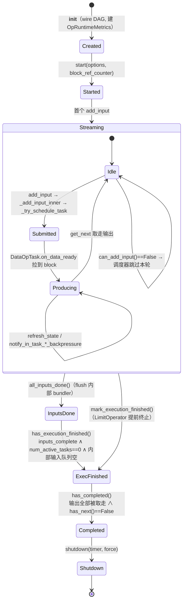

### 6.2 `DataOpTask` / `MetadataOpTask`：把 Ray task 包成可轮询对象

调度器是一个单线程 while 循环，它不能在 `ray.get` 上阻塞。所以每个提交出去的 Ray task 都要被包成一个**可轮询对象**，暴露一个"等什么"和一批"就绪时干什么"的回调。基类：

```python
# python/ray/data/_internal/execution/interfaces/physical_operator.py:64-88（节选）
class OpTask(ABC):
    """Abstract class that represents a task that is created by an PhysicalOperator.

    The task can be either a regular task or an actor task.
    """
    @abstractmethod
    def get_waitable(self) -> Waitable:
        """Return the ObjectRef or ObjectRefGenerator to wait on."""
```

`Waitable = Union[ray.ObjectRef, ObjectRefGenerator]`（`:61`）。两个子类：

- **`MetadataOpTask`**（`:491-518`）：包一个普通 `ObjectRef`，只有一个 `task_done_callback`。用途单一——actor pool 用 `actor.get_location.remote()` 探测 actor 是否就绪。
- **`DataOpTask`**（`:151-488`）：包一个 **streaming generator**（`ObjectRefGenerator`），这是数据路径的核心。

#### 为什么必须是 streaming generator

对比两种做法：

```
 普通 task（num_returns=1，返回 list）
 ┌────────────────────────── task 全程 ──────────────────────────┐
 t=0                                                          t=T
 │                                                             │ ← 唯一一次交付
 └── 下游在 t<T 全程空转，且 task 内部要攒住 N 个 block ────────────┘

 streaming generator（num_returns="streaming"）
 ┌──────┬──────┬──────┬──────┬───────────────────────────────────┐
 t=0   t1     t2     t3     t4                                t=T
        ↓      ↓      ↓      ↓                                  ↓
      block  block  block  block                            StopIteration
      下游立刻可以开工；上游 task 每吐一块就能释放本地引用
```

设置在 `TaskPoolMapOperator` 的静态 remote args 里：

```python
# python/ray/data/_internal/execution/operators/task_pool_map_operator.py:113-127（节选）
        ray_remote_static_args = {
            **(self._ray_remote_args or {}),
            "num_returns": "streaming",
            "_labels": {self._OPERATOR_ID_LABEL_KEY: self.id},
        }
        ...
        self._map_task = cached_remote_fn(_map_task, **ray_remote_static_args)
```

三个收益，缺一不可：

1. **流水线深度**：下游算子在上游 task 还在跑时就拿到了前几个 block，形成真正的流式执行。
2. **单 task 内存上界**：task 不需要在内存里攒完所有输出。配合 generator 背压（`_generator_backpressure_num_objects`），未被消费的输出还会反压住 task 本身：

   ```python
   # python/ray/data/_internal/execution/operators/task_pool_map_operator.py:179-188（节选）
           if ("_generator_backpressure_num_objects" not in dynamic_ray_remote_args
               and self.data_context._max_num_blocks_in_streaming_gen_buffer is not None):
               # The `_generator_backpressure_num_objects` parameter should be
               # `2 * _max_num_blocks_in_streaming_gen_buffer` because we yield
               # 2 objects for each block: the block and the block metadata.
               dynamic_ray_remote_args["_generator_backpressure_num_objects"] = (
                   2 * self.data_context._max_num_blocks_in_streaming_gen_buffer)
   ```
   默认 `_max_num_blocks_in_streaming_gen_buffer = 2`（`context.py:331`），即最多 2 个未消费块。
3. **细粒度背压**：driver 每次只拉一个预算内的量，见下文 `max_bytes_to_read`。

代价是协议变复杂：generator **交替 yield block 和 pickle 过的元数据**，两个对象一对。

```python
# python/ray/data/_internal/execution/util.py:81-98（节选）
def yield_block_with_stats(block, build_metadata):
    """Yield a block then its pickled metadata, per the streaming-gen protocol."""
    gen_stats: "StreamingGeneratorStats" = yield block
    block_ser_time_s = gen_stats.object_creation_dur_s if gen_stats else None
    yield pickle.dumps(build_metadata(block_ser_time_s))
```

先 yield block 再 yield meta 的顺序不能颠倒：block 的序列化耗时只有在 block 交付后才知道，要写进 meta。

#### 拉取循环

`on_data_ready` 是这套协议的解码器。它由调度器在每个迭代里调用：

```python
# python/ray/data/_internal/execution/streaming_executor_state.py:735-745（节选）
                            bytes_read = task.on_data_ready(
                                remaining_output_budget.get(state, None),
                                metadata_fetcher,
                            )
                            op_data_tasks.append(task)
                            if state in remaining_output_budget:
                                remaining_output_budget[state] = max(
                                    remaining_output_budget[state] - bytes_read, 0)
```

`max_bytes_to_read` 就是背压策略算出的字节预算，`0` 表示"完全不许读"。循环体的关键几段：

```python
# python/ray/data/_internal/execution/interfaces/physical_operator.py:297-334（节选）
        while max_bytes_to_read is None or bytes_read < max_bytes_to_read:
            if self._pending_block_ref.is_nil():
                # 非阻塞轮询（timeout_s=0）；仅在流已耗尽时用有界阻塞超时，
                # 否则 return object 永远拉不回来，task 就永远不会被观测为完成
                next_timeout_s = (METADATA_GET_TIMEOUT_S
                                  if self._streaming_gen._stream_exhausted() else 0)
                try:
                    self._pending_block_ref = self._streaming_gen._next_sync(timeout_s=next_timeout_s)
                except StopIteration:
                    self._state = TaskGeneratorState.DRAINED
                    break
                if self._pending_block_ref.is_nil():
                    break     # generator 暂时没新输出，下轮再来
```

`timeout_s=0` 的非阻塞轮询是"调度循环不阻塞"的落地方式。生命周期用一个三态枚举跟踪：

```python
# python/ray/data/_internal/execution/interfaces/physical_operator.py:142-149
class TaskGeneratorState(Enum):
    """Lifecycle of a ``DataOpTask``'s streaming generator, as seen by the
    data driver. Advances strictly ACTIVE -> DRAINED -> FINISHED."""
    ACTIVE = auto()
    DRAINED = auto()
    FINISHED = auto()
```

`DRAINED`（generator 耗尽）到 `FINISHED`（完成回调已触发）之间有间隔，因为元数据可能还在后台线程 fetch 中——设计上刻意**先交付输出、后宣告完成**（`:220-225`）。异常也从这条路走：如果 generator 在 yield 了 block 之后抛 `StopIteration`，说明只吐了半对，那个"block"实际是异常对象：

```python
# python/ray/data/_internal/execution/interfaces/physical_operator.py:335-353（节选）
            if self._pending_meta_ref.is_nil():
                try:
                    self._pending_meta_ref = self._streaming_gen._next_sync(timeout_s=METADATA_WAIT_TIMEOUT_S)
                except StopIteration:
                    # The generator should always yield 2 values (block and metadata)
                    # each time. If we get a StopIteration here, it means an error
                    # happened in the task. And in this case, the block_ref is the
                    # exception object.
                    try:
                        ray.get(self._pending_block_ref)
                        assert False, "Above ray.get should raise an exception."
                    except Exception as ex:
                        self._task_error = ex
                        self._state = TaskGeneratorState.DRAINED
```

拉到完整一对后，`produce_block` 反序列化元数据、登记内存、把 `RefBundle` 推给输出回调：

```python
# python/ray/data/_internal/execution/interfaces/physical_operator.py:453-466
        meta_with_schema: BlockMetadataWithSchema = pickle.loads(meta_bytes)
        meta = meta_with_schema.metadata
        self._block_ref_counter.on_block_produced(
            block_ref, meta.size_bytes or 0, self._producer_id)
        self._output_ready_callback(
            RefBundle([BlockEntry(block_ref, meta)], owns_blocks=True,
                      schema=meta_with_schema.schema),
        )
        self._last_block_meta = meta
        return meta.size_bytes or 0
```

预算在**拉取时**扣减而非交付时（`:372-376`），因为 block 从被 yield 的那一刻就已经占了对象存储。

### 6.3 `MapOperator` 基类

```python
# python/ray/data/_internal/execution/operators/map_operator.py:202-207
class MapOperator(InternalQueueOperatorMixin, OneToOneOperator, ABC):
    """A streaming operator that maps input bundles 1:1 to output bundles.

    This operator implements the distributed map operation, supporting both task
    and actor compute strategies.
    """
```

`MapOperator.create()`（`:356-488`）是工厂：`TaskPoolStrategy → TaskPoolMapOperator`，`ActorPoolStrategy → ActorPoolMapOperator`。基类负责三件所有 map 算子共通的事：输入侧 bundling、输出侧队列、统计回流；`_try_schedule_task` 留给子类（`:594-603`）。

#### 输入侧：为什么要 bundling

**问题**：上游可能吐出一堆很小的 block（比如 1000 个文件、每个 10 KB）。若一个 block 起一个 Ray task，任务调度开销（序列化、派发、生成器建立）会吃掉全部收益——典型的"每个 task 干 1 ms 活、花 20 ms 开销"。

**方案**：`RebundleQueue` 在 driver 侧攒够 `min_rows_per_bundle` 行再触发一个 task。

```python
# python/ray/data/_internal/execution/operators/map_operator.py:257-260
        # Bundles block references up to the min_rows_per_bundle target.
        self._block_ref_bundler = ref_bundler
        if self._block_ref_bundler is None:
            self._block_ref_bundler = RebundleQueue(EstimateSize(min_rows_per_bundle))
```

两种策略：

- `EstimateSize`（`bundle_queue/bundler.py:44-74`）：宽松语义——"攒到目标就放行，但宁可超也不给空 bundle"：
  ```python
  # python/ray/data/_internal/execution/bundle_queue/bundler.py:63-67
      def can_build_ready_bundle(self, num_pending_rows: int) -> bool:
          return num_pending_rows > 0 and (
              self._min_rows_per_bundle is None
              or num_pending_rows >= self._min_rows_per_bundle
          )
  ```
  `min_rows_per_bundle=None` 时退化为普通队列（来一个放一个）。
- `ExactMultipleSize`（`:77-100`）：精确语义，用于 strict streaming repartition，会**切片**最后一个 bundle 让总行数刚好是目标的整数倍。

`_add_input_inner` 的路径：

```python
# python/ray/data/_internal/execution/operators/map_operator.py:535-557（节选）
    def _add_input_inner(self, refs: RefBundle, input_index: int):
        self._block_ref_bundler.add(refs)
        self._metrics.on_input_queued(refs, input_index=0)
        if self._block_ref_bundler.has_next():
            (bundled_input, input_refs) = self._block_ref_bundler.get_next_with_original()
            for bundle in input_refs:
                self._metrics.on_input_dequeued(bundle, input_index=0)
            # NOTE: This is a strict path, hence operator is *required* to launch
            #       at least 1 task
            self._try_schedule_task(bundled_input, strict=True)
```

`get_next_with_original()` 同时返回合并后的 bundle 和构成它的原始 bundle 列表——因为指标是按原始 bundle 记的，必须精确出队才不会漏账。

`strict=True` 是一条**活性（liveness）保证**：调度器只在 `can_add_input()` 为真时调 `add_input`，所以这一路必须真的启动 task，否则输入就丢在缓冲里没人管了。相对的，`all_inputs_done` 的 flush 路径是 `strict=False`——此时可能所有 actor 都忙，启动不了也得容忍：

```python
# python/ray/data/_internal/execution/operators/map_operator.py:700-721（节选）
    def all_inputs_done(self):
        self._block_ref_bundler.finalize()
        while self._block_ref_bundler.has_next():
            (bundled_input, input_refs) = self._block_ref_bundler.get_next_with_original()
            for bundle in input_refs:
                self._metrics.on_input_dequeued(bundle, input_index=0)
            # NOTE: When `all_inputs_done` is invoked we can't guarantee that the
            #       task will be launched since all actors might be busy.
            self._try_schedule_task(bundled_input, strict=False)
        assert self._block_ref_bundler.estimate_size_bytes() == 0, ...
```

#### 输出侧：动态块切分

**问题**：一个 UDF 可能把 1 MiB 的输入炸成 5 GiB 的输出（图片解码、embedding 展开）。如果整个输出是一个 block，它会：① 撑爆对象存储、② 让下游只能用 1 个 task 处理它、③ 触发 spill。

**方案**：`BlockOutputBuffer` 在 worker 侧按 `target_max_block_size` 动态切分（**dynamic block splitting**）。阈值判定：

```python
# python/ray/data/_internal/output_buffer.py:150-166（节选）
    def has_next(self) -> bool:
        if self._finalized:
            return not self._has_yielded_blocks or self._buffer.num_rows() > 0
        elif self._output_block_size_option is None:
            # NOTE: When block sizing is disabled, buffer won't be producing
            #       incrementally, until the whole sequence is ingested.
            return False
        elif self._output_block_size_option.disable_block_shaping:
            return self._buffer.num_rows() > 0
        return self._exceeded_buffer_row_limit() or self._exceeded_buffer_size_limit()
```

大小判定用**估算**而非精确测量：

```python
# python/ray/data/_internal/output_buffer.py:123-130
    def _exceeded_buffer_size_limit(self) -> bool:
        if self._output_block_size_option.disable_block_shaping:
            return False
        return (
            self._max_bytes_per_block() is not None
            and self._buffer.get_estimated_memory_usage() > self._max_bytes_per_block()
        )
```

`get_estimated_memory_usage()` 来自 `DelegatingBlockBuilder`，避免每次 add 都实际拼表算字节数。

真正切的时候有一个**1.5 倍滞后阈值**，避免产出一大堆半空的尾块：

```python
# python/ray/data/_internal/output_buffer.py:168-176
    def _exceeded_block_size_slice_limit(self, block: BlockAccessor) -> bool:
        # Slice a block to respect the target max block size. We only do this if we are
        # more than 50% above the target block size, because this ensures that the last
        # block produced will be at least half the target block size.
        return (
            self._max_bytes_per_block() is not None
            and block.size_bytes()
            >= MAX_SAFE_BLOCK_SIZE_FACTOR * self._max_bytes_per_block()
        )
```

`MAX_SAFE_BLOCK_SIZE_FACTOR = 1.5`（`context.py:88`），`target_max_block_size` 默认 `128 MiB`（`context.py:76`）。切分本身按平均行宽反算行数，零拷贝切片，余量退回缓冲：

```python
# python/ray/data/_internal/output_buffer.py:197-214（节选）
        if self._exceeded_block_row_slice_limit(accessor):
            target_num_rows = self._max_num_rows_per_block()
        elif self._exceeded_block_size_slice_limit(accessor):
            num_bytes_per_row = accessor.size_bytes() / accessor.num_rows()
            target_num_rows = max(1, math.ceil(self._max_bytes_per_block() / num_bytes_per_row))

        if target_num_rows is not None and target_num_rows < accessor.num_rows():
            block = accessor.slice(0, target_num_rows, copy=False)
            block_remainder = accessor.slice(target_num_rows, accessor.num_rows(), copy=False)

        self._buffer = DelegatingBlockBuilder()
        if block_remainder is not None:
            self._buffer.add_block(block_remainder)
```

driver 侧的输出队列按 `preserve_order` 二选一：

```python
# python/ray/data/_internal/execution/operators/map_operator.py:496-500
        # Create output queue with desired ordering semantics.
        if options.preserve_order:
            self._output_queue = ReorderingBundleQueue()
        else:
            self._output_queue = FIFOBundleQueue()
```

`ReorderingBundleQueue` 用 `key=task_index` 维持提交顺序，代价是可能明明有输出却 `has_next()==False`（在等前序 task）——这正是 `has_completed()` 里要额外检查 `internal_output_queue_num_blocks == 0` 的原因（`physical_operator.py:794-797`）。

#### 元数据与统计回流

两个回调把 task 结果接回算子：

```python
# python/ray/data/_internal/execution/operators/map_operator.py:620-663（节选）
        def _output_ready_callback(task_index, output: RefBundle):
            # Since output is streamed, it should only contain one block.
            assert len(output) == 1
            self._metrics.on_task_output_generated(task_index, output)
            self._output_queue.add(output, key=task_index)
            self._metrics.on_output_queued(output)

        def _task_done_callback(task_index, exception, task_exec_stats, task_exec_driver_stats):
            self._metrics.on_task_finished(task_index, exception, task_exec_stats, task_exec_driver_stats)
            # 每个 task 完成就用"已收输入数 / 已提交 task 数"重新外推总量
            (_, self._estimated_num_output_bundles,
             self._estimated_output_num_rows) = estimate_total_num_of_blocks(
                self._next_data_task_idx, self.upstream_op_num_outputs(), self._metrics)
            self._data_tasks.pop(task_index)
            self._output_queue.finalize(key=task_index)   # 告知重排队列此 task 无更多输出
            if task_done_callback:
                task_done_callback()                      # 子类钩子（归还 actor / 释放资源计数）
```

worker 侧的元数据在 `_map_task` 里组装。注意 `blk_exec_stats_builder.finish()` 必须在 yield **之前**调用，否则会把下游消费的等待时间算成本 task 的耗时：

```python
# python/ray/data/_internal/execution/operators/map_operator.py:865-901（节选）
            for block in block_iter:
                block_meta = BlockAccessor.for_block(block).get_metadata()
                block_schema = BlockAccessor.for_block(block).schema()
                # Finish processing before yielding the block!
                blk_exec_stats_builder.finish()

                def build_metadata(block_ser_time_s):
                    exec_stats = blk_exec_stats_builder.build(
                        block_ser_time_s=block_ser_time_s,
                        udf_time_s=map_transformer.udf_time_s(reset=True),
                        task_idx=ctx.task_idx)
                    task_dur_s = time.perf_counter() - task_start_s
                    return BlockMetadataWithSchema.from_metadata(
                        replace(block_meta, exec_stats=exec_stats,
                                task_exec_stats=TaskExecWorkerStats(
                                    task_wall_time_s=task_dur_s,
                                    max_uss_bytes=profiler.estimate_max_uss(),
                                    custom_op_stats=op_stats_reporter.get_stats())),
                        schema=block_schema if not yielded_schema else None)

                yield from yield_block_with_stats(block, build_metadata)
                yielded_schema = True   # schema 只随第一块回传，后续块省掉去重开销
```

`MapTransformer` 序列化是**懒的**，为了让 `on_start` 回调（如 Iceberg schema 演化）能先修改状态：

```python
# python/ray/data/_internal/execution/operators/map_operator.py:289-302（节选）
    @functools.cached_property
    def _map_transformer_ref(self) -> ObjectRef[MapTransformer]:
        """Lazily serialize _map_transformer to object store on first access.

        Deferred until first task submission so that on_start callbacks
        (e.g., on_write_start for Iceberg) can modify the transformer state
        before serialization.
        """
        ref = ray.put(self._map_transformer)
        self._warn_large_udf(ref)     # >100 MiB 就警告"UDF 可能误捕获了大对象"
        return ref
```

### 6.4 `TaskPoolMapOperator` vs `ActorPoolMapOperator`

#### 无状态 task 池

`TaskPoolMapOperator._try_schedule_task` 直接发一个 Ray task，没有池的概念：

```python
# python/ray/data/_internal/execution/operators/task_pool_map_operator.py:165-206（节选）
    def _try_schedule_task(self, bundle: RefBundle, strict: bool):
        self._notify_first_input(bundle)
        ctx = TaskContext(task_idx=self._next_data_task_idx, op_name=self.name,
                          target_max_block_size_override=self.target_max_block_size_override)
        dynamic_ray_remote_args = self._get_dynamic_ray_remote_args(input_bundle=bundle)
        dynamic_ray_remote_args["name"] = self.name
        logical_usage = ExecutionResources.from_resource_dict(dynamic_ray_remote_args)
        ...
        gen = self._map_task.options(**dynamic_ray_remote_args).remote(
            self._map_transformer_ref, self._data_context_ref, ctx,
            *bundle.block_refs, slices=bundle.slices, **self.get_map_task_kwargs())
        self._current_logical_usage = self._current_logical_usage.add(logical_usage)
        def task_done_callback():
            self._current_logical_usage = self._current_logical_usage.subtract(logical_usage)
        self._submit_data_task(gen, bundle, task_done_callback=task_done_callback)
```

并发度完全由背压和资源决定——它的 `can_add_input()` 用的是基类实现（恒 `True`），限流靠 `min_max_resource_requirements()` 和调度器的 budget。一个有意思的动态决策是 scheduling strategy：

```python
# python/ray/data/_internal/execution/operators/map_operator.py:572-585（节选）
        # For tasks with small args, we will use SPREAD by default to optimize for
        # compute load-balancing. For tasks with large args, we will use DEFAULT to
        # allow the Ray locality scheduler a chance to optimize task placement.
        if "scheduling_strategy" not in ray_remote_args:
            if input_bundle and input_bundle.size_bytes() > ctx.large_args_threshold:
                ray_remote_args["scheduling_strategy"] = ctx.scheduling_strategy_large_args
            else:
                ray_remote_args["scheduling_strategy"] = ctx.scheduling_strategy
```

小输入求负载均衡（SPREAD），大输入求数据本地性（交给 Ray 的 locality scheduler）。

#### 有状态 actor 池

`ActorPoolMapOperator` 在 `concurrency=N` 或 UDF 是 callable class 时启用。它的 `can_add_input()` 是唯一真正实现了这个契约的地方，注释写得很郑重：

```python
# python/ray/data/_internal/execution/operators/actor_pool_map_operator.py:312-323
    def can_add_input(self) -> bool:
        """NOTE: PLEASE READ CAREFULLY

        This method has to abide by the following contract to guarantee Operator's
        ability to handle all provided inputs (liveness):

            - This method should only return `True` when operator is guaranteed
            to be able to launch a task, meaning that subsequent `op.add_input(...)`
            should be able to launch a task.
        """
        return self._actor_pool.can_schedule_task()
```

派发逻辑：从内部 bundle 队列取一个，选 actor，选不到就停：

```python
# python/ray/data/_internal/execution/operators/actor_pool_map_operator.py:435-472（节选）
        while self._bundle_queue.has_next():
            bundle = self._bundle_queue.peek_next()
            actor = self._actor_pool.select_actors(
                bundle=bundle, actor_locality_enabled=self._actor_locality_enabled)
            if actor is None:
                break
            self._bundle_queue.remove(bundle)
            self._metrics.on_input_dequeued(bundle, input_index=0)
            self._actor_pool.on_task_submitted(actor)
            ...
            gen = actor.submit.options(num_returns="streaming", ...).remote(
                self._data_context_ref, ctx, *input_blocks,
                slices=bundle.slices, **self.get_map_task_kwargs())
```

**`_ActorPool` 的组成**（`:783-1359`）。核心是三个索引结构：

```python
# python/ray/data/_internal/execution/operators/actor_pool_map_operator.py:821-851（节选）
        # Actors that have started running, including alive and restarting actors.
        self._running_actors: Dict[ActorHandle, _ActorState] = {}
        # Actors that are not yet ready (still pending creation).
        self._pending_actors: Dict[ObjectRef, ActorHandle] = {}
        ...
        # ALIVE Actor on ACTIVE node -> _ActorRank(num_tasks_in_flight)
        # heap gives highest rank (lowest comparable value) first.
        # This means we prefer actors with FEWER num tasks inflight.
        self._alive_actors_to_in_flight_tasks_heap: heapdict[ActorHandle, _ActorRank] = heapdict()
        # ACTIVE node -> per-node heap of ALIVE actors ranked by num_tasks_in_flight.
        # Peek gives the least-busy actor on each node in O(1).
        self._alive_node_to_actor_heap: DefaultDict[NodeIdStr, heapdict[ActorHandle, _ActorRank]] = defaultdict(heapdict)
```

一个全局堆 + 每节点一个堆，都以"在飞任务数"为 key，越少排越前。

**pending vs ready**：actor 创建后先进 `_pending_actors`，同时发一个 `actor.get_location.remote()` 包成 `MetadataOpTask`；这个 metadata task 完成就调 `pending_to_running` 把它挪进 `_running_actors` 并插入两个堆（`:325-381`、`:960-1004`）。这也是 `num_active_tasks()` 要排除 metadata task 的原因（`map_operator.py:771-780`）：actor 还在启动不算"有活在跑"。

**locality-aware 派发**：先按 bundle 数据所在节点找，找不到再退回全局最闲：

```python
# python/ray/data/_internal/execution/operators/actor_pool_map_operator.py:1042-1057（节选）
        if not self._alive_actors_to_in_flight_tasks_heap:
            return None
        _, least_busy_rank = self._alive_actors_to_in_flight_tasks_heap.peekitem()
        if least_busy_rank >= self.max_tasks_in_flight_per_actor():
            return None      # 全池都满了，快速失败
        target_actor: Optional[ActorHandle] = None
        if bundle is not None and actor_locality_enabled:
            target_actor = self._find_actor_with_locality(bundle)
        if target_actor is None:
            target_actor, _ = self._alive_actors_to_in_flight_tasks_heap.peekitem()
        return target_actor
```

```python
# python/ray/data/_internal/execution/operators/actor_pool_map_operator.py:1337-1353（节选）
        preferred_locs = bundle.get_preferred_object_locations()
        for node_id, _total_bytes in sorted(preferred_locs.items(),
                                            key=lambda item: (-item[1], item[0])):
            node_heap = self._alive_node_to_actor_heap.get(node_id)
            if not node_heap:
                continue
            actor, rank = node_heap.peekitem()   # O(1) 拿该节点最闲的 actor
            if rank < max_tasks:
                return actor
        return None
```

按"该节点上的字节数降序"遍历候选节点，即优先去数据最多的地方。命中率作为 `locality_hits` / `locality_misses` 暴露在进度条里（`:552-558`）。

**`max_tasks_in_flight_per_actor`** 允许给一个 actor 排队多于它能并发执行的任务。目的是**流水线化**：actor 在跑第 N 个 task 时，第 N+1 个 task 的 block 已经在往这个节点搬了。默认是 `max_concurrency × 2`：

```python
# python/ray/data/_internal/execution/operators/actor_pool_map_operator.py:233-244（节选）
        max_actor_concurrency = self._ray_remote_args.get("max_concurrency", 1)
        config = AutoscalingActorConfig(
            min_size=compute_strategy.min_size,
            max_size=compute_strategy.max_size,
            initial_size=compute_strategy.initial_size,
            max_tasks_in_flight_per_actor=compute_strategy.max_tasks_in_flight_per_actor
            or self.data_context.max_tasks_in_flight_per_actor
            or max_actor_concurrency * DEFAULT_ACTOR_MAX_TASKS_IN_FLIGHT_TO_MAX_CONCURRENCY_FACTOR,
            max_actor_concurrency=max_actor_concurrency,
            per_actor_resource_usage=per_actor_resource_usage)
```

`DEFAULT_ACTOR_MAX_TASKS_IN_FLIGHT_TO_MAX_CONCURRENCY_FACTOR = 2`（`context.py:341-343`）。这个"允许超订"直接决定了池利用率能超过 100%，进而决定自动伸缩能否触发（见 6.5）。

另外，actor 场景下 callable class UDF 默认被**限制在单线程**执行：

```python
# python/ray/data/_internal/planner/plan_udf_map_op.py:375-387（节选）
        if (not is_async_udf and isinstance(compute, ActorPoolStrategy)
                and not compute.enable_true_multi_threading):
            # NOTE: By default Actor-based UDFs are restricted to run within a
            # single-thread (when enable_true_multi_threading=False).
            #
            # Historically, this has been done to allow block-fetching, batching, etc to
            # be overlapped with the actual UDF invocation, while avoiding the
            # pitfalls of concurrent GPU access (like OOMs, etc) when specifying
            # max_concurrency > 1.
            udf = make_callable_class_single_threaded(udf)
```

即"IO 与批处理可并发，GPU 计算串行"，避免多线程同时访问 GPU 导致 OOM。

actor 的容错默认是**无限重启 + 无限任务重试**：

```python
# python/ray/data/_internal/execution/operators/actor_pool_map_operator.py:627-640（节选）
        if "max_restarts" not in ray_remote_args:
            ray_remote_args["max_restarts"] = -1
        if ("max_task_retries" not in ray_remote_args
                and ray_remote_args.get("max_restarts") != 0):
            ray_remote_args["max_task_retries"] = -1
        # Allow actor tasks to execute out of order by default. This prevents actors
        # from idling when the first actor task is blocked.
        if "allow_out_of_order_execution" not in ray_remote_args:
            ray_remote_args["allow_out_of_order_execution"] = True
```

但**初始化期死亡是例外**：Ray Core 不重启创建任务失败的 actor（那是 `USER_ERROR`），Ray Data 自己维护一个"连续初始化死亡"预算，超了就整体失败——这样"UDF 构造函数写错了"会快速失败，而偶发的节点故障不会（`:383-411`）。

```python
# python/ray/data/_internal/execution/operators/actor_pool_map_operator.py:396-405（节选）
        self._consecutive_actor_init_deaths += 1
        budget = self.data_context.max_consecutive_actor_init_deaths
        if budget >= 0 and self._consecutive_actor_init_deaths > budget:
            logger.error(...)
            raise error
```

关闭时不用 `ray.kill` 而是丢引用，让引用计数回收：

```python
# python/ray/data/_internal/execution/operators/actor_pool_map_operator.py:1283-1289（节选）
        # NOTE: By default, we remove references to the actor and let ref counting
        # garbage collect the actor, instead of using ray.kill.
        #
        # Otherwise, actor cannot be reconstructed for the purposes of produced
        # object's lineage reconstruction.
```

#### 对比表

| 维度 | `TaskPoolMapOperator` | `ActorPoolMapOperator` |
|---|---|---|
| 状态 | 无状态；每批输入一个 Ray task | 有状态；actor 常驻 |
| `init_fn` 执行次数 | 每个 task 一次（实际上非 callable-class 场景是空函数） | 每个 actor **一次**（`_MapWorker.__init__` → `_init_udf_with_retries`） |
| 启动开销 | 低（Ray task 派发），但每 task 都付一次 | 高（actor 创建 + 模型加载），一次性摊销 |
| 内存/资源复用 | 无；进程可被 Ray 复用但状态不保留 | 模型、连接池、CUDA context 全程复用 |
| GPU 场景 | 每 task 重新加载模型 → 通常不可接受 | **首选**；默认单线程串行执行避免 GPU 并发 OOM |
| 并发控制 | 背压 + 资源 budget；`concurrency=int` 设上限（`max_concurrency`） | `can_add_input()` 严格门控；`max_tasks_in_flight_per_actor` 允许超订以流水线化 |
| 容错 | Ray task 级重试（`retried_map_errors` / `max_map_retries`） | `max_restarts=-1`、`max_task_retries=-1`；初始化死亡另计预算 |
| 数据本地性 | Ray 调度器决定（大参数走 locality 策略） | 主动实现：`_find_actor_with_locality` + 每节点堆 |
| 弹性 | 由 budget 自然伸缩 | `DefaultActorAutoscaler` 按池利用率显式扩缩 |
| 何时用 | 无状态转换、IO 密集、读写、轻量 map | 需要昂贵一次性初始化（模型推理）、GPU、需要复用外部连接 |

一句选择标准：**每条数据的处理成本远小于初始化成本时，用 actor pool；否则用 task pool。** 代码层面的触发条件很直接——UDF 是 callable class 或显式给了 `concurrency=(min, max)`，就走 actor。

### 6.5 Actor 自动伸缩

伸缩决策的**唯一信号是池利用率（pool utilization）**：

```python
# python/ray/data/_internal/actor_autoscaler/autoscaling_actor_pool.py:268-284（节选）
    def get_pool_util(self) -> float:
        # If there are no running actors, we set the utilization to indicate that the
        # pool should be scaled up immediately.
        if self.current_size() == 0:
            return float("inf")
        else:
            # We compute utilization as a ratio of
            #  - Number of submitted tasks over
            #  - Max number of tasks that Actor Pool could currently run
            #
            # This value could exceed 100%, since by default actors are allowed
            # to queue tasks ...
            return self.num_tasks_in_flight() / (
                self.max_actor_concurrency() * self.current_size())
```

分母是"当前池能同时执行的任务数"，分子是"已提交的任务数"。因为 `max_tasks_in_flight_per_actor = 2 × max_concurrency`，这个比值最大能到 2.0——所以上扩阈值可以设在 1.0 以上：

| 参数 | 默认值 | 位置 |
|---|---|---|
| `actor_pool_util_upscaling_threshold` | **1.75** | `context.py:369-373` |
| `actor_pool_util_downscaling_threshold` | **0.5** | `context.py:375-378` |
| `actor_pool_max_upscaling_delta` | **1** | `context.py:380-383` |

`DefaultActorAutoscaler._derive_target_scaling_config`（`default_actor_autoscaler.py:52-180`）按优先级依次判断：

1. **输入耗尽 → 强制下缩**（`:59-65`）：`force=True` 绕过防抖。
2. **越界修正**（`:67-77`）：低于 `min_size` 补齐，高于 `max_size` 削减。
3. **超预算下缩**（`:79-96`）：`allocation − usage` 为负时，按每 actor 资源反算需要释放几个，但不能低于 `min_size`。
4. **没收到输入则不动**（`:100-101`）：防止从 `initial_size` 意外缩水。
5. **利用率上扩**（`:106-152`）：
   ```python
   # python/ray/data/_internal/actor_autoscaler/default_actor_autoscaler.py:126-144（节选）
               max_scale_up: int = min(
                   budget_max_scale_up,                        # 资源预算允许几个
                   self._get_actor_pool_max_upscaling_delta(), # 单次最多扩几个（默认 1）
                   actor_pool.max_size() - actor_pool.current_size(),
               )
               ...
               delta = self._compute_upscale_delta(actor_pool, op_state)
               delta = max(1, delta)      # 至少 +1
               delta = min(delta, max_scale_up)
   ```
   期望 delta 是按比例算的：`ceil(current_size × (util / threshold − 1))`（`:241-248`）。
6. **利用率下缩**（`:153-172`）：有 pending actor 时不缩（避免抖动），且不低于 `min_size`，每次只缩 1 个（`_compute_downscale_delta` 恒返回 1，`:250-251`）。

上扩之后有一段冷却期禁止下缩，防止来回抖：

```python
# python/ray/data/_internal/execution/operators/actor_pool_map_operator.py:1084-1106（节选）
        if req.delta < 0:
            # To prevent bouncing back and forth, we disallow scale down for
            # a "cool-off" period after the most recent scaling up ...
            # Note that this action is unidirectional and doesn't apply to
            # scaling up, ie if actor pool just scaled down, it'd still be able
            # to scale back up immediately.
            if (not req.force and self._last_upscaled_at is not None
                    and (time.time() <= self._last_upscaled_at + self._debounce_period_s)):
                return False
```

防抖期 10 秒（`_ACTOR_POOL_SCALE_DOWN_DEBOUNCE_PERIOD_S = 10`，`:791`），且是**单向**的——扩容不受限，缩容才等。

下缩时优先杀 pending actor 而非 idle actor，理由是减少启动churn：

```python
# python/ray/data/_internal/execution/operators/actor_pool_map_operator.py:1215-1226（节选）
        # We prioritize killing pending actors over idle actors to reduce actor starting
        # churn.
        released = self._try_remove_pending_actor()
        if not released:
            released = self._try_remove_idle_actor()
```

有一个容易踩的配置陷阱，autoscaler 启动时会主动检查并警告：如果 `max_tasks_in_flight_per_actor / max_concurrency < upscaling_threshold`，利用率永远达不到阈值，池就**永远不会扩容**（`default_actor_autoscaler.py:226-239`）。

### 6.6 其他基础算子速览

**`InputDataBuffer`**（`input_data_buffer.py:15-103`）是 DAG 的叶子，把已有的 `RefBundle` 原样吐出。三个细节：

- 构造时就 `mark_execution_finished()`（`:49`）——它没有输入，一开始就"执行完了"。
- 支持惰性初始化：`input_data_factory` 在 `start()` 时才调（`:56-62`），这样 `plan_read_op` 的 `get_read_tasks()` 不会在计划阶段就去访问文件系统。
- `_get_next_inner` 用递增索引而**不 pop**：
  ```python
  # python/ray/data/_internal/execution/operators/input_data_buffer.py:72-77
      def _get_next_inner(self) -> RefBundle:
          # We can't pop the input data. If we do, Ray might garbage collect the block
          # references, and Ray won't be able to reconstruct downstream objects.
          bundle = self._input_data[self._input_data_index]
          self._input_data_index += 1
          return bundle
  ```
  保住引用 = 保住 lineage = 下游对象丢了还能重建。

**`LimitOperator`**（`limit_operator.py:21-147`）是"提前终止上游"的机制。它在 driver 侧逐 bundle 累加行数，够了就切最后一块并**立刻**宣告执行完成：

```python
# python/ray/data/_internal/execution/operators/limit_operator.py:100-101
        if self._limit_reached():
            self.mark_execution_finished()
```

调度器随后发现它 `has_completed()`，就不再向它派输入，上游因为下游不再消费而被背压停住——整条链自然收敛。切最后一块用一个 `num_cpus=0` 的远程 task（`:73`），避免把 block 拉回 driver。它还 `throttling_disabled() -> True`（`:146-147`），因为它只做元数据操作和一次轻量切片。

**`base_physical_operator.py` 里的三个基类**：

- `InternalQueueOperatorMixin`（`:22-73`）：要求子类暴露 `_input_queues` / `_output_queues`，混入统一的队列大小统计。`has_execution_finished()` / `has_completed()` 会 `isinstance` 检查它，用内部队列是否为空作为完成条件之一。
- `OneToOneOperator`（`:76-102`）：单输入单输出，`MapOperator` 和 `LimitOperator` 的父类。
- `AllToAllOperator`（`:105-239`）：与 `MapOperator` 语义相反——**阻塞式**。所有输入攒在 `_input_buffer` 里，`all_inputs_done()` 时一次性调 `bulk_fn`：
  ```python
  # python/ray/data/_internal/execution/operators/base_physical_operator.py:187-189
          input_bundles = self._input_buffer.to_list()
          output_buffer, self._stats = self._bulk_fn(input_bundles, ctx)
          self._output_buffer = FIFOBundleQueue(output_buffer)
  ```
  它 `throttling_disabled() -> True`（`:237-239`），因为内部的 shuffle task 有自己的资源管理（第 9 章）。
- `NAryOperator`（`:242-268`）：多输入单输出，`Union` / `Zip` / `Mix` 的父类。

### 6.7 `OpRuntimeMetrics`：一份数据，三个消费者

```python
# python/ray/data/_internal/execution/interfaces/op_runtime_metrics.py:197-206（节选）
@dataclass
class OpRuntimeMetrics(metaclass=OpRuntimesMetricsMeta):
    """Runtime metrics for a 'PhysicalOperator'.

    Metrics are updated dynamically during the execution of the Dataset.
    This class can be used for either observablity or scheduling purposes.

    DO NOT modify the fields of this class directly. Instead, use the provided
    callback methods.
    """
```

指标用 `metric_field()` / `metric_property()` 声明，元类 `OpRuntimesMetricsMeta`（`:166-186`）在类创建时扫描字段元数据，自动注册到全局 `_METRICS` 列表——所以加一个新指标只需加一个带 `description` 和 `metrics_group` 的字段，dashboard 图表和 stats 输出自动跟上。分六组（`MetricsGroup`，`:43-49`）：`INPUTS` / `OUTPUTS` / `TASKS` / `OBJECT_STORE_MEMORY` / `ACTORS` / `MISC`。

**三个消费者**：

1. **调度决策**：`average_num_inputs_per_task` / `average_num_outputs_per_task` / `average_rows_outputs_per_task` 喂给 `estimate_total_num_of_blocks`（`physical_operator.py:1206-1242`）做总量外推；`obj_store_mem_max_pending_output_per_task` 进入 `min_max_resource_requirements`（`task_pool_map_operator.py:243-248`）。
2. **背压策略**：`obj_store_mem_internal_inqueue` / `obj_store_mem_internal_outqueue` / `obj_store_mem_pending_task_outputs` 是第 8 章各背压策略的输入；反向地，`notify_in_task_*_backpressure` 又把背压状态写回 `task_submission_backpressure_time` / `task_output_backpressure_time`。
3. **用户可见 stats / dashboard**：`as_dict()`（`:589-624`）导出全部非 internal 指标，`internal_only=True` 的（如 `issue_detector_hanging`）只给内部问题检测器用。

关键指标（第 11 章会用到）：

| 指标 | 组 | 位置 | 含义 |
|---|---|---|---|
| `num_inputs_received` / `bytes_inputs_received` | INPUTS | `:212-226` | 收到的输入块数 / 字节数 |
| `num_task_inputs_processed` / `bytes_task_inputs_processed` | INPUTS | `:227-240` | task 已处理完的输入 |
| `num_task_outputs_generated` / `bytes_task_outputs_generated` / `rows_task_outputs_generated` | OUTPUTS | `:253-267` | task 产出的块 / 字节 / 行 |
| `num_outputs_taken` / `bytes_outputs_taken` | OUTPUTS | `:278-291` | 已被下游取走的量 |
| `num_tasks_submitted` / `running` / `finished` / `failed` | TASKS | `:331-355` | task 计数四元组 |
| `task_completion_time_s` / `task_worker_completion_time_s` | TASKS | `:418-427` | driver 视角 vs worker 视角的累计耗时（差值≈调度开销） |
| `task_scheduling_time_s` | TASKS | `:428-436` | 从派发到真正开跑的时间 |
| `task_submission_backpressure_time` | TASKS | `:408-412` | 算子**发不出**新 task 的挂钟时间 |
| `task_output_backpressure_time` / `task_output_backpressure_time_s` | TASKS | `:413-417`, `:437-444` | 算子**读不了**输出 / task 有输出却没人取 的时间 |
| `block_size_bytes` / `block_size_rows` | TASKS（Histogram） | `:467-480` | 产出块大小分布——诊断动态切块是否生效 |
| `task_completion_time` / `block_completion_time` | TASKS（Histogram） | `:445-458` | 耗时分布，看长尾 |
| `num_tasks_task_locality_hit` / `_miss` | TASKS | `:387-396` | 首个输出块是否落在输入所在节点 |
| `average_max_uss_per_task` | TASKS | `:907-915` | 每 task 峰值 USS 均值——UDF 内存画像 |
| `obj_store_mem_internal_inqueue` / `_outqueue` | OBJ_STORE | `:762-781` | 算子内部队列占的对象存储字节 |
| `obj_store_mem_pending_task_inputs` | OBJ_STORE | `:783-788` | 在飞 task 输入占用 |
| `obj_store_mem_pending_task_outputs` | OBJ_STORE | `:790-816` | generator 缓冲区里未取走的输出估算 |
| `obj_store_mem_spilled` / `obj_store_mem_freed` | OBJ_STORE | `:530-539` | 落盘 / 释放字节 |
| `num_alive_actors` / `pending` / `restarting` / `active` / `idle` | ACTORS | `:483-507` | actor 池状态分解 |
| `pool_utilization` / `num_tasks_in_flight` | ACTORS | `:508-517` | 自动伸缩的判据 |

更新全靠回调，没有轮询：`on_input_received` / `on_input_queued` / `on_input_dequeued` / `on_output_queued` / `on_output_dequeued` / `on_output_taken` / `on_task_submitted` / `on_task_output_generated` / `on_task_finished`（`:933-1231`）。其中 `on_task_finished` 顺手做了两件非统计的事——检测输入是否落过盘，以及释放输入：

```python
# python/ray/data/_internal/execution/interfaces/op_runtime_metrics.py:1204-1230（节选）
        ctx = self._op.data_context
        if ctx.enable_get_object_locations_for_metrics:
            locations = ray.experimental.get_object_locations(inputs.block_refs)
            for entry in inputs.blocks:
                if locations[entry.ref].get("did_spill", False):
                    self.obj_store_mem_spilled += entry.metadata.size_bytes
        self.obj_store_mem_freed += total_input_size
        ...
        inputs.destroy_if_owned()
        del self._running_tasks[task_index]
```

`inputs.destroy_if_owned()` 是内存回收的实际触发点：task 完成 → 输入不再需要 → 若本算子拥有这些 block（`owns_blocks=True`）就立刻销毁。这也解释了为什么 `plan_read_op` 和 `InputDataBuffer` 的根 bundle 必须 `owns_blocks=False`——它们是 lineage 的根，不能被回收。

`task_scheduling_time_s` 的算法值得单独说，它把 driver 视角和 worker 视角的时间相减，得出纯调度开销：

```python
# python/ray/data/_internal/execution/interfaces/op_runtime_metrics.py:1082-1092（节选）
        # Task's scheduling time is calculated as:
        #
        #   Time to first block (driver) - Time to generate & ser first block (worker)
        #
        if time_to_first_output_s is not None:
            scheduling_delta = time_to_first_output_s - (
                task_info.cum_block_gen_time_s + task_info.cum_block_ser_time_s)
            self.task_scheduling_time_s += scheduling_delta
```

同一个 delta 还按 locality 命中与否分桶累加（`:1094-1106`），于是可以直接对比"数据本地"和"跨节点"两类 task 的调度成本——这是判断 `actor_locality_enabled` 有没有收益的直接依据。

---

## 7. StreamingExecutor：调度循环的心脏

前面几章把一条 `Dataset` 变换链拆成了逻辑计划、物理计划和一串 `PhysicalOperator`。但物理算子自己不会跑起来——它只是一个被动的状态机：你调 `add_input()` 喂给它一个 bundle，它内部提交 Ray task；你调 `has_next()` / `get_next()`，它把做好的结果交出来。真正决定"什么时候喂谁、喂多少、什么时候停手"的，是 `StreamingExecutor`。

这一章把这台调度器彻底拆开。

### 7.1 为什么需要流式执行器

#### 阶段式执行（BSP）的问题

传统的批处理引擎按**阶段（stage）**执行：Spark 的 BSP（Bulk Synchronous Parallel，块同步并行）模型是典型代表。一个阶段的所有 task 必须全部完成、结果全部落地，下一个阶段才能开始。

放到 Ray Data 的场景里，问题立刻暴露。假设一条 `read → map → write` 的流水线处理 100TB 图片：

```
BSP 执行（阶段屏障）：

时间 ─────────────────────────────────────────────────────────────►
read   ████████████████████████│                    │
map                            │████████████████████│
write                          │                    │██████████████
                               ↑                    ↑
                          屏障：100TB 必须          屏障
                          全部物化在 object store

object store 占用
100TB ┤                    ╭──────────╮
      │                ╭───╯          ╰───╮
      │            ╭───╯                  ╰───╮
      │        ╭───╯      ← 装不下，开始 spill 到磁盘
 集群 ┼────────╯ ─ ─ ─ ─ ─ ─ ─ ─ ─ ─ ─ ─ ─ ─ ─ ─ ─ ─  ← 容量上限
 容量 │    ╭───╯                              ╰───╮
    0 ┼────╯                                      ╰────
```

一旦超出集群 object store 容量，Ray 会把对象 spill 到磁盘。原本纯内存的数据流变成"写盘 + 读盘"，吞吐直接崩掉一个数量级。更糟的是 `read` 阶段跑完时 CPU 全空转等着 `map`，集群利用率被腰斩。

#### 流式执行

流式执行（streaming execution）取消阶段屏障：`read` 产出的第一个 block 立刻就能喂给 `map`，`map` 产出的第一个 block 立刻就能喂给 `write`。集群里只需要驻留 **in-flight**（在飞）的那一小部分数据。

```
流式执行（无屏障）：

时间 ─────────────────────────────────────────────────────────────►
read   ████████████████████████████████████
map      ██████████████████████████████████████
write      ████████████████████████████████████████

object store 占用
100TB ┤
      │
 集群 ┼─ ─ ─ ─ ─ ─ ─ ─ ─ ─ ─ ─ ─ ─ ─ ─ ─ ─ ─ ─ ─ ─ ─ ─ ─  ← 容量上限
 容量 │
      │   ╭─╮╭╮ ╭─╮ ╭╮╭─╮╭╮ ╭─╮╭─╮ ╭╮╭─╮  ← 只驻留 in-flight 部分
    0 ┼───╯ ╰╯╰─╯ ╰─╯╰╯ ╰╯╰─╯ ╰╯ ╰─╯╰╯ ╰───
```

三个算子同时占用集群资源，`read` 用 I/O、`map` 用 CPU/GPU、`write` 用 I/O——资源被重叠使用而不是串行使用。100TB 的数据集只需要几十 GB 的驻留内存就能跑完。

#### 代价，诚实地讲

流式执行不是免费的：

- **调度复杂度爆炸。** 不再是"跑完一个阶段再跑下一个"，而是每一轮都要回答"现在应该给哪个算子喂数据"。这就是本章要拆的 `_scheduling_loop_step`。
- **必须有背压（backpressure）。** 如果 `read` 比 `map` 快 10 倍，队列会无限堆积，最终又回到 OOM/spill。第 8 章专讲背压。
- **AllToAll 仍然是屏障。** `sort`、传统 `groupby` 这类需要全局数据视角的操作，实现上就是 `AllToAllOperator`——它在 `all_inputs_done()`（`python/ray/data/_internal/execution/operators/base_physical_operator.py:178`）里才调用 `_bulk_fn`，即攒齐全部输入才动手。流式执行只能把屏障两侧的部分流起来，屏障本身消不掉。
- **顺序不再保证。** 默认 `preserve_order=False`，输出顺序取决于 task 完成顺序（见 7.6）。

### 7.2 Topology 与 OpState

#### Topology 就是一个字典

`Topology` 的定义朴素到有点意外（`python/ray/data/_internal/execution/streaming_executor_state.py:57`）：

```python
Topology = Dict[PhysicalOperator, "OpState"]
```

它是「物理算子 → 该算子的调度状态」的**有序**映射。Python 3.7+ 的 dict 保序，而构建过程是 DFS 后序遍历，所以这个字典的迭代顺序天然就是**拓扑序**（上游在前，下游在后）。后面 `update_operator_states` 里用 `reversed(list(topology.items()))` 反向遍历，就是靠这个性质。

构建代码在 `streaming_executor_state.py:549`：

```python
def build_streaming_topology(dag, options, block_ref_counter) -> Topology:
    topology: Topology = {}

    def setup_state(op: PhysicalOperator) -> OpState:
        if op in topology:
            raise ValueError("An operator can only be present in a topology once.")

        inqueues = []
        for parent in op.input_dependencies:      # 先递归处理所有上游
            parent_state = setup_state(parent)
            inqueues.append(parent_state.output_queue)   # ← 关键：直接拿上游的 output_queue

        op_state = OpState(op, inqueues)          # 每个上游 edge 对应一个输入队列
        topology[op] = op_state
        op.start(options, block_ref_counter)      # 启动算子（建 actor pool 等）
        return op_state

    setup_state(dag)                              # 从 DAG 根（最下游）开始 DFS
    return topology
```

**这里有一个必须点明的设计**：下游的输入队列**不是**上游输出队列的副本，而是**同一个对象**（`streaming_executor_state.py:581`）。所以流水线里根本没有"把 bundle 从上游输出队列搬到下游输入队列"这一步——上游 `add_output()` 一压入，下游立刻就能看见。`shutdown` 的代码注释直白地确认了这点（`streaming_executor.py:412`）：

```python
# Input queues alias upstream output queues; clears the DAG except the sink.
```

这个别名（aliasing）设计省掉了一次搬运和一份内存核算，代价是队列的归属有点模糊：一条 edge 上的队列，对上游叫 output queue，对下游叫 input queue。

#### OpState 持有什么

`OpState`（`streaming_executor_state.py:315`）的构造函数就是它的全部家当：

```python
def __init__(self, op: PhysicalOperator, inqueues: List[OpBufferQueue]):
    assert len(inqueues) == len(op.input_dependencies), (op, inqueues)
    self.input_queues: List[OpBufferQueue] = inqueues        # 每条输入 edge 一个
    self.output_queue: OpBufferQueue = OpBufferQueue(
        num_splits=op.num_output_splits()                    # streaming_split 会 >1
    )
    self.op = op
    self.num_completed_tasks = 0
    self.inputs_done_called = False
    self.input_done_called = [False] * len(op.input_dependencies)
    self._finished: bool = False                             # 执行正常结束
    self._exception: Optional[Exception] = None              # 执行抛异常
    self._scheduling_status = OpSchedulingStatus()           # 上一轮调度决策的快照
    self._schema: Optional["Schema"] = None
    self._num_waiting_consumers: int = 0                     # 阻塞在 get_output_blocking 的消费者数
```

**为什么队列在 OpState 上而不在算子里？** 这是整个架构的枢纽。算子只管"处理"：收到 bundle 就提交 task，task 完成就产出 block。而**队列归调度器管**，因为只有调度器需要"全局视野"：

- 要判断某个算子该不该继续跑，得看它下游队列堆了多少（背压）；
- 要判断整个 DAG 的 object store 占用，得把所有 edge 上的队列字节数加起来；
- 要判断某个算子是否可运行，得看它的输入队列有没有东西（`has_pending_bundles()`，`streaming_executor_state.py:362`）。

如果队列藏在算子内部，调度器就得靠算子逐个上报，全局决策无从下手。

注意算子**内部**仍然有队列（比如 `MapOperator` 的 ref-bundler、`preserve_order` 用的重排队列）。`OpState` 通过 `InternalQueueOperatorMixin` 接口把这部分也算进总账（`streaming_executor_state.py:365`）：
```python
def total_enqueued_input_blocks(self) -> int:
    external_queue_size = sum(q.num_blocks for q in self.input_queues)
    internal_queue_size = (
        self.op.internal_input_queue_num_blocks()
        if isinstance(self.op, InternalQueueOperatorMixin)
        else 0
    )
    return external_queue_size + internal_queue_size
```

#### 三算子串联的拓扑结构

```
                                        StreamingExecutor 后台线程
                                        （持有 topology 字典）
    ┌──────────────────────────────────────────────────────────────────────┐
    │                                                                      │
    │  OpState(ReadFiles)         OpState(Map)          OpState(Write)      │
    │  ┌──────────────────┐   ┌──────────────────┐   ┌──────────────────┐   │
    │  │ input_queues:[Q0]│   │ input_queues:[Q1]│   │ input_queues:[Q2]│   │
    │  │        │         │   │        ▲         │   │        ▲         │   │
    │  │  dispatch_next_  │   │        │         │   │        │         │   │
    │  │     task()       │   │        │ 同一个   │   │        │ 同一个  │   │
    │  │        ▼         │   │        │ 对象！   │   │        │ 对象！  │   │
    │  │  ┌───────────┐   │   │  ┌───────────┐   │   │  ┌───────────┐   │   │
    │  │  │ op(算子)  │   │   │  │ op(算子)  │   │   │  │ op(算子)  │   │   │
    │  │  │ 内部队列  │   │   │  │ 内部队列  │   │   │  │ 内部队列  │   │   │
    │  │  └─────┬─────┘   │   │  └─────┬─────┘   │   │  └─────┬─────┘   │   │
    │  │  add_output()    │   │  add_output()    │   │  add_output()    │   │
    │  │        ▼         │   │        ▼         │   │        ▼         │   │
    │  │  output_queue=Q1 ├───┘   output_queue=Q2├───┘   output_queue=Q3│   │
    │  │  （即下游的 Q1） │       （即下游的 Q2）│       （sink 输出）  │   │
    │  └──────────────────┘   └──────────────────┘   └────────┬─────────┘   │
    └──────────────────────────────────────────────────────────┼────────────┘
                                                               │
                                       get_output_blocking() ──┘
                                                ▼
                                        主线程 / 用户线程
                                        （iter_batches 等）
```

数据流动只有两个动作：

1. **`process_completed_tasks` 的尾部**（`streaming_executor_state.py:771`）把算子内部做好的输出搬到 `OpState.output_queue`：

   ```python
   for op, op_state in topology.items():
       while op.has_next():
           op_state.add_output(op.get_next())
   ```
2. **`OpState.dispatch_next_task`**（`streaming_executor_state.py:465`）从输入队列取一个 bundle 喂给算子：

   ```python
   def dispatch_next_task(self) -> None:
       for i, inqueue in enumerate(self.input_queues):
           ref = inqueue.pop()
           if ref is not None:
               self.op.add_input(ref, input_index=i)   # 算子在这里提交 Ray task
               # ... 更新队列相关的 metrics（双向扣减：本 op 的入队、上游 op 的出队）
               return
       assert False, "Nothing to dispatch"
   ```

   多输入算子（`zip`、`union`）会按 `input_queues` 顺序找第一个非空队列，取一个就返回。

#### OpBufferQueue 与 BundleQueue 家族

`OpState` 上的队列类型是 `OpBufferQueue`（`streaming_executor_state.py:209`），它是一层"分流 + 线程安全"的包装：

```python
def __init__(self, num_splits: int):
    self._queues: List[ThreadSafeBundleQueue] = [
        ThreadSafeBundleQueue(create_bundle_queue()) for _ in range(num_splits)
    ]
```

`num_splits > 1` 只在 `streaming_split()` 场景出现，此时 bundle 按 `bundle.output_split_idx` 路由到对应子队列。`pop()` 还有一个细节（`streaming_executor_state.py:265`）：返回的是 `dataclasses.replace(bundle)` 的**浅拷贝**，防止下游（比如 `OutputSplitter` 改 `output_split_idx`）的修改反向污染可能被复用的原 bundle。

真正的容器是 `BundleQueue` 抽象（`python/ray/data/_internal/execution/bundle_queue/base.py:16`）。**为什么不直接用 `deque`？** 因为调度器要做内存核算，需要这些 O(1) 查询：

| 方法 | 用途 |
|---|---|
| `estimate_size_bytes()` | 这条 edge 上堆了多少字节 → 背压/资源判断 |
| `num_blocks()` | 堆了多少 block → 进度显示、no-progress 检测 |
| `num_rows()` | 堆了多少行 |
| `num_bundles()` / `__len__` | 堆了多少 bundle |
| `peek_next()` | 看一眼队头但不出队（保证行/块/字节数不变） |

`BaseBundleQueue`（`base.py:129`）用增量维护实现了这四个计数——入队/出队时钩子加减，而不是每次遍历：

```python
def _on_enqueue_bundle(self, bundle: RefBundle):
    self._nbytes += bundle.size_bytes()
    self._num_blocks += len(bundle.block_refs)
    self._num_bundles += 1
    self._num_rows += bundle.num_rows() or 0
```
具体实现有四种，默认是 `HashLinkedQueue`（`bundle_queue/__init__.py:14`）：

- **`HashLinkedQueue`**（`hash_link.py:22`）：手写双向链表 + `Dict[RefBundle, Deque[_Node]]` 索引。为的就是 **O(1) 删除任意 bundle**——Python 内置结构删中间元素是 O(n)。注释解释得很清楚（`hash_link.py:36`）：字典值是 deque 而非单个节点，因为同一个 bundle 可能被入队多次。
- **`FIFOBundleQueue`**（`fifo.py:14`）：`deque` 包装，算子内部缓冲用。
- **`ReorderingBundleQueue`**（`reordering.py:14`）：按 `key`（task 序号）而非插入顺序出队，`preserve_order=True` 时 `MapOperator` 的输出队列用它（`operators/map_operator.py:497`）。它有个危险约束：key 必须是**连续**的 `[0, N]`，否则队列会永久卡住。
- **`RebundleQueue`**（`bundler.py:129`）：按行数策略合并/切分 bundle，`min_rows_per_bundle` 就靠它实现。
- **`ThreadSafeBundleQueue`**（`thread_safe.py:12`）：加锁转发。`OpState` 上的队列必须用它，因为消费者线程和调度线程会同时访问 sink 的 output queue。

### 7.3 调度主循环

#### 外层：run()

`StreamingExecutor` 继承 `threading.Thread`（`streaming_executor.py:107`），`run()` 就是那个不停转的循环（`streaming_executor.py:424`）：

```python
def run(self):
    exc: Optional[Exception] = None
    self._metadata_fetcher.start()
    try:
        while True:
            t_start = time.perf_counter()
            continue_sched = self._scheduling_loop_step(self._topology)  # ← 一轮
            sched_loop_duration = time.perf_counter() - t_start

            self.update_metrics(sched_loop_duration)
            # ...
            for callback in self._callbacks:
                callback.on_execution_step(self)          # 回调挂钩点（见 7.7）
            if not continue_sched or self._shutdown:
                break
    except Exception as e:
        exc = e                                            # 不在这里抛，转交消费者
    finally:
        _, state = self._output_node
        state.mark_finished(exc)                           # 唤醒阻塞的消费者
    ```

注意这个循环**没有 sleep**。它不会空转烧 CPU，因为 `process_completed_tasks` 内部的 `ray.wait` 带 100ms 超时（`streaming_executor_state.py:60`），天然限速。
#### 一轮循环干了什么

`_scheduling_loop_step`（`streaming_executor.py:500`）的骨架，按真实顺序：

```python
def _scheduling_loop_step(self, topology: Topology) -> bool:
    self._resource_manager.update_usages()                    # ① 刷新资源账本

    # 注释：process_completed_tasks() 有 ray.wait() 开销，很贵，
    #      所以一次调用之后要允许多次 dispatch，换取并行度
    num_errored_blocks = process_completed_tasks(              # ② 收割完成的 task
        topology,
        self._backpressure_policies,
        self._max_errored_blocks,
        output_backpressure_guard=self._output_backpressure_guard,
        metadata_fetcher=self._metadata_fetcher,
    )
    # ... 错误块计数

    self._resource_manager.update_usages()                    # ③ 再刷一次账本
    self._report_current_usage()

    i = 0
    while True:                                                # ④ 尽可能多地派发
        op = select_operator_to_run(
            topology,
            self._resource_manager,
            self._backpressure_policies,
            ensure_liveness=self._consumer_idling(),           # 消费者饿着就保活
            ranker=self._ranker,
        )
        if op is None:
            break
        topology[op].dispatch_next_task()                      # 喂一个 bundle
        self._resource_manager.update_usages()                 # 每喂一次就重算账本
        i += 1
        if i % self._progress_manager.TOTAL_PROGRESS_REFRESH_EVERY_N_STEPS == 0:
            self._refresh_progress_manager(topology)

    self._cluster_autoscaler.try_trigger_scaling()             # ⑤ 触发集群扩容
    self._actor_autoscaler.try_trigger_scaling()               #    触发 actor pool 扩缩

    update_operator_states(topology)                           # ⑥ 推进算子生命周期
    self._refresh_progress_manager(topology)
    self._update_stats_metrics(state=DatasetState.RUNNING.name)
    # ... 每 5s 打一次 debug 日志

    should_continue = not all(op.has_completed() for op in topology)   # ⑦ 是否全部完成
    self._no_progress_guard.check()                            # ⑧ 卡死检测
    return should_continue
```
**关于"每轮调度多少"的更正**：这一版的实现不是"每轮只调度一个算子的一个 bundle"。第 ④ 步是一个 `while True`，会一直派发到 `select_operator_to_run` 返回 `None`（即没有算子可跑了）。原因就写在 `streaming_executor.py:515` 的注释里：`process_completed_tasks()` 里的 `ray.wait` 是昂贵的 RPC，一轮只派发一次太浪费。

细粒度体现在**每次 `dispatch_next_task()` 只喂一个 bundle，且喂完立刻 `update_usages()`**（`streaming_executor.py:548-550`）。所以下一次 `select_operator_to_run` 看到的资源账本一定是最新的——不会出现"基于陈旧账本连续派发十个 task 然后 OOM"的情况。粒度是"一次决策一个 bundle"，而吞吐靠"一轮内可以做很多次决策"来保证。

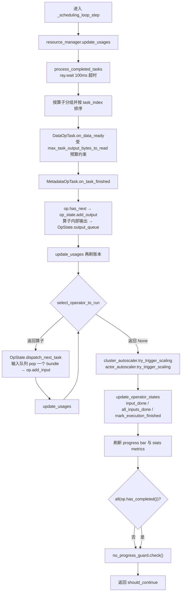

#### process_completed_tasks 的三段

`streaming_executor_state.py:593` 这个函数做三件事：

**第一段：算出每个算子的输出预算**（`:624-657`）。遍历所有背压策略，取 `max_task_output_bytes_to_read(op)` 的**最小值**（最严格的赢）。如果结果是 0，说明该算子被彻底掐住了输出——此时 `OutputBackpressureGuard` 作为逃生舱介入（`:647`）：

```python
if max_bytes_to_read == 0 and output_backpressure_guard.should_unblock(op):
    max_bytes_to_read = 1        # 放开 1 字节，保证流水线不死锁
```

**第二段：`ray.wait` 收割**（`:699-756`）：

```python
ready, _ = ray.wait(
    list(active_tasks.keys()),
    num_returns=len(active_tasks),
    fetch_local=False,                                    # 只要状态，不拉数据到本地
    timeout=WAIT_FOR_TASK_COMPLETION_TIMEOUT_S,           # 0.1s
)
```
拿到的 ready task 按算子分组，组内按 `task_index()` 排序。排序的理由在 `:707-711` 的注释里：背压策略会限制每个算子能读的 block 数，此时我们希望**少数 task 尽快跑完并释放资源**，而不是所有 task 各吐一点 block、谁都跑不完。

然后逐个调 `task.on_data_ready(budget, metadata_fetcher)`，返回值是本次读取的字节数，从预算里扣掉（clamp 到 0）。UDF 抛出的异常在这里被 `_record_errored_block`（`:662`）捕获，按 `DataContext.max_errored_blocks` 决定是忍下来还是重抛终止执行。

**第三段：把算子内部输出搬进 OpState**（`:771-775`），就是前面 7.2 引过的那五行。

#### select_operator_to_run：筛选 + 排序

`streaming_executor_state.py:898` 的实现只有两步：

```python
def select_operator_to_run(topology, resource_manager, backpressure_policies,
                           ensure_liveness, ranker) -> Optional[PhysicalOperator]:
    eligible_ops = get_eligible_operators(                 # 1. 筛
        topology, backpressure_policies, ensure_liveness=ensure_liveness
    )
    if not eligible_ops:
        return None

    ranks = ranker.rank_operators(eligible_ops, topology, resource_manager)  # 2. 排
    assert len(eligible_ops) == len(ranks), (eligible_ops, ranks)
    next_op, _ = min(zip(eligible_ops, ranks), key=lambda t: t[1])   # 取 rank 最小者
    return next_op
```

**筛选条件**在 `get_eligible_operators`（`:826`）。一个算子"可运行"必须同时满足四条（`:866-875`）：

```python
if (
    not op.has_completed()          # ① 没跑完
    and op.can_add_input()          # ② 算子自己愿意收（如 actor pool 还没就绪会返回 False）
    and state.has_pending_bundles() # ③ 输入队列里有东西
):
    if not in_backpressure:         # ④ 没有任何背压策略拦它
        op_runnable = True
        eligible_ops.append(op)
    else:
        dispatchable_ops.append(op)  # 满足 ①②③ 但被背压 → 放进备选池
```

第 ④ 条 `in_backpressure` 来自遍历所有背压策略调 `p.can_add_input(op)`，任一策略否决就算被背压，并记下**第一个**触发的策略名（用于 progress bar 显示 `[backpressured:tasks(策略名)]`，见 `format_op_state_summary`，`:1091`）。默认启用三个策略（`backpressure_policy/__init__.py:17`）：`ConcurrencyCapBackpressurePolicy`（并发上限）、`ResourceBudgetBackpressurePolicy`（资源预算）、`DownstreamCapacityBackpressurePolicy`（下游堆积）。详见第 8 章。

每轮筛选还会把结果记进 `state._scheduling_status`（`:878`），这是给 progress bar 和 issue detector 看的快照。
**保活逃生舱**（`:886-893`）——这是防死锁的关键：

```python
if (
    not eligible_ops                                       # 没有任何算子过关
    and ensure_liveness                                    # 消费者正饿着
    and all(op.num_active_tasks() == 0 for op in topology)  # 整个 DAG 一个在飞 task 都没有
):
    return dispatchable_ops        # 无视背压，放行备选池
```

`ensure_liveness` 的值就是 `self._consumer_idling()`（`streaming_executor.py:602`）：sink 的 output queue 空了，说明消费者无事可做。三个条件同时成立意味着"流水线彻底停摆且没人在干活"——此时宁可违反背压也要动起来。

**排序策略**在 `python/ray/data/_internal/execution/ranker.py`。目前只有一个实现 `DefaultRanker`（`ranker.py:72`），返回一个二元组，**越小越优先**：

```python
def rank_operator(self, op, topology, resource_manager) -> Tuple[int, int]:
    throttling_disabled = 0 if op.throttling_disabled() else 1
    return (
        throttling_disabled,                                    # 主键
        resource_manager.get_op_usage(op).object_store_memory,   # 次键
    )
```

按字典序比较：

1. **主键**：`throttling_disabled()` 为 True 的算子排 0，优先。这类算子只改 bundle 元数据、不真正占资源（典型是 `OutputSplitter`，见 `interfaces/physical_operator.py:1014` 的说明），让它们先跑没有代价。
2. **次键**：当前 object store 占用**最少**的算子优先。直觉是"雨露均沾"——给占内存最少的算子机会，避免某个算子把 object store 吃光。

注意这**不是**"优先选堆积最多的"或"优先选最下游的"。`Ranker` 是抽象基类（`ranker.py:36`），`create_ranker()`（`execution/__init__.py:55`）目前硬编码返回 `DefaultRanker()`，留了替换策略的口子。

#### update_operator_states：推进生命周期

`streaming_executor_state.py:779` 分两趟遍历：

**正向**（`:783-799`）：如果某个上游算子已 `has_completed()` 且它的 output queue 也空了，就调 `op.input_done(idx)` 通知下游"这条输入不会再来数据了"。所有输入都 done 时调 `op.all_inputs_done()`——这正是 `AllToAllOperator` 开始干活的触发点。

**反向**（`:804-823`，`reversed(topology)` 即从下游往上游）：如果一个算子的所有下游都完成了，说明没人还需要它的输出，调 `op.mark_execution_finished()` 提前收工。这是 `limit` 提前终止能传播回上游的机制。执行结束的算子会把输入队列 `clear()` 掉，释放 block ref。
### 7.4 线程模型与输出

#### 为什么必须是独立线程

`StreamingExecutor` 同时继承 `Executor` 和 `threading.Thread`（`streaming_executor.py:107`），构造函数末尾双重初始化（`:176-178`）：

```python
Executor.__init__(self, self._data_context.execution_options)
thread_name = f"StreamingExecutor-{self._dataset_id}"
threading.Thread.__init__(self, daemon=True, name=thread_name)
```

`__init__` 里的注释说明了动机（`:135-137`）：

> We run the control loop on a separate thread so that it doesn't become stalled between generator `yield`s.

考虑 `for batch in ds.iter_batches(): train_step(batch)`。用户线程在 `train_step` 里跑 GPU 训练，花 500ms。如果调度循环和消费在同一个线程，这 500ms 内没人收割完成的 task、没人给上游派发新 task——整个集群空转。放到后台线程后，用户训练的同时上游继续满负荷跑。

#### execute() 与 OutputIterator

`execute()`（`streaming_executor.py:185`）是一次性的启动序列：建 `BlockRefCounter` → `build_streaming_topology` → 建 `ResourceManager` / `OutputBackpressureGuard` / progress manager / 背压策略 / cluster autoscaler / actor autoscaler / `NoProgressGuard` → 记下 `_output_node` → 触发 `before_execution_starts` 回调 → `self.start()`（启动线程）→ 返回迭代器。

返回的类型是 `_ClosingIterator`（`streaming_executor.py:768`），它实现了 `OutputIterator` 接口（`interfaces/executor.py:10`）：

```python
class _ClosingIterator(OutputIterator):
    def get_next(self, output_split_idx: Optional[int] = None) -> RefBundle:
        try:
            op, state = self._executor._output_node
            bundle = state.get_output_blocking(output_split_idx)   # 阻塞点
            if self._executor._progress_manager:
                self._executor._progress_manager.update_total_progress(
                    bundle.num_rows() or 0, op.num_output_rows_total()
                )
            return bundle
        except BaseException as e:      # 注意是 BaseException，为了抓 KeyboardInterrupt
            self._executor.shutdown(
                force=False,
                exception=e if not isinstance(e, StopIteration) else None,
            )
            raise
```

名字里的 "Closing" 指的就是这个 `except`：**迭代器耗尽（`StopIteration`）或出任何异常，都会顺手把 executor 关掉**。文档字符串同时警告：如果迭代器没被完整消费，调用方必须自己关。
#### get_output_blocking 的阻塞语义

真正的阻塞发生在 `OpState.get_output_blocking`（`streaming_executor_state.py:482`）：

```python
starving = False
try:
    while True:
        if self._exception is not None:
            raise self._exception                     # 执行出错 → 在消费者线程重抛
        elif self._finished and not self.output_queue.has_next(output_split_idx):
            raise StopIteration()                     # 正常结束且队列空 → 迭代结束
        ref = self.output_queue.pop(output_split_idx)
        if ref is not None:
            self.op.metrics.num_external_outqueue_blocks -= len(ref.blocks)
            self.op.metrics.num_external_outqueue_bytes -= ref.size_bytes()
            return ref
        if not starving:
            with self._waiting_consumers_lock:
                self._num_waiting_consumers += 1      # 登记"我饿着"
            starving = True
        time.sleep(0.01)                              # 10ms 轮询
finally:
    if starving:
        with self._waiting_consumers_lock:
            self._num_waiting_consumers -= 1
```

这是 10ms 间隔的轮询而非条件变量，实现简单但有 10ms 的延迟抖动。`_num_waiting_consumers` 这个计数不只是统计——`OutputBackpressureGuard.should_unblock` 会读它来判断"外部消费者是否真的在饿"（`streaming_executor_state.py:166`），从而决定要不要放开输出背压。

#### 消费慢 → 背压回传的完整链条

这条链要串起来看（细节在第 8 章）：

```
消费端 train_step 慢
   ↓ sink 的 output_queue 不被 pop，持续堆积
   ↓ OpState.output_queue.memory_usage 上升
   ↓ ResourceManager.update_usages() 看到该 edge 占用增长
   ↓ 背压策略：DownstreamCapacity/ResourceBudget 判定上游算子超限
   ↓ ① can_add_input(op) 返回 False
   │     → get_eligible_operators 把它剔出 eligible_ops
   │     → select_operator_to_run 不再选它 → 停止 dispatch_next_task
   │     → 算子不再提交新 Ray task
   └ ② max_task_output_bytes_to_read(op) 降到 0
         → process_completed_tasks 不再从 streaming generator 里拉 block
         → 已在飞的 task 在 generator 的 yield 处被阻塞住
   ↓ 上游算子的输入队列开始堆积 → 递归重复以上过程
   ↓ 一直传到最上游的 read 算子停止提交 task
```

两条路径缺一不可：①管"别再提交新活"，②管"已提交的活别再吐数据"。只有①的话，在飞 task 仍会把 object store 填满。
#### 异常传播

worker 上 UDF 抛的异常，路径是这样的：

1. worker 抛异常 → Ray task 失败 → `DataOpTask.on_data_ready` 在拉取时抛出；
2. `process_completed_tasks` 的 `_record_errored_block`（`streaming_executor_state.py:662`）按 `max_errored_blocks` 预算决定：还有额度就 `logger.error` 然后忍下来；额度耗尽就 `raise e from None`；
3. 异常穿过 `_scheduling_loop_step`，被 `run()` 的 `except Exception as e: exc = e` 接住（`streaming_executor.py:451`）——**不在调度线程里抛，那样只会打印到 stderr 而用户线程毫无察觉**；
4. `finally` 里 `state.mark_finished(exc)`（`streaming_executor.py:456`），把异常存进 sink `OpState._exception`（`streaming_executor_state.py:541`）；
5. 用户线程下一次 `get_output_blocking` 循环检查到 `self._exception is not None`，在**用户线程**重新抛出；
6. `_ClosingIterator.get_next` 的 `except BaseException` 顺手 `shutdown(force=False, exception=e)`，然后原样 `raise`。

用户拿到的是一个带完整 traceback、发生在自己调用栈上的异常，而 executor 已经清理完毕。

#### shutdown 与提前退出

`shutdown(force, exception)`（`streaming_executor.py:305`）在 `_shutdown_lock`（可重入锁）保护下执行，靠 `self._shutdown` 标志幂等。顺序是：

1. 置 `self._shutdown = True`，调度循环下一轮会自己 `break`（`:449`）；
2. `self.join(timeout=2.0)`——给调度线程 2 秒收尾，超时就不等了；
3. `self._metadata_fetcher.stop()`（必须在 join 之后，喂它数据的线程已停）；
4. 冻结 stats、关 progress bar、打印总结；
5. `for op in self._topology.keys(): op.shutdown(timer, force=force)` —— 每个算子取消在飞 task、销毁 actor。取消逻辑在 `PhysicalOperator._cancel_active_tasks`（`interfaces/physical_operator.py:1172`）：先对所有 task 调 `_cancel(force)`；**只有 `force=True` 时**才逐个 `ray.get` 等待真正终止；
6. `_clear_topology_queues_post_shutdown`（`:404`）清空所有队列以释放 object ref。这里有个精细处理：sink 的 output queue 在"多 split 且非强制、无异常"的情况下**不清**，因为 `streaming_split` 的各个 split 可能还在读；
7. 触发 `after_execution_succeeds` / `after_execution_fails` 回调，通知 cluster autoscaler 撤销资源请求。

`force` 的语义（`interfaces/executor.py:75`）：`force=True` 保证方法返回时所有活动都已停止；`force=False` 允许异步终止。三种触发路径：

- **`take(10)` 这类阻塞 API**：拿够行数后调 `_synchronize_progress_bar()`（`python/ray/data/dataset.py:8288`）→ `shutdown(force=True)`。强制是为了避免调度线程的日志把控制台输出搅乱（issue #32414）。
- **`with self._create_executor() as executor:`**（`dataset.py:8415`）：`Executor.__exit__` 调 `shutdown(force=True, exception=exc_value)`。
- **垃圾回收**：`StreamingExecutor.__del__` 和 `_ClosingIterator.__del__` 都调 `shutdown(force=False)`——GC 时不该同步阻塞。
### 7.5 卡死检测与自动伸缩

#### NoProgressGuard：排查 hang 的第一道防线

`python/ray/data/_internal/execution/no_progress_guard.py` 解决的是最恶心的一类问题：作业既不报错也不推进，就那么挂着。

判定标准是一个三元组快照（`no_progress_guard.py:19`）：

```python
@dataclass(frozen=True)
class OperatorState:
    num_outputs_taken: int                  # 累计取走的输出数
    total_enqueued_input_blocks: int        # 当前输入队列 block 数
    total_enqueued_output_blocks: int       # 当前输出队列 block 数
```

每轮循环末尾（`streaming_executor.py:589`）调 `check()`（`no_progress_guard.py:82`）：

```python
current_progress_states = self._current_progress_states()   # 全部算子的三元组列表
execution_made_progress = current_progress_states != self._last_progress_states
if execution_made_progress:
    self._last_progress_states = current_progress_states
    self._last_progress_time = current_time
    return

if current_time - self._last_progress_time >= self._timeout_s:
    raise ExecutionTimeoutError(self._error_message())
```

"有进展"的定义很宽松：**任何一个算子的任一计数发生变化**就算。这意味着 block 进队、出队、被消费，都会重置计时器。默认超时是 `DataContext.execution_no_progress_timeout_s`，值为 30 分钟（`python/ray/data/context.py:193`），`-1` 关闭。

抛出的错误信息（`no_progress_guard.py:109`）会列出所有未完成的算子及其活跃/完成 task 数和已取输出数——这就是定位 hang 在哪一环的直接线索。

`enabled` 是 `cached_property`（`:68`），并且**遇到 `AllToAllOperator` 或 `HashShufflingOperatorBase` 就整体禁用**：这两类算子在 `_bulk_fn` 里长时间不动计数，需要特殊判定逻辑，而它们正在被 V2 hash shuffle 取代，代码里选择不支持。
#### 另外两个保活机制

除了 guard，前面已经出现过两个更细粒度的逃生舱，值得一起归纳：

- **`get_eligible_operators` 的 liveness 分支**（`streaming_executor_state.py:886`）：整个 DAG 无在飞 task 且消费者饿着时，无视背压放行备选算子。
- **`OutputBackpressureGuard`**（`streaming_executor_state.py:126`）：当所有背压策略把某算子的输出预算压到 0 字节时，`should_unblock` 决定是否放开 1 字节。它的判定分层（`:144-195`）：
  - 该算子是终端算子：无外部消费者（如 write 流水线）→ 直接放开；有外部消费者 → 只在 `num_waiting_consumers > 0`（消费者真饿）时放开，避免慢消费者场景下 block 堆积；
  - 有下游算子且下游 `num_active_tasks() == 0`：下游因资源不足无法提交 → 放开（让上游 task 完成以释放资源）；下游能提交但输入队列空 → 放开（至少给它一个 block）；
  - 都不满足，最后看 `IdleDetector.detect_idle(op)`（`:89`）——每 10 秒检测一次输出计数有没有涨，没涨就放开，并在闲置超 60 秒时打印一次警告（`:106`），提示用户可能是集群资源被非 Data 任务抢占。

这套逃生舱之所以必要，是因为背压策略是保守的近似：它宁可错杀也不放过，所以必须有机制保证"错杀导致死锁"时能自我修复。

#### 集群自动伸缩

Ray Core 的 autoscaler 是**被动**的：看到 pending task 才扩容。Ray Data 有更多信息——它知道自己还有多少待处理数据、各算子的资源缺口——所以选择**主动**发请求。

入口是 `create_cluster_autoscaler`（`python/ray/data/_internal/cluster_autoscaler/__init__.py:35`），默认返回 `DefaultClusterAutoscalerV2`（`default_cluster_autoscaler_v2.py:164`）；用户指定了 `PlacementGroupSchedulingStrategy` 时换成 `PlacementGroupClusterAutoscaler`（PG bundle 已经精确描述了需求，通用扩容反而会拉起没用的节点）。

`try_trigger_scaling()`（`default_cluster_autoscaler_v2.py:290`）每轮循环被调一次，逻辑是：

1. `observe()` 采样当前资源利用率（滚动窗口默认 10 秒，`RAY_DATA_CLUSTER_UTIL_AVG_WINDOW_S`）；
2. 限频：距上次请求不足 10 秒就返回（`RAY_DATA_MIN_GAP_BETWEEN_AUTOSCALING_REQUESTS`）；
3. CPU/GPU/memory/object_store_memory **四个维度的窗口平均利用率全部低于阈值**（默认 0.75，`RAY_DATA_CLUSTER_SCALING_UP_UTIL_THRESHOLD`）→ 不扩容；
4. 否则按**节点形状（node shape）**构造请求：现有每个 worker 形状各算一份 `active_bundles`（"这些节点我要保住"），再按 `cluster_scaling_up_delta`（默认每种形状 +1）加一份 `pending_bundles`（"这些是我想要的增量，尽力而为"），最后用 `cap_resource_request_to_limits` 按 `resource_limits` 截断。

和 V1 的关键区别写在类文档里（`:172-174`）：请求的 bundle 是**整台节点的资源规格**而不是 `incremental_resource_usage()`（单个 task 的增量）。原因是当扩容动机来自内存压力时，只要几个 CPU 的增量请求根本触发不了扩容——现有 CPU 就能满足。**缩容不在这里处理**，靠 Ray 的空闲节点回收。

`get_total_resources()`（`:427`）反向为 `ResourceManager` 提供"这次执行实际能用多少资源"——来自 `AutoscalingCoordinator` 的预留（reservation），多个 Dataset 并发时靠它分账。
顺带说明：`python/ray/data/_internal/execution/autoscaling_requester.py` 里的 `AutoscalingRequester` actor 是**上一代实现的残留**。全仓库 grep 只有该文件内部引用它，`StreamingExecutor` 走的是 `cluster_autoscaler/` 这条路。它的思路（按 `execution_id` 记录最新请求、聚合后调 `ray.autoscaler.sdk.request_resources`、60 秒 TTL 过期清理、CPU 请求向上取整到超过集群总量以便真正触发扩容，`autoscaling_requester.py:85-98`）已经被 `DefaultAutoscalingCoordinator` 继承。读代码时不必在它上面花时间。

#### dataset_state.py：对外状态快照

`python/ray/data/_internal/execution/dataset_state.py` 只有一个枚举：

```python
class DatasetState(enum.IntEnum):
    UNKNOWN = 0
    RUNNING = 1
    FINISHED = 2
    FAILED = 3
    PENDING = 4
```

用在 `_update_stats_metrics(state=...)`（`streaming_executor.py:724`）：每轮循环报 `RUNNING`，shutdown 时按有无异常报 `FINISHED`/`FAILED`，并有 5 秒的节流（`UPDATE_METRICS_INTERVAL_S`，`:115`）。配套的 `_get_state_dict`（`:699`）组装出给 Ray Dashboard 用的快照：整体进度/总量/行数，以及每个算子的名字、进度、`queued_blocks`、状态。

### 7.6 执行选项

`ExecutionOptions`（`python/ray/data/_internal/execution/interfaces/execution_options.py:372`）是标记为 `@DeveloperAPI` 的调优旋钮，通过 `DataContext.get_current().execution_options` 访问。当前**真正生效**的字段只有四个：

| 字段 | 默认值 | 影响调度循环的哪一环 |
|---|---|---|
| `resource_limits` | 各维度 `inf` | `ResourceManager.get_global_limits()` 的上限；背压策略据此算预算；cluster autoscaler 用它截断扩容请求（`default_cluster_autoscaler_v2.py:333`） |
| `preserve_order` | `False` | `MapOperator.start()` 选队列实现（`operators/map_operator.py:497`）；`OutputSplitter` 忽略 locality hint（`operators/output_splitter.py:135`） |
| `verbose_progress` | `True`（`RAY_DATA_VERBOSE_PROGRESS`） | 传给 `get_progress_manager`（`streaming_executor.py:255`），决定是否为每个算子单独显示进度条 |
| `label_selector` | `None` | 给本 Dataset 的所有 task/actor 打标签选择器；也传给 cluster autoscaler 做 subcluster 隔离 |

三个已废弃字段，读代码时会遇到：

- **`locality_with_output`**（`:528`）：已完全移除，getter 恒返回 `False`，setter 传真值只打一条 `DeprecationWarning`。彻底的 no-op。
- **`actor_locality_enabled`**（`:497`）：setter 会警告（2027 年 1 月后移除），Ray Data 现在内部自己管 actor locality。
- **`exclude_resources`**（`:474`）：setter 会警告，官方建议改用 `label_selector`。内部有个 `_set_exclude_resources`（`:491`）供 Train v1 无警告调用。

`validate()`（`:516`）在 `Executor.__init__` 里被调（`interfaces/executor.py:49`），只做一件检查：同一个资源维度上 `resource_limits` 和 `exclude_resources` 不能同时设置。
#### preserve_order 的取舍

默认 `False` 能提高吞吐，原因很直接：

```
preserve_order=False   task 完成即产出
  task#0 ████████████████████ (慢)
  task#1 ████               ↓ 立刻交给下游
  task#2 █████              ↓ 立刻交给下游
  下游         ██  ███  ...  ← 不等 task#0

preserve_order=True    必须按 task_index 顺序产出
  task#0 ████████████████████ (慢)
  task#1 ████ ─────── 结果在 ReorderingBundleQueue 里排队等待 ──┐
  task#2 █████ ────── 结果在 ReorderingBundleQueue 里排队等待 ──┤
  下游                                            ██ ██ ███ ←──┘
                                                  ↑ 被最慢的 task 拖住
```

`preserve_order=True` 时 `MapOperator` 的输出队列换成 `ReorderingBundleQueue`（`operators/map_operator.py:497`），结果必须按 `task_index` 连续出队。一个慢 task 会把它后面所有已完成的结果都堵在队列里——**既拖延迟，又占内存**。

必须开 `True` 的场景由框架自动判断（`python/ray/data/dataset.py:8358`）：

```python
if preserve_order or self._logical_plan.require_preserve_order():
    executor._options.preserve_order = True
```

`require_preserve_order()` 覆盖 `zip`（两侧必须行对行对齐）、`sort` 这类计划。用户手动开的典型理由是：结果要写成有序文件，或者调试时需要可复现的输出顺序。

### 7.7 回调机制

`ExecutionCallback`（`python/ray/data/_internal/execution/execution_callback.py:7`）是外部系统挂钩执行生命周期的口子，只有四个方法：

```python
class ExecutionCallback:
    def before_execution_starts(self, executor): ...          # execute() 末尾，start() 之前
    def on_execution_step(self, executor): ...                # 每轮调度循环之后
    def after_execution_succeeds(self, executor): ...         # shutdown 且无异常
    def after_execution_fails(self, executor, error): ...     # shutdown 且有异常
```

触发点分别在 `streaming_executor.py:291`（before）、`:447`（step）、`:383` / `:386`（succeeds/fails）。回调实例由 planner 创建（`python/ray/data/_internal/planner/planner.py:271`），随 `execute(dag, initial_stats, callbacks)` 传入。
注册方式有三条（`python/ray/data/context.py:1264` 的 `execution_callback_classes`）：

1. **内建**（`context.py:1293`）：`ExecutionIdxUpdateCallback`（成功后给 `DataContext._execution_idx` 加一）、`IssueDetectionExecutionCallback`、`ResourceAllocatorPrometheusCallback`；
2. **环境变量** `RAY_DATA_EXECUTION_CALLBACKS`：逗号分隔的 `module.path.ClassName`，动态 import 并校验是 `ExecutionCallback` 子类（`context.py:1300-1325`）；
3. **代码注册**：追加到 `DataContext.custom_execution_callback_classes`（`context.py:1034`）。

两个内建回调很好地示范了这个机制能干什么：

- **`IssueDetectionExecutionCallback`**（`callbacks/insert_issue_detectors.py:14`）：`before_execution_starts` 里往 executor 上挂一个 `IssueDetectorManager`，`on_execution_step` 里每轮跑一次 `invoke_detectors()`。这就是"高延迟算子""数据倾斜"这类告警的来源。
- **`ResourceAllocatorPrometheusCallback`**（`callbacks/resource_allocator_prometheus_callback.py:13`）：`on_execution_step` 里把每个算子的 CPU/GPU/memory/object-store 预算和 `max_bytes_to_read` 写进 Prometheus Gauge。

注意回调拿到的是**整个 executor 对象**，可以读 `_topology`、`_resource_manager`、`_dataset_id`——权限很大，也确实没有做任何封装。文档字符串（`context.py:1274`）还提到两个不走这条路的回调：`LoadCheckpointCallback` 和 `UsageCallback` 需要构造参数，由 planner 直接实例化后追加。

`Executor.execute` 的 docstring 里有一句容易踩的坑（`interfaces/executor.py:65`）：这个方法**保留并直接使用你传进来的那个 list 对象**，所以不要传字面量 `[]`——先建好 list 再传。

---

读到这里，`streaming_executor.py` 的 807 行应该不再有黑盒：`execute()` 搭台，`run()` 转圈，`_scheduling_loop_step` 每轮做「收割 → 选算子 → 派发 → 推进生命周期 → 检查完成/卡死」，`_ClosingIterator` 把 sink 的输出交给用户线程并在结束时清场。剩下唯一没展开的是"背压策略凭什么说某个算子该停"——那是下一章的内容。

---

## 8. 资源管理、背压与内存

第 7 章把 StreamingExecutor 的调度循环拆开了，但留了三个洞：`get_eligible_operators` 里那些背压策略凭什么说某个算子"该停"？`update_usages` 到底在算什么账？`max_task_output_bytes_to_read` 这个预算数字从哪来？

这一章补上。主角是 `ResourceManager`（`python/ray/data/_internal/execution/resource_manager.py`，933 行），它是流式执行的"财务部"：统计每个算子花了多少资源、给每个算子发预算。背压策略只是照着这本账执行的门卫。

### 8.1 ExecutionResources：资源的四个维度

`ExecutionResources`（执行资源）定义在 `python/ray/data/_internal/execution/interfaces/execution_options.py:13` —— 注意**不在** `interfaces/common.py`（那个文件里只有 histogram 工具和 `NodeIdStr`）。它是个只有四个字段的不可变值对象（`__slots__`，见 `execution_options.py:24`）：

| 维度 | 字段 | 含义 | 超限后果 |
|---|---|---|---|
| CPU | `cpu` | 逻辑 CPU slot 数（可为小数） | 任务排队，不会崩 |
| GPU | `gpu` | 逻辑 GPU slot 数 | 任务排队，不会崩 |
| 堆内存（heap memory） | `memory` | worker 进程的逻辑内存（字节） | 节点真实内存打满 → OOM-kill |
| 对象存储（object store） | `object_store_memory` | 节点级 plasma 共享内存（字节） | spill 到磁盘，吞吐骤降 |

#### 为什么 object store 内存必须单独算一维

新手最容易把这两种内存混成一个。它们在物理上是完全不同的两块：

```
                ┌──────────────── 一台 Ray 节点 ──────────────────┐
 worker 进程私有 │  ┌──────────┐ ┌──────────┐ ┌──────────┐        │
 的堆内存        │  │ worker 1 │ │ worker 2 │ │ worker 3 │  ...   │
 = `memory` 维度 │  │  heap    │ │  heap    │ │  heap    │        │
                │  └────┬─────┘ └────┬─────┘ └────┬─────┘        │
                │       │  零拷贝读   │            │              │
                │  ┌────▼────────────▼────────────▼────────────┐ │
 节点级共享的    │  │    plasma 共享内存池（object store）        │ │
 plasma 内存     │  │    = `object_store_memory` 维度            │ │
                │  └────────────────────┬───────────────────────┘ │
                │                        │ 满了就 spill            │
                │                   ┌────▼─────┐                  │
                │                   │  本地磁盘 │                  │
                │                   └──────────┘                  │
                └────────────────────────────────────────────────┘
```

- `memory` 是**进程私有**的。UDF 里 `pd.concat` 出来的那份数据、模型权重、Arrow→pandas 转换的副本都算在这里。打满了 Ray 的 memory monitor 会**杀进程**。
- `object_store_memory` 是**节点级共享**的，block（数据块）就存在这里，多个 worker 零拷贝读同一个 block。打满了 Ray 把冷数据**写到磁盘**（spill），不杀进程。

所以 object store 是"软"约束，`memory` 是"硬"约束。这个区别是本章最后一节全部排障逻辑的根源。

#### 一个类，两种语义

同一个类既表示"用了多少"（usage），也表示"上限是多少"（limit），靠构造方式区分：

```python
# execution_options.py:43-46 —— 表示用量：未指定的维度折算成 0
self._cpu = safe_round(cpu, 5)                            # CPU 保留 5 位小数
self._object_store_memory = safe_round(object_store_memory, 0)  # 内存取整到字节

# execution_options.py:90-95 —— 表示上限：未指定的维度是 inf
return ExecutionResources(cpu=safe_or(cpu, float("inf")), gpu=safe_or(gpu, float("inf")),
                          object_store_memory=safe_or(object_store_memory, float("inf")),
                          memory=safe_or(memory, float("inf")))
```

`property` 读取时 `None` 一律折算成 0（`execution_options.py:97-111`），所以用量语义下的 `ExecutionResources()` 就是全零；而 `for_limits()` 造出来的四维全是 `inf`。`inf` 会一路穿透所有运算 —— 8.3 会用到这一点：把某算子的 `object_store_memory` 预算设成 `inf`，等价于对它关闭对象存储背压。

#### 运算语义

所有运算都是逐维度的、返回新对象的：

- `add` / `subtract`（`:254`、`:270`）：逐维加减，**不 clamp**，可以减出负数。所以调用方几乎总是紧跟一个 `.max(ExecutionResources.zero())`（`resource_manager.py:246-250` 就是这个套路）。
- `max` / `min`（`:286`、`:297`）：逐维取大/取小，用来 clamp 和取交集。
- `scale(f)`（`:336`）：等比缩放，特意单独处理 `f == 0`，因为 `0 * inf = nan`。
- `combine` / `combine_sum`（`:162`、`:195`）：一次遍历折叠一批资源、只分配一个结果对象；调度热路径上每轮跑很多次。
- `zero()` / `inf()`（`:140`、`:153`）：`functools.cache` 的共享单例。
- `satisfies_limit(limit, *, ignore_object_store_memory=False)`（`:308`）：四维**全部** `<=` 才为 True。

`ignore_object_store_memory` 这个开关值得单说。理由写在 `resource_manager.py:716-718`：**object store 内存可以超额认购（oversubscribe），CPU/GPU 不行**。超了 object store 只是 spill；超了 CPU 则 Ray Core 直接拒绝调度、任务永远 pending。所以做"这个算子能不能至少跑起来一个 task"的可行性判断时，故意忽略 object store 维度。

### 8.2 ResourceManager：全局资源账本

`ResourceManager`（`resource_manager.py:88`）要回答三个问题。

#### 问题一：整个集群有多少可用资源？

`get_global_limits()`（`resource_manager.py:269`）：

```python
if (time.time() - self._global_limits_last_update_time
        < self.GLOBAL_LIMITS_UPDATE_INTERVAL_S):        # 1 秒，见 :92
    return self._global_limits                          # 缓存命中直接返回
default_limits = self._options.resource_limits          # 用户设的硬上限（默认全 inf）
total_resources = self._get_total_resources()           # 来自 cluster autoscaler
total_resources = total_resources.copy(                 # object store 只取一个 fraction
    object_store_memory=total_resources.object_store_memory * default_mem_fraction)
self._global_limits = (default_limits.min(total_resources)   # 用户上限 ∩ 集群实际
                       .subtract(exclude)                   # exclude_resources（已废弃）
                       .max(ExecutionResources.zero()))     # 夹到非负
```

三个要点：

- **1 秒刷新一次**（`GLOBAL_LIMITS_UPDATE_INTERVAL_S`，`:92`）。集群在自动伸缩，每次返回值可能不同。`_get_total_resources` 的实现是 `self._cluster_autoscaler.get_total_resources()`（`_internal/execution/streaming_executor.py:240`），最终来自 autoscaling coordinator **已经预留给这次执行**的资源（`_internal/cluster_autoscaler/default_cluster_autoscaler_v2.py:427-433`）—— 不是裸的 `ray.cluster_resources()`。
- **object store 只用一个 fraction**：开启资源预留时 0.5（`DEFAULT_OBJECT_STORE_MEMORY_LIMIT_FRACTION`，`:97`，可用 `RAY_DATA_OBJECT_STORE_MEMORY_LIMIT_FRACTION` 覆盖），关闭时降到 0.25（`:104`）。留一半是安全垫：账本本身是估算的、spill 有延迟、还有别的负载共享 plasma。用户可用 `DataContext.override_object_store_memory_limit_fraction` 强改。
- **最后 clamp 到非负**。注释（`:291-293`）说明原因：Ray Train 预留的 CPU 可能比 Ray Data 看到的集群总量还多，`subtract` 会减成负数。

#### 问题二：每个算子用了多少？

`update_usages()`（`resource_manager.py:191`）。第 7 章说过它每轮被调多次（每派发一次 task 就重算），代码里的 TODO 也承认有冗余。流程是：清空三张表 → **从下游往上游**遍历拓扑 → 逐算子记账 → 汇总 → 更新预算。

```python
for op, state in reversed(self._topology.items()):     # 注意是 reversed
    op_usage = op.current_logical_usage()              # CPU / GPU / heap memory
    op_running_usage = op.running_logical_usage()      # 已在跑的那部分
    op_pending_usage = op.pending_logical_usage()      # 还在等资源的 actor
    assert not op_usage.object_store_memory            # 算子自己不报对象存储用量
    used_object_store = self._estimate_object_store_memory_usage(op, state)
    op_usage = op_usage.copy(object_store_memory=used_object_store)
    # ...
    op._metrics.obj_store_mem_used = op_usage.object_store_memory   # 喂给 dashboard
```

三个口径的关系（定义在 `_internal/execution/interfaces/physical_operator.py:1044`、`:1061`、`:1077`）：`running = current - pending`，`pending` 默认 0，只有 actor pool 类算子（actor 已申请、还没起来）才非零。progress bar 上显示的是 `running`。

CPU/GPU/heap 三维由算子自报；对象存储那一维由 ResourceManager 自己算，拆成两部分：

```python
# resource_manager.py:178-189
def _estimate_object_store_memory_usage(self, op, state) -> int:
    if isinstance(op, InputDataBuffer):
        return 0    # 输入 ref 在执行开始前就存在，不计入动态用量
    # (1) 内部：正在跑的 task 已产出、还没被拉取的 block（估算值）
    self._mem_op_internal[op] = op.metrics.obj_store_mem_pending_task_outputs or 0
    # (2) 输出：这个算子产出的、仍然活着的所有 block
    self._mem_op_outputs[op] = op.estimate_object_store_usage()
    return self._mem_op_outputs[op] + self._mem_op_internal[op]
```

#### 关键：按"生产者"归属，所以队列别名不会重复计账

第 7 章强调过一个容易踩坑的设计：下游的 `input_queue` 和上游的 `output_queue` 是**同一个 `OpBufferQueue` 对象**。如果按队列记账，这份字节数会被上下游各记一次。

Ray Data 的解法是换记账维度：**按生产者（producer）归属，而不是按位置归属**。`estimate_object_store_usage()` 的默认实现只有一行（`physical_operator.py:1053-1058`）：

```python
return self._block_ref_counter.get_object_store_memory_usage(self.id)
```

`BlockRefCounter`（`_internal/execution/block_ref_counter.py:9`，第 2 章介绍过）维护一张 `producer_id -> 活着的总字节数` 表。block 产出时 `on_block_produced(block_ref, size_bytes, producer_id)` 加账（`:39`）并向 Ray Core 注册 out-of-scope 回调；当**所有** Python `ObjectRef` 都被 GC、**且所有**拿它当参数的 task 都结束后，回调触发扣账（`:60-66`）。

于是"这个 block 现在躺在哪个队列里"完全无关紧要 —— 只要还活着，就记在生产它的算子头上，且只记一次。几个漂亮的推论：

- 队列别名天然不会双算。
- 用户迭代器（`iter_batches` / `streaming_split`）预取住的 block 也自动算进末端算子的用量，因为那些 ref 还活着。`_external_consumer_bytes`（`resource_manager.py:137`，由 `iterator.py:262`、`_internal/iterator/stream_split_iterator.py:470` 上报）只用于**展示**和 DownstreamCapacity 策略的分母，不参与 usage 累加。
- 特例：`ShuffleMapOp` 把它覆写成返回 0（`_internal/execution/operators/shuffle_operators/shuffle_map_operator.py:431-434`），因为 map 侧的中间分区由 reduce 侧管，背压也在 reduce 侧做。

> **与常见描述的一处偏差**：算子的对象存储用量**不是** "BlockRefCounter + 队列 `estimate_size_bytes()`" 之和，而是 "BlockRefCounter（输出）+ `obj_store_mem_pending_task_outputs`（在飞 task 的生成器缓冲）"。队列的 `estimate_size_bytes()` 只出现在 `OpRuntimeMetrics` 的展示型指标（`obj_store_mem_internal_inqueue` 等，`_internal/execution/interfaces/op_runtime_metrics.py:766`）和 DownstreamCapacity 策略的分母里。

`_mem_op_internal` 是**估算**值：`obj_store_mem_pending_task_outputs`（`op_runtime_metrics.py:794`）= `在跑的 task 数 × obj_store_mem_max_pending_output_per_task`，后者（`:819`）= `min(_max_num_blocks_in_streaming_gen_buffer, 平均每 task 输出块数) × average_bytes_per_output`。`_max_num_blocks_in_streaming_gen_buffer` 默认 2（`context.py:331`）。注释特意提醒：**不要**假设它至少有一个 `target_max_block_size`，否则输出很小的算子会永远调度不出去。

#### 问题三：总共用了多少？

三行 `combine_sum` 把逐算子用量卷成全局（`resource_manager.py:232-238`），然后更新预算：

```python
# resource_manager.py:243-252
completed_ops_usage = self._get_completed_ops_usage()
available_limits = (self.get_global_limits().subtract(completed_ops_usage)
                    .max(ExecutionResources.zero()))
self._op_resource_allocator.update_budgets(limits=available_limits)
```

已经执行完、但输出队列里还压着数据的算子（`_get_completed_ops_usage`，`:468`），它占的内存要从"可分配总量"里**先扣掉** —— 不该再给它发预留。连同它下游那些"不合格"算子一起扣。

#### 不合格算子与"分组"

`is_op_eligible(op)`（`resource_manager.py:424`）：

```python
return (not op.throttling_disabled()        # 只改 metadata 的算子（如 OutputSplitter）
        and not op.has_execution_finished())
```

不合格（ineligible）算子**不受节流**，但它占的内存不能凭空消失 —— 规则是**归到它上游最近的那个合格算子头上**。`_get_downstream_ineligible_ops`（`:433`）和 `get_downstream_eligible_ops`（`:447`）实现穿透查找，`get_op_usage(op, include_ineligible_downstream=True)`（`:301`）返回带下游的合计。

所以对 `map1 -> limit1 -> limit2 -> map2`，账本上其实是两个组：`{map1, limit1, limit2}` 和 `{map2}`。`limit` 只做元数据裁剪，单独给它预留资源毫无意义。

#### progress bar 上看到的那串数字

`get_op_usage_str`（`resource_manager.py:341`）拼出来的。默认只有摘要；`verbose_progress` 打开（或设 `RAY_DATA_DEBUG_RESOURCE_MANAGER=1`，`:41`）后追加：

```
1.0 CPU, 256.0MB object store (in=64.0MB,out=192.0MB), alloc=(cpu=...,obj_store=...),
budget=(cpu=1.0,mem=0B,gpu=0.0,obj_store=128.0MB,out=64.0MB)
```

- `in=` → `_mem_op_internal`（在飞 task 的生成器缓冲）
- `out=` → `_mem_op_outputs`（已产出、仍活着的 block）
- `alloc=` → `budget + usage`，这个算子的总配额
- `budget=` → 还剩多少可花
- `budget` 里的 `out=` → `_output_budgets[op]`，即 `max_task_output_bytes_to_read` 上次算出的值

排障时这行最有信息量：`budget` 的 `obj_store=0B` 就意味着这个算子被内存预算掐住了。

### 8.3 ReservationOpResourceAllocator：为什么不能"先到先得"

`OpResourceAllocator` 是抽象接口（`resource_manager.py:539`），当前只有一个实现：`ReservationOpResourceAllocator`（`:625`）。工厂函数在 `_internal/execution/__init__.py:24`，版本枚举 `OpResourceAllocatorVersion` 目前只有 `V1`（`:20-21`）—— 环境变量 `RAY_DATA_USE_OP_RESOURCE_ALLOCATOR_VERSION` 存在但没有别的值可选。`DataContext.op_resource_reservation_enabled` 默认 `True`（`context.py:305`），是个历史 kill-switch。

#### 先到先得为什么会死锁

这是流式执行特有的风险。设想 `read -> map -> write`，资源先到先得：

```
  read 抢光了 object store / CPU
        │
        ▼
  read 疯狂产出 block，堆在 read→map 的队列里
        │
        ▼
  map 想起 task 处理这些 block ── 但已经没有余量给 map 的输出（或 CPU 被占满）
        │
        ▼
  map 起不来 → 队列里的 block 没人消费 → read 的输出永远不会被释放
        │
        ▼
  ┌────────────────────────────────┐
  │  死锁 / spill 风暴 / 节点 OOM   │
  └────────────────────────────────┘
```

批处理引擎没有这个问题 —— 上一个 stage 跑完资源就全释放了。流式执行里上下游**同时活着**，谁也不会先退场，所以必须**先给每个人留一份**。

#### 预留比例与两级切分

`reservation_ratio` 来自 `DataContext.op_resource_reservation_ratio`，默认 **0.5**（`DEFAULT_OP_RESOURCE_RESERVATION_RATIO`，`context.py:309`，环境变量 `RAY_DATA_OP_RESERVATION_RATIO`）。类文档（`resource_manager.py:645-648`）说得很直白：调高 → 分配更均匀但可能利用率不足；调低 → 更激进但更容易饿死下游。

`_update_reservation`（`:683`）的核心：

```python
# 每个合格算子先分到 ratio * 总量 / 算子数
default_reserved = limits.scale(self._reservation_ratio / (len(eligible_ops)))
# 其中至少一半的 object store 只给"输出"用（CPU/GPU 都是 0：拉块不需要 CPU）
reserved_for_outputs = ExecutionResources(
    0, 0, max(default_reserved.object_store_memory / 2, 1))
reserved_for_tasks = default_reserved.subtract(reserved_for_outputs)
```

为什么要把预留再劈成两半？注释（`:661-667`）解释：如果不单独给输出留一块，预算会被在飞 task 的生成器缓冲和内部输出队列（`preserve_order=True` 时尤其严重）吃干，结果**没有预算把 block 从算子里拉出来** —— 又是一种活锁。

然后用算子自报的 min/max 夹一下（`:708-713`）：

```python
min_resource_usage, max_resource_usage = op.min_max_resource_requirements()
if min_resource_usage is not None:
    reserved_for_tasks = reserved_for_tasks.max(min_resource_usage)  # 至少够跑一个 task
if max_resource_usage is not None:
    reserved_for_tasks = reserved_for_tasks.min(max_resource_usage)  # 别超过它用得完的量
```

`min_max_resource_requirements` 的语义是"跑一个 task 的资源"和"跑满 `concurrency` 个 task 的资源"（`_internal/execution/operators/task_pool_map_operator.py:235-264`）；max 的 object store 维度故意设成 `inf`，因为没人知道一个 task 会输出多少。

#### 划分全景图

```
  集群 object store 总量（autoscaling coordinator 预留给本次执行的那份）
  ├─────────────────────────────────────────────────────────────────────┤
  │  × DEFAULT_OBJECT_STORE_MEMORY_LIMIT_FRACTION (0.5)
  ▼
  global_limits.object_store_memory                 （另外 50% 是安全垫）
  ├────────────────────────────────────┬────────────────────────────────┤
  │  预留区 = ratio(0.5) × global_limits │  共享池 _total_shared（余下 50%）│
  ├──────────┬──────────┬──────────────┤                                │
  │  op1 份额 │  op2 份额 │   op3 份额    │  按需分配，每轮重新切分          │
  │ (总量/3)  │          │              │                                │
  ├─────┬────┼─────┬────┼─────┬────────┤                                │
  │tasks│out │tasks│out │tasks│  out   │                                │
  │ 1/2 │1/2 │ 1/2 │1/2 │ 1/2 │  1/2   │                                │
  └─────┴────┴─────┴────┴─────┴────────┴────────────────────────────────┘
     ↑      ↑
     │      └── _reserved_for_op_outputs[op]：只用于把 block 拉出算子
     └── _op_reserved[op]：给在飞 task 用（含 CPU/GPU/heap）

  每轮每个算子拿到的预算 = max(op_reserved − 自己用掉的, 0) + 共享池的均分份额
```

#### 集群太小时的降级

如果剩余资源连"给这个算子留够跑一个 task"都做不到（`:719-738`）：

```python
if reserved_for_tasks.add(reserved_for_outputs).satisfies_limit(
        remaining, ignore_object_store_memory=True):     # 只看 CPU/GPU
    self._reserved_min_resources[op] = True
else:
    self._reserved_min_resources[op] = False
    # 只保住最低的 object store，CPU/GPU 一律归零（Ray Core 不允许超额认购）
    reserved_for_tasks = ExecutionResources(0, 0, min_resource_usage.object_store_memory)
```

降级策略是**优先保上游**：遍历顺序就是拓扑顺序，先来先占；下游拿不到最低预留没关系，它可以等上游跑完释放资源（注释 `:733-735`）。

如果连**第一个**算子都留不足（`index == 0`），`_warn_if_op_starved_too_long`（`:754`）会在持续饥饿超过 `STARVATION_WARNING_DELAY_S`（默认 60 秒，`RAY_DATA_STARVATION_WARNING_DELAY_S`，`:50`）后打一条 `Cluster resources are not enough to run any task from ...` 的 warning。延迟 60 秒是为了避开集群正在扩容的窗口，避免误报。

#### 每轮的预算计算

`update_budgets`（`resource_manager.py:827`）分四步。第一步算"自己的预留还剩多少"（`:842-871`）：

```python
op_mem_usage = self._resource_manager.get_mem_op_internal(op)          # 在飞输出
op_outputs_usage = self._resource_manager.get_mem_op_outputs(
    op, include_ineligible_downstream=True)                            # 含下游不合格算子
op_mem_usage += max(op_outputs_usage - self._reserved_for_op_outputs[op], 0)
#   ↑ 只有超出"输出专用预留"的部分，才算侵占了 task 预留
op_reserved_remaining = op_reserved.subtract(op_usage).max(ExecutionResources.zero())
self._op_budgets[op] = op_reserved_remaining
remaining_shared = remaining_shared.subtract(         # 超额部分从共享池扣
    op_usage.subtract(op_reserved).max(ExecutionResources.zero()))
```

第二步**从下游往上游**分共享池（`:876`，`reversed(eligible_ops)`）：`op_shared = remaining_shared / 剩余算子数`，逐个递减分母。从下游开始是刻意的 —— 先满足消费者才不会积压。

第三步是"借用"（`:883-891`）：如果某算子分到的预算连 `min_scheduling_resources()`（起一个 task/actor 的最小 bundle，`physical_operator.py:853`）都不够，这份预算等于白给；于是允许它从共享池多借一点凑够门槛，前提是共享池还够。

第四步是封顶与兜底：按 `max_resource_usage` 削掉用不完的份额（`:893-904`），把削下来的余量留给别人；最后把还没分完的零头全给"最下游那个没被封顶的算子"（`:916-923`）。

#### 物化算子的逃生舱

```python
# resource_manager.py:929-933
for op in eligible_ops:
    if self._resource_manager._is_blocking_materializing_op(op):
        self._op_budgets[op] = self._op_budgets[op].copy(
            object_store_memory=float("inf"))
```

`AllToAllOperator`、`HashShufflingOperatorBase`、`ShuffleMapOp`、`ZipOperator`（`_BLOCKING_MATERIALIZING_OPERATORS`，`resource_manager.py:56-62`）要等上游**全部**输出到齐才能开工。如果对它的上游做对象存储背压，上游被卡住 → 物化算子永远等不到全部输入 → 死锁。所以把上游的 object store 预算直接设成 `inf`，即彻底关掉这一维背压。代价是这类作业确实可能 spill，这是设计上接受的取舍。

同理 `_get_eligible_ops`（`:593`）只把"第一个未完成物化算子及其上游"视为合格：物化算子下游的算子根本还没法开始执行，给它们预留资源纯属浪费。

#### 两个出口

allocator 的计算结果通过两个方法暴露给背压策略：

```python
# resource_manager.py:771-785 —— 拦"提交"
def can_submit_new_task(self, op) -> bool:
    budget = self.get_budget(op)
    if budget is None:
        return True
    return (op.incremental_resource_usage().satisfies_limit(budget)   # 够再起一个 task
            and budget.object_store_memory                            # 且够放它的输出
                >= (op.metrics.obj_store_mem_max_pending_output_per_task or 0))

# resource_manager.py:807-825 —— 拦"拉取"
def max_task_output_bytes_to_read(self, op) -> Optional[int]:
    if op not in self._op_budgets:
        return None
    res = self._op_budgets[op].object_store_memory
    op_outputs_usage = self._resource_manager.get_mem_op_outputs(
        op, include_ineligible_downstream=True)
    res += max(self._reserved_for_op_outputs[op] - op_outputs_usage, 0)  # 输出预留余额
    if math.isinf(res):
        return None            # inf → 不限（物化算子上游走这条路）
    return int(res)
```

第二个就是第 7 章 `process_completed_tasks` 里用的那个预算，读出来是"通用预算的 object store 部分 + 输出专用预留还没花掉的部分"。`can_submit_new_task` 里那个 `and` 的后半很关键：**光看 CPU 够不够是不行的**，还得确认对象存储放得下这个 task 将要产出的东西，否则起了也是给 plasma 添堵。

### 8.4 三个默认背压策略

`BackpressurePolicy`（`backpressure_policy/backpressure_policy.py:14`）只有两个钩子：

| 方法 | 默认返回 | 对应第 7 章的哪一环 |
|---|---|---|
| `can_add_input(op)` | `True` | `get_eligible_operators` → 算子能否**提交**新 task |
| `max_task_output_bytes_to_read(op)` | `None` | `process_completed_tasks` → 能从在飞 task **拉取**多少字节 |

聚合语义是"最严格者胜"，分别实现在两处：

```python
# streaming_executor_state.py:854-856 —— 任一策略否决即背压
for p in backpressure_policies:
    if not p.can_add_input(op):
        triggered_policy = p.name
        break

# streaming_executor_state.py:631-639 —— 取所有非 None 里的最小值
for policy in backpressure_policies:
    policy_limit = policy.max_task_output_bytes_to_read(op)
    if policy_limit is not None:
        if policy_limit == 0 and limiting_policy is None:
            limiting_policy = policy.name       # 记下第一个把预算压到 0 的策略
        max_bytes_to_read = policy_limit if max_bytes_to_read is None \
                            else min(max_bytes_to_read, policy_limit)
```

#### 为什么必须是两个钩子

这是本章最容易被忽略、实践中最要紧的一点：

```
  只有 can_add_input（拦提交）:
     停止提交新 task ── 但已经在飞的 N 个 task 还在跑
                        ↓ 它们继续往生成器缓冲里塞 block
                        ↓ 只要执行器还在拉取，object store 继续涨
                     背压"生效"了，内存还是爆

  只有 max_task_output_bytes_to_read（拦拉取）:
     停止拉取 ── 但执行器还在不停提交新 task
                 ↓ 在飞 task 数无限增长，每个都占着 CPU 和生成器缓冲
              CPU 打满 + plasma 被在飞输出撑满
```

`can_add_input` 关住**入口**（新增在飞 task），`max_task_output_bytes_to_read` 关住**出口**（在飞 task 的产出流入 plasma 的速率）。第 7 章那条"消费慢 → 队列堆积 → `can_add_input` 返回 False + `max_task_output_bytes_to_read` 降到 0"的链条，两端各由一个钩子把守。

#### 默认启用的三个策略

`ENABLED_BACKPRESSURE_POLICIES`（`backpressure_policy/__init__.py:17-21`），按列表顺序构造、按顺序求值。

**1. `ConcurrencyCapBackpressurePolicy`**（`concurrency_cap_backpressure_policy.py:31`，显示名 `ConcurrencyCap`）。已被 `@Deprecated` 标注（`:27-30`，"Ray 2.59 及之后移除"）。默认情况下它只做一件朴素的事：

```python
return num_tasks_running < self._concurrency_caps[op]      # :176 / :190
```

`_concurrency_caps[op]` 在构造时从算子读取（`:90-97`）：只有 `TaskPoolMapOperator` 且 `get_max_concurrency_limit()` 非 None 才有限制，也就是用户在 `map_batches(..., concurrency=N)` 里给的那个 N；其余算子是 `inf`。

它还有一套 EWMA（指数加权移动平均）动态调并发的逻辑：维护输出队列字节数的 level 和偏差 dev，构造死区 `[level - K_DEV*dev, level + K_DEV*dev]`，超上界减 1 个并发、低于下界加 1 个（`_effective_cap`，`:218-253`）。但这套逻辑由 `DataContext.enable_dynamic_output_queue_size_backpressure` 控制，**默认关闭**（`context.py:387`）。它不实现 `max_task_output_bytes_to_read`，只管提交那一环。

**2. `ResourceBudgetBackpressurePolicy`**（`resource_budget_backpressure_policy.py:14`，显示名 `ResourceBudget`）。最薄的一层，纯转发给 8.3 的 allocator：

```python
def can_add_input(self, op):                       # :21
    return self._resource_manager._op_resource_allocator.can_submit_new_task(op)
def max_task_output_bytes_to_read(self, op):       # :27
    return self._resource_manager.max_task_output_bytes_to_read(op)
```

两个钩子都实现了 —— 默认配置下真正干活的主力策略。

**3. `DownstreamCapacityBackpressurePolicy`**（`downstream_capacity_backpressure_policy.py:80`，显示名 `DownstreamCapacity`）。思路：不看绝对内存，看**上游堆积量 / 下游正在处理的量**这个比值。

```python
# :171-196
def _get_output_pressure(self, op) -> float:
    downstream_capacity_size_bytes = self._get_downstream_capacity_size_bytes(op)
    if downstream_capacity_size_bytes == 0:
        return 0            # 下游没在处理任何东西，无从比较
    output_size_bytes = self._resource_manager.get_mem_op_outputs(
        op, include_ineligible_downstream=True)
    return (output_size_bytes / downstream_capacity_size_bytes) - 1
```

分母 `_get_downstream_capacity_size_bytes`（`:117`）= 下游合格算子的 `obj_store_mem_pending_task_inputs` 之和，穿透不合格算子递归下去；如果没有下游（末端算子），用 `get_external_consumer_bytes()`（用户迭代器预取量）。末尾减 1 是因为分子里已经包含了下游在飞的输入（注释 `:191-196`）。

判据是**两个条件的组合**（`_should_apply_backpressure`，`:198`）：

```python
utilized_budget_fraction = get_utilized_object_store_budget_fraction(...)  # usage/(usage+budget)
if utilized_budget_fraction <= self.OBJECT_STORE_BUDGET_UTIL_THRESHOLD:    # 0.5
    result = False                    # 内存还宽裕，不管堆积
else:
    result = output_pressure > self._backpressure_capacity_ratio            # 2.0
```

- `OBJECT_STORE_BUDGET_UTIL_THRESHOLD` = 0.5（`RAY_DATA_DOWNSTREAM_CAPACITY_OBJECT_STORE_BUDGET_UTIL_THRESHOLD`，`:90`）：预算用掉一半以上才开始管堆积。
- `downstream_capacity_backpressure_ratio` 默认 **2.0**（`context.py:392`，`RAY_DATA_DOWNSTREAM_CAPACITY_BACKPRESSURE_RATIO`）。设成 `None` 即关闭本策略（`_should_skip_backpressure`，`:149`）。文档的说法是"ratio 越高，背压介入越晚"。

`_should_skip_backpressure`（`:145`）还会跳过：不合格算子、自己或下游不合格算子是阻塞物化算子的、下游合格算子里有物化算子的 —— 理由和 8.3 那个 `inf` 逃生舱一样，避免和物化语义打架。两个钩子共用同一个判断：`can_add_input` 返回 `not should`，`max_task_output_bytes_to_read` 触发时直接返回 `0`（`:242-247`）。

#### 速查表

| 策略 | 拦哪一环 | 判据 | 相关配置 | 用户可见症状 |
|---|---|---|---|---|
| `ConcurrencyCap` | 提交 | `num_tasks_running < cap`，cap 来自 `concurrency=` | `map_batches(concurrency=N)`；动态模式需 `enable_dynamic_output_queue_size_backpressure`（默认关） | `[backpressured:tasks(ConcurrencyCap)]`；`Tasks:` 长期贴着 N 不动 |
| `ResourceBudget` | 提交 **+** 拉取 | `incremental_resource_usage <= budget` 且 `budget.obj_store >= 单 task 预期输出`；拉取额度 = `budget.obj_store + 输出预留余额` | `op_resource_reservation_ratio`(0.5)、`override_object_store_memory_limit_fraction`、`op_resource_reservation_enabled` | `[backpressured:tasks(ResourceBudget)]` / `outputs(ResourceBudget)`；verbose 里 `budget=(...,obj_store=0B)` |
| `DownstreamCapacity` | 提交 **+** 拉取 | 预算利用率 > 0.5 **且** `op_outputs / 下游在飞输入 − 1 > ratio` | `downstream_capacity_backpressure_ratio`(2.0，`None` 关闭)、`RAY_DATA_DOWNSTREAM_CAPACITY_OBJECT_STORE_BUDGET_UTIL_THRESHOLD`(0.5) | `[backpressured:tasks(DownstreamCapacity)]`；上游 `Queued blocks` 高位徘徊而下游 CPU 未满 |

progress bar 上那段 `[backpressured:...]` 由 `format_op_state_summary`（`streaming_executor_state.py:1096-1112`）拼装，括号里是**第一个**触发的策略的 `name`。第 7 章提到的 `OutputBackpressureGuard.should_unblock` 在 `streaming_executor_state.py:646-648` 生效：聚合完之后如果额度是 0 且 guard 说该放行，把 0 抬成 1 字节，并清掉策略归属。

### 8.5 block 大小与动态切块

背压管"总量"，block 大小管"粒度"。两者共同决定内存曲线的形状。

| 常量 | 值 | 位置 | 作用 |
|---|---|---|---|
| `DEFAULT_TARGET_MAX_BLOCK_SIZE` | 128 MiB | `context.py:76` | 目标最大块大小，读和 transform 都用 |
| `DEFAULT_TARGET_MIN_BLOCK_SIZE` | 1 MiB | `context.py:90` | 读时避免产出比这更小的块 |
| `MAX_SAFE_BLOCK_SIZE_FACTOR` | 1.5 | `context.py:88` | 超过 `1.5 × target_max` 才真的去切片 |

128 MiB 不是拍脑袋的，`context.py:72-75` 给了推导：流式执行下约有 `num_cpus` 个并发 task，内存足迹约 `2 × num_cpus × target_max_block_size`，按典型 4 GiB/核 机型和 Ray Core 默认 30% 的 object store 占比正好对上。`DEFAULT_SHUFFLE_TARGET_MAX_BLOCK_SIZE` 则是 1 GiB（`context.py:79`）：shuffle 反正要全量物化，小块没有好处，大块能少一堆分区开销。

`MAX_SAFE_BLOCK_SIZE_FACTOR` 的 1.5 是防抖设计。如果一超过 128 MiB 就切，最后一块可能只有几 KB；等到 1.5 倍再切，能保证切下来的**余块至少有半个目标大小**（`output_buffer.py:168-176` 的注释）。`target_min_block_size` 的作用点在读并行度推导：`max_reasonable_parallelism = mem_size / target_min_block_size`（`_internal/util.py:193`），即"再怎么并行也不要把块切得比 1 MiB 还小"。

#### `BlockOutputBuffer`：在 task 内部边产边切

`_internal/output_buffer.py:53`。它把"任意大小的输入流"变成"目标大小的块流"，使用协议是 add → 检查 `has_next()` → `next()`，结束时 `finalize()` 再检查一次（类文档 `:66-79`）。触发条件是行数或字节数任一超标（`has_next`，`:150-166`），字节数走 `get_estimated_memory_usage()`（`:123-130`）。真正切的时候（`next()`，`:187`）：

```python
block = self._buffer.build()
accessor = BlockAccessor.for_block(block)
if self._exceeded_block_row_slice_limit(accessor):          # 行数超标
    target_num_rows = self._max_num_rows_per_block()
elif self._exceeded_block_size_slice_limit(accessor):       # 字节数超 1.5 倍
    num_bytes_per_row = accessor.size_bytes() / accessor.num_rows()   # 按均值外推
    target_num_rows = max(1, math.ceil(self._max_bytes_per_block() / num_bytes_per_row))
if target_num_rows is not None and target_num_rows < accessor.num_rows():
    block = accessor.slice(0, target_num_rows, copy=False)            # 零拷贝切片
    block_remainder = accessor.slice(target_num_rows, accessor.num_rows(), copy=False)
# 余块塞回新 buffer，下一轮继续
```

`OutputBlockSizeOption`（`:10`）的两个特殊态：`disable_block_shaping=True` 时立刻产出、不整形；整个 option 为 `None` 时完全不增量产出，一个输入块对应一个输出块（`:155-161` 的注释）。

#### `SizeEstimator`：便宜的字节数估算

真正调 Ray 序列化器量一个对象有多大是很贵的。`_internal/size_estimator.py:9` 的做法是**分段降采样 + 加权均值外推**：

```python
def add(self, item) -> None:            # :20
    self._count += 1
    if self._count <= 10:               # 前 10 个：每个都真量，权重 1
        self._running_mean.add(self._real_size(item), weight=1)
    elif self._count <= 100:            # 11~100：每 10 个量一个，权重 10
        if self._count % 10 == 0:
            self._running_mean.add(self._real_size(item), weight=10)
    elif self._count % 100 == 0:        # 100 以后：每 100 个量一个，权重 100
        self._running_mean.add(self._real_size(item), weight=100)

def size_bytes(self) -> int:            # :44
    return int(self._running_mean.mean * self._count)     # 均值 × 总数
```

采样率随数量下降（1 → 1/10 → 1/100），加权均值（`RunningMean`，`:68`，改编自 RLlib 的 `MeanStdFilter`）保证估计无偏。`_real_size`（`:47`）走 Ray 的序列化上下文拿 `total_bytes`，client 模式退化到 `cloudpickle.dumps`。

它服务于 `TableBlockBuilder`（`_internal/table_block.py:67`）：未压实的行用估算，已压实的 table 用真实 `size_bytes()` 并缓存游标（`get_estimated_memory_usage`，`:148-153`）；累积超过 `MAX_UNCOMPACTED_SIZE_BYTES`（默认就是 128 MiB，`:46`）就压实成一个 table。

#### 块太大和太小，各是什么病

```
   块太小 (<< 1 MiB)                    块太大 (>> 128 MiB)
   ─────────────────                    ────────────────────
   task 数量爆炸                         单 task 峰值内存高 → OOM 风险
   每块元数据开销占比高                   切片粒度粗 → 尾部长尾、负载不均
   调度器 CPU 成瓶颈（driver 单点）       背压反应迟钝（一次 +128 MiB 的跳变）
   ray.wait / 回调风暴                   重试代价大（失败要重算一整块）
   object store 对象数过多                limit / take 下推被浪费
```

一条实用的经验法则：

1. 看 `ds.stats()` 里各算子的平均块大小，落在 **1 MiB ~ 128 MiB** 区间基本合理；目标是让**并发 task 数 × 单 task 峰值块内存**留在 `global_limits.object_store_memory` 以内。
2. 平均块 < 1 MiB 且 task 数上万 → 提高 `target_min_block_size`，或降低 `read_op_min_num_blocks` / `override_num_blocks`。
3. 平均块贴着 128 MiB 且频繁 spill → 调低 `target_max_block_size`（比如 32~64 MiB），代价是 task 变多。
4. 平均块远超 `1.5 × target_max_block_size` → 切片没生效，通常是 UDF 返回了巨大的不可切对象，或者用了 `disable_block_shaping`。

#### `ConfigureMapTaskMemoryUsingOutputSize`：给 map task 申报 `memory`

光控 object store 不够 —— 还得防止 Ray 在一个节点上塞太多 map task 把**堆内存**打爆。办法是给每个 map task 的 `ray.remote` 加上 `memory` 资源请求，让 Ray Core 调度器帮忙限流。

`_internal/logical/rules/configure_map_task_memory.py:16` 的 `ConfigureMapTaskMemoryRule` 是物理优化规则之一（注册在 `_internal/logical/optimizers.py:47`）。它给每个 `MapOperator` 包一层 `ray_remote_args_fn`（`:22-57`），在**运行时**动态填 `memory`，但有两个跳过条件（`:33-50`）：用户已显式指定 `memory`；或者用了 placement group 调度策略（那种情况下 PG 里没预留 `memory`，填了会根本调度不出去）。

估算依据只有一行（`ConfigureMapTaskMemoryUsingOutputSize`，`:86`）：

```python
return op.metrics.average_bytes_per_output      # 平均输出块大小
```

注释（`:72-85`）解释了这个看似过简的选择：假设处理过程中数据**至少会被复制一份**到堆上，所以按"一个目标块大小"报。通常不起作用（128 MiB 对 4 GiB/核 无关痛痒），但在 `num_cpus=0.01` 或 `target_max_block_size=1GB` 这类极端配置下能救命。还有个重要前提：除非手动指定，Ray 的 `memory` 资源**不含** object store 那部分（总量 = 节点内存 − object store 内存）。

配套的还有 `HighMemoryIssueDetector`（`_internal/issue_detection/detectors/high_memory_detector.py:42`）：每 30 秒（`:39`）比较 `average_max_uss_per_task`（实测每 task 峰值 USS）和启动时申报的 `memory`，超了就打一条建议你显式设 `memory=` 的 warning。参考基线 `SAFE_DEFAULT_LOGICAL_MEMORY_PER_CPU` 是 `4 GiB × num_cpus`（`_internal/execution/operators/map_operator.py:96`、`:126-138`）。

### 8.6 spilling 与 OOM：两种截然不同的失败

回到 8.1 那张图：两块内存，两种打满方式，两套完全不同的解法。把它们搞混是 Ray Data 调优里最常见、也最浪费时间的错误。

#### 成因链一：object store 溢出 → spill

```
  块太大 / 并发太高 / 消费端太慢 / 预留不足
        │
        ▼  活着的 block 字节数 > 节点 plasma 容量
  Ray Core 把冷对象写到 /tmp/ray/session_*/ 的 spill 目录
        │
        ▼  下次读要从磁盘 restore（几百 MB/s，vs 内存的几十 GB/s）
  ┌────────────────────────────────────────────┐
  │ 症状：吞吐骤降一个数量级，CPU 利用率反而下降  │
  │       进程不死，作业最终能跑完（只是很慢）    │
  └────────────────────────────────────────────┘
```

怎么确认：`ray status` 里的 spill 量在涨；`ds.stats()` 末尾的 `Cluster memory: * Spilled to disk: NMB`（`_internal/stats.py:1530-1540`）；Prometheus 指标 `data_spilled_bytes`（`_internal/stats.py:406-408`）；raylet 日志里的 spilling 行。

#### 成因链二：worker 堆内存溢出 → OOM-kill

```
  单个 UDF 一次持有太多数据
    ├── batch_size 太大（一个 batch 就是几 GB）
    ├── UDF 内部物化（list(...)、pd.concat、把生成器抽干）
    ├── Arrow → pandas 转换（可能翻倍甚至更多）
    └── 模型权重 / CUDA context 常驻
        │
        ▼  worker 进程 RSS 超过节点阈值
  Ray 的 memory monitor 主动 kill 这个 worker（或内核 OOM killer 出手）
        │
        ▼
  ┌────────────────────────────────────────────┐
  │ 症状：WorkerCrashedError / OutOfMemoryError │
  │       task 重试，可能反复崩到作业失败         │
  └────────────────────────────────────────────┘
```

#### 对照表

| | object store 溢出（spill） | worker 堆溢出（OOM-kill） |
|---|---|---|
| 打满的是 | 节点级 plasma 共享内存 | worker 进程私有堆 |
| 对应维度 | `object_store_memory` | `memory` |
| 现象 | 吞吐骤降、CPU 空转、作业不死 | `WorkerCrashedError`、task 反复重试 |
| 日志关键字 | `Spilled ... MiB`、`ray status` 的 spill 行、`data_spilled_bytes` | `OutOfMemoryError`、`memory monitor`、内核 `Out of memory: Killed process` |
| 根因 | 活着的 block 太多/太大；消费端跟不上；物化算子关掉了背压 | 单个 UDF 调用的瞬时堆占用太大 |
| 该调什么 | `target_max_block_size` ↓；`concurrency` ↓；`op_resource_reservation_ratio` ↑；`override_object_store_memory_limit_fraction` ↓；加机器 | `batch_size` ↓；改 UDF（流式处理、避免 `pd.concat`）；显式 `memory=`；`num_cpus` ↑ 变相降并发 |
| 是否致命 | 否，只是慢 | 是 |

#### 一个必须记住的误区

**调小 `target_max_block_size` 救不了堆内存问题。** 它管的是"一个 block 有多大"，影响 plasma 里的对象大小和数量。但如果你的 UDF 是这样的：

```python
def blow_up(batch):
    return {"x": np.repeat(batch["x"], 100)}    # 每行展开成 100 行
ds.map_batches(blow_up, batch_size=4096)
```

那么无论 block 多小，`map_batches` 都会攒够 `batch_size=4096` 行喂给 UDF，UDF 在**堆上**一次性造出 409600 行 —— block 大小对这个峰值毫无影响。唯一有效的手段是**降 `batch_size`** 或**改写 UDF**（分批 yield、用生成器）。反过来也成立：如果是 spill 问题，把 `batch_size` 降到 1 也没用，因为堆在 plasma 里的是**已产出的 block**，不是 UDF 的中间态。

#### 排障决策树

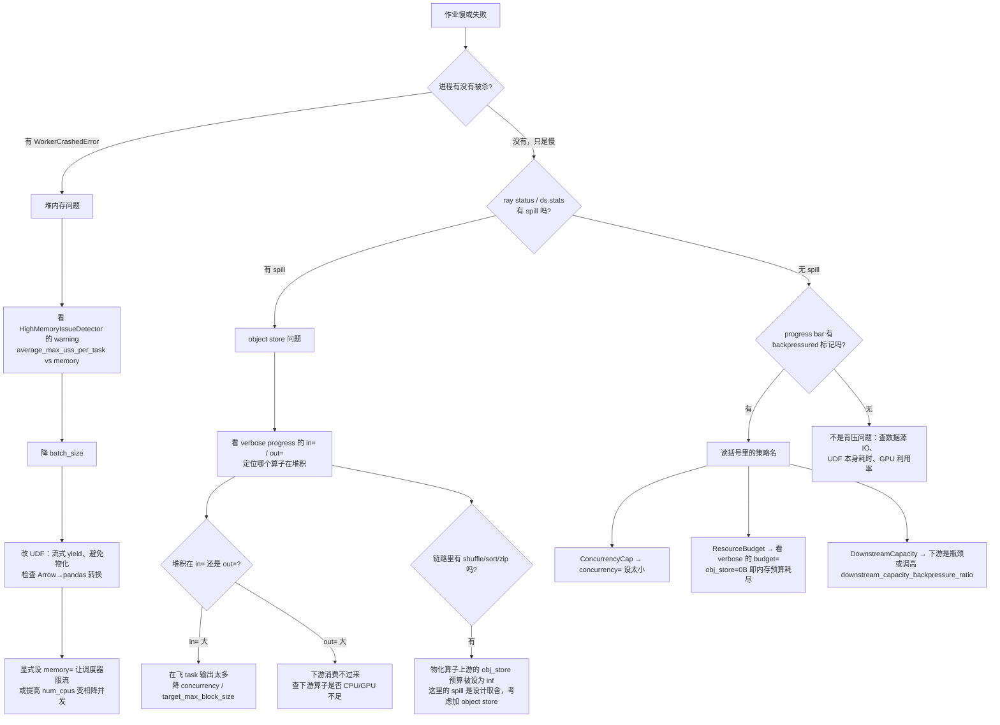

通用的入手顺序：**先开 verbose progress**（`RAY_DATA_VERBOSE_PROGRESS=1`，或直接 `RAY_DATA_DEBUG_RESOURCE_MANAGER=1` 强制打开详细模式），把 `in=` / `out=` / `budget=` 这三个数字看清楚，再决定动哪个旋钮。本章讲的所有机制，最终都汇聚成 progress bar 上那一行字。

---

## 9. Shuffle 与聚合

### 9.1 为什么 shuffle 是分水岭

前面几章讲的算子（map / map_batches / filter / flat_map）有一个共同的好处：**一个输出块只取决于一个输入块**。这意味着调度器可以来一块算一块，算完立刻交给下游——这就是第 7 章讲的流式执行（streaming execution）能成立的前提。

`sort` / `groupby` / `join` 打破了这个前提。它们的语义要求"把 key 相同的行聚到一起"，而在计算之前，谁也不知道某个 key 的行散落在哪些输入块里。于是**任一输出分区都可能依赖全部输入分区**，形成一张全连接图，这类算子在数据库文献里叫 all-to-all（全交换）算子，在 MapReduce 语境里就叫 shuffle（混洗）。

```
        输入块（M 个 map task）                输出块（N 个 reduce task）

        ┌──────────┐                            ┌──────────┐
        │  map 0   │───┬──┬──┬──────────────────▶│ reduce 0 │
        └──────────┘   │  │  │      ┌───────────▶└──────────┘
        ┌──────────┐   │  │  │      │            ┌──────────┐
        │  map 1   │───┼──┼──┼──────┼───────────▶│ reduce 1 │
        └──────────┘   │  │  │      │   ┌───────▶└──────────┘
        ┌──────────┐   │  │  │      │   │        ┌──────────┐
        │  map 2   │───┼──┼──┼──────┼───┼───────▶│ reduce 2 │
        └──────────┘   │  │  │      │   │   ┌───▶└──────────┘
             ...       ...          ...         ...
        ┌──────────┐                            ┌──────────┐
        │ map M-1  │───┴──┴──┴──────┴───┴───┴──▶│reduce N-1│
        └──────────┘                            └──────────┘

        每根线 = 一个中间对象（partition shard），共 M × N 根
```

这张图解释了 shuffle 的三笔账：

- **数据搬运**：M×N 次跨节点传输，无法靠 locality 消除。
- **元数据压力**：M×N 个 `ObjectRef`。在朴素实现里这些 ref 全部由 driver 持有，M=N=1000 就是一百万个 ref。Ray 内核给每个 ref 估了一个常量开销 `CALLER_MEMORY_USAGE_PER_OBJECT_REF`，Ray Data 用它来提前给用户报警（`python/ray/data/_internal/planner/exchange/pull_based_shuffle_task_scheduler.py:52-66`）。
- **流水线屏障（pipeline barrier）**：reduce 0 要等**所有** map 完成才能保证自己拿全了数据。屏障上游的算子做完了也不能把结果继续往下推，屏障下游的算子在屏障打开前一直闲着。第 6 章讲的 `AllToAllOperator` 就是这个屏障的物理体现：输入全攒在 `_input_buffer`，`all_inputs_done()` 时一次性调 `_bulk_fn`。

后面会看到，Ray Data 的两代 shuffle 架构，本质都是在跟这三笔账较劲：sort-based 路径优化的是第一、二笔（push-based 两级 merge），hash-based 路径优化的是第二、三笔（常驻 aggregator + 增量聚合）。

### 9.2 两大流派总览

Ray Data 现在同时维护两套 shuffle 实现，由 `DataContext.shuffle_strategy` 选择。枚举定义在 `python/ray/data/context.py:41-49`：

| `ShuffleStrategy` 取值 | 流派 | 实现入口 | 备注 |
|---|---|---|---|
| `sort_shuffle_pull_based` | sort-based | `PullBasedShuffleTaskScheduler` | 最朴素的 MapReduce |
| `sort_shuffle_push_based` | sort-based | `PushBasedShuffleTaskScheduler` | 论文式两级 merge，原 `use_push_based_shuffle=True` |
| `hash_shuffle`（**默认**） | hash-based V1 | `HashShufflingOperatorBase` + aggregator actor | 常驻 actor 接收分片 |
| `shuffle_v2` | hash-based V2 | `ShuffleMapOp` → `ShuffleReduceOp` | 无状态 task，两个物理算子 |
| `gpu_shuffle` | GPU | `GPUShuffleOperator` + rapidsmpf | 需要 GPU 与 RAPIDS 依赖 |

默认值来自 `python/ray/data/context.py:124-126`，环境变量 `RAY_DATA_DEFAULT_SHUFFLE_STRATEGY` 可覆盖；已废弃的 `RAY_DATA_PUSH_BASED_SHUFFLE` 如果被设置，会在 `_deduce_default_shuffle_algorithm()`（`python/ray/data/context.py:539-559`）里反过来压过它并打 warning。另外 `HASH_SHUFFLE_V2 = "shuffle_v2"`（`context.py:55`）与 `SHUFFLE_V2` 同值，按 Python enum 语义是别名；字符串 `"hash_shuffle_v2"` 由 `_missing_`（`context.py:57-69`）兼容并告警。

**并非所有算子都听 `shuffle_strategy` 的话。** 路由逻辑集中在 `python/ray/data/_internal/planner/plan_all_to_all_op.py:275-379`，实际分工是：

- `sort` / `random_shuffle` / `repartition(num_blocks=...)`（不带 `keys`）：**只有 sort-based 路径**。`generate_sort_fn`（`python/ray/data/_internal/planner/sort.py:69-72`）与 `generate_random_shuffle_fn`（`random_shuffle.py:74-81`）里只区分 push-based 与 pull-based，其余取值一律落回 pull-based。
- `repartition(keys=...)`：**只走 hash 家族**，其他取值直接抛错（`plan_all_to_all_op.py:319-326`）。
- `aggregate`（即 `groupby().sum()` 之类）：四条路都有（`plan_all_to_all_op.py:352-368`），fall-through 才是 sort-based。
- `join`：`plan_join_op`（`python/ray/data/_internal/planner/planner.py:192-212`）只判断 `SHUFFLE_V2`，否则一律 V1 `JoinOperator`；没有 sort-based join。

为什么默认从 sort-based 换成了 `HASH_SHUFFLE`？把 9.1 的三笔账对照一下就清楚了：sort-based 需要采样决定边界（多一轮全量扫描）、需要 driver 管 M×N 个 ref、且 reduce 端拿到的是排好序的分片必须归并后才能出结果；hash-based 用一组常驻 actor 承接分片，driver 只看到 `num_partitions` 个输出，而且聚合类算子可以在 shuffle 进行中就增量归并。代价是引入了 actor 生命周期与内存预留的复杂度——这也是 V2 又要把 actor 换回无状态 task 的原因。

### 9.3 sort-based 路径：经典 exchange 框架

这一套代码在 `python/ray/data/_internal/planner/exchange/` 下，模型直接抄自 Volcano 论文的 exchange 算子（`interfaces.py:31-33` 的注释就写了出处）。它把"数据怎么切"和"任务怎么排"拆成了两个正交的抽象。

#### 9.3.1 两个接口：Spec 管语义，Scheduler 管调度

`ExchangeTaskSpec`（`python/ray/data/_internal/planner/exchange/interfaces.py:18`）只有两个静态方法：

```python
    @staticmethod
    def map(idx, block, output_num_blocks) -> List[Union[Block, "BlockMetadataWithSchema"]]:
        """Returns list of [BlockMetadata, Block1, Block2, ..., BlockN]."""   # interfaces.py:45-56
    @staticmethod
    def reduce(*mapper_outputs, partial_reduce: bool = False):
        """Reduce function to be run for each output block."""                # interfaces.py:58-73
```

约定很直白：`map` 把 1 个输入块切成 `output_num_blocks` 个分片（外加尾部一个元数据项），`reduce` 收来自各个 map 的**同号**分片、合成 1 个输出块。`partial_reduce=True` 用于 push-based 的中间 merge 阶段——同一个 `reduce` 函数既能做局部合并也能做最终合并。

`ExchangeTaskScheduler`（`interfaces.py:76`）负责把这两个函数铺到集群上。它还带一个公共能力：`warn_on_high_local_memory_store_usage()`（`interfaces.py:109-124`），专门盯 driver 内存——正是 9.1 说的第二笔账。

三个实现：`PullBasedShuffleTaskScheduler`、`PushBasedShuffleTaskScheduler`、`SplitRepartitionTaskScheduler`。

#### 9.3.2 pull-based：最朴素，也最容易被 M×N 压垮

`python/ray/data/_internal/planner/exchange/pull_based_shuffle_task_scheduler.py:21`。两阶段，中间是硬同步：

```python
        shuffle_map_out = [                                    # :88-94
            shuffle_map.options(
                **map_ray_remote_args,
                num_returns=1 + output_num_blocks,             # N 个分片 + 1 个元数据
            ).remote(i, block, output_num_blocks, *self._exchange_spec._map_args)
            for i, block in enumerate(input_blocks_list)
        ]
        # ... 等所有 map 的元数据回来（map_bar.fetch_until_complete，:107）
        shuffle_reduce_out = [                                 # :120-126
            shuffle_reduce.options(**reduce_ray_remote_args, num_returns=2).remote(
                *self._exchange_spec._reduce_args,
                *[shuffle_map_out[i][j] for i in range(input_num_blocks)],  # 第 j 号分片，来自全部 M 个 map
            )
            for j in range(output_num_blocks)
        ]
```

第 j 个 reduce task 的参数列表长度是 M。M 个 map × N 个 reduce，driver 侧的 `shuffle_map_out` 是一个 M×N 的 ref 二维表。代码自己算了这笔账并主动告警（`:52-66`）：

```python
        caller_memory_usage = (
            input_num_blocks * output_num_blocks * CALLER_MEMORY_USAGE_PER_OBJECT_REF
        )
```

M=N=10000 时这就是一亿个 ref——driver 会先于计算 OOM。这是 pull-based 的硬上限，也是 push-based 存在的理由。

#### 9.3.3 push-based：插一层 merge，把 M×N 降成 M×num_merge

`PushBasedShuffleTaskScheduler`（`python/ray/data/_internal/planner/exchange/push_based_shuffle_task_scheduler.py:414`）的类文档就是算法说明（`:415-447`），出处是 [arxiv 2203.05072]。核心思路：**别让 map 的输出直接堆到 driver 等 reduce 来拉，而是趁着别的 map 还在跑，就地把已完成的 map 输出 merge 掉。**

一轮（round）里的三级结构：

```
  第 r 轮：   M 个 map task ──► N 个 merge task ──►（暂存 P 个输出/merge）
              每个产出 N 份         每份来自 M 个 map
                                    每个产出 P 份
  最终 reduce 阶段：R 个 reduce task，每个从"每一轮"的某个 merge 各取 1 份
  约束：N * P = R = output_num_blocks；M / N = merge_factor（默认 2，:456）
```

关键的下降在于 driver 侧不再持有 M×N，而是 `num_rounds × (num_map_tasks_per_round × num_merge_tasks_per_round)`，代码里就是 `_PushBasedShuffleStage.get_estimated_num_refs()`（`:158-170`）。merge 的输出被 merge task 自己攥着（`_MergeStageIterator.pop_merge_results`，`:333`），reduce 只需要 `num_rounds` 个参数而不是 M 个。

三个配套设计值得留意：

- **调度形状是按集群 CPU 拓扑算出来的**，不是用户给的。`_compute_shuffle_schedule`（`:752-833`）拿 `_get_num_cpus_per_node_map()` 逐节点分配 merge task（每个 merge 配 `merge_factor` 个 map 组成一个 pipeline 组），剩下的 CPU 全给 map；`num_rounds = ceil(num_input_blocks / num_map_tasks_per_round)`。
- **map 与 merge 流水线重叠**：`_PipelinedStageExecutor`（`:185`）默认 `max_concurrent_rounds=1`，即"提交下一轮 map 时才回收上一轮"；reduce 阶段用 2（`:611-616`）。
- **merge task 与 reduce task 同置**：reduce 的 `scheduling_strategy` 被显式抹掉（`:484-485`），改成跟它的 merge 输入贴在一起，省一跳网络。
- **输出顺序要还原**：reduce 是 round-robin 派发的（`round_robin_reduce_idx_iterator`，`:93-123`），所以收集完要按 index 重排（`:627-631`）。

#### 9.3.4 sort：采样 → 按边界切 → 归并

`SortTaskSpec` 的 docstring（`python/ray/data/_internal/planner/exchange/sort_task_spec.py:94-114`）把三段式写得很清楚，本质是**外部归并排序**（external merge sort）：

1. **采样（sampling）**：`sample_boundaries()`（`:161-236`）。每个块采 `n_samples = int(num_reducers * 10 / len(blocks))` 行（`:175`）——注意这是"总样本量 ≈ 10×reducer 数"的反推，块越多每块采得越少。样本汇总到 driver，多列排序用 Python 稳定排序反向多轮实现（`:223-228`），最后取 `num_reducers - 1` 个分位点作为边界（`:231-236`）。
2. **切分（map）**：`BlockAccessor.sort_and_partition(boundaries, sort_key)`（`:138`），块内先排序再按边界切。
3. **归并（reduce）**：`merge_sorted_blocks`（`:156-158`），先 `normalize_block_types` 统一块类型。

采样这一步是 sort-based 路径的"隐性第四阶段"：`generate_sort_fn`（`python/ray/data/_internal/planner/sort.py:48-58`）必须先拿到**全部**块的 ref 才能采样，所以 `Sort` 逻辑算子的进度条有三根（`SORT_SAMPLE` / `Shuffle Map` / `Shuffle Reduce`，见 `python/ray/data/_internal/logical/operators/all_to_all_operator.py:196-206`）。

**边界不均 = 数据倾斜（data skew）。** 边界是从抽样估的分位点，如果 key 分布极度偏斜（比如 90% 的行是同一个值），落在同一区间的行会全部涌向同一个 reduce task，该 task 的内存和耗时被单独拉爆，而其他 reducer 空转。采样量只有 ~10×N 行，倾斜检测能力有限；`num_outputs` 默认直接等于输入块数（`sort.py:42-44`），也就是说输入块越多、reducer 越多、每块采样越稀。缓解手段只有两条：`sort(boundaries=...)` 手工指定边界（`SortKey._boundaries`，`sort_task_spec.py:48-56`；此时 `num_outputs = len(boundaries) + 1`，`sort.py:66`），或者先 `repartition` 调整输入块数。

#### 9.3.5 random_shuffle：不看 key，只切片

`ShuffleTaskSpec`（`python/ray/data/_internal/planner/exchange/shuffle_task_spec.py:22`）被 `random_shuffle()` 和 `repartition(shuffle=True)` 共用，区别只在构造参数 `random_shuffle: bool`。它的 `map` 完全不看数据内容——目标分区是**按行号等分**的：

```python
        if random_shuffle:                                  # :94-97
            seed_i = random_seed + idx if random_seed is not None else None
            block = block.random_shuffle(seed_i)            # 1. 块内先打乱
            block = BlockAccessor.for_block(block)
        slice_sz = max(1, math.ceil(block.num_rows() / output_num_blocks))   # :102
        slices = []
        for i in range(output_num_blocks):
            slices.append(block.slice(i * slice_sz, (i + 1) * slice_sz))     # 2. 等分切片（Arrow 零拷贝）
        if random_shuffle:                                  # :109-111
            random = np.random.RandomState(seed_i)
            random.shuffle(slices)                          # 3. 再打乱"分片→分区"的对应关系
```

三步随机化的分工：第 1 步保证同一分区内的行来自原块的随机位置；第 3 步是为了避免小块场景下产出空分区（`:107-108` 的注释）。`reduce` 侧再做一次块内 `random_shuffle`（`:136-139`），因为 concat 之后行是按来源块分段聚集的。

顺带一个坑：`map` 会检查输入块是否超过 `1.5 × target_shuffle_max_block_size`（`MAX_SAFE_BLOCK_SIZE_FACTOR = 1.5`，`python/ray/data/context.py:88`）并告警，提示这通常是**上游 map 算子被融合进了 shuffle**（`shuffle_task_spec.py:82-91`）。融合逻辑就是 `upstream_map_fn`（`:59-75`），由 planner 从 `ctx.upstream_map_transformer` 传入（`random_shuffle.py:49-63`）。

#### 9.3.6 repartition 的两种模式

`generate_repartition_fn`（`python/ray/data/_internal/planner/repartition.py:27`）按 `shuffle` 返回两个不同的闭包（`:102-104`）：

- `shuffle=True` → `shuffle_repartition_fn`（`:35`）：走 `ShuffleTaskSpec` + pull/push 调度器，**真的搬数据**，每个输入块都被切成 N 片。
- `shuffle=False` → `split_repartition_fn`（`:80`）：走 `SplitRepartitionTaskScheduler`（`python/ray/data/_internal/planner/exchange/split_repartition_task_scheduler.py:23`），**只重组块边界**。

split 模式的做法：先按总行数算出 N-1 个等分下标（`:56-64`），交给 `_split_at_indices`（`:79-83`）把恰好跨界的块切开，然后每个输出分区只对**相邻**的那几段做一次 concat（`reduce_task`，`:95-103`）。绝大多数块整块进入某个输出分区，不需要任何跨节点搬运——所以文档说它"minimize the necessary data movement"（`python/ray/data/dataset.py:2294`）。代价是它需要精确行数，块行数未知时直接抛错（`split_repartition_task_scheduler.py:44-47`）；另外输出分区可能不足 N 个，末尾要补空块（`:113-150`）。

`repartition` 实际有第三种模式：给 `target_num_rows_per_block` 时走的是 **streaming repartition**，那是个纯 map 类算子（`plan_streaming_repartition_op`，`python/ray/data/_internal/planner/plan_udf_map_op.py:187`），完全没有 shuffle，本章只在最后的小结表里提一下。

#### 9.3.7 randomize_block_order：几乎零成本

`generate_randomize_blocks_fn`（`python/ray/data/_internal/planner/randomize_blocks.py:19`）根本不提交任何 task：

```python
            rng = np.random.default_rng(seed)
            input_owned = all(b.owns_blocks for b in refs)
            rng.shuffle(blocks_with_metadata)               # randomize_blocks.py:44-46
```

它只在 driver 上把 `(block_ref, metadata)` 列表原地洗一遍，再逐个包成新的 `RefBundle`（`:49-57`）。块内容一个字节都没动，也没有任何对象被读取或复制——开销是 O(块数) 的指针置换。这也解释了它的语义边界：**只打乱块之间的顺序，不打乱块内部的行**。想要真正的行级随机，必须用 `random_shuffle()`。

### 9.4 hash-based 路径 V1：常驻 aggregator actor

这是当前默认路径（`shuffle_strategy=hash_shuffle`），代码主体在 `python/ray/data/_internal/execution/operators/hash_shuffle.py`（2226 行）。

#### 9.4.1 换掉了什么

sort-based 路径里，reduce 是**任务**：它必须等所有 map 完成、把 M 个分片当参数拉过来，才能开始干活。hash-based 路径把 reduce 换成了**常驻 actor**——每个 partition 有归属的 actor，map 侧算完一块就直接把分片**推**给对应 actor。

用一个类比：sort-based 像"快递到驿站自提"——所有包裹先落地（driver 记账 M×N 个单号），收件人再一个个去取；hash-based 像"送货上门"——快递员算好门牌号直接送到收件人手里，驿站不用记账。

这么换带来三个连锁效果：

- **driver 只看到 `num_partitions` 个输出**，而不是 M×N 个中间 ref。9.1 的第二笔账被消掉。
- **actor 可以在收货过程中就干活**：这是 9.6 要重点讲的增量聚合（incremental compaction）。
- **map task 的完成条件变了**：它必须等对方**签收**（`submit` 的返回）才算完成，否则 aggregator 可能提前 finalize。

第三点在代码里是显式的同步（`hash_shuffle.py:352-373`），注释直接点名了原因。

#### 9.4.2 核心类清单

| 类 / 函数 | 位置 | 角色 |
|---|---|---|
| `ShuffleAggregation` | `hash_shuffle.py:116` | **无状态**的聚合语义接口，只有 `is_compacting` / `compact` / `finalize` |
| `ConcatAggregation` | `hash_shuffle.py:199` | `repartition` 用：concat 全部分片，可选排序 |
| `HashShufflingOperatorBase` | `hash_shuffle.py:492` | 所有 hash-shuffle 物理算子的基类 |
| `HashShuffleOperator` | `hash_shuffle.py:1583` | 具体的 key-based repartition 算子 |
| `AggregatorPool` | `hash_shuffle.py:1689` | driver 侧的池：持 actor handle、算 partition→actor 映射、健康监控 |
| `HashShuffleAggregator` | `hash_shuffle.py:1954` | **aggregator actor**（`@ray.remote(max_task_retries=-1)`，`:1950`） |
| `PartitionBucket` | `hash_shuffle.py:402` | actor 内单个 (seq, partition) 的累积状态：`lock` + `queue.Queue` |
| `_shuffle_block` | `hash_shuffle.py:248`（`@ray.remote` 在 `:247`） | map 侧的分区+推送 task |

注意一个容易踩的命名：接口叫 `ShuffleAggregation` 而**不是** `StatefulShuffleAggregation`——它的 docstring 明确写了 "meant to be *stateless*"（`:126-129`），状态全部由 actor 持有。`hash_shuffle.py:505` 还残留一处过时的 `StatefulAggregation` 提法，属于文档漂移。

三个子类分布在别的文件：`HashAggregateOperator`（`python/ray/data/_internal/execution/operators/hash_aggregate.py:81`）、`JoinOperator`（`python/ray/data/_internal/execution/operators/join.py:415`）。对应的 `ShuffleAggregation` 实现分别是 `ReducingAggregation`（`hash_aggregate.py:23`）和 `JoiningAggregation`（`join.py:58`）。

#### 9.4.3 数据流

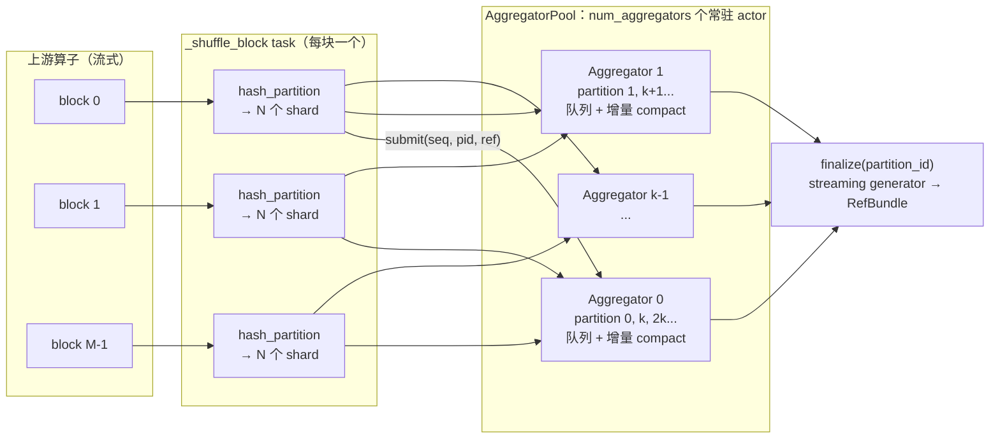

图里两处细节值得强调。第一，M×N 的连线仍然存在——**数据搬运量没变**，变的只是 ref 的持有者：分片被 `ray.put` 后 ref 直接作为 `submit` 的参数交给 actor，driver 从不持有它（`hash_shuffle.py:348-354`）。第二，`AggregatorPool` 是 driver 侧的普通 Python 对象，不是 actor；它作为参数被序列化进 `_shuffle_block` task（`hash_shuffle.py:252`），map task 因此能在 worker 上直接拿到 actor handle。

#### 9.4.4 分区函数

分区函数是 `hash_partition`，在 `python/ray/data/_internal/arrow_ops/transform_pyarrow.py:135`，底层是 `_hash_partition`（`:101`）。它**不是** pyarrow.compute 的哈希，也不是 murmur：

- 快路径（`:117-130`）：`table.to_pandas(types_mapper=pd.ArrowDtype)` 后调 `pandas.util.hash_pandas_object`（底层 xxhash），再 `np.mod(hashes, num_partitions)`。
- 慢路径（`:105-115`）：含嵌套 / tensor / object 列时，退回 Python 内置 `hash(tuple)` % N。
- 切分（`:168-181`）：`pyarrow.compute.sort_indices` + `np.bincount` + `take_table`，然后零拷贝 `slice` 出每个分区；**空分区不出现在返回的 dict 里**。

`_shuffle_block` 里只对**投影后的 key 列**求哈希（`transform_pyarrow.py:157` 的 `table.select(hash_cols)`），这是 join 两侧能"同 key 落同 partition"的保证——列名可以不同，值相同就够了。

#### 9.4.5 num_partitions 与 num_aggregators：两个不同的数

这是 hash 路径最容易搞混的一对概念。`num_partitions` 是**逻辑扇出度**，`num_aggregators` 是**actor 个数**，后者 ≤ 前者。

`num_partitions` 三级回退（`hash_shuffle.py:548-556`）：

```python
        target_num_partitions: int = (
            num_partitions                          # 1. 用户显式指定
            or (max(estimated_input_blocks) if all(estimated_input_blocks) else None)
                                                    # 2. 上游算子估计的输出块数
            or data_context.default_hash_shuffle_parallelism   # 3. 默认 200
        )
```

`default_hash_shuffle_parallelism` 默认 `DEFAULT_MIN_PARALLELISM = 200`（`python/ray/data/context.py:864`、`:162`，环境变量 `RAY_DATA_DEFAULT_MIN_PARALLELISM`）。

`num_aggregators` 则被集群规模夹住（`hash_shuffle.py:585-591`）：

```python
        max_shuffle_aggregators = _derive_max_shuffle_aggregators(
            total_available_cluster_resources, data_context
        )
        num_aggregators = min(target_num_partitions, max_shuffle_aggregators)
```

`_derive_max_shuffle_aggregators`（`:465`）的上限是 `min(ceil(总 CPU 数), max_hash_shuffle_aggregators or 128)`（`:485-489`）。它的注释（`:469-484`）给出了推理链：shuffle 是 stage 的终结算子，finalize 时整个集群资源都归它，所以 actor 数按总 CPU 配、再压一个固定上限（`DEFAULT_MAX_HASH_SHUFFLE_AGGREGATORS = 128`，`context.py:128`）。

partition 到 aggregator 的映射就是取模（`hash_shuffle.py:1848-1851`）：

```python
    def _get_aggregator_id_for_partition(self, partition_id: int) -> int:
        assert partition_id < self._num_partitions
        return partition_id % self._num_aggregators
```

所以默认配置下、16 核集群上一次 `groupby`：200 个 partition 分给 16 个 actor，每个 actor 管 12~13 个 partition。

顺带修正两处代码里的文档漂移，别跟着抄：`max_hash_shuffle_aggregators` 的 docstring（`context.py:884-886`）说上限是"总 CPU × 2"，代码里没有那个 2；`hash_shuffle.py:583-584` 的注释说 aggregator 数默认取 `DataContext.min_parallelism`，实际读的是 `max_hash_shuffle_aggregators`。

#### 9.4.6 map 侧：分区、推送、等签收

`_shuffle_block`（`hash_shuffle.py:248`）是整条路径的搬运工。核心循环（`:326-356`，已裁剪）：

```python
    for partition_id in range(num_partitions):
        partition_shard = block_partitions.get(partition_id)
        if partition_shard is None:
            # 空分区：默认跳过；send_empty_blocks=True 时仍发一个空表，
            # 目的是把 schema 广播给可能收不到任何数据的 aggregator（:330-333）
            if not send_empty_blocks:
                continue
            partition_shard = _create_empty_table(block.schema)
        # ...
        aggregator = pool.get_aggregator_for_partition(partition_id)
        # 无论分片多小都先 ray.put，让分片统一由 Object Store 管理（:349-350）
        partition_ref = ray.put(partition_shard)
        awaitable = aggregator.submit.remote(input_index, partition_id, partition_ref)
        awaitable_to_partition_map[awaitable] = partition_id
```

然后是那个关键的同步（`:358-373`）：task 在返回前 `ray.wait` 等所有 `submit` 的 ack。注释写明了理由——"aggregations are not getting finalized before they receive corresponding partitions"。这就是 hash 路径把"全屏障"降级为"半屏障"的地方：**上游可以继续流式产块，但 finalize 必须等最后一个签收**。

#### 9.4.7 内存管理：没有自己的 spill，靠 Object Store

V1 **没有**任何显式的落盘逻辑。设计上是刻意的：分片一律 `ray.put` 进 Object Store，溢出交给 Ray 自己的 object spilling。两处注释都写明了这一点：

- `:349-351`：无论分片大小都 put，"irrespective of their size"。
- `:1440-1459`：给 aggregator 预留内存时若被单节点容量夹住，日志会说明"relying on object-store spilling for the remainder"，并指出 aggregator 持有的是"(spillable) object store"里的数据。

真正的内存杠杆是另外三个：

**（a）累积缓冲 + 增量 compaction。** 每个 (input_seq, partition) 一个 `PartitionBucket`（`:402`），内部是 `queue.Queue` + `threading.Lock`。`submit` 只把分片塞进队列；队列长度过阈值才触发一次 `compact`（`:2023-2054`）：

```python
        bucket.queue.put(partition_shard)
        if (
            self._aggregation.is_compacting()                       # 该聚合是否可压缩
            and bucket.queue.qsize() >= bucket.compaction_threshold
        ):
            with bucket.lock:                                       # 只有 compact 才加锁
                if bucket.queue.qsize() < bucket.compaction_threshold:
                    return                                          # 别人刚 compact 过
                to_compact = bucket.drain_queue()
                bucket.compaction_threshold = min(                  # 阈值指数退避
                    bucket.compaction_threshold * 2,
                    self._max_num_blocks_compaction_threshold,
                )
            compacted = self._aggregation.compact(to_compact)        # 计算在锁外
            bucket.queue.put(compacted)                              # 结果重新入队
```

阈值倍增（`:2046-2049`）是为了摊薄"非归约型"聚合（如 `Unique`、`AsList`）反复处理同一批元素的成本。基类的 `_get_min_max_partition_shards_compaction_thresholds()` 返回 `None`（`:1568`），所以**纯 `repartition` 不做 compaction**（`ConcatAggregation` 继承 `is_compacting() == False`）；`HashAggregateOperator` 覆盖成 `(100, 2000)`（`hash_aggregate.py:174`、`:83-84`）。

**（b）输出块整形。** `finalize` 里用 `_shape_blocks`（`:2152`）按 `target_max_block_size` 切块（`:2089-2090`）；`HashShuffleOperator` 设了 `disallow_block_splitting=True`（`:1620`），此时 `_aggregator_target_max_block_size` 为 `None`，不切。

**（c）finalize 分批。** `_try_finalize`（`:1056`）一次只调度一批分区，批大小 = `max_hash_shuffle_finalization_batch_size or num_aggregators`（`:1124-1141`）。这是控制"聚合峰值内存"的主要旋钮：finalize 是最吃内存的一步（要把某个 partition 的全部分片合到一起）。批内的分区是**随机采样**的（`:1167-1169`），注释解释了原因：相邻 partition 因为取模映射会落到相邻 aggregator，而相邻 aggregator 很可能同机，顺序 finalize 会造成"滑动透镜"式的单节点内存尖峰。

#### 9.4.8 背压：不自己实现，但塑造全局决策

`HashShufflingOperatorBase` 既没有覆盖 `throttling_disabled()`，也没有实现 `should_add_input()` / `can_add_input()`（全局搜索确认：`throttling_disabled` 的覆盖只出现在 `base_physical_operator.py:237`、`limit_operator.py:146`、`mix_operator.py:149`、`output_splitter.py:142`、`union_operator.py:122`、`zip_operator.py:146`、`aggregate_num_rows.py:69`，默认实现在 `interfaces/physical_operator.py:1014` 返回 `False`）。

也就是说 hash shuffle **接受**第 8 章讲的通用背压，同时从两个方向影响它：

- 被登记为**阻塞式物化算子**：`_BLOCKING_MATERIALIZING_OPERATORS` 里同时列了 `HashShufflingOperatorBase` 和 `ShuffleMapOp`（`python/ray/data/_internal/execution/resource_manager.py:56-62`），资源管理器据此判断算子是否有资格拿预算（`:427`、`:618`）。
- 汇报资源用量：`current_logical_usage`（`:1252`）、`base_resource_usage`（`:1263`）、`per_task_resource_allocation`（`:1323`）、`incremental_resource_usage`（`:1330`）、`min_scheduling_resources`（`:1339`）。

算子自己的节流只有两处：启动前的**在线采样窗口**（`_should_start_shuffle_from_sample`，`:871`；`_start_shuffle`，`:999`）和上面说的 finalize 批大小。采样窗口的作用是：先攒 8~16 个 bundle（`MEMORY_ESTIMATION_SAMPLE_MIN/MAX_BUNDLES`，`:105-110`）估算数据集总字节数，据此给 aggregator 定 `memory` 预留，然后才真正拉起 actor 池并把攒下的 bundle 补发出去（`:1010-1016`）。这段是 V1 唯一会"憋着不发"的时期，被刻意做得很短以保持流式。

另外 `python/ray/data/_internal/execution/no_progress_guard.py:68-78` 把 `HashShufflingOperatorBase` 和 `AllToAllOperator` 一起特判：拓扑里出现它们时无进度检测直接 `enabled = False`。那段注释还透露了路线图——两者"deprecating both of them in favor of the V2 hash shuffle implementation around Ray 2.60"。

### 9.5 Shuffle V2：把 actor 换回无状态 task

先纠正一个容易产生的误解：`python/ray/data/_internal/execution/operators/hash_shuffle_v2.py` 只有 54 行，**里面没有任何算子类**。它是个纯工厂模块，只提供三个闭包和一个常量：

- `_SHUFFLE_MAP_RUNTIME_ENV`（`:15`）：给 shuffle map worker 打上 `RAY_DATA_SHUFFLE_MAP_WORKER=1`，把它们和 `ReadParquet`/`Project` 的 worker 隔开，避免 mmap 的 Object Store 页把 RSS 算重。
- `_make_hash_partition_fn(key_columns, num_partitions)`（`:18`）：包一层 `hash_partition`。
- `_concat_reduce`（`:29`）、`_sort_reduce(key_columns)`（`:39`）。

真正的 V2 算子在 `python/ray/data/_internal/execution/operators/shuffle_operators/`：

| 文件 | 内容 |
|---|---|
| `shuffle_map_operator.py:64` | `ShuffleMapOp(InternalQueueOperatorMixin, PhysicalOperator, SubProgressBarMixin)` |
| `shuffle_reduce_operator.py:50` | `ShuffleReduceOp` |
| `shuffle_tasks.py` | 两个远程 task 与线上格式：`_shuffle_map_task:99`、`_shuffle_reduce_task:258` |
| `external_shuffle_runtime.py` | 基于磁盘 / Arrow Flight 的分片传输，**目前未接线**（见下） |

`ShuffleMapOp` 的工作：按节点把输入块攒到 `shuffle_input_batch_bytes`（默认 1 GiB，`context.py:879`）再一起分区（`_add_input_inner:163`、`_flush_merge_buffer:196`），提交 `_shuffle_map_task` 时 `num_returns = num_partitions + 1`（`:228`），每个分区一个 Arrow IPC buffer；map task 用 `NodeAffinitySchedulingStrategy(..., soft=True)` 钉在源数据所在节点（`:231`）。分区身份靠塞进 `BlockMetadata.input_files` 的哨兵串传递（`_PARTITION_ID_SENTINEL:45`、`make_partition_sentinel:48`、`extract_partition_id:52`）。

`ShuffleReduceOp` 接收 1~N 个**同分区方案**的 `ShuffleMapOp`，把各上游的同号分区配对，配齐就提交一个 `_shuffle_reduce_task`（`_add_input_inner:168`、`_submit_reduce_task:233`）。reduce task 的远程参数是 `num_cpus=1.0` + `scheduling_strategy="SPREAD"` + `num_returns="streaming"`（`_reduce_task_remote_args:155`）。它还能吸收一个下游 map 算子（`fused_output_map_transformer`，由 `logical/rules/operator_fusion.py:379-386` 接线）。

V1 与 V2 的结构差异：

| | V1 `hash_shuffle.py` | V2 `shuffle_operators/` |
|---|---|---|
| 物理形态 | **一个** `PhysicalOperator` | **两个**：`ShuffleMapOp` → `ShuffleReduceOp` |
| reduce 载体 | 常驻 **actor**（`HashShuffleAggregator`），池大小按在线采样定 | 无状态 **task**，每分区一个 |
| 分片传输 | map `ray.put` 后 `submit` 进 actor，并等签收 | map 返回 `N+1` 个 ref，reducer 批量 `ray.get` 拉 |
| 分片编码 | Object Store 里的裸 `pa.Table` | Arrow IPC `pa.Buffer`，默认 zstd 压缩（`hash_shuffle_compression`） |
| 聚合扩展点 | `ShuffleAggregation`（`compact` + `finalize`），支持增量压缩 | 纯 `PartitionFn` / `ReduceFn` 闭包，无 compaction |
| 扇入单位 | `num_aggregators`（≤ `num_partitions`，取模映射） | 恰好 `num_partitions` 个 reduce task |
| 分区身份 | 显式 `partition_id` 参数 | `BlockMetadata.input_files` 里的哨兵串 |
| 内存估算 | 采样估数据集字节 → 每 actor `memory` 预留 | 每 task 按输入字节 ×2（排序 ×3） |
| 下游融合 | 无 | reduce 可吸收下游 `TaskPoolMapOperator` |

**为什么说 V2 更流式？** 因为它是两个独立物理算子，`ShuffleMapOp` 就是个普通的、受背压管的算子，第 7 章的调度循环能像对待 map 一样交错调度它；`ShuffleReduceOp` 通过 `InternalQueueOperatorMixin` 暴露内部队列（`_input_queues:156`、`_output_queues:160`）给下游容量策略。而 V1 是"一个算子内部藏着 map 和 reduce 两个阶段"，调度器只能看到一个黑盒。注意 `ShuffleMapOp.estimate_object_store_usage()` 直接返回 `0`（`shuffle_map_operator.py:431-434`），注释说明"backpressure is driven by the reduce side instead"。

V2 的 reduce 端反而**不能**增量聚合：`shuffle_tasks.py:324-333` 的注释写得很直白——"Gather every input's full shard list, then call reduce_fn exactly once with all inputs together (no streaming...)"。所以 V2 的分区内存上界完全来自 map 侧预聚合，而不是 actor 里的周期性 compaction。

最后一个坑：`external_shuffle_runtime.py` 的 docstring 说自己被 `external_shuffle_tasks` 导入，但**该模块在树里不存在**，唯一的非测试引用者是 `python/ray/data/tests/test_hash_shuffle_external_runtime.py`。当作"已落地但未接线"的代码看待即可——出货路径传的是 Object Store 里的 `pa.Buffer`，不是文件。

### 9.6 聚合

#### 9.6.1 用户视角

入口是 `Dataset.groupby(key)` 返回的 `GroupedData`（`python/ray/data/grouped_data.py:29`）。它的便捷方法**只有六个**：`count()`（`:384`）、`sum()`（`:401`）、`min()`（`:445`）、`max()`（`:484`）、`mean()`（`:523`）、`std()`（`:562`），加上通用的 `aggregate(*aggs)`（`:57`）和 `map_groups(...)`（`:99`）。`Quantile`、`Unique` 之类**没有便捷方法**，只能塞进 `aggregate(...)`。

`GroupedData.aggregate` 本身不决定走哪条路，它只生成逻辑算子 `Aggregate`（`:70-77`）；分派在 planner（`plan_all_to_all_op.py:352-368`）。真正在 `grouped_data.py` 里读 `shuffle_strategy` 的是 `map_groups`（`:229-248`）：hash 家族的三种策略都降级成 `repartition(num_partitions, keys=self._key, sort=True)`，sort-based 则降级成 `self._dataset.sort(self._key)`。`sort=True` 是必须的——`map_groups` 要求同组行在块内连续。

#### 9.6.2 AggregateFn 的三段式，以及 V2

两个基类都在 `python/ray/data/aggregate.py`（1943 行，是**单文件模块**，不是包）：

- `AggregateFn`（`:70`）：**已废弃**（`@Deprecated` 在 `:68`）。它是闭包式的，构造时传 `init` / `merge` / `accumulate_row` 或 `accumulate_block` / `finalize`（`:118-128`），没有任何抽象方法。
- `AggregateFnV2(AggregateFn, abc.ABC, ...)`（`:181`，`@PublicAPI(stability="alpha")`）：只有**两个**抽象方法——`combine(current_accumulator, new)`（`:290`）和 `aggregate_block(block)`（`:312`）；`finalize`（`:330`）默认是恒等。

V2 的巧妙之处是它在构造函数里把自己**适配回** V1 协议，顺带包上一层 null 安全（`:264-276`）：

```python
        _safe_combine = _null_safe_combine(self.combine, ignore_nulls)
        _safe_aggregate = _null_safe_aggregate(self.aggregate_block, ignore_nulls)
        # ...
        super().__init__(
            name=name,
            init=_safe_zero_factory,                              # V1 init  ← V2 zero_factory
            merge=_safe_combine,                                  # V1 merge ← V2 combine
            accumulate_block=lambda _, block: _safe_aggregate(block),   # 注意丢弃了入参累加器
            finalize=_safe_finalize,
        )
```

`lambda _, block:` 那一行是理解 V2 的钥匙：`aggregate_block` 是**纯的"块 → 局部结果"**，合并一律走 `combine`。这样三段式就退化成教科书式的 monoid：零值（`zero_factory`）、局部归约（`aggregate_block`）、结合律合并（`combine`）、收尾（`finalize`）。null 安全的实现在 `:1418`（`_null_safe_zero_factory`）、`:1463`、`:1479`、`:1490`——`ignore_nulls=True` 时零值是 `None`（表示"空容器"），否则是真零值。

**局部聚合（combiner）为什么能把 shuffle 数据量降几个数量级？** 因为 `aggregate_block` 在 map 侧就跑了：一个 100 万行、1000 个不同 key 的输入块，经过局部 `sum` 之后只剩 1000 行（`Mean` 是 1000 个 `[sum, count]` 二元组）。走到网络上的是 1000 行而不是 100 万行。这也是为什么 `Quantile`（`:1021`，累加器是完整值列表）和 `AsList`（`:479`）这类"非归约型"聚合特别贵——它们的局部结果不比输入小。

内置聚合（全部在 `aggregate.py`，除注明外都直接继承 `AggregateFnV2`）：`Count:406`、`AsList:479`、`Sum:544`、`Min:604`、`Max:673`、`Mean:742`、`Std:829`（Welford 三元组）、`AbsMax:941`、`Quantile:1021`、`Unique:1134`、`CountDistinct:1266`（继承 `Unique`）、`ValueCounter:1337`、`MissingValuePercentage:1543`、`ZeroPercentage:1629`、`ApproximateQuantile:1730`（KLL sketch）、`ApproximateTopK:1828`。

顺带说明：`python/ray/data/_internal/aggregate.py` 是**空文件**（0 字节），不要引用它。

#### 9.6.3 V1 hash 聚合：actor 内的增量归并

`HashAggregateOperator`（`python/ray/data/_internal/execution/operators/hash_aggregate.py:81`）+ `ReducingAggregation`（`:23`）。它是"缓冲 + 周期性增量归并"的组合，不是纯流式也不是纯攒全：

1. **shuffle 前**就做一次局部聚合：`_create_aggregating_transformer`（`:183`）作为 `input_block_transformer` 传入，流程是「剪列 → 按 key 排序 → `_aggregate`」（`:191-217`）。
2. **actor 内**：`is_compacting()` 返回 `True`（`:40`），于是 9.4.7 讲的 compaction 生效。阈值来自 `_get_min_max_partition_shards_compaction_thresholds`（`:173`），即 `(100, 2000)`（`:83-84`）——队列攒到 100 个分片就归并成 1 个，阈值随后倍增到 2000 上限。
3. **finalize**：`ReducingAggregation.finalize`（`:48-58`）把队列残余抽干，调 `_combine(blocks, finalize=True)`。

实际的归约算子是 `BlockAccessor._combine_aggregated_blocks`（`python/ray/data/_internal/table_block.py:365`），实现是对各块的行迭代器做 `heapq.merge`（`:412-418`）后逐组调 `aggs[i].merge(...)`（`:463`）。**注意：hash 路径也在复用排序归并内核**，这就是为什么第 1 步要把分片按 key 排好序。

这是 hash 路径相对 sort 路径最大的优势：一个 partition 收到 1000 个分片，不需要同时把 1000 个都留在内存里等 finalize，中途就压成十几个。峰值内存从 O(分片总量) 降到 O(compaction 阈值 × 单分片)。

#### 9.6.4 V2 hash 聚合：向量化，但放弃了增量

`hash_aggregate_v2.py`（271 行）里**同样没有算子类**，只有函数工厂，插进通用的 `ShuffleMapOp` / `ShuffleReduceOp`：

- `_make_aggregating_transformer(key_columns, aggregation_fns)`（`:54`）→ map 侧
- `_make_aggregating_reduce_fn(...)`（`:63`）→ reduce 侧

两者都先试**全向量化**路径，不行才回落到和 V1 相同的 Python 引擎（`_fallback_aggregating_transformer:210`、`_fallback_aggregating_reduce_fn:245`）。门禁是 `_agg_specs`（`:17`，收集每个 agg 的 `_arrow_agg_spec()`，任一个不支持就返回 `None`）加 `_is_vectorizable`（`:38`）——后者在两种情况下否决：收集型与归约型 spec **混用**（`:43-46`），或者**无 key 的全局聚合**（`:47-51`，因为全局只有一组，Python 路径已经是向量化的）。

向量化的核心就是两次 `pyarrow.TableGroupBy.aggregate`。map 侧（`:120-131`）：

```python
        for i, (agg, spec) in enumerate(zip(aggs, specs)):
            col = agg.get_target_column()
            opts = arrow_agg_options(agg._ignore_nulls)
            if spec.prep is not None:
                block = spec.prep(i, col, block)              # 派生指示列（如 is_null → int64）
            names.extend(f"__agg{i}_{c}" for c in spec.components)
            agg_specs += spec.raw_agg_specs(i, col, opts)     # 产出 (col, kernel, options) 元组
        out = block.group_by(keys, use_threads=False).aggregate(agg_specs)
        return out.rename_columns(keys + names)
```

reduce 侧（`:191-205`）用 `spec.merge_specs` 再 group_by 一次，然后 `spec.finalize(merged, comps[i])` 组装最终列。

#### 9.6.5 arrow_aggregation.py：声明式的向量化规格

`python/ray/data/_internal/arrow_aggregation.py`（197 行）里**没有执行逻辑**，纯数据：

- `ArrowAggOptions`（`:7`）+ `arrow_agg_options(ignore_nulls)`（`:21`）：三种 option 语义不同——`ScalarAggregateOptions(skip_nulls=..., min_count=1)`（空组/全 null → null）、`CountOptions(mode="only_valid" or "all")`、`ScalarAggregateOptions(min_count=0)`（计数与百分比永不为 null）。
- `ArrowAggSpec`（`:35`）：`components`（`:39`）、`raw_agg_specs`（`:44`，map 侧）、`finalize`（`:46`）、`collection`（`:50`）、`merge_specs`（`:53`，reduce 侧）、`prep`（`:56`）。
- spec 工厂：`sum_spec:84`、`count_spec:97`、`minmax_spec:115`、`mean_spec:128`、`missing_pct_spec:143`、`zero_pct_spec:163`、`distinct_spec:184`。

两种形状：**两阶段归约**（sum/min/max/mean/count/百分比）有有界的可合并中间态，map 产 `__agg{i}_{component}` 列、reduce 合并、finalize 组装——`mean_spec` 是最干净的例子（components 是 `("sum","count")`，merge 是 `sum(sum)`+`sum(count)`，finalize 是相除且 count=0 → null，见 `_finalize_mean:63-68`）。**单阶段收集**（`distinct_spec`，`collection=True`、`merge_specs=None`）没有有界中间态，map 只剪列、reduce 一次性 `distinct`。

哪些聚合被向量化（看各类的 `_arrow_agg_spec()`）：`Count`、`Sum`、`Min`、`Max`、`Mean`、`MissingValuePercentage`、`ZeroPercentage` 无条件向量化；`Unique`/`CountDistinct` 在不开 list-encoding 且 `on` 是 `str` 时向量化（`aggregate.py:1205-1208`、`:1324-1327`）；`Std`、`AbsMax`、`Quantile`、`AsList`、`ValueCounter` 和两个 sketch 聚合**不向量化**，只能走 Python 引擎。

#### 9.6.6 sort-based 聚合作为对照

`SortAggregateTaskSpec`（`python/ray/data/_internal/planner/exchange/aggregate_task_spec.py:16`）由 `generate_aggregate_fn`（`python/ray/data/_internal/planner/aggregate.py:27`）驱动，后者开头就断言策略只能是两种 sort-based（`:36-42`）。

- **map**（`:44`）：剪列 → `sort_and_partition(boundaries, sort_key)` → 每个分区调 `_aggregate`（`:52-70`）。
- **reduce**（`:73`）：`normalize_block_types` → `_combine_aggregated_blocks(..., finalize=not partial_reduce)`（`:79-88`）。

修正一处常见误记：reduce **不调** `merge_sorted_blocks`（那是 `Sort` 路径的函数，`arrow_block.py:481`），它调的是 `_combine_aggregated_blocks`（`table_block.py:365`）。另外 `_prune_unused_columns`（`:91`）是三条路共用的：V1/V2 hash 聚合都导入它（`hash_aggregate.py:192-206`、`hash_aggregate_v2.py:219-230`）。

sort-based 聚合必须**全量物化**，有两个独立原因：它跑在 `AllToAllOperator` 上（输入全攒在 `_input_buffer`，`base_physical_operator.py:142/174/187-188`）；而且采样边界需要拿到全部块的 ref（`planner/aggregate.py:75-81`）。

#### 9.6.7 对比

| 维度 | sort-based 聚合 | hash-based V1 | hash-based V2 |
|---|---|---|---|
| 峰值内存 | 高：reduce 端要同时持有 M 个已排序分片 | 低：compaction 把队列压到阈值内 | 中：靠 map 侧预聚合，reduce 一次性归并 |
| 是否需全量物化 | **是**（采样 + `AllToAllOperator`） | 摄入端流式，输出仍等全部摄入完 | 同 V1，但 map/reduce 是两个可交错的算子 |
| 是否保序 | **是**，全局按 key 有序（范围分区 + 归并） | **否**，输出按哈希桶序；分区内因复用排序归并内核而偶然有序，不是契约 | **否**，`TableGroupBy.aggregate` 行序未定义 |
| 倾斜敏感度 | 高，且额外受采样精度影响 | 中：哈希分区更均匀，但热点 key 仍压在单个 partition | 同 V1 |
| 计算引擎 | Python 累加器（`_aggregate` / `_combine_aggregated_blocks`） | 同左 | 优先 `pyarrow.compute` 向量化，不支持才回落 |
| 额外阶段 | 采样（多一轮全量扫描） | 在线采样窗口（8~16 bundle） | 无 |

**三条路都不增量出结果**——差别在峰值内存，不在阻塞性。V1 的 `_try_finalize` 要求所有输入摄入完且所有 shuffle task 完成（`hash_shuffle.py:1056-1065`）；V2 的 reducer 也要凑齐全部分片才 reduce 一次。

顺带一个特例：`ds.count()` 根本不走 shuffle。planner 把它映射到 `AggregateNumRows`（`python/ray/data/_internal/execution/operators/aggregate_num_rows.py:13`），直接累加块元数据里的行数，`throttling_disabled()` 返回 `True`（`:69`）。

### 9.7 Join

用户入口是 `Dataset.join(ds, join_type, num_partitions, on=..., right_on=...)`（`python/ray/data/dataset.py:3564`）。注意 `num_partitions` 是**必填位置参数**——join 没有默认并行度。

`JoinType`（枚举定义在逻辑层 `python/ray/data/_internal/logical/operators/join_operator.py:23`）八种全部支持：`INNER:24`、`LEFT_OUTER:25`、`RIGHT_OUTER:26`、`FULL_OUTER:27`、`LEFT_SEMI:28`、`RIGHT_SEMI:29`、`LEFT_ANTI:30`、`RIGHT_ANTI:31`。逻辑算子是 `Join(NAry, ...)`（`:45`），字段含 `num_partitions:53`、`left/right_columns_suffix:54-55`、`partition_size_hint:56`（**已废弃且被忽略**，`dataset.py:3712-3719`）、`aggregator_ray_remote_args:57`。`validate_schemas` 不是 `Join` 的字段，而是 `Dataset.join` 的关键字参数（`dataset.py:3576`，默认 `False`，因为取 schema 可能很贵），在 driver 上调静态方法 `Join._validate_schemas`（`join_operator.py:100`）。

走哪条路由 `plan_join_op`（`python/ray/data/_internal/planner/planner.py:192-212`）决定：`SHUFFLE_V2` 时展成 `ShuffleMapOp(左) + ShuffleMapOp(右) → ShuffleReduceOp`（`_plan_join_shuffle_v2:145`，reduce 闭包来自 `_make_join_reduce_fn`，`join.py:121`）；其余一律 V1 `JoinOperator`（`python/ray/data/_internal/execution/operators/join.py:415`，继承 `HashShufflingOperatorBase`，聚合实现 `JoiningAggregation:58`）。**注意 `partition_size_hint` 的 docstring 说 join "现在跑在 v2 路径上"，但代码里默认策略是 `HASH_SHUFFLE`，实际走的是 V1。**

**两侧如何对齐分区。** `key_columns` 是一个**按输入序号索引的列表**（`hash_shuffle.py:527`，长度断言在 `:576`），`_do_add_input_inner` 用 `self._key_column_names[input_index]` 取本侧的 key（`:727`），再交给同一个 `hash_partition`。因为哈希只算投影后的 key 列，`left_on` 和 `right_on` 列名不同但值相同时仍落到同一 partition id。V2 路径同理，两个 `ShuffleMapOp` 各自实例化一次 `_make_hash_partition_fn`（`planner.py:159`、`:167`）。然后 `JoiningAggregation.finalize` 按序号取两份分片（`join.py:100-108`）。

**本地 join 用 pyarrow**，不是 pandas 也不是 cuDF（`join.py:220-227` 的 `pa.Table.join`，join_type 由 `_JOIN_TYPE_TO_ARROW_JOIN_VERB_MAP:43` 映射）。因为 Arrow 不能 join 含 map/union/list/struct/null 等列的表（枚举在 `_is_pa_join_not_supported:488-505`），`join_tables`（`:169`）做了一套"拆列 → join → 按索引贴回"的动作：不支持的列先摘掉（`_split_unsupported_columns:360`），给支持的投影追加合成索引列 `__rd_index_level_{left,right}__`（`_index_name:317`），join 完再 `take` + `hstack` 贴回（`_add_back_unsupported_columns:392-404`）。用不支持的列做 join key 则直接报错（`:249-263`）。

**没有 broadcast join。** 全仓搜索 `broadcast_join` / `BroadcastJoin` / `small_side` / `build_side` / `probe_side` / `map_side_join` 零命中，也没有 join 专属的逻辑优化规则（唯一提到 `Join` 的规则是谓词下推）。**目前只有 shuffle join**，两侧都全量 shuffle。内存按分区大小的 2 倍预算（`join.py:527-533`，注释："2x due to budgeted 100% overhead of Arrow's in-memory join"）。调优只有一个旋钮：加大 `num_partitions` 以减小单分区。

### 9.8 GPU shuffle

`python/ray/data/_internal/gpu_shuffle/` 三个文件，由 `shuffle_strategy=gpu_shuffle` 激活。定位很明确：**把分区与 all-to-all 交给 NVIDIA 的 rapidsmpf 在 GPU 上做**，Ray Data 只负责块的进出与顺序还原。

- `hash_shuffle.py`：`GPUShuffleActor`（`:58`，`@ray.remote(num_gpus=1)`）、`GPURankPool`（`:217`）、`GPUShuffleOperator`（`:397`）。注意 `GPUShuffleOperator` **不是** `HashShufflingOperatorBase` 的子类，是直接建在 `PhysicalOperator` 上的平行实现；块按轮转分给 rank（`get_actor_for_block:328`）。
- `hash_aggregate.py`：`GPUAggregateFn`（`:115`，抽象方法 `partial_aggregate:153` / `final_aggregate:166`）、`GPUCount:279` / `GPUSum:359` / `GPUMin:521` / `GPUMax:685` / `GPUMean:849`、`GPUHashAggregateOperator(GPUShuffleOperator)`（`:1610`）。
- `rapidsmpf_backend.py`：全部 import 都在 `lazy_load()` 内部（`:55-81`），模块级 `__getattr__`（`:264-270`）首次访问时才实例化并缓存 —— 这样 CPU-only 机器上也能 import。用到的 rapidsmpf 组件：`Shuffler`、`partition_and_pack` / `unpack_and_concat` / `unspill_partitions`、`RmmResourceAdaptor`、`BufferResource` + `LimitAvailableMemory`。三处版本分支（26.4.0 / 26.2.0 / `Shuffler` 签名）。

**通信走 UCXX，不是 NVLink 专用路径**（全目录搜 `nvlink` 零命中，传输选择完全交给 UCXX）。rank 0 调 `setup_root()`，地址字节广播给所有 rank（`GPURankPool.start`，`hash_shuffle.py:291-315`），actor 放置 `{"num_gpus": 1, "scheduling_strategy": "SPREAD"}`（`:268-271`）。RMM 侧是 `PoolMemoryResource(CudaMemoryResource())` + 可选的 device→host spill 阈值（`rapidsmpf_backend.py:164-182`）。

适用场景与限制：

- **必须有 GPU**：`_derive_num_gpu_ranks`（`hash_shuffle.py:377`）取 `gpu_shuffle_num_actors` 或集群 GPU 总数，都没有就抛错（`:385-388`）。
- **只支持 aggregate 与 key-based repartition**：dispatch 只有两处（`plan_all_to_all_op.py:307` 和 `:353`）。**join 不支持**——设了 `gpu_shuffle` 后 join 会静默落回 CPU 的 `JoinOperator`。`sort` / `random_shuffle` 同样没有 GPU 分支。
- **数据不必已经在 GPU 上**：Arrow 进、actor 内转 cuDF，所以上游可以是普通 CPU 算子；但 extract 时会**拷回 CPU 内存**（`:188` 的显式 caveat）。
- **分区乱序到达**：rapidsmpf 的 `extract()` 按完成顺序 yield（`rapidsmpf_backend.py:231-239`），Ray Data 把 partition id 塞进 Arrow schema metadata（`_GPU_PARTITION_ID_KEY = b"_gpu_partition_id"`，`:50`）再用 `ReorderingBundleQueue` 在 driver 侧复原（`:558-582`）。
- **不支持的聚合静默回落 CPU**，除非用户显式传了 `GPUAggregateFn`（那时改为硬报错，`plan_all_to_all_op.py:249-262`）。
- 相关配置：`gpu_shuffle_num_actors`（`context.py:916`）、`gpu_shuffle_rmm_pool_size`（`:920`）、`gpu_shuffle_spill_memory_limit`（`:924`，默认 `"auto"`）、`gpu_shuffle_setup_timeout_s`（`:928`，默认 120s）。

### 9.9 CombineShuffles 规则：相邻 shuffle 能合并

`CombineShuffles(Rule)` 在 `python/ray/data/_internal/logical/rules/combine_shuffles.py:19`，注册为 `_LOGICAL_RULESET` 的第四条（`python/ray/data/_internal/logical/optimizers.py:36`，排在 limit 下推、投影下推、谓词下推之后）。

**为什么能合并？** 因为 shuffle 会彻底重排数据，前一次 shuffle 的结果对后一次没有任何价值——后者要重新哈希/重新排序全部数据。所以连着两次 shuffle 时，前一次是纯浪费。

`apply`（`:24`）用 `plan.dag._apply_transform(self._combine)` 自底向上遍历（`logical_operator.py:70-85`：先递归子节点，子节点变了才重建，然后对本节点应用变换）。

合并条件只有**一条通用守卫 + 五个硬编码组合**。守卫是（`:41-45`）：

```python
        # Repartitions should have exactly 1 input
        if len(op.input_dependencies) != 1:
            return op
        input_op = op.input_dependencies[0]
```

五个组合，每个都把结果挂到"祖父"节点 `input_op.input_dependencies[0]` 上：

| 上游 → 下游 | 行 | 结果 |
|---|---|---|
| `Repartition` → `Repartition` | `:47` | `Repartition`，`shuffle = 上游.shuffle or 下游.shuffle`，其余取下游 |
| `StreamingRepartition` → `StreamingRepartition` | `:56` | `StreamingRepartition`，`strict = 上游.strict or 下游.strict` |
| `Repartition` → `Aggregate` | `:65` | 只留 `Aggregate`，上游 repartition **整个丢掉** |
| `StreamingRepartition` → `Repartition` | `:72` | 只留 `Repartition` |
| `Sort` → `Sort` | `:80` | `Sort`，只保留下游的 `sort_key` |

两处 `or` 是关键——把"更强的保证"保留下来（`:48`、`:59`）：

```python
        if isinstance(input_op, Repartition) and isinstance(op, Repartition):
            shuffle = input_op.shuffle or op.shuffle       # 任一要求真 shuffle，结果就真 shuffle
            return Repartition(
                num_outputs=op.num_outputs,
                input_dependencies=[input_op.input_dependencies[0]],
                shuffle=shuffle,
                keys=op.keys,
                sort=op.sort,
            )
```

有几个"看起来应该检查但其实没检查"的点，写代码时别误以为有保护：**不检查两个 op 的 `keys` 是否一致**、**不检查 `num_outputs`**、**也不检查上游是否只有一个消费者**。fan-out 时上游 shuffle 会在另一分支上存活，本分支跳过它——在这五种组合下语义是安全的（因为下游都会重新 shuffle），但这意味着该规则在后两种组合里是个"丢弃器"而不是真正的"融合器"。另外 `Repartition → Repartition` 会丢掉上游的 `keys`/`sort`，所以"先按 key 有序分区、再普通非 shuffle 重分区"会丢掉有序性。

### 9.10 实践小结

| 操作 | 走哪条路径 | 是否全屏障 | 主要开销 | 调优旋钮 |
|---|---|---|---|---|
| `sort(key)` | 只有 sort-based（pull / push） | **是**（`AllToAllOperator` + 采样需全部 ref） | 采样一轮 + M×N 传输 + reduce 端归并 | `shuffle_strategy=sort_shuffle_push_based`；`sort(boundaries=...)` 抗倾斜；先 `repartition` 调 reducer 数 |
| `random_shuffle()` | 只有 sort-based | **是** | M×N 传输；块内两次 `random_shuffle` | `num_blocks`（pull-based 才支持）；`ray_remote_args` |
| `repartition(n, shuffle=True)` | 只有 sort-based | **是** | 全量搬运，每块切 n 片 | 优先考虑换成 `shuffle=False` |
| `repartition(n, shuffle=False)` | `SplitRepartitionTaskScheduler` | **是**（仍是 `AllToAllOperator`，但只重组块边界） | 只切跨界块 + 相邻段 concat；不跨节点搬运 | 需要精确行数，块行数未知会报错 |
| `repartition(n, keys=[...])` | **只有** hash 家族（V1 / V2 / GPU），其他策略报错 | 半屏障：摄入流式，输出等摄入完 | 哈希分区 + aggregator 承接 | `num_blocks` 即 `num_partitions`；`max_hash_shuffle_aggregators`；`sort=True` 会让 reduce 峰值内存 ×3 |
| `randomize_block_order()` | driver 侧列表洗牌 | 形式上是 `AllToAllOperator`，但不提交任何 task | O(块数) 指针置换，**几乎零成本** | 无。只打乱块序，不打乱行 |
| `repartition(target_num_rows_per_block=...)` | streaming repartition，**纯 map 类算子** | **否**，完全流式 | 块的拆分/合并 | `strict=True` 严格对齐块大小；可与上游 `map_batches` 融合 |
| `groupby(k).sum()` 等 | 默认 hash V1；四条路可选 | 半屏障（sort-based 为全屏障） | map 侧局部聚合 + 分片传输 + finalize | `num_partitions`；`max_hash_shuffle_finalization_batch_size` 控峰值内存；`shuffle_strategy=shuffle_v2` 拿 Arrow 向量化；避开 `Quantile`/`AsList` 这类非归约聚合 |
| `join(...)` | 默认 hash V1；`shuffle_v2` 时走两算子 | 半屏障 | 两侧全量 shuffle；Arrow join 预算 2× 分区大小 | **`num_partitions` 是唯一旋钮**（必填）；`aggregator_ray_remote_args`；无 broadcast join |
| `map_groups(fn)` | 降级为 `repartition(keys=..., sort=True)`（hash 家族）或 `sort(key)` | 同底层路径 | 额外一次块内排序 | `GroupedData(num_partitions=...)`；`batch_size=None` 使每批即一块 |

三条经验：

1. **默认策略是 `hash_shuffle`，但只有 aggregate / key-based repartition / join 真正吃到它**。`sort` 和 `random_shuffle` 永远走 sort-based，想优化它们只能在 pull/push 之间选。
2. **hash 路径的峰值内存旋钮是 finalize 批大小，不是 `num_partitions`。** 加大 `num_partitions` 减小单分区，但 partition 变多后 actor 每个要管更多分区；`max_hash_shuffle_finalization_batch_size` 才是直接限制"同时有多少个 partition 在做最贵的那一步"。
3. **想彻底躲开屏障，就别用 shuffle。** `ds.count()` 有 `AggregateNumRows` 快路径，`repartition(target_num_rows_per_block=...)` 是纯流式，`randomize_block_order()` 是零成本——这三个是本章唯一不用付 shuffle 代价的操作。

---

## 10. 读写路径与消费侧

前面几章讲的是"计划怎么变成算子、算子怎么被调度"。这一章讲两头：数据**怎么进来**（读路径）、**怎么出去**（写路径 + 消费侧）。

读路径的核心变化是 DataSourceV2 把"一个读任务干三件事"拆成了流水线上的三段算子。消费侧的核心是 `iter_batches` 那条把 `RefBundle` 磨成"可以直接喂给 `model(batch)` 的张量"的六级流水线。

### 10.1 V1 Datasource：一个 ReadTask 干三件事

V1 的读接口只有两个东西：数据源（Datasource）和读任务（ReadTask，读任务）。

`Datasource` 是一个 ABC（`python/ray/data/datasource/datasource.py:150`），核心只有三个东西：`get_read_tasks(parallelism, per_task_row_limit=None, data_context=None)`（`:229`）、`estimate_inmemory_data_size()`（`:222`，供优化器估算总大小）、`supports_distributed_reads`（`:266`，`local://` 时置 `False`）。

`ReadTask` 是一个**可调用对象**（`python/ray/data/datasource/datasource.py:332`）。它把"要读什么"和"读出来大概是什么样"打包在一起：

```python
# python/ray/data/datasource/datasource.py:354
def __init__(self, read_fn, metadata, schema=None, per_task_row_limit=None):
    self._metadata = metadata          # BlockMetadata：num_rows/size_bytes/input_files
    self._read_fn = read_fn            # 真正干活的闭包
    # ...
# :383
def __call__(self) -> Iterable[Block]:
    result = self._read_fn()
    # ...
    if self._per_task_row_limit is None:
        yield from result              # 一次调用产出一串 block，不是一个
        return
    yield from _iter_sliced_blocks(result, self._per_task_row_limit)
```

注意 docstring 里那句关键约定（`:346`）：**一个 ReadTask 返回的 block 数量可以在运行时变化**——读一个大文件时它可以吐多个 block 以免 OOM。所以 `metadata` 描述的是"这个 task 全部输出的总和"，不是单个 block。而 `metadata` 在 **driver 侧就可用**，不需要真的去读：优化器靠它估算总字节数、决定并行度、算内存上限。


#### 为什么这套接口在文件类数据源上不够好

`get_read_tasks(parallelism)` 这个签名本身就是问题所在：它要求数据源在**返回之前**就知道要切成几份、每份是什么。对文件类数据源来说，这意味着**列举必须在 driver 上同步跑完**——`get_read_tasks` 得先 `ls` 完所有目录、拿到所有文件大小，才能做分桶、才能构造出 ReadTask 列表。

具体的痛点有四条：

- **列举无法并行**。S3 上 10 万个文件的 `ListObjectsV2` 分页在 driver 单线程跑，几分钟内集群空转。
- **列举和读取无法分别限流**。列举是纯元数据 RPC（吃网络往返，不吃内存），读取是解码（吃 CPU 和内存）。塞进同一个 task 里，背压机制只能按一个画像来调。
- **无法做文件级下推**。谓词、投影是在构造 ReadTask 之后才由优化器下推的，而此时文件列表已经定死；想根据分区值跳过整个文件，只能在 `read_fn` 内部土法解决。
- **粒度是"文件"而不是"读单元"**。一个 2 GB 的 Parquet 文件在 V1 里就是一个 ReadTask，它自己内部吐多个 block；调度器看到的是一个不可分割的大任务。

一句类比：V1 的 ReadTask 像一个"我自己去找菜、自己洗、自己炒"的厨师，你只能通过"雇几个厨师"来调节吞吐。V2 把它拆成了配菜间和灶台。

### 10.2 V2 三段式读

#### 10.2.1 三个抽象

V2 把 V1 的 `Datasource` 一分为三，各自只回答一个问题：

| 抽象 | 定义位置 | 回答什么问题 | 在哪跑 |
|---|---|---|---|
| `DataSourceV2` | `python/ray/data/_internal/datasource_v2/datasource_v2.py:64` | 数据在哪（paths / filesystem）、schema 是什么、给我一个 Scanner | driver |
| `Scanner`（扫描器） | `.../scanners/scanner.py:12` | 应用了所有下推之后，输出 schema 是什么；给我一个 Reader | driver 构造，序列化到 worker |
| `Reader`（读取器） | `.../readers/base_reader.py:11` | 拿到一个工作单元，吐出 Arrow table 流 | worker |
| `FileManifest`（文件清单） | `.../listing/file_manifest.py:16` | 工作单元本身：一批 (路径, 大小, 分块元数据) | 作为 block 在算子间流动 |

`DataSourceV2` 的抽象方法只有两个：`infer_schema(sample)`（`:150`）和 `create_scanner(schema, filesystem, **options)`（`:165`）；文件类源额外覆盖 `_get_file_indexer()`（`:129`）和 `get_size_estimator()`（`:139`）。它还带一个 `DatasourceCategory` 枚举（`:43`：`FILE_BASED / DATABASE / DATA_LAKE / IN_MEMORY / SYNTHETIC / STREAMING`），用来声明"我这类源适用哪些优化"。

`Scanner` 是**不可变**的（frozen dataclass），每次下推返回一个新实例。这是它能安全被优化器反复改写的前提：

```python
# python/ray/data/_internal/datasource_v2/scanners/arrow_file_scanner.py:118
def prune_columns(self, columns: List[str]) -> "ArrowFileScanner":
    if self.columns:
        existing = set(self.columns)
        columns = [c for c in columns if c in existing]   # 与已有投影求交
    return replace(self, columns=tuple(columns))          # dataclasses.replace，克隆
```

`ArrowFileScanner`（`.../scanners/arrow_file_scanner.py:26`）通过 mixin 声明能力：`SupportsFilterPushdown / SupportsColumnPruning / SupportsLimitPushdown / SupportsPartitionPruning`（`:27-31`）。第 4 章讲的下推规则就是靠 `isinstance` 检查这些 mixin 来决定能推什么。

`FileManifest` 不是一个普通的 dataclass，而是**一个 block 的结构化视图**。它固定要求三列（`.../listing/file_manifest.py:11-13`）：

```
__path                  : string      # 文件路径
__file_size             : int64       # 本"块"的字节数（不一定是整个文件）
__file_chunk_metadata   : struct/None # 分块元数据；None = 整文件读
```

注意 docstring 里的关键约定（`file_manifest.py:26-29`）：**每一行代表一个文件的一个 chunk**。整文件读时 chunk metadata 为 `None`、`__file_size` 就是文件大小；分块读时多行共享同一个 `path` 但带不同的 chunk metadata（Parquet 场景下是 row group id 列表）。

它之所以要"披着 block 的皮"，是因为这样它才能被 `RefBundle` 装着、被 executor 调度、被背压机制计量——列举结果和真实数据走的是**同一条传输管道**，不需要为元数据另建一套通道。

#### 10.2.2 第一段 ListFiles：把"找文件"变成一个算子

`ListFiles` 逻辑算子（`_internal/logical/operators/read_operator.py:428`）是一个 `SourceOperator`，没有上游依赖。它的物理规划器 `plan_list_files_op`（`_internal/planner/plan_list_files_op.py:57`）搭出一个 `MapOperator`，输入是把用户路径包成的 block。

**路径切分**：入口把用户给的 paths 切成最多 200 份：

```python
# python/ray/data/_internal/planner/plan_list_files_op.py:54
DEFAULT_MAX_NUM_LIST_FILES_TASKS = 200
# :155
if should_parallelize and op.paths:
    path_splits = np.array_split(
        list(op.paths),
        min(DEFAULT_MAX_NUM_LIST_FILES_TASKS, len(op.paths)),   # :158
    )
else:
    path_splits = [list(op.paths)]
# :168 每份包成一个单列 arrow table {"__path": [...]}
block = pa.Table.from_pydict({PATH_COLUMN_NAME: paths})
# :180 根 bundle 必须 owns_blocks=False，否则 DAG 无法重建（同第 5 章 V1 的处理）
ref_bundle = RefBundle((BlockEntry(block_ref, metadata),), owns_blocks=False, ...)
```

注意 `should_parallelize` 不是无条件为真（`:128-129`）：当需要全局 shuffle（要一个全局 RNG 看到完整列举结果）或 indexer 自己做 bin-packing（要看到完整文件流才能全局装箱）时，退化成单个 task。

**两个关键的算子级设置**：

```python
# python/ray/data/_internal/planner/plan_list_files_op.py:135
ray_remote_args={"_generator_backpressure_num_objects": -1},  # 列举极快，默认背压会饿死下游
# :136-138
supports_fusion=False,   # 不与下游 ReadFiles 融合：列举和读取资源画像不同
# :140
map_op.throttling_disabled = lambda: True
```

这三行是"为什么要独立成算子"的答案：列举是 I/O 等待型（吃并发不吃 CPU/内存），读取是解码型。融合之后你没法给它们不同的并发度和背压策略。拆开后 ListFiles 可以关掉限流全速跑，把 manifest 堆在队列里让 ReadFiles 按自己的节奏消费。

**FileIndexer（文件索引器）**：真正干列举活的组件（`.../listing/file_indexer.py:30`）。默认实现 `NonSamplingFileIndexer`（`:138`）在每个列举 task 内部再开一层线程池做**工作窃取式目录遍历**：

```python
# python/ray/data/_internal/datasource_v2/listing/file_indexer.py:146
_DEFAULT_MAX_PATHS_PER_OUTPUT = env_integer("RAY_DATA_MAX_PATHS_PER_LIST_FILES_OUTPUT", 1000)
_DEFAULT_NUM_WORKERS = env_integer("RAY_DATA_LIST_FILES_THREADED_NUM_WORKERS", 8)  # :150
```

`_get_file_info_iterator_threaded`（`:245`）的逻辑很直白：种子路径入队，worker 取出一个路径 `ls` 一下，文件当结果、子目录当新的工作项塞回队列（`:310-318`）。深目录树因此能自动展开成并行工作。每攒满 1000 个 chunk 就吐一个 manifest block（`:399-405`），而不是等全部列完——这样下游 ReadFiles 能立刻开始干活。

两条 API 的分工值得注意：`list_files()`（`:191`）产出已分块的 manifest；`list_file_infos()`（`:340`）产出原始的 `(path, size)` 流。零字节文件的跳过和 pruner 过滤统一在 `list_file_infos` 里做（`:361-367`），两条路径共享同一个过滤点。

**可选的 shuffle**：`shuffle_files`（`.../listing/listing_utils.py:99`）把所有 manifest block 拼成一个再整体打乱。这解决的是**训练场景的文件顺序偏置**：如果数据按类别分文件存放，不打乱就会出现"前半个 epoch 全是 class A"。它的确定性靠一个小技巧保证：

```python
# python/ray/data/_internal/datasource_v2/listing/file_manifest.py:116
if seed is not None:
    sort_indices = pa.compute.sort_indices(..., sort_keys=[(PATH_COLUMN_NAME, "ascending")])
    block = block.take(sort_indices)      # 先按路径排序，抵消线程池的乱序
permutation = np.random.default_rng(seed).permutation(n)
```

因为多线程 indexer 的产出顺序本身不确定，不先排序的话同一个 seed 在两次执行里会给出不同结果。

**size-balanced 分桶**：这是 V2 最实用的一个改进，解决**文件大小倾斜**。

想象一个目录里有 1 个 2 GB 的文件和 999 个 1 MB 的文件。按文件数均分成 10 份，某一份会拿到那个 2 GB 文件、跑 100 倍长，整个 stage 被它拖住。`RoundRobinPartitioner`（`.../partitioners/round_robin_partitioner.py:15`）按**估算的内存字节数**而不是文件数分桶：

```python
# python/ray/data/_internal/datasource_v2/partitioners/round_robin_partitioner.py:52
def add_input(self, input_manifest: FileManifest):
    in_memory_size_estimates = self._in_memory_size_estimator.estimate_in_memory_sizes(input_manifest)
    for file_path, file_size, file_chunk_metadata, in_memory_size_estimate in zip(...):
        self._partitioner.add_item((file_path, file_size, file_chunk_metadata), in_memory_size_estimate)
```

估算器对 Parquet 就是一个固定倍数（`.../readers/in_memory_size_estimator.py:129`：`PARQUET_ENCODING_RATIO_ESTIMATE_DEFAULT = 5`，`:145` 直接 `ratio * file_sizes`）。选固定倍数而不是读元数据是有意的——读 footer 会拖慢启动。

底层算法在 `WeightedRoundRobinPartitioner`（`_internal/weighted_round_robin.py:28`），三档判定：

```
桶权重 < min_bucket_size    → 加进去，留在当前桶继续攒        (weighted_round_robin.py:79-80 的反面)
min ≤ 桶权重 < max          → 加进去，轮转到下一个桶            (:79-80)
桶权重 ≥ max_bucket_size    → 加进去后立刻吐出这个桶            (:77-78)
```

ASCII 示意（min=64MB，max=128MB，num_buckets=3）：

```
输入(估算内存): [10, 10, 10, 200, 5, 5, 60, 5, ...] MB
                  │   │   │    │
  bucket0 [10 ────┘   │   │    │            10 <min → 留在 b0
  bucket0 [10,10 ─────┘   │    │            20 <min → 留在 b0
  bucket0 [10,10,10 ──────┘    │            30 <min → 留在 b0
  bucket0 [.., 200] ───────────┘  →→ EMIT   230 ≥max → 立刻吐出（单个大文件独占一桶）
  bucket0 [5,5,60 ...                        70 ≥min → 轮转到 b1
```

`min/max` 来自 `DataContext.target_min_block_size / target_max_block_size`（`read_api.py:536-541`，`target_max_block_size` 为 `None` 时用 `sys.maxsize` 兜底）。**桶数只是提示**——注释说得很清楚（`read_api.py:528-530`）：分区器优先满足 `[min, max]` 块大小约束，实际桶数随数据总量伸缩。

Parquet 还有一条更精细的路：如果 indexer 用的是读 footer 的 chunker，它自己就把 row group 装箱成"约一个 block 大小"的读单元（`OnlineBinPacker`，`.../partitioners/online_bin_packer.py:240`，区分"轻文件"进共享混装桶 `_SharedBinPool:139` 和"重文件"独占桶 `_SingleFileBinPool:196`，阈值是一个桶的容量 `:256`）。此时 `produces_partitioned_manifests` 为 `True`（`file_indexer.py:38`），`plan_list_files_op` 跳过 partitioner（`:110`）也不并行列举。

整条 ListFiles 的 transform 链最终是这样拼起来的（`plan_list_files_op.py:78-118`）：

```
BlockMapTransformFn(list_files_for_each_block)   # :79  必有
  ├─ 若 shuffle_config 非空 → BlockMapTransformFn(shuffle_files)      # :99
  └─ 若 partitioner 非空且 not produces_partitioned_manifests
                          → BlockMapTransformFn(partition_files)      # :111
```

三段都设了 `disable_block_shaping=True`——manifest block 的形状由分桶逻辑决定，不能让通用的块整形再插一手。

#### 10.2.3 第二段 ReadFiles：真正读

`ReadFiles` 逻辑算子（`read_operator.py:238`）持有 Scanner（含全部下推状态）和 schema。它的名字是拼出来的：

```python
# python/ray/data/_internal/logical/operators/read_operator.py:293
object.__setattr__(self, "_name", f"ReadFiles{self.datasource_name}")
```

`ParquetDatasourceV2` 的 `name` 是 `"ParquetV2"`（`.../parquet_datasource_v2.py:87`），所以 `ds.explain()` 里看到的算子叫 **`ReadFilesParquetV2`**。

物理规划器 `plan_read_files_op`（`_internal/planner/plan_read_files_op.py:43`）只有一个 transform：

```python
# python/ray/data/_internal/planner/plan_read_files_op.py:60
def do_read(blocks: Iterable[Block], _: TaskContext) -> Iterable[Block]:
    reader = scanner.create_reader()          # :61 每个 task 建一次 reader
    for block in blocks:
        manifest = FileManifest(block)        # :68 block → 结构化视图
        if isinstance(scanner, FileScanner):
            manifest = scanner.prune_manifest(manifest)   # :70 文件级剪枝
        if len(manifest) == 0:
            continue                          # :72 整批都被剪掉，跳过
        for table in reader.read(manifest):   # :73 真正的 I/O
            if block_udf is not None:
                table = block_udf(table)      # :75 read_parquet(_block_udf=) 的落点
            yield table
```

**文件级谓词剪枝**是这一段最值钱的优化。基类 `FileScanner.prune_manifest` 是恒等函数（`.../scanners/file_scanner.py:37-46`），`ArrowFileScanner` 覆盖它：

```python
# python/ray/data/_internal/datasource_v2/scanners/arrow_file_scanner.py:178
def prune_manifest(self, manifest: FileManifest) -> FileManifest:
    if self.partition_predicate is None or self.partitioning is None:
        return manifest                                   # :187-188 没条件就不干活
    parser = PathPartitionParser(self.partitioning)        # :190
    keep_indices = []
    for i, path in enumerate(manifest.paths):             # :193
        # 从路径字符串里解析出分区值（hive 风格 date=2024-01-01/），直接求值谓词
        if parser.evaluate_predicate_on_partition(path, self.partition_predicate):
            keep_indices.append(i)
    if len(keep_indices) == len(manifest):
        return manifest                                   # :198 全留，避免无谓拷贝
    pruned_block = manifest.as_block().take(keep_indices)  # :208
    return FileManifest(pruned_block)
```

关键点：**它靠路径字符串就能判定，一个字节的数据都不用读**。`ds.filter(col("date") == "2024-01-01")` 在分区表上就变成"根本不打开其他日期的文件"。

注意这里的分工：普通数据列的谓词走 `push_filters`（`arrow_file_scanner.py:84`），最终变成 PyArrow scanner 的 `filter=` 参数（在文件内部按 row group 统计剪枝）；只有**只引用分区列**的谓词走 `prune_partitions`（`:156`）→ `prune_manifest`（跳过整个文件）。拆分是优化器的责任（`:100-101` 注释明说）。

**投影下推变成 Parquet 列选择**在 `FileReader.read` 里落地（`.../readers/file_reader.py:192`）。它先把请求的列分成两拨：

```python
# python/ray/data/_internal/datasource_v2/readers/file_reader.py:235
on_disk_column_names = set(dataset.schema.names)
if self._columns is None:
    columns_to_read_from_file = None      # :237 无投影，读全部
    columns_to_synthesize = None
else:
    columns_to_read_from_file = [c for c in self._columns if c in on_disk_column_names]  # :240
    columns_to_synthesize = set(self._columns) - on_disk_column_names                    # :243
# :245
scanner_kwargs = {
    "columns": columns_to_read_from_file,   # ← 这就是 Parquet 的列选择
    "filter": self._predicate.to_pyarrow() if self._predicate is not None else None,
    "batch_size": self._resolve_batch_size(dataset),
    "batch_readahead": _ARROW_SCANNER_BATCH_READAHEAD,
}
```

`columns_to_synthesize` 是"文件里没有、要事后合成"的列：hive 分区键、`include_paths=True` 时的 `path` 列、`include_row_hash=True` 时的 `row_hash`。`ParquetScanner.read_schema`（`.../scanners/parquet_scanner.py:42`）负责在逻辑 schema 里把这些合成列补上，且只在它们没被投影剪掉时才补（`:60-61`）。

#### 10.2.4 第三段 Download：URI 列下载

这一段**不在 `read_*` 路径上**。它由用户显式触发：

```python
from ray.data.expressions import download
ds = ray.data.read_parquet("s3://bucket/metadata/")     # 表里有一列 uri
ds = ds.with_column("bytes", download("uri"))           # ← 这里产生 Download 算子
```

`download()` 是一个表达式工厂（`python/ray/data/expressions.py:2118`），返回 `DownloadExpr`；`Dataset.with_column` 检测到它就绕开普通的 `with_columns` 路径，直接构造 `Download` 逻辑算子（`python/ray/data/dataset.py:1239`）。典型场景：元数据表里存着几百万张图片的 S3 URI，要把字节拉下来喂给模型。

`plan_download_op`（`_internal/planner/plan_download_op.py:69`）展开成**三个物理算子**：

```
SplitDownloadURIs(uri)   task 池   把大 URI block 切成 ≤8192 行的小块
        ↓
PlanDownloadBlocks(uri)  actor 池  HEAD 请求拿文件大小，按字节数重新分桶
        ↓
DownloadURIBytes(uri)    task 池   真正 GET 字节
```

**第一段**（`:110-127`）只做一件事：`_arrow_batcher(block, 8192)`，把宽 block 切窄。

```python
# python/ray/data/_internal/planner/plan_download_op.py:46
URI_SPLIT_MAX_ROWS = max(1, env_integer("RAY_DATA_DOWNLOAD_URI_SHARD_NUM_ROWS", 8192))
```

**第二段为什么必须是 actor 池**：它要对每个 URI 发一次 HEAD 请求拿文件大小。HEAD 是极短的请求，代价几乎全在**建连接和初始化 client** 上：

- S3 client（boto/obstore store）初始化要走一遍凭证解析链，S3 上可能是 IMDS 元数据服务往返；
- HTTPS 连接池要重新握手；
- 用 task 池的话，每个 task 是一个新的 Python 进程上下文，这些开销**每个 task 付一次**。

actor 池让这些对象在 actor 生命周期内复用。`PartitionActor`（`_internal/planner/download_partition_actor.py:166`，PyArrow 路径）和 `AsyncPartitionActor`（`:190`，obstore 异步路径）都在 `__init__` 里建好 provider 和 partitioner，`__call__` 只跑分桶：`_extract_credentials_from_filesystem` 只做一次（`:200`），`StoreRegistry` 缓存 obstore store 对象、连接池随之复用（`:215`）。

并发上限是双层的：actor 池最多 16 个（`plan_download_op.py:47-49`：`URI_METADATA_FETCH_MAX_ACTORS`，env `RAY_DATA_DOWNLOAD_PARTITION_MAX_ACTORS`），每个 actor 内部 HEAD 并发 128（`download_partition_actor.py:29`：`URI_HEAD_MAX_CONCURRENCY`，由 `asyncio.Semaphore` 控制，`:136`）。PyArrow 路径则用 16 线程的 `ThreadPoolExecutor`（`:89`，`URI_DOWNLOAD_MAX_WORKERS`）。

这个算子还额外设了 `ray_remote_args=None`（`plan_download_op.py:169`，注释说明用户给的资源要求只应作用于真正下载的 task，元数据规划是轻量内部操作）和 `_generator_backpressure_num_objects: -1`（`:174`）。

**为什么按字节数分桶而不是按文件数**：图片/音频这类数据的大小分布极度长尾。缩略图 5 KB，原图 20 MB，差 4000 倍。按行数均分，某个下载 task 会拿到一堆大图、内存爆掉或者跑得极慢。

`_ExactDownloadPartitioner`（`_internal/planner/download_partitioner.py:30`）的做法：权重取"这一行所有 URI 列的字节数之和"，喂给同一个 `WeightedRoundRobinPartitioner`（`:88-93`，`min_bucket_size` 默认是 `target_max_block_size` 的一半，`:63`；`num_buckets` 默认 2，`:12-14`）。元数据按 1024 行一批拉取（`:102`、`:9-11`）。

三个细节值得注意：

- **`or None` 而不是 `0`**（`:125`，注释在 `:120-124`）。大小未知的行（HEAD 失败、URI 解析不出来）权重传 `None`，`WeightedRoundRobinPartitioner` 会把它们**轮转铺开**而不是当成零重量堆在一个桶里（`weighted_round_robin.py:58-61`）。
- **分块 drain**（`:134`，注释 `:130-133`）。不等整个 block 的元数据都拉完就开始吐桶，让 GET 和 HEAD 在时间上重叠。
- **`emit_before_overflow=True`** 是这里和 ListFiles 分桶的唯一差别（`weighted_round_robin.py:68-74`）：一行加进去会超上限时，先把当前桶吐掉再放。下载场景宁可桶偏小也不要超内存。

**第三段**（`plan_download_op.py:214-221`）就是老老实实拉字节。两条实现：`download_bytes_async`（obstore）和 `download_bytes_threaded`（`plan_download_op.py:226`，PyArrow + `make_async_gen`，16 个 worker，`preserve_ordering=True` 保证列对齐）。路由决策在规划期完成（`:104-106`）：obstore 装了且能从 filesystem 静态抽出凭证才走 async 路，否则退回线程路——注释 `:99-103` 说明这是为了避免把用户的 Okta/STS/profile 凭证悄悄丢掉。

#### 10.2.5 完整读链路

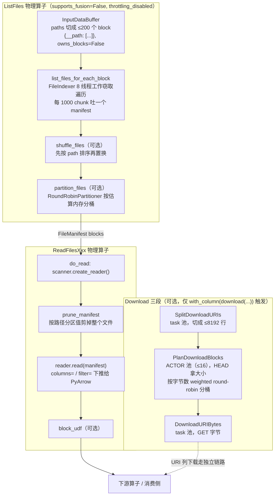

### 10.3 读并行度是怎么定的

**先说一个容易踩的事实**：`SetReadParallelismRule` 只匹配 V1 的 `Read` 算子。

```python
# python/ray/data/_internal/logical/rules/set_read_parallelism.py:109
if isinstance(logical_op, Read):
    self._apply(plan, op, logical_op)
```

`ReadFiles` 不在这个判断里。也就是说在这个 commit 下，`read_parquet` 走 V2 之后**这条规则完全不参与**，并行度由 `_read_datasource_v2` 在建图时一次性决定（见本节末）。

#### V1 路径：`parallelism="auto"`（即 `override_num_blocks=None` → `-1`）的推导链

核心公式只有一行（`_internal/util.py:214-218`）：

```python
parallelism = max(
    min(ctx.read_op_min_num_blocks, max_reasonable_parallelism),   # 下限 200，但不超过"块别太小"的上限
    min_safe_parallelism,                                          # 块别太大
    avail_cpus * 2,                                                # 至少 2 倍 CPU
)
```

两个中间量（`_internal/util.py:192-193`）：

```python
min_safe_parallelism      = max(1, int(mem_size / target_max_block_size))   # 默认 128 MiB（context.py:76）
max_reasonable_parallelism = max(1, int(mem_size / ctx.target_min_block_size))  # 默认 1 MiB（context.py:90）
```

按 docstring 里的顺序理解（`_internal/util.py:147-157`）：

1. **起点 200**（`context.py:110`：`DEFAULT_READ_OP_MIN_NUM_BLOCKS = 200`，字段声明 `context.py:940`）。
2. **最小块大小**：如果 200 份会让每块小于 1 MiB，就往下压（`min(...)` 那一项）。
3. **最大块大小**：如果块会超过 128 MiB，就往上抬（`min_safe_parallelism`）。
4. **可用 CPU**：至少 `avail_cpus * 2`。

**为什么下限是 200 而不是 CPU 数**？两个理由：

- **弹性伸缩**。读的时候集群可能只有 4 个 CPU，autoscaler 还在拉机器。如果按当时的 CPU 数定块数，扩容之后这些块也切不开了——块数是**执行前定死**的，CPU 数是运行时变化的。多切一点，后来的机器才有活干。
- **落后者容忍**。块数远大于并发度时，慢的 task 只拖累一小份数据，快的 worker 能继续领新块。块数等于 CPU 数时，一个慢 task 就是整个 stage 的尾巴。

代价是小数据集上会产生一堆小块，所以第 2 步（`target_min_block_size`）存在就是给这种情况兜底。

#### 用户显式给 `override_num_blocks` 时

`parallelism` 不再是 `-1`，`_autodetect_parallelism` 里 `if parallelism < 0` 整块被跳过，用户的值原样返回。但**它不一定是最终块数**：

```python
# python/ray/data/_internal/logical/rules/set_read_parallelism.py:82
if estimated_num_blocks < detected_parallelism and estimated_num_blocks > 0:
    k = math.ceil(detected_parallelism / estimated_num_blocks)   # :83 额外切分因子
    estimated_num_blocks = estimated_num_blocks * k
    return detected_parallelism, reason, estimated_num_blocks, k
```

数据源只能给出 `num_read_tasks` 个读任务（比如只有 3 个文件，你要 200 份），差额靠**在读任务输出侧再切块**补上（`:146` 的 `op.set_additional_split_factor(k)`）。反过来，如果 `mem_size / num_read_tasks` 超过 `target_max_block_size`，`size_based_splits`（`:49-51`）也会把每个 task 的输出切细。

给得太大会有一条明确的警告（`set_read_parallelism.py:61-75`），触发条件是 `num_read_tasks >= available_cpu_slots * 4 and num_read_tasks >= 5000`：

> The requested number of read blocks of {parallelism} is more than 4x the number of available CPU slots in the cluster of {available_cpu_slots}. This can lead to slowdowns during the data reading phase due to excessive task creation.

#### V2 路径：并行度只是分桶提示

```python
# python/ray/data/read_api.py:545
num_buckets = parallelism if parallelism != -1 else ctx.read_op_min_num_blocks
# :548
partitioner = None if indexer.produces_partitioned_manifests else RoundRobinPartitioner(
    in_memory_size_estimator=datasource.get_size_estimator(),
    min_bucket_size=min_bucket_size,      # ctx.target_min_block_size or 0（:536）
    max_bucket_size=max_bucket_size,      # ctx.target_max_block_size or sys.maxsize（:537-541）
    num_buckets=num_buckets,
)
```

注释 `:528-530` 直说了：`num_buckets` 是 hint，分区器优先满足 `[min, max]` 块大小约束，实际桶数随总数据量伸缩。所以在 V2 下 `override_num_blocks` 的语义从"我要恰好这么多块"退化成"我希望大概这么多桶"。

#### 读并行度不对时的排查顺序

1. **先确认走的是 V1 还是 V2**。`ds.explain()` 看算子名：`ReadParquet` 是 V1，`ReadFilesParquetV2` 是 V2。走 V2 就别去 `set_read_parallelism.py` 找原因了。
2. **打开 debug 日志看 reason**。`_autodetect_parallelism` 会给出四种归因字符串之一（`_internal/util.py:220-246`）：`read_op_min_num_blocks=200` / `output blocks of size at least target_min_block_size=...` / `output blocks of size at most target_max_block_size=...` / `parallelism at least twice the available number of CPUs (N)`。这一句直接告诉你是哪一档在起作用。
3. **检查 `estimate_inmemory_data_size()` 的估算准不准**。整条链的输入是 `mem_size`；估歪了后面全歪。V2 下对应的是 `ParquetInMemorySizeEstimator` 的固定 5 倍——高压缩比数据（大量重复值）实际膨胀可能是 20 倍，此时桶会偏大。
4. **看实际块数而不是并行度**。`ds.materialize().stats()` 里的块数才是真相；`detected_parallelism` 只是目标值，中间还有 `k` 和 `size_based_splits` 两层乘数。
5. **文件数是硬上限（V1）**。3 个文件最多 3 个读任务，`override_num_blocks=200` 只能靠输出侧切分来兑现，读阶段的 I/O 并行度依然是 3。V2 因为有 chunker 可以把单文件切成多个读单元，没有这个限制。

### 10.4 写路径

#### Datasink 的完整生命周期

`Datasink`（`python/ray/data/datasource/datasink.py:47`）的四个回调，按时间顺序：

| 回调 | 位置 | 在哪跑 | 干什么 |
|---|---|---|---|
| `on_write_start(schema)` | `:54` | driver，写任务启动前一次 | 建目录、校验 SaveMode、开事务 |
| `write(blocks, ctx)` | `:71` | 每个写任务 | 真正落盘，返回 `WriteReturnType` |
| `on_write_complete(write_result)` | `:89` | driver，全部成功后一次 | **commit**。docstring 明说这个方法必须成功，`write_datasink()` 才返回 |
| `on_write_failed(error)` | `:102` | driver，best-effort | 回滚 |

另外三个属性：`get_name()`（`:112`，自动剥掉类名的 `Datasink` 后缀和前导下划线）、`supports_distributed_writes`（`:126`）、`min_rows_per_write`（`:131`，控制每次 `write()` 调用大约拿到多少行）。

`write()` 收到的是一个 **block 生成器**（不是单个 block），返回值汇总进 `WriteResult`（`:21-29`）：

```python
@dataclass
class WriteResult(Generic[WriteReturnType]):
    num_rows: int                          # 总写入行数
    size_bytes: int                        # 总字节数
    write_returns: List[WriteReturnType]   # 每个 write() 的返回值汇总
```

`WriteResult.combine`（`:32`）负责把各任务的结果并起来。这个设计让 Iceberg/Delta 这类需要"收集所有 data file 元数据再提交一次 manifest"的 sink 能自然实现：`write()` 返回文件元数据，`on_write_complete` 拿到全部元数据做原子提交。

#### 文件名生成：防冲突的三段式

`_FileDatasink`（`datasource/file_datasink.py:32`）把文件名委托给 `FilenameProvider`：

```python
# python/ray/data/datasource/filename_provider.py:79
def get_filename_for_task(self, write_uuid: str, task_index: int) -> str:
    file_id = f"{write_uuid}_{task_index:06}"       # :96
    filename = ""
    if self.dataset_uuid is not None:
        filename += f"{self.dataset_uuid}_"          # :99
    filename += file_id
    if self.file_format is not None:
        filename += f".{self.file_format}"           # :102
    return filename
```

产出形如 `{dataset_uuid}_{write_uuid}_{000003}.parquet`。三段各自防一类冲突：

- **`write_uuid`**：防**重复写**冲突。同一个 Dataset 写两次（或者失败重试后重写）不会覆盖上次的文件。
- **`task_index`**（6 位零填充）：防**同次写内部**的任务间冲突。
- **`dataset_uuid`**：区分不同 Dataset 写到同一目录。

docstring `:83-85` 明确要求：给定 write UUID 和 task index，文件名必须**唯一且确定**。确定性是为了任务重试——重试产生同样的文件名，覆盖掉半截文件而不是留下垃圾。

`write_uuid` 通过 `TaskContext` 传进来（`file_datasink.py:290-291`：`ctx.kwargs[WRITE_UUID_KWARG_NAME]`），落盘用 `call_with_retry` 包了一层（`:296-300`）。

#### SaveMode 与目录创建时机

`SaveMode`（`python/ray/data/_internal/savemode.py:7`，`@PublicAPI(stability="alpha")`）有六个成员，判定全部在 `_FileDatasink.on_write_start`（`file_datasink.py:92`）里，而且是**幂等**的（`:94-96` 的 `_write_started` 守卫）：

| 成员 | 目标已存在时的行为 | 代码位置 |
|---|---|---|
| `CREATE` / `ERROR` | 抛 `ValueError` | `file_datasink.py:104-108` |
| `APPEND`（默认） | 直接写进去，不动已有文件 | 不进任何分支 |
| `OVERWRITE` | `filesystem.delete_dir_contents(self.path)` | `:113-115` |
| `IGNORE` | 设 `_skip_write = True`，整个写操作跳过 | `:109-111` |
| `UPSERT` | 需要 key 字段，文件 sink 不支持 | `savemode.py:25-28` |

时序上有一个重要细节：`_FileDatasink` 的 `on_write_start` 是在 `Dataset.write_datasink` 里**显式提前调用**的（`dataset.py:6654-6656`），而不是等 Write 算子收到第一个 bundle。注释 `:6648-6652` 解释了原因：SaveMode 检查和建目录必须在启动任何写任务之前完成。其他 datasink 才走"第一个 bundle 到达时自动调用"的默认路径。

`try_create_dir`（默认 `True`）控制建目录，有一个 S3 特例（`file_datasink.py:118-148`）：S3 URI 默认**跳过** `create_dir`，除非 `DataContext.s3_try_create_dir` 打开。原因在 `:126-137`——PyArrow 的 s3fs 建目录时会递归检查所有父目录，IAM 策略只允许写 `s3://bucket/foo` 前缀时，对 `s3://bucket/foo/bar` 建目录会失败，尽管实际写入是允许的。对称的收尾动作在 `:171-174`：目录是这次建的、最终一行都没写，就把目录删掉。

分区写不在 `_FileDatasink` 基类里，而在具体实现。`ParquetDatasink`（`_internal/datasource/parquet_datasink.py:177` 的 `partition_cols`）把它直接转交 PyArrow 建 `key=value/` 目录（`:376` 的 `partitioning=self.partition_cols`）；`:225-227` 校验设了 `partitioning_flavor` 就必须给 `partition_cols`。

#### 用户视角：`write_*` 返回什么

**这里要纠正一个常见误解**：在这个 commit 下 `Dataset.write_parquet` 的签名是 `-> None`（`dataset.py:4830`），`write_datasink` 也是 `-> None`（`dataset.py:6606`）。**它不返回 Dataset。**

第 5 章讲的那条 `pre → write → post` fn 链和收集写统计产出的单行 block 确实存在，但它是**内部**的，`write_datasink` 自己消费掉了：

```python
# python/ray/data/dataset.py:6662
self._write_ds = Dataset._from_parent(self, logical_plan).materialize()
iter_, stats, _ = self._write_ds._execute_to_iterator()          # :6664
for bundle in iter_:
    write_results.append(_gen_datasink_write_result(ray.get(bundle.block_refs)))  # :6670
combined_write_result = WriteResult.combine(*write_results)      # :6672
logger.info("Data sink %s finished. %d rows and %s data written.", ...)  # :6674
datasink.on_write_complete(combined_write_result)                 # :6680
```

所以想知道"写了多少行"，途径是：**看 `:6674` 那条 INFO 日志**；或**自定义 Datasink**、在 `on_write_complete` 里拿完整 `WriteResult`；或写前 `ds.count()`。`ds._write_ds`（`:6662`）是私有字段，不要依赖。文件数量没有直接暴露的字段——`write_returns` 里有什么完全取决于具体 sink 的 `write()` 返回值（`_FileDatasink.write` 返回 `None`）。


### 10.5 checkpoint：长作业的断点续跑

**它解决什么问题**：一个跑 6 小时的批量推理作业，在第 5 小时挂了。不开 checkpoint 就得从头重读重算。

**粒度是行级**，不是文件级也不是 block 级——这是它和常见 checkpoint 方案最大的区别。它要求用户提供一个 **`id_column`**（`python/ray/data/checkpoint/interfaces.py:50-52`）：ID 值必须全局唯一且**在所有算子中保持不变**。写侧按 block 写一个 checkpoint 文件（`interfaces.py:24-25`），记的是已完成的行 id；重跑时把所有 id 加载进内存，作为过滤条件传给读任务（`:26-29`）。

**怎么开启**：

```python
from ray.data.checkpoint import CheckpointConfig
ctx = ray.data.DataContext.get_current()
ctx.checkpoint_config = CheckpointConfig(
    id_column="row_id",
    checkpoint_path="s3://bucket/ckpt",     # 或集群可见的网络挂载路径
    delete_checkpoint_on_success=True,
)
```

`CheckpointConfig` 在 `checkpoint/interfaces.py:46`（`stability="beta"`），`DataContext.checkpoint_config` 是 property（`context.py:1374`），setter 也接受 dict（`:1379-1393`）。后端二选一（`CheckpointBackend`，`interfaces.py:15`，`stability="alpha"`）：`CLOUD_OBJECT_STORAGE` 或 `FILE_STORAGE`（后者必须是集群可见的网络挂载路径，`:39-41`）。

**`_CHECKPOINT_FILTER_OPS` 意味着什么**：

```python
# python/ray/data/_internal/planner/planner.py:259
_CHECKPOINT_FILTER_OPS = (Read, ReadFiles)
```

只有读算子（V1 `Read` 和 V2 `ReadFiles`）能挂过滤器。`_check_supports_checkpointing`（`planner.py:408`）要求两件事同时成立：

```python
# python/ray/data/_internal/planner/planner.py:413
if not isinstance(logical_plan.dag, (Write, StreamingSplit)):
    return False              # 计划顶端必须是 Write 或 StreamingSplit
# :416
def _all_paths_contain_checkpoint_filter(op):
    if isinstance(op, self._CHECKPOINT_FILTER_OPS):
        return True           # :417-418 每条到叶子的路径上都要有一个读算子
    return all(_all_paths_contain_checkpoint_filter(d) for d in op.input_dependencies)
```

换句话说：**只有"读 → 变换 → 写/split"这种形状的计划能开 checkpoint**。中间有 join、有 from_pandas 这种非读叶子，或者顶端是 `iter_batches` 而不是 `write_*`，都不行。

挂载方式是包一层算子而不是改读算子：`plan_read_files_op_with_checkpoint_filter`（`_internal/planner/checkpoint/plan_read_files_op.py:30`）先调普通的 `plan_read_files_op`，再用 `create_checkpoint_filter_op` 在它下游插一个 **actor 池** `CheckpointFilter` `MapOperator`，同样 `supports_fusion=False`（见文件头注释 `:1-8`）。V1 和 V2 共用同一份包装逻辑（`:38-42`）。

过滤本身是向量化的（`CheckpointFilter.filter_rows_for_block`，`checkpoint/checkpoint_filter.py:382`；numpy 实现在 `:394`）。

**成熟度**：`CheckpointBackend` 标 alpha，`CheckpointConfig` 标 beta，且注释里多处写着 "Only supported for batch-based backend currently"。这是一个**实验性特性**，对计划形状的约束很紧（必须有 `id_column`、必须是 read→write 形状），生产上用之前要实测。

### 10.6 消费侧：iter_batches 的 prefetch 流水线

#### 10.6.1 问题：executor 给的东西和训练循环要的东西差得很远

executor 吐出来的是 `RefBundle`——一组指向 object store 的 block 引用。而 `for batch in ds.iter_torch_batches(batch_size=256):` 想要的是一个**固定 256 行、指定格式、可能已经在 GPU 上**的东西。中间隔着五道坎：

```
RefBundle(block_refs)        ← executor 产出，数据还在别的节点
   ①  预取到本地 object store       ray.wait(fetch_local=True) 或 prefetcher actor
   ②  ray.get 取回本地堆内存         跨节点传输发生在这里
   ③  重新切批                       block 边界 ≠ batch 边界，要拼要切；可选局部 shuffle
   ④  格式转换                       Arrow → pandas / numpy / 保持 Arrow
   ⑤  collate                        → torch.Tensor
   ⑥  finalize                       → .to(device)，pin_memory，非阻塞拷贝
batch                        ← 用户拿到
```

关键矛盾：**block 边界和 batch 边界没有任何关系**。一个 block 可能是 5 万行，一个 batch 是 256 行；也可能一个 block 只有 100 行，凑一个 batch 要拼 3 个 block。所以第 ③ 步必须有一个跨 block 的缓冲区。

#### 10.6.2 六阶段流水线

`BatchIterator`（`_internal/block_batching/iter_batches.py:60`）的 `_pipeline` 方法就是这条链的定义：

```python
# python/ray/data/_internal/block_batching/iter_batches.py:240
def _pipeline(self, ref_bundles: Iterator[RefBundle]) -> Iterator[FinalizedBatch]:
    block_iter = self._prefetch_blocks(ref_bundles)      # :242 Step 1 触发本地预取
    block_iter = self._resolve_block_refs(block_iter)    # :245 Step 2 ray.get
    batch_iter = self._blocks_to_batches(block_iter)     # :248 Step 3 切批 (+shuffle)
    batch_iter = self._format_batches(batch_iter)        # :251 Step 4 线程池: format+collate
    if self._preserve_order:
        batch_iter = self._restore_original_batch_order(batch_iter)   # :259 Step 5
    batch_iter = self._finalize_batches(batch_iter)      # :262 Step 6 移到 GPU
    yield from batch_iter
```

**哪些阶段用线程重叠**，是这里最需要说清的事。有**两层**线程：

```python
# python/ray/data/_internal/block_batching/iter_batches.py:273
batch_iter = iter_threaded(self._ref_bundles, fn=self._pipeline)
#                          ↑ 整条 _pipeline 跑在 1 个后台线程里（默认 num_workers=1）
```

```python
# python/ray/data/_internal/block_batching/iter_batches.py:215
num_threadpool_workers = min(DEFAULT_FORMAT_THREADPOOL_NUM_WORKERS, self._prefetch_batches)
#                            ↑ 4（:31-33，env RAY_DATA_MAX_FORMAT_THREADPOOL_NUM_WORKERS）
# :442  format+collate 单独再开一个 num_threadpool_workers 的线程池
collated_iter = iter_threaded(batch_iter, fn=threadpool_computations_format_collate,
                              num_workers=num_threadpool_workers,
                              output_buffer_size=num_threadpool_workers)
```

所以：**Step 1-3 在一个后台线程**（串行，因为 batcher 是有状态的），**Step 4（format + collate）在一个最多 4 线程的池里并行**，**Step 5-6 和用户代码在主线程**。

`finalize_fn` 特意**不放进线程池**（`iter_batches.py:111-113` 的 docstring）：它做 GPU 搬运，是内存密集操作，多线程并发搬只会打爆显存。

类注释里画的在飞状态很直观（`iter_batches.py:66-79`，`prefetch_batches=2`）：

```
[用户线程]      在 Batch 0 上训练
[fetch 线程]      Batch 1 finalize + 进输出队列
[worker 线程 1]     Batch 2 format + collate
[worker 线程 2]     Batch 3 format + collate
[Raylet]              Batch 4 + 5 被拉到本地 object store
```

结论（`:80`）：任意时刻本地**堆内存**里有 `prefetch_batches + 1` 个 batch，本地**object store** 里还有 `prefetch_batches` 个。

#### 10.6.3 `prefetch_batches` 到底控制什么

它同时是三个东西的旋钮，这是最容易搞混的地方：

1. **object store 预取窗口大小**（`prefetch_batches_locally`，`iter_batches.py:454`）
2. **format/collate 线程池的线程数上限**（`:215-217`，取 `min(4, prefetch_batches)`）
3. **是否启用 prefetcher actor**（`:170-174`，`prefetch_batches > 0` 是前提之一）

第 1 项的实现是一个**按行数**（不是按 block 数）滑动的窗口（`iter_batches.py:492-533`）：先塞 bundle 直到累计行数达到 `num_batches_to_prefetch * batch_size`（`:492`、`:501-509`），一次性把整个窗口交给 prefetcher（`:511`）；之后每吐出一个 block ref 就补进新的、重新 `prefetch_blocks`（`:517-533`）。`prefetch_batches=0` 时整个机制关掉，退化成直接遍历（`:484-490`）。

**与 object store 预取的关系**：`prefetch_blocks` 有两种实现，都在 `_internal/block_batching/util.py`：

- `WaitBlockPrefetcher`（`util.py:487`）：一个后台线程调 `ray.wait(blocks, num_returns=1, timeout=0, fetch_local=True)`（`:513-520`）。`fetch_local=True` 是关键——它告诉 raylet "把这些对象拉到本节点"。`timeout=0` 是故意的（`:516-518` 注释）：只是**触发**拉取，不阻塞预取线程。
- `ActorBlockPrefetcher`（`util.py:544`）：在本节点起一个（`get_if_exists=True` 的命名）actor（`:550-559`），把 block ref 作为参数传给它的 `prefetch` 方法（`:561-562`）。方法体是空的（`:569-570`）——**参数传递本身就触发了 Ray 把对象拉到该 actor 所在节点**。这是一个巧妙的 hack：借用 Ray 的参数解析机制来做预取。

选哪个由 `DataContext.actor_prefetcher_enabled` 决定（`iter_batches.py:170-179`），Ray Client 模式下强制用 `ray.wait` 版。

#### 10.6.4 `local_shuffle_buffer_size`：训练场景最重要的旋钮

**它是什么**：一个本地内存缓冲区。数据流进来先攒在缓冲区里，攒够了就从里面**随机**取 `batch_size` 行出来。

**为什么它不需要全屏障**（对照第 9 章的 `random_shuffle()`）：全局 shuffle 要求"任意一行都可能出现在任意位置"，这在物理上意味着所有数据必须先落地、再全交换、再重分区——一个完整的 all-to-all 屏障。局部 shuffle 只承诺"**在滑动窗口内**随机"，所以它可以完全流式：数据流过窗口，边流边打乱。

实现是 `ShufflingBatcher`（`_internal/batcher.py:169`）。它没有用"随机丢一行进去、随机取一行出来"的经典 reservoir 写法，而是**增量索引**（`:172-174`）：

```python
# python/ray/data/_internal/batcher.py:184  （类 docstring 里的示例）
buffer:  [A, B, C, D, E, F, G, H, I]
indices: [4, 7, 1, 0, 8, 3, 6, 2, 5]   # 一次生成的随机置换

next_batch() -> take([4, 7, 1]) -> [E, H, B]   # batch_head 0 -> 3
next_batch() -> take([0, 8, 3]) -> [A, I, D]   # batch_head 3 -> 6
next_batch() -> take([6, 2, 5]) -> [G, C, F]   # batch_head 6 -> 9
```

好处写在 `:176-182`：数据缓冲区原地不动，只额外分配一个 int64 索引数组（省内存）；每次 `next_batch` 只对索引的一个小切片做 `take`（每批耗时短且均匀，容易被预取线程藏住）。

**缓冲区布局**（ASCII）：

```
        ┌──────────── 已压实缓冲区 (_shuffle_buffer) ────────────┐  ┌── 未压实 (_builder) ──┐
块内容:  [ ......已 yield...... | ....剩余可取.... ]                [ 新 add 进来的 block ]
索引:    [0 .. batch_head)      [batch_head .. len(_shuffled_indices))
                ↑
          _batch_head 单调右移；剩余量降到阈值以下时触发压实（compaction）
压实动作: 把"剩余可取"take 出来 + 未压实部分拼接 → 重新 build → 重新生成置换 → batch_head=0
```

三个阈值（`batcher.py:19-24`、`:217-228`）：

```python
SHUFFLE_BUFFER_COMPACTION_RATIO = 1.5       # :19 攒到 1.5×min 才压实，摊薄压实开销
SHUFFLE_BUFFER_COMPACTION_THRESHOLD = 0.5   # :24 剩余压实行数降到 0.5×min 就该压实了
# :217-220 如果 shuffle_buffer_min_size < batch_size，内部上调到 batch_size（算法要求）
self._min_rows_to_yield_batch = max(1, int(shuffle_buffer_min_size * 0.5))          # :223
self._min_rows_to_trigger_compaction = int(shuffle_buffer_min_size * 1.5)           # :226
```

`has_batch()` 的判定（`:302-315`）体现了"延迟出批以摊薄压实开销"：

```python
if not self._done_adding:
    return num_rows >= self._batch_size and (
        self._num_compacted_rows() >= self._min_rows_to_yield_batch      # 压实区还够取
        or num_rows - self._batch_size >= self._min_rows_to_trigger_compaction  # 或者攒够了可以压实
    )
else:
    return num_rows >= self._batch_size    # 输入结束后不再讲究，能凑一批就出
```

**局限，必须讲清楚**：

- **随机性只在窗口内**。`local_shuffle_buffer_size=10000` 而数据集有 1 亿行时，第 1 行和第 1 亿行**永远不可能相邻**。如果数据在磁盘上按标签排序，局部 shuffle 只能在 1 万行的窗口里混，一个 batch 里可能仍然全是同一类。
- **正确的组合拳**：`shuffle="files"`（打乱文件顺序，10.2.2）+ `local_shuffle_buffer_size`（窗口内打乱）。前者提供粗粒度随机，后者提供细粒度随机，两者都不需要全屏障。真的需要严格全局随机才上 `random_shuffle()`。
- **内存风险有显式告警**（`batcher.py:251-263`）：因为 Arrow table 是内存映射的，缓冲区里的 block 占的是 **object store 内存**而不是堆内存。缓冲区估算大小超过本节点 object store 容量时会 warn：

  > The node you're iterating on has {X} object store memory, but the shuffle buffer is estimated to use {Y}. If you don't decrease the shuffle buffer size from {N} rows, you might encounter spilling.

- **必须指定 batch_size**（`:213-214`：`raise ValueError("Must specify a batch_size if using a local shuffle.")`）。
- **首批延迟变大**。要先攒够 `shuffle_buffer_min_size` 才出第一批（docstring `:204-210` 明说这是随机性和首批延迟的取舍）。
- **`local_shuffle_seed`** 直接喂给 `np.random.default_rng`（`:216`）。注意它只保证 batcher 内部的置换可复现，上游 block 到达顺序仍受调度影响——要完全确定还得配 `preserve_order`。

#### 10.6.5 collate_fn

`python/ray/data/collate_fn.py` 定义了一个抽象基类和三个"按输入格式分类"的子类，外加一个默认实现：

| 类 | 位置 | 输入类型 | `batch_format` 被设成 |
|---|---|---|---|
| `CollateFn` | `collate_fn.py:155` | 泛型基类，只有 `__call__` | — |
| `ArrowBatchCollateFn` | `:174` | `pyarrow.Table` | `"pyarrow"`（`iterator.py:570`）|
| `NumpyBatchCollateFn` | `:194` | `Dict[str, np.ndarray]` | `"numpy"`（`iterator.py:572`）|
| `PandasBatchCollateFn` | `:210` | `pandas.DataFrame` | `"pandas"`（`iterator.py:574`）|
| `DefaultCollateFn` | `:226` | `pyarrow.Table`（继承 Arrow 版）| `"pyarrow"`（`iterator.py:565`）|

**为什么要按输入格式分成三个类而不是一个函数**：因为 `iter_torch_batches` 需要**根据你的 collate 想吃什么，反向决定第 ④ 步 format 成什么**（`iterator.py:566-576`）。传裸函数已被弃用（`:577-583` 的 `RayDeprecationWarning`，Ray 2.47 起）。

`DefaultCollateFn` 的两个细节：

```python
# python/ray/data/collate_fn.py:234
def __init__(self, dtypes=None, combine_chunks=False, num_workers=_DEFAULT_NUM_WORKERS):
    # _DEFAULT_NUM_WORKERS = 4（:229-232，env RAY_DATA_DEFAULT_COLLATE_FN_THREADPOOL_MAX_WORKERS）
# :282
return arrow_batch_to_tensors(batch, dtypes=self.dtypes,
                              combine_chunks=self.combine_chunks,
                              threadpool=self._threadpool)   # 列级并行转换
```

`combine_chunks` 由目标设备决定（`iterator.py:560`：`combine_chunks = device.type == "cpu"`）。原因写在 `:553-558`：GPU 传输可以跳过合并 chunk——每个 chunk 各自转成 tensor，然后在 `move_tensors_to_device` 里**边搬边 concat**；CPU 则必须先合并再转换。

`pin_memory=True` 会把 collate 包一层 `_PinMemoryCollateFnWrapper`（`collate_fn.py:290`，`iterator.py:587-588`），它跑在**同一个 collate 线程池里**（`:292-294` 注释），只对 `TensorBatchType` 生效（`:304-306`）。

#### 10.6.6 `iter_torch_batches` 的额外步骤

`iterator.py:380` 起。在通用流水线之上它多做四件事：

**1. device 解析**（`iterator.py:536-547`）。`device="auto"` 时在 Ray Train worker 里用 `get_device()`，否则 `"cpu"`。有一个容易漏的坑被专门处理了：

```python
# python/ray/data/iterator.py:541
if torch.cuda.is_available() and device.type == "cuda" and device.index is None:
    # "cuda" 不带 index 是线程相对的：解析成"调用线程当前的 CUDA 设备"。
    # finalize_fn 跑在后台 fetch 线程上，它的 current device 可能和消费线程不同。
    device = torch.device("cuda", torch.cuda.current_device())   # :547 钉死成具体 index
```

**2. dtype 转换**在 collate 阶段完成，不是单独一步。`dtypes` 传给 `DefaultCollateFn`（`:562`），最终到 `arrow_batch_to_tensors`（`util/torch_utils.py:243`）。`collate_fn` 和 `dtypes` 互斥（`iterator.py:529-534` 直接抛错）。

**3. device 搬运**是 `finalize_fn`，即 `DefaultFinalizeFn`（`_internal/utils/torch_utils.py:28`）：

```python
# python/ray/data/_internal/utils/torch_utils.py:42
@torch.no_grad()
def __call__(self, batch) -> FinalizedData:
    if is_tensor_batch_type(batch):
        batch = move_tensors_to_device(batch, device=self._device,
                                       non_blocking=DEFAULT_TENSOR_NON_BLOCKING_TRANSFER)
    return FinalizedData(data=batch)
```

`move_tensors_to_device`（`util/torch_utils.py:467`）按结构分派（`:498-511`）：单 tensor 直接 `.to()`；**嵌套的 tensor 序列**（`combine_chunks=False` 时每列是一个 chunk 列表）走 `concat_tensors_to_device`（`:379`）——在搬运的同时沿 batch 维拼接。这就是"GPU 路径可以跳过 combine_chunks"的兑现点。

**4. 非阻塞拷贝**默认开启：

```python
# python/ray/data/util/torch_utils.py:22
DEFAULT_TENSOR_NON_BLOCKING_TRANSFER = env_bool("RAY_AIR_DEFAULT_TENSOR_NON_BLOCKING_TRANSFER", True)
```

`non_blocking=True` 让 H2D 拷贝不强制同步，CPU 可以继续准备下一批。它要配 pinned memory 才真正异步——这就是 `pin_memory=True` 的意义：`pin_tensors_to_memory`（`util/torch_utils.py:355`）递归地把 CPU tensor 钉住，已钉住或已在 GPU 上的跳过（`:368-370`）。

`iter_tf_batches`（`iterator.py:606`）简单得多：没有 device / pin_memory / collate_fn 参数，只有 `dtypes`，走 `_internal/utils/tensorflow_utils.py` 的转换。TF 自己管设备放置。

### 10.7 split 与 streaming_split

#### 10.7.1 `split(n)`：在已物化的 block 列表上切

`Dataset.split(n, *, equal=False, locality_hints=None)`（`dataset.py:2733`）返回 `List[MaterializedDataset]`。**它必须先物化**：

```python
# python/ray/data/dataset.py:2807
bundle: RefBundle = self._execute()      # 整个 Dataset 执行完，拿到全部 block ref
block_refs = bundle.block_refs
metadata = bundle.metadata
```

之后分三种情况：

**a) `equal=True and locality_hints is None`**（`:2791-2798`）：走一条捷径——先 `count()`，算出 `n` 个切点，转交 `split_at_indices`，再丢掉最后一段：

```python
count = self.count()
split_index = count // n
split_indices = [split_index * i for i in range(1, n + 1)]
shards = self.split_at_indices(split_indices)
return shards[:n]        # 最后一段最多 n-1 行，安全丢弃
```

**b) 无 locality hints**（`:2814-2816`）：最简单的 `np.array_split(block_refs, n)`——**按 block 数均分，不看行数**。所以 `equal=False` 时各份行数可能差很多。

**c) 有 locality hints**（`:2845` 起）：**两轮贪心**。第一轮，对每个 actor 找出所有位于该 actor 节点上的 block，分配给它（不超过配额）；第二轮，用剩下的 block 填满每个 actor 的配额。反向索引 `block_refs_by_node_id` 的构造有一个简化（`:2880-2881` 注释）：block 存在多个节点上时只取第一个。

`_equalize`（`_internal/equalize.py`，在 `dataset.py:2950` 被调用）在 locality 路径下负责最后的行数对齐。

#### 10.7.2 `split_at_indices` / `split_proportionately`

`split_at_indices(indices)`（`dataset.py:2966`）同样先 `self._execute()`（`:3013`），然后调 `_split_at_indices`（`_internal/split.py:246`）。行边界切分是**远程任务** `_split_single_block`（`split.py:92`，由 `_split_all_blocks` 以 `scheduling_strategy="SPREAD"`、`num_returns=2+len(indices)` 派发，`:180-187`）。三个设计点：

- **不需要切的 block 直接复用**（`:175-179`）：`_drop_empty_block_split` 判断出该 block 无需切分时，原 ref 原样进结果，零成本。
- **只 `ray.get` 元数据**（`:197-199` 的注释 "only get metadata"）。数据块以 ref 形式返回，**owner 是 driver 而不是执行 split 的 worker**（`split.py:107-110` 的 docstring 解释了那个奇怪的 `num_returns` 返回结构就是为此）。这样 worker 退出不会导致 block 丢失。
- **切分是 `block_accessor.slice`**（`:122`）。对 Arrow 是零拷贝视图，但序列化回 object store 时会实际拷贝。

`split_proportionately`（`dataset.py:3045`）是 `split_at_indices` 的语法糖，把比例换算成绝对索引。

#### 10.7.3 `streaming_split(n)`：Ray Train 集成的核心

**注意签名**：`streaming_split(n, *, equal=False, locality_hints=None)`（`dataset.py:2629`）——**`equal` 默认是 `False`**，不是 `True`。

模型是"**一个 executor，n 个消费者**"。典型场景是 n 个训练 worker 各拉一份不重叠的数据。它**不物化**，数据边产边分发。

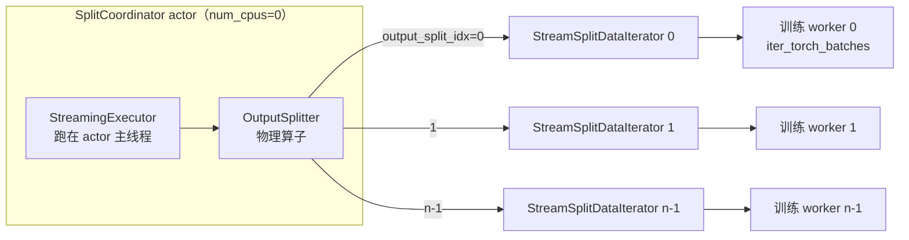

`SplitCoordinator`（`_internal/iterator/stream_split_iterator.py:186`，`@ray.remote(num_cpus=0)`）在**自己的主线程上跑一个完整的 streaming executor**，客户端通过 actor 调用（跑在其他线程）拉数据（`:188-191` 的 docstring）。消费者侧是 `StreamSplitDataIterator`（`:27`），它是可 pickle 的，所以能直接传给 `@ray.remote` 的训练 worker（`:71` 注释）。

拉取接口是一个**阻塞** RPC：

```python
# python/ray/data/_internal/iterator/stream_split_iterator.py:347
def get(self, epoch_id: int, output_split_idx: int, client_prefetched_bytes: int = 0) -> Optional[RefBundle]:
    if epoch_id != self._cur_epoch:                      # :367
        raise ValueError("Invalid iterator: the dataset has moved on to another epoch.")
    # :382 拿不到就阻塞在 OutputSplitter 的输出队列上（注意：在锁外面调用）
    while next_bundle is None or not next_bundle.blocks:
        next_bundle = self._output_iterator.get_next(output_split_idx)
```

`get_next(output_split_idx)` 就是第 7 章讲的 `OutputIterator.get_next()`——**`num_splits > 1` 只在这个场景出现**。协调器还做了一层"每次只返回一个 block、余下的存回 `_next_bundle` 字典"的拆分（`:386-397`），让每次 RPC 的粒度可控。

**epoch 屏障**（`_barrier`，`:561`）：多轮迭代时所有 split 必须一起进入下一个 epoch。慢的消费者会让别人卡在这里，所以有一条超时告警（`:578-587`）：

> StreamSplitDataIterator(epoch={e}, split={i}) blocked waiting on other clients for more than {T}s. All clients must read from the DataIterator splits at the same time.

#### 10.7.4 OutputSplitter 内部机制

`OutputSplitter`（`_internal/execution/operators/output_splitter.py:42`）给每个输出 bundle 打上 `output_split_idx`（`:45-46`）。它维护一个内部缓冲区 `_buffer`（`HashLinkedQueue`，`:73`）和一个输出队列（`:75`），以及每个 split 已发出的行数 `_num_output`（`:77`）。

**选谁接下一个 bundle**：贪心，给目前拿到最少的那个（`:286-289`）：

```python
def _select_next_output_index(self) -> int:
    i, _ = min(enumerate(self._num_output), key=lambda t: t[1])
    return i
```

**locality hint 怎么起作用**：选定接收者后，在缓冲区里**找一个恰好在该消费者节点上的 bundle**：

```python
# python/ray/data/_internal/execution/operators/output_splitter.py:291
def _find_preferred_bundle(self, target_output_index: int) -> Optional[RefBundle]:
    if self._locality_hints:
        preferred_loc = self._locality_hints[target_output_index]
        for bundle in self._buffer:                       # :296 TODO: 加反向索引
            if preferred_loc in self._get_locations(bundle):   # :297
                return bundle
    return None
```

找不到怎么办？分三档（`:249-259`）：

```python
if preferred_bundle:
    target_bundle = preferred_bundle                     # 命中，走
elif len(self._buffer) >= self._max_buffer_size or force:
    target_bundle = self._buffer.peek_next()             # :254 缓冲区满了，发最久等待的（miss）
else:
    break                                                # :259 都不行，先攒着，等更好的候选
```

这就是"**为 locality 故意延迟分发**"（`:89-91` 注释）。缓冲上限保证活性：

```python
# python/ray/data/_internal/execution/operators/output_splitter.py:98
if locality_hints:
    self._max_buffer_size = DEFAULT_OUTPUT_SPLITTER_MAX_BUFFERING_FACTOR * n
else:
    self._max_buffer_size = 0        # 没有 hint 就不缓冲，来一个发一个
```

命中率统计在 `:278-282`（`_locality_hits` / `_locality_misses`），通过 `progress_str()`（`:222-226`）显示在进度条上，没开 hint 时显示 `[locality disabled]`。

一个重要交互：**`preserve_order=True` 会强制关掉 locality**（`:135-138`），因为按 locality 挑 bundle 天然是非确定的顺序。同理这个算子明确声明"不提供任何顺序保证"（`:54`）。它还 `throttling_disabled` 返回 `True`（`:142-149`），理由是限流只会缩小缓冲区、降低命中率。

**`equal=True` 的代价**：核心是 `_can_safely_dispatch`（`:302`）：

```python
if not self._equal:
    return True                                          # :303-305 不要求等长，随便发
output_distribution = self._num_output.copy()
output_distribution[target_index] += target_num_rows     # :309 模拟发出去
buffer_requirement = self._calculate_buffer_requirement(output_distribution)  # :310
buffer_size = self._buffer.num_rows() - target_num_rows
return buffer_size >= buffer_requirement                 # :314 发完还够不够"补齐别人"
```

`_calculate_buffer_requirement`（`:316-320`）= `sum(max_n - n for n in distribution)`，即"要把所有 split 拉到当前最高水位，还差多少行"。

所以 `equal=True` 的代价是：**必须始终在缓冲区里囤够能补齐所有 split 的行数**。发一个 bundle 会让某个 split 领先，就必须保留足够的数据让其他 split 追上——不够就 `break`，停止分发。这直接意味着：

- **内存占用更高**（要囤数据）；
- **慢消费者拖住快消费者**——快的那个把 `_num_output` 拉高之后，`buffer_requirement` 变大，分发会被卡住直到攒够；
- **数据会被截断**。收尾的 `all_inputs_done`（`:177`）把缓冲区按 `max_n - n` 分配（`:200`）、平分余数（`:206-207`），然后 `clear_internal_input_queue()`（`:220`）**丢弃截断的尾巴**——类 docstring `:48` 明说 "truncating the Dataset"。
- **行边界切分**（`_split_from_buffer`，`:322`）：为了凑准确的行数，bundle 会被 `_split` 从中间切开（`:334`），新产生的 block 要注册到 `_block_ref_counter`（`:336-343`）。

#### 10.7.5 对比表

| 维度 | `split(n)` | `streaming_split(n)` |
|---|---|---|
| 是否物化 | **必须**。`self._execute()`（`dataset.py:2807`）跑完整个 Dataset | **不物化**。executor 在 coordinator actor 里边跑边分发 |
| 内存占用 | 全量数据同时驻留 object store | 只有在飞的 bundle + `OutputSplitter` 缓冲区 |
| 返回类型 | `List[MaterializedDataset]`，可重复迭代、可传给 remote | `List[DataIterator]`，一次性流（多 epoch 要走屏障） |
| 是否等长 | `equal=False`（默认）按 **block 数**均分，行数可能差很多；`equal=True` 走 `split_at_indices` 精确等长 | `equal=False`（默认）尽力均衡；`equal=True` 精确等长但**截断**尾部 |
| locality | 两轮贪心，按 actor 节点分配 block（`dataset.py:2845+`） | `OutputSplitter` 延迟分发挑本节点 bundle，有命中率统计 |
| 慢消费者影响 | 无（数据已经全部落地） | `equal=True` 时会拖住快消费者；多 epoch 时屏障会卡（有超时告警） |
| 适用场景 | 数据集能放进集群内存；需要多次 epoch 且不想重算；要把 Dataset 传给 actor | 数据集远大于集群内存；Ray Train 分布式训练；流式推理 |

一句话选择：**能装进内存且要多轮迭代 → `split`；装不进内存或者是训练主流程 → `streaming_split`**。Ray Train 的 `DataConfig` 默认用后者。

### 10.8 章末：「我要读 X」路径表

**先明确一件事**：在这个 commit（97f7eec）下，`read_api.py` 里 `_read_datasource_v2` **只有一个调用点**——`read_api.py:1687`，在 `read_parquet` 内部。也就是说**只有 Parquet 走 V2**，其他所有格式仍走 V1 的 `read_datasource`。

| 我要读 | 入口（行号） | V1/V2 | 关键参数 | 常见坑 |
|---|---|---|---|---|
| Parquet | `read_parquet`（`read_api.py:1370`） | **V2**（`:1603` 分岔，`:1673` 构造 `ParquetDatasourceV2`，`:1687` 调 `_read_datasource_v2`）| `columns`、`filter`、`partitioning`、`shuffle="files"`、`ignore_missing_paths`、`skip_paths` | `dataset_kwargs` 已弃用（`:1616-1622`）；`ignore_missing_paths` / `skip_paths` 在 V1 下直接抛 `NotImplementedError`（`:1706-1712`）；算子名是 `ReadFilesParquetV2` 不是 `ReadParquet` |
| CSV | `read_csv`（`:2075`） | V1 | `parse_options`、`convert_options`、`partitioning` | schema 靠采样推断，不同文件列类型不一致会炸；分隔符要通过 `parse_options` 传 |
| JSON | `read_json`（`:1901`） | V1 | `arrow_json_args`、`lines` | 默认按 JSON Lines 解析；单个巨大 JSON 数组无法并行切分 |
| 图片 | `read_images`（`:1742`） | V1 | `size`、`mode`、`include_paths` | **不走 Download 算子**（那是 `with_column(download(...))` 的路）；小图特多时块数会爆，配 `override_num_blocks` |
| 二进制 | `read_binary_files`（`:3250`） | V1 | `include_paths`、`output_column_name` | 一个文件一行，单文件超大会撑爆 block |
| numpy | `read_numpy`（`:2579`） | V1 | `numpy_load_args` | `.npy` 必须整文件读进内存，没有流式路径 |
| 文本 | `read_text`（`:2245`） | V1 | `encoding`、`drop_empty_lines` | 按行切分，一行一 row，开销比列式格式大得多 |
| SQL | `read_sql`（`:3369`） | V1 | `connection_factory`、`shard_keys`、`num_partitions` | 不给 `shard_keys` 就是单任务串行读；连接工厂必须可 pickle |
| `from_pandas` | `:3940` | 都不是 | — | 内存数据直接进 `InputData`，无读算子；driver 侧一次性 `ray.put`，大 DataFrame 会打爆 driver |
| `from_numpy` | `:4106` | 都不是 | — | 同上，返回 `MaterializedDataset` |
| `from_items` / `range` | `:174` / `:266` | 都不是 / 合成源 | `override_num_blocks` | `range` 用 `RangeDatasource`，适合压测 |
| 自定义 | `read_datasource(datasource)`（`:607`） | V1 | 实现 `get_read_tasks` + `estimate_inmemory_data_size` | **V2 没有公开入口**：`_read_datasource_v2`（`:434`）带下划线，`DataSourceV2` 虽标 `@DeveloperAPI` 但要自己搭 `ListFiles`/`ReadFiles` 逻辑图。目前自定义源实际只能走 V1 |

几条跨格式的通用注意事项：

- **`override_num_blocks` 的语义在 V1 和 V2 下不同**。V1 下它经过 `SetReadParallelismRule` 校正（还可能再乘一个切分因子 `k`）；V2 下它只是 `RoundRobinPartitioner` 的桶数**提示**，真正决定桶数的是 `target_min/max_block_size`（见 10.3）。
- **`RAY_DATA_USE_DATASOURCE_V2=0`** 可以把 Parquet 退回 V1（`context.py:112` 的 `DEFAULT_USE_DATASOURCE_V2`）。排查 V2 相关问题时这是最快的 A/B 手段。
- **训练前的组合拳**：`read_parquet(..., shuffle="files")` → `.iter_torch_batches(local_shuffle_buffer_size=..., prefetch_batches=..., pin_memory=True)`。这条链上没有任何全屏障，是流式训练的推荐姿势。

---

## 11. 可观测性、调优与排错

前十章讲的是「Ray Data 怎么工作」。这一章把那些机制翻译成一件事：**当作业慢了、挂了、炸了，你该看哪里、按哪个旋钮**。

结构上刻意做成手册：11.1–11.6 是「看什么」（stats / explain / 进度条 / IssueDetector / 外部导出），11.7 是「症状 → 原因 → 验证 → 处置」的诊断表，11.8 是完整旋钮速查表，11.9 是源码导航索引。建议先扫一遍 11.7 的决策树，其余按需跳读。

### 11.1 先分清两个 `stats`

Ray Data 里有两个名字很像、职责完全不同的 `stats`，混用是新手最常见的困惑：

| | `python/ray/data/_internal/stats.py` | `python/ray/data/stats.py` |
| --- | --- | --- |
| 入口 | `Dataset.stats()`、`Dataset.get_stats_summary()` | `Dataset.summary()` → `DatasetSummary` |
| 核心类 | `DatasetStats` / `DatasetStatsSummary` / `OperatorStatsSummary` / `IterStatsSummary` / `_StatsActor` / `_StatsManager` | `DatasetSummary`（`python/ray/data/stats.py:33`，`@PublicAPI(stability="alpha")`） |
| 回答什么 | **执行画像**（execution profile）：每个物理算子跑了多少 task、耗时、吞吐、spill | **数据画像**（data profile）：每列的 min/max/mean/count/missing_pct |
| 是否触发计算 | 只读已执行完的统计 | 会真的跑一遍聚合 |

本章后面提到的 `stats` 一律指前者。数据画像是分析工具，不是排障工具。

### 11.2 `ds.stats()` 逐字段解读

#### 11.2.1 数据是怎么攒起来的

统计的原子单位是 **`BlockStats`**（块级统计），由 worker 在产出每个 block 时填好，随 block metadata 回到 driver。`DatasetStats.metadata` 是一个 `StatsDict`，即 `{算子名: List[BlockStats]}`；`DatasetStats.parents` 串成一棵树，对应逻辑上的执行阶段链。

聚合发生在 `OperatorStatsSummary.from_block_metadata`（`python/ray/data/_internal/stats.py:1731`）：对一个算子的所有 `BlockStats` 做**单趟扫描**，累加 wall time / cpu time / UDF time / 输出行数 / 输出字节，并按 `es.task_idx` 归组算「每 task 行数」、按 `es.node_id` 归组算「每节点 task 数」（`python/ray/data/_internal/stats.py:1753-1779`）。

关键一点：**聚合的 key 是物理算子名**。融合后的算子只有一个名字（`up.name + "->" + down.name`），所以第 4 章讲的算子融合会直接决定这里的粒度——这是 11.2.4 要说的限制。

`DatasetStats.to_summary()`（`:1311`）把树转成 `DatasetStatsSummary`，`to_string()`（`:1462`）负责渲染。注意 `to_summary` 里还做了一件事：把父节点最后一个算子的输出行数填进子节点的 `total_input_num_rows`（`:1374-1389`），这就是 stats 里 `Total input num rows` 的来源。

#### 11.2.2 真实输出格式

下面这段是 `python/ray/data/tests/test_stats.py:743-781` 的断言原文（`T` = 时间、`N` = 数字，是测试的归一化占位符，见 `canonicalize`，`python/ray/data/tests/test_stats.py:591`）。这是**唯一有测试保护的权威格式**：

```text
Operator N ReadRange->MapBatches(dummy_map_batches): N tasks executed, N blocks produced in T
* Remote wall time: T min, T max, T mean, T total
* Remote cpu time: T min, T max, T mean, T total
* UDF time: T min, T max, T mean, T total
* Output num rows per block: N min, N max, N mean, N total
* Output size bytes per block: N min, N max, N mean, N total
* Output rows per task: N min, N max, N mean, N tasks used
* Tasks per node: N min, N max, N mean; N nodes used
* Operator throughput:
    * Total input num rows: N rows
    * Total output num rows: N rows
    * Ray Data throughput: N rows/s
    * Estimated single task throughput: N rows/s
* Extra metrics: {...}                    # 仅 verbose_stats_logs=True 时出现

Operator N split(N, equal=False):

Dataset iterator time breakdown:
* Total time overall: T
    * Total time in Ray Data iterator initialization code: T
    * Total time user thread is blocked by Ray Data iter_batches: T
    * Total time spent waiting for the first batch after starting iteration: T
    * Total execution time for user thread: T
* Batch iteration time breakdown (summed across prefetch threads):
    * In get RefBundles: T min, T max, T avg, T total
    * In ray.get(): T min, T max, T avg, T total
    * In batch creation: T min, T max, T avg, T total
    * In batch formatting: T min, T max, T avg, T total
Streaming split coordinator overhead time: T
Total batches consumed: N
Total rows consumed: N

Runtime Metrics:                          # 仅 verbose_stats_logs=True 时出现
* ReadRange->MapBatches(dummy_map_batches): T (N%)
* split(N, equal=False): T (N%)
* Scheduling: T (N%)
* Total: T (N%)
```

三个容易踩的排版细节：

- `Operator throughput` 下面那四行的缩进在源码里是**制表符 `\t`**（`python/ray/data/_internal/stats.py:1935-1942`），测试里的 4 空格是 `canonicalize` 替换出来的。写正则解析 stats 时要按 `\t` 匹配。
- 迭代器那一段的 `    * ` 才是真的 4 个空格（`:2056`、`:2078` 等）。两处缩进风格不一致。
- 所有时间都过 `fmt()`（`python/ray/data/_internal/stats.py:65-72`）：`>1s` 显示 `1.23s`，`>1ms` 显示 `42.14ms`，否则 `103.38us`。**单位是变的**，别按固定后缀解析。

> ⚠️ `Dataset.stats()` 的 docstring 示例（`python/ray/data/dataset.py:7795-7801`）是**过期的**，它带 `:options: +MOCK` 所以不受 doctest 校验。它里面的 `* Peak heap memory usage (MiB): ...` 在当前代码里**已经完全不存在**（全仓库 grep 只剩这一行 docstring），`* Output num rows:` 也已改名为 `* Output num rows per block:`。`doc/source/data/` 下几篇 rst 同样过期。以 `python/ray/data/_internal/stats.py` 和 `test_stats.py` 为准。

#### 11.2.3 逐字段含义

| 字段 | 源码 | 怎么读 |
| --- | --- | --- |
| `Operator N <name>: X tasks executed, Y blocks produced in Zs` | `:1494`、`:1793-1810` | `N` 是算子序号；`Y/X` > 1 说明单 task 切了多块（`target_max_block_size` 生效）；`Zs` 是该算子 `latest_end - earliest_start` 的墙钟跨度，不是 CPU 时间 |
| `[execution cached]` | `:1496` | 该算子的统计已在本次输出里打印过（同一 uuid），被去重 |
| `Suboperator n <name>` | `:1512` | 一个 `DatasetStats` 节点带多个算子名（AllToAll 的 map/reduce 阶段），此时行前有 `\t` |
| `Remote wall time` | `:1862` | task 内部 `wall_time_s` 的 min/max/mean/**total**。`total` 是所有 task 累加，会远大于墙钟时间（并发） |
| `Remote cpu time` | `:1871` | 同上但是 CPU 时间。**`wall − cpu` 就是 task 内部的等待**：I/O、`ray.get`、GIL 争用、被输出背压卡住 |
| `UDF time` | `:1880` | 纯用户函数耗时。`wall − udf` 是 Ray Data 自身的框架开销（切块、序列化、格式转换） |
| `Output num rows per block` | `:1890` | **per block**，不是 per task。`min` 远小于 `max` → block 大小不均 |
| `Output size bytes per block` | `:1901` | 拿 `mean` 对照 `target_max_block_size`（默认 128 MiB）判断块是否过小 |
| `Output rows per task` | `:1912` | `count` 就是 task 数。`max/mean` 比值大 → 数据倾斜（skew） |
| `Tasks per node` | `:1922` | `min/max` 差距大 → 调度不均或集群异构；`nodes used` 只有 1 而集群有多节点 → 检查 `scheduling_strategy` |
| `Operator throughput` | `:1928-1942` | `Ray Data throughput = 输出行数 / 算子墙钟`（并发后的实际吞吐）；`Estimated single task throughput = 输出行数 / Σwall_time`（假想单 task 无并发的吞吐）。**前者 ÷ 后者 ≈ 有效并发度** |
| `Cluster memory: Spilled/Restored to disk` | `:1533-1535` | 整个集群维度的 spill（含其他作业） |
| `Dataset memory: Spilled to disk` | `:1539-1540` | **本 dataset** 的 spill。非 0 就说明 object store 装不下工作集 |
| `Dataset throughput` | `:1542-1545` | 末端算子输出行数 / 整个 dataset 墙钟 |
| `Runtime Metrics` | `:1596-1614` | 每算子墙钟跨度占 `Total` 的百分比。**百分比可以超过 100%**，因为算子并发运行而 `Total` 是墙钟；某算子接近 100% 就是关键路径 |
| `Dataset iterator time breakdown` | `:2039-2160` | 消费侧耗时。`Total time user thread is blocked by Ray Data iter_batches` 高 → **训练循环在等数据**；`In batch formatting` / `In collate_fn` / `In host->device transfer` 高 → 瓶颈在 batch 后处理而非读取 |
| `Block locations` | `:2129-2134` | 只在 `enable_get_object_locations_for_metrics=True` 时输出；`remote` 占比高说明跨节点拉块 |

`num_rows_per_s` / `num_rows_per_task_s` 都在任一为 0 时整块 `Operator throughput` 不打印（`:1928`），所以看不到这一段通常意味着算子没产出行或墙钟为 0。

#### 11.2.4 融合带来的观测盲区

融合是性能优化，也是可观测性的代价：

```text
ds.read_parquet(...).map(decode).map(normalize).map_batches(infer)
                    └────────── 可能融合成一行 stats ──────────┘
Operator 1 ReadParquet->Map(decode)->Map(normalize)->MapBatches(infer): ...
```

一行 stats 就代表这四段的**总和**，`UDF time` 也是四个 UDF 的合计——**无法知道是 decode 慢还是 normalize 慢**。三种绕法，按侵入性排序：

1. **先看 `explain()` 确认融合边界**（11.3）。很多时候你以为融合了其实没融合，反之亦然。
2. **临时打断融合**：给中间某个算子加一个不同的 `ray_remote_args`，最省事的是 `num_cpus=0.99`。第 4 章的 `_canonicalize` 规则决定了 `ray_remote_args` 不完全相等即阻断融合，于是这一步会被拆成独立算子，各自出一行 stats。**调完记得删掉**。
3. **在 UDF 内部自己打点**，把耗时写成输出列或直接 `logger.info`。适合融合边界不好拆的场景（比如 actor pool）。

#### 11.2.5 开关与进阶入口

| 开关 | 位置 | 默认 | 作用 |
| --- | --- | --- | --- |
| `DataContext.enable_auto_log_stats` | `python/ray/data/context.py:953` | `False` | 执行结束自动 `logger.info(stats)`（`python/ray/data/_internal/execution/streaming_executor.py:351-352`），无需手动调 `stats()` |
| `DataContext.verbose_stats_logs` | `python/ray/data/context.py:954` | `False` | 打开后额外输出 `* Extra metrics: {...}`（`:1519-1526`）和 `Runtime Metrics`（`:1546-1547`）。**排障时基本必开** |
| `DataContext.enable_get_object_locations_for_metrics` | `python/ray/data/context.py:967` | `False` | 打开 `Block locations` 段与 spill 字节的精确统计，有额外 RPC 开销 |
| `DataContext.trace_allocations` | `python/ray/data/context.py:955` | `RAY_DATA_TRACE_ALLOCATIONS`，`0` | 追踪对象分配/eager free，开销很大，只用于调试内存泄漏 |

还有一个不太为人知的入口：`Dataset.get_stats_summary(detail=True)`（`python/ray/data/dataset.py:7850`）。它在普通 summary 之上调 `collect_scheduling_overhead`（`python/ray/data/_internal/scheduling_overhead.py:172`），通过 **Ray State API** 拉最多 10000 个 task 的事件时间戳，按算子名前缀匹配、切成 4 个时间桶，算出每个 task 生命周期阶段的 p50/p99/mean/max/min（毫秒）：

```text
PENDING_ARGS_AVAIL → PENDING_NODE_ASSIGNMENT → PENDING_OBJ_STORE_MEM_AVAIL
                   → PENDING_ARGS_FETCH → SUBMITTED_TO_WORKER → RUNNING → FINISHED
```

对应 `SchedulingPhase` 的枚举（`python/ray/data/_internal/scheduling_overhead.py:47-59`）：`args_wait_ms` / `node_assignment_ms` / `obj_store_mem_wait_ms` / `args_fetch_ms` / `worker_dispatch_ms` / `execution_ms`，以及三个聚合口径 `scheduling_ms`、`worker_startup_ms`、`total_overhead_ms`。怀疑「task 提交出去但迟迟不跑」时，这是唯一能把等待拆到 Ray Core 各阶段的工具：`obj_store_mem_wait_ms` 高 → object store 满；`node_assignment_ms` 高 → 集群没资源；`worker_startup_ms` 高 → worker 冷启动/环境安装。

### 11.3 `ds.explain()`

`Dataset.explain()`（`python/ray/data/dataset.py:7810`）只是 `print(explain_plan(self._logical_plan))`。`explain_plan`（`python/ray/data/_internal/util.py:1966-1993`）依次打印**四段**，每段都是重新跑一遍优化器得到的：

| 段 | 来自 | 用途 |
| --- | --- | --- |
| `-------- Logical Plan --------` | 原始 `logical_plan` | 你写的 API 调用序列 |
| `-------- Logical Plan (Optimized) --------` | `LogicalOptimizer().optimize(...)` | 逻辑规则的成果：谓词/投影/limit 下推、shuffle 合并 |
| `-------- Physical Plan --------` | `create_planner().plan(...)` | 逻辑算子映射成物理算子（`TaskPoolMapOperator` / `ActorPoolMapOperator` / `AllToAllOperator` …） |
| `-------- Physical Plan (Optimized) --------` | `PhysicalOptimizer().optimize(...)` | **融合结果在这里**，还有 split factor、target block size 继承 |

因为 `_add_section` 传的是 `show_op_repr=True`，物理段打印的是 `repr(op)`，形如 `TaskPoolMapOperator[ReadRange->Map(<lambda>)]`——括号里是算子名，括号外是物理算子类，两个信息都在。

**缩进方向和直觉相反**：`_format_operator_dag`（`python/ray/data/_internal/dataset_repr.py:316-346`）是从 DAG 根（最下游的 sink）开始 DFS，`depth == 0` 不缩进，之后每层 `+- ` 前面加 `(depth-1) * 3` 个空格。所以

```text
TaskPoolMapOperator[Map(<lambda>)]        ← 最下游（sink），在最上面
+- TaskPoolMapOperator[ReadRange]         ← 它的输入
   +- InputDataBuffer[Input]              ← 最上游（source），缩进最深
```

**越靠下、缩进越深 = 越上游**。数据流方向是从下往上读。

explain 最值钱的三个用法：

1. **确认融合是否发生**：对比第三段和第四段。第三段有 3 个 `TaskPoolMapOperator`、第四段合成 1 个带 `->` 的，说明融了；没合就去对照第 4 章的阻断条件清单（actor pool 上游、`ray_remote_args` 不等、`ray_remote_args_fn` 存在、`concurrency` 不匹配、上游 `can_modify_num_rows=True` 而下游有 `batch_size`、`Repartition(shuffle=False)`、`StreamingRepartition` 作上游、additional split factor）。
2. **确认下推是否生效**：对比第一段和第二段。谓词下推成功的话，`Filter` 会从计划里消失、条件被吸收进 `Read`/`ReadFiles` 的算子参数；投影下推同理会体现在 read 算子的列清单上。**`filter(fn=lambda)` 永远不下推**（第 4 章），只有 `filter(expr=...)` 能推进 reader；`Dataset.filter` 走 lambda 路径时会在 `python/ray/data/dataset.py:2229` 告警。
3. **确认并行度**：`SetReadParallelismRule` 是物理规则，它设置的 additional split factor 只影响第四段。第四段里 read 算子的 repr 与第三段不同（或多出一个 split 算子），就是并行度被改写了。

`explain()` 不触发执行，随便调。它也不需要 dataset 已经跑过——所以适合在提交长作业前先看一眼。

### 11.4 进度条

#### 11.4.1 三种后端怎么选

`get_progress_manager`（`python/ray/data/_internal/progress/__init__.py:16-97`）的选择逻辑：

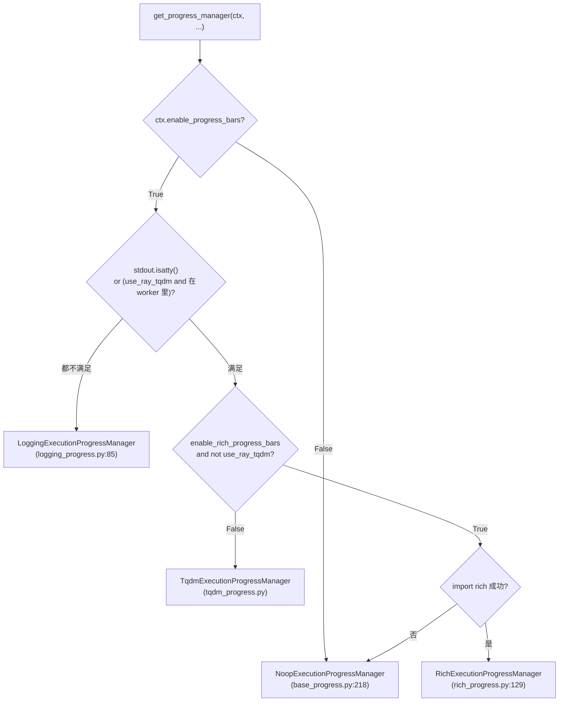

要点：默认 `enable_rich_progress_bars=False`（`RAY_DATA_ENABLE_RICH_PROGRESS_BARS`）且 `use_ray_tqdm=True`（`RAY_TQDM`），所以**默认走 tqdm**。在 K8s / CI / nohup 这类非 tty 环境里自动降级成 logging 后端，每 `RAY_DATA_NON_TTY_PROGRESS_LOG_INTERVAL`（默认 10）秒打一批（`python/ray/data/_internal/progress/logging_progress.py:99`），块状输出形如：

```text
======= Running Dataset: dataset_1_0 =======
dataset_1_0: 12000/40000
Active & requested resources: 14/16 CPU, 2/2 GPU, 8.1GB/12.0GB object store (pending: 2 CPU)

ReadParquet->Map(decode): 12000/40000
  Tasks: 14; Actors: 0; Queued blocks: 31 (3.9GB); Resources: 14.0 CPU, 6.2GB object store
MapBatches(Model): 8000/40000
  Tasks: 4 [backpressured:tasks(ConcurrencyCapBackpressurePolicy)]; Actors: 4; ...
============================================
```

#### 11.4.2 算子行的标注怎么读

每个算子那一行的描述由 `format_op_state_summary` 拼装（`python/ray/data/_internal/execution/streaming_executor_state.py:1091-1125`）。这是判断「卡在哪」最快的一手信号：

```text
Tasks: 4 [backpressured:tasks(ResourceBudgetBackpressurePolicy),outputs(DownstreamCapacityBackpressurePolicy)]; \
Actors: 5 (running=4, restarting=0, pending=1, active=3, idle=1, util=0.750, tasks_in_flight=6); \
Queued blocks: 31 (3.9GB); Resources: 14.0 CPU, 2.0 GPU, 6.2GB object store; [17/20 objects local]
  ^^^^^^^^^^^^^^^^^^^^^^^^^^^^^^^^^^^^^^^^^^^^^^^^^^^^^^^^^^^^^^^^^^^^^^^^^^^^^^^^^^^^^^^^^^^^^^^^^
```

| 标注 | 源码 | 含义与读法 |
| --- | --- | --- |
| `Tasks: N` | `:1096-1097` | 当前在飞 task 数（`num_active_tasks()`）。长期为 0 而 `Queued blocks` 不为 0 = 该算子被拦住了 |
| `[backpressured:tasks(<Policy>)]` | `:1103-1106` | 该算子**提交侧**被背压（`can_add_input` 返回 False），括号里是具体策略名 |
| `[backpressured:outputs(<Policy>)]` | `:1107-1110` | **拉取侧**被背压（`max_task_output_bytes_to_read` 限流），task 在跑但输出不让读走 |
| `Actors: N` | `:936-943` | `running+pending+restarting`。**只有当三者全为 running 时才简写成 `Actors: N`**；否则展开 `ActorPoolInfo`（`python/ray/data/_internal/actor_autoscaler/autoscaling_actor_pool.py:82-87`），其中 `util` 就是第 6 章的 `get_pool_util()`，`pending` 长期 > 0 = actor 起不来 |
| `Queued blocks: N (XGB)` | `:1117` | 入队但还没被消费的输入块数与字节。**持续增长 = 该算子是瓶颈**；上游的这个值增长而自己为 0 = 你自己是瓶颈的下游 |
| `Resources: ...` | `:1118` + `resource_manager.py:341-353` | 该算子当前占用的 CPU / memory / GPU / object store |
| `(in=..., out=..., alloc=(...), budget=(...))` | `resource_manager.py:359-386` | 只在 `verbose=True` 时追加。`budget` 是 `ReservationOpResourceAllocator` 给它的剩余预算，`-1` 表示 `inf` |
| `[all objects local]` / `[17/20 objects local]` / `[locality off]` | `python/ray/data/_internal/execution/util.py:74-78`、`actor_pool_map_operator.py:552-558` | actor pool 的 locality 命中；`output_splitter.py:222-226` 里对应 `[locality disabled]` |

`verbose=True` 的那一版只在 `python/ray/data/_internal/execution/streaming_executor.py:748`（`_debug_dump_topology`，写 debug 日志）里用，进度条本身传的是默认 `verbose=False`。想看 budget/alloc 就把 Ray Data 的 logger 调到 DEBUG。

#### 11.4.3 三个开关的分工

| 开关 | 位置 | 默认 | 管什么 |
| --- | --- | --- | --- |
| `DataContext.enable_progress_bars` | `python/ray/data/context.py:960` | `True`（`RAY_DATA_DISABLE_PROGRESS_BARS=1` 关） | **总闸**。关掉后全局条和算子条一起消失，走 Noop |
| `DataContext.enable_operator_progress_bars` | `python/ray/data/context.py:962` | `True` | 只关算子级别的条，保留全局总进度 |
| `ExecutionOptions.verbose_progress` | `_internal/execution/interfaces/execution_options.py:433-436` | `True`（`RAY_DATA_VERBOSE_PROGRESS=0` 关） | 让**非 AllToAll** 算子也显示子进度条。关掉后只有带 `SubProgressBarMixin` 的算子（sort/shuffle 的 map/reduce 阶段）才有子条（`logging_progress.py:130-131`、`rich_progress.py:183-184`、`tqdm_progress.py:85-86`） |
| `DataContext.enable_progress_bar_name_truncation` | `python/ray/data/context.py:963` | `True` | 融合后算子名很长，默认按 `MAX_NAME_LENGTH = 100` 截断（`base_progress.py:115`）。想看完整融合链就关掉 |

### 11.5 IssueDetector 框架

#### 11.5.1 触发机制

`IssueDetectionExecutionCallback`（`python/ray/data/_internal/execution/callbacks/insert_issue_detectors.py:14`）在 `before_execution_starts` 时给 executor 装一个 `IssueDetectorManager`，然后每轮调度后（`on_execution_step`）调 `invoke_detectors()`。

`invoke_detectors`（`python/ray/data/_internal/issue_detection/issue_detector_manager.py:46-61`）不是每轮都真跑：每个 detector 有自己的 `detection_time_interval_s()`，**返回 `-1` 就整体跳过**，否则按各自间隔节流。

检出的 `Issue`（`python/ray/data/_internal/issue_detection/issue_detector.py:16`，字段 `dataset_name` / `operator_id` / `message` / `issue_type`）走三条路（`issue_detector_manager.py:63-107`）：

1. `logger.warning(issue.message)` —— 你在日志里看到的就是这个；
2. 累加算子指标 `metrics._issue_detector_hanging` / `_issue_detector_high_memory`（每轮先清零，`:71-72`，所以它是「当前是否有问题」而非累计计数）；
3. 通过 `OperatorEventExporter` 导出成 Ray export 事件（11.6）。

只要这一轮有 issue，还会附一句提示：`Found N issues. To disable issue detection, run DataContext.get_current().issue_detectors_config.detectors = [].`

#### 11.5.2 内置检测器

`IssueType` 只有两个值：`HANGING = "hanging"`、`HIGH_MEMORY = "high memory"`（`issue_detector.py:10-12`）。默认启用的 detector 列表在 `IssueDetectorsConfiguration.detectors`（`python/ray/data/_internal/issue_detection/issue_detector_configuration.py:25-32`）：

| 检测器 | 文件 | 默认启用 | 判据 | 默认阈值 |
| --- | --- | --- | --- | --- |
| `HashShuffleAggregatorIssueDetector` | `detectors/hash_shuffle_detector.py:32` | ✅ | `HashShuffleOperator` 的 aggregator pool 有 actor 长期未 ready | `detection_time_interval_s=30.0`、`min_wait_time_s=300.0`（`:28-29`）；被 `DataContext.__post_init__` 覆盖为 `hash_shuffle_aggregator_health_warning_interval_s`(30) / `min_hash_shuffle_aggregator_wait_time_in_s`(300)，见 `python/ray/data/context.py:1054-1060` |
| `HighMemoryIssueDetector` | `detectors/high_memory_detector.py:42` | ✅ | `MapOperator` 的 `average_max_uss_per_task` 同时 > 初始 `memory` 请求且 ≥ `get_safe_default_logical_memory(remote_args)` | `detection_time_interval_s=30`（`:39`） |
| `HangingExecutionIssueDetector` | `detectors/hanging_detector.py:87` | ❌ **默认注释掉** | 某 task 距上次产出输出的时间 > `mean + z * stddev`（`op_task_duration_stats`），且该算子至少跑过 `min_count` 个 task | `op_task_stats_min_count=10`、`op_task_stats_std_factor=10`、`detection_time_interval_s=30.0`（`:28-32`） |

`HangingExecutionIssueDetector` 被禁用的原因写在 `issue_detector_configuration.py:27`：`TODO(Justin): Enable once it's non-blocking`——它的 `_refresh_state` 会同步调 Ray State API 的 `get_task()`（`hanging_detector.py:252-282`，`timeout=1`），会阻塞调度线程。**想用它排查挂死必须手动开，并且知道有调度开销。**

两条报警长什么样（截取要点）：

```text
# HighMemoryIssueDetector，模板在 high_memory_detector.py:22-34
Operator 'MapBatches(Model)' uses 3.2GB of memory per task on average, but Ray
only requests 0.0B per task at the start of the pipeline.
To avoid out-of-memory errors, consider setting `memory=3.2GB` in the
appropriate function or method call. ...

# HashShuffleAggregatorIssueDetector，模板在 hash_shuffle_detector.py:135-145
Only 12 out of 128 hash-shuffle aggregators are ready after 305.0 secs.
This might indicate resource contention for cluster resources
(available CPUs: 0.0, required CPUs: 1.0). Cluster only has 2.11 GiB available
memory, required memory: 8.00 GiB. ... Consider increasing cluster size or
reducing the number of aggregators via `DataContext.max_hash_shuffle_aggregators`.
```

#### 11.5.3 关掉 / 调阈值 / 加一个

```python
from ray.data import DataContext
from ray.data._internal.issue_detection.detectors import HangingExecutionIssueDetector

cfg = DataContext.get_current().issue_detectors_config

cfg.detectors = []                                       # 全关
cfg.high_memory_detector_config.detection_time_interval_s = -1   # 只关 high-memory（-1 = 跳过）
cfg.hanging_detector_config.op_task_stats_std_factor = 3          # 收紧挂死判据
cfg.detectors.append(HangingExecutionIssueDetector)               # 手动启用挂死检测
```

自定义 detector 只需实现 `IssueDetector` 的三个方法：`from_executor(cls, executor)`（工厂，从 executor 抓 `_topology` / `_dataset_id` / `_data_context`）、`detect() -> List[Issue]`、`detection_time_interval_s() -> float`，然后 append 到 `cfg.detectors`。注意 `detect()` 跑在**调度线程**上，任何阻塞调用都会拖慢整个 pipeline（这就是 hanging detector 被默认关掉的教训）。

### 11.6 导出到外部系统

三个 exporter 结构一致：都通过 **Ray export event API** 把结构化 protobuf 写到 session 日志目录，都由 `check_export_api_enabled(...)` 单独 gate，**都没有 `DataContext` 开关**——只认环境变量 `RAY_enable_export_api_write=1`（全开）或 `RAY_enable_export_api_write_config=<逗号分隔的 source 名>`（细粒度），见 `python/ray/_private/ray_constants.py:551,560`。

| Exporter | 文件 | 导出内容 | Export source type | 生产者 |
| --- | --- | --- | --- | --- |
| `DatasetMetadataExporter` | `metadata_exporter.py:338` | `DatasetMetadata`（`:171`）：job_id / dataset_id / start_time / 完整 `Topology`（算子 name、id、uuid、`_get_logical_args()`、input_dependencies、sub_stages）/ 脱敏后的 `DataContext` / 状态。还内嵌 Dashboard 面板清单（`OPERATOR_PANELS` 的 id+title，`:310`） | `EXPORT_DATASET_METADATA` | `_StatsActor`：注册时 `stats.py:896`，状态变更 `:983`、`:1030` |
| `OperatorEventExporter` | `operator_event_exporter.py:83` | `OperatorEvent`（`:20`）：dataset_id / operator_id / operator_name / event_time / event_type / message | `EXPORT_DATASET_OPERATOR_EVENT` | `IssueDetectorManager._report_issues`（`:98`）。事件名由 `format_export_issue_event_name`（`:70`）生成，只有 `ISSUE_DETECTION_HANGING` / `ISSUE_DETECTION_HIGH_MEMORY` 在 proto 枚举里（`src/ray/protobuf/export_dataset_operator_event.proto:23-27`），其余被丢弃 |
| `OperatorSchemaExporter` | `operator_schema_exporter.py:63` | `OperatorSchema`（`:19`）：`operator_uuid` + `{列名: 类型}` | `EXPORT_DATASET_OPERATOR_SCHEMA` | `StreamingExecutor._export_operator_schema`（`:607-621`），仅在某算子输出 schema 发生变化时触发（`:569-573`） |

用途上：`DatasetMetadataExporter` 是 **Ray Dashboard 的 Data 页面**的数据源（它连面板清单都一起导出了）；`OperatorSchemaExporter` 的 uuid + 列类型是喂给**外部血缘/数据目录系统**的天然素材；`OperatorEventExporter` 适合接告警。

**Prometheus 指标**分两个来源：

- `ResourceAllocatorPrometheusCallback`（`python/ray/data/_internal/execution/callbacks/resource_allocator_prometheus_callback.py:13`）暴露 5 个预算 Gauge，tag 均为 `(dataset, operator)`：`data_cpu_budget`、`data_gpu_budget`、`data_memory_budget`、`data_object_store_memory_budget`、`data_max_bytes_to_read`。**`inf` 编码成 `-1`**（`:88-95`、`:112-114`），画图时要过滤掉；`data_max_bytes_to_read` 只在 `op_resource_allocator_enabled()` 时才写（`:108`）。它默认就在 `DataContext.execution_callback_classes` 里（`python/ray/data/context.py:1293-1297`），无需开关。
- `_StatsActor`（`python/ray/data/_internal/stats.py:365`）暴露绝大多数指标。命名规律：概览类 `data_spilled_bytes` / `data_output_rows` / `data_cpu_usage_cores` …（tag `dataset, operator`）；迭代类 `data_iter_*`（tag `dataset, split`）；dataset 级 `data_dataset_state` / `data_dataset_estimated_total_rows`（tag `dataset, job_id, start_time`）；此外 `_create_prometheus_metrics_for_execution_metrics`（`:682`）把 `OpRuntimeMetrics` 的每个字段自动变成 `data_<字段名>`，`_create_prometheus_metrics_for_per_node_metrics`（`:714`）在 `enable_per_node_metrics=True`（`RAY_DATA_PER_NODE_METRICS=1`）时额外产出 `data_*_per_node`（tag `dataset, node_ip`）。

自定义 callback 有两条注册路径：环境变量 `RAY_DATA_EXECUTION_CALLBACKS="mymod.MyCallback,..."`（`python/ray/data/context.py:367`、解析在 `:1300-1325`），或 `DataContext.custom_execution_callback_classes.append(MyCallback)`（`:1034`、`:1328`）。实例化发生在 planner（`python/ray/data/_internal/planner/planner.py:271-272`）。接口是 `ExecutionCallback` 的四个钩子：`before_execution_starts` / `on_execution_step` / `after_execution_succeeds` / `after_execution_fails`（`python/ray/data/_internal/execution/execution_callback.py:7-25`）。

顺带一提用量遥测：`python/ray/data/_internal/usage/` 会把匿名化的算子拓扑、pyarrow 版本、spill/OOM/node-death 计数打进 GCS usage stats（`TagKey.DATA_USAGE`）。关闭方式是 `RAY_USAGE_STATS_ENABLED=0` / `ray disable-usage-stats`，或 Ray Data 专属的 `RAY_DATA_USAGE_DISABLED=1`（`python/ray/data/_internal/usage/collector.py:145-150`）。

### 11.7 常见问题诊断手册

#### 11.7.0 「吞吐不达预期」总决策树

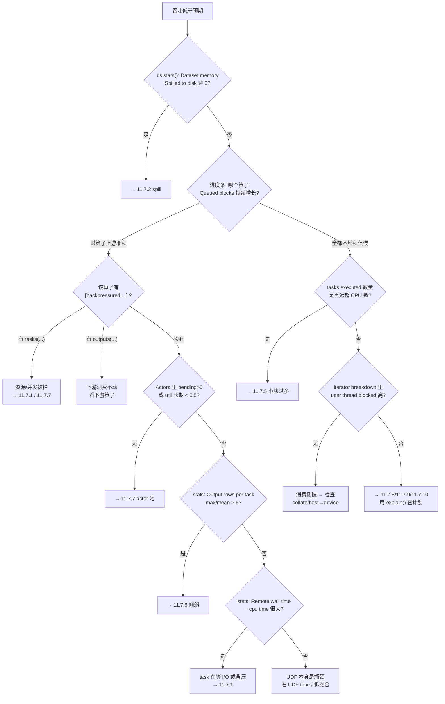

#### 11.7.1 GPU 利用率低 / GPU 算子饿着

| 可能原因 | 验证方法 | 处置 |
| --- | --- | --- |
| 上游 CPU 算子供不上 | 进度条：GPU 算子 `Queued blocks` ≈ 0 而 `Tasks` 也少；上游算子 `Tasks` 拉满 | 给上游加 `concurrency=`，或把重解码搬到 GPU 算子内部；`stats()` 看上游 `Ray Data throughput` 是否 < GPU 算子的处理能力 |
| 融合被阻断，多了一次 object store 往返 | `explain()` 第四段：预期融合的算子仍是两个 | 对照第 4 章清单消除阻断因素（统一 `ray_remote_args`、去掉 `ray_remote_args_fn`、对齐 `concurrency`） |
| AllToAll 屏障 | `explain()` 里存在 `AllToAllOperator[...]`；进度条上游先跑完再启动下游 | 尽量把 sort/shuffle 移到 GPU 段之后；或改用 `StreamingRepartition` |
| actor 池没扩容 | 进度条 `Actors: N (…util=…)` 长期不涨 | 见 11.7.7 |
| `batch_size` 太小，GPU 每批算得太快 | `stats()` 的 `Output num rows per block` 很小；`data_iter_batch_shaping_seconds` 高 | 调大 `map_batches(batch_size=...)`。注意：**传了 `batch_size` 就相当于设了 `min_rows_per_bundled_input`**，若上游 `can_modify_num_rows=True`（`Limit`/`Filter`/`FlatMap`/`Read`/`ReadFiles`/`Write`）会阻断融合 |
| task 提交出去起不来 | `get_stats_summary(detail=True)` 看 `node_assignment_ms` / `worker_startup_ms` p99 | 扩容、预热 runtime env、检查 `num_gpus` 请求是否可满足 |

#### 11.7.2 object store 频繁 spill、吞吐骤降

**验证**：`ds.stats()` 尾部的 `Dataset memory: * Spilled to disk: XMB`（本作业）与 `Cluster memory:`（全集群）；Prometheus 的 `data_spilled_bytes{dataset,operator}` 能定位到具体算子；`ray memory` / dashboard 的 object store 水位。

**处置顺序**（从便宜到贵）：

1. 降 `DataContext.target_max_block_size`（默认 128 MiB，`python/ray/data/context.py:76`）。峰值内存 ≈ `2 × 并发 task 数 × target_max_block_size`。
2. 降算子 `concurrency`，直接砍并发工作集。
3. 确认预留生效：`op_resource_reservation_enabled`（默认开）+ `op_resource_reservation_ratio`（默认 0.5，`python/ray/data/context.py:309`）。object store 上限是 `DEFAULT_OBJECT_STORE_MEMORY_LIMIT_FRACTION=0.5`，无预留时降到 `0.25`（`python/ray/data/_internal/execution/resource_manager.py:97-104`）。
4. 打开/收紧下游容量背压：`downstream_capacity_backpressure_ratio`（默认 2.0，设 `None` 关闭，`python/ray/data/context.py:1014`）。
5. 别用 `materialize()` 把整个 dataset 钉在 object store 里；`preserve_order=True` 也会拖长 block 生命周期。

#### 11.7.3 worker 被 OOM-kill（`WorkerCrashedError`）

这是**堆内存**（进程 RSS）不足，和 object store spill 是两回事。

| 步骤 | 做什么 |
| --- | --- |
| 确认 | 日志里 `WorkerCrashedError` / `The node ... was killed because ... memory pressure`；Prometheus `ray_memory_manager_worker_eviction_total` |
| 定位 | 打开 `verbose_stats_logs`，看 `Extra metrics` 里的 `average_max_uss_per_task`；或直接等 `HighMemoryIssueDetector` 的警告（它就是干这个的） |
| 处置 | 按 detector 的建议给 `map_batches(memory=...)` 声明真实内存需求，让 Ray Core 据此限制并发；同时降 `batch_size` 和 `target_max_block_size` |
| 兜底 | `DataContext.max_map_retries`（默认 3，`context.py:979`）、`retried_map_errors`（默认 `False`）、`max_errored_blocks`（默认 0，`:982`，设 >0 允许丢块继续） |

#### 11.7.4 作业挂住不动

第一道防线是 `NoProgressGuard`（第 7 章）：默认 `execution_no_progress_timeout_s = 30 * 60`（`RAY_DATA_EXECUTION_NO_PROGRESS_TIMEOUT_S`，`python/ray/data/context.py:193-195`），判据是任一算子的 `(num_outputs_taken, total_enqueued_input_blocks, total_enqueued_output_blocks)` 三元组变化。设 `-1` 禁用，设 `0` 会直接报错。

**但它在拓扑里出现 `AllToAllOperator` 或 `HashShufflingOperatorBase` 时整体禁用**（`python/ray/data/_internal/execution/no_progress_guard.py:70-76`）——而 shuffle 恰恰是最容易挂的地方。这种场景改用：

1. `HashShuffleAggregatorIssueDetector` 的警告（默认开，300s 后开始报）：aggregator 起不齐就是最常见的 shuffle 挂死原因，跟着它的建议降 `DataContext.max_hash_shuffle_aggregators`（默认 128）。
2. `hash_shuffle_reduce_get_timeout_s`（默认 1800.0，`python/ray/data/context.py:874`）：reduce 端单次 `ray.get()` 超时会抛 `GetTimeoutError` 而不是永久等待；调小可以更快暴露问题。
3. 手动启用 `HangingExecutionIssueDetector`（11.5.3），它会打出具体 `task_id` / `pid` / `node_id`，拿到 pid 后用 `py-spy dump --pid <pid>` 抓栈。
4. 看进度条：所有算子 `Tasks: 0` 且 `Queued blocks` 不变 = 真挂了；某算子 `Tasks: N` 不变但 `Queued blocks` 不动 = task 卡在 UDF 里。
5. 异常语义提醒（第 7 章）：调度线程的异常存进 sink 的 `OpState._exception`，**由用户线程重抛**。若用户线程正卡在 `iter_batches` 上，你看到的堆栈会是消费侧的——`DataContext.log_internal_stack_trace=True`（`RAY_DATA_LOG_INTERNAL_STACK_TRACE`）能把内部栈打全。

#### 11.7.5 task 数爆炸 / 小 block 太多

**症状**：`tasks executed` 是 CPU 数的几十倍、driver 单线程调度成为瓶颈、进度条刷得飞快但总吞吐不涨。

**验证**：

- `stats()` 的 `Output size bytes per block` 的 `mean` 远小于 `target_max_block_size`；
- `Runtime Metrics` 里 `Scheduling` 占比高（`streaming_exec_schedule_s`，`verbose_stats_logs` 才打）；
- Prometheus `data_block_size_bytes` / `data_block_size_rows` 直方图整体偏左；
- `data_task_scheduling_time_s`——第 6 章定义为「driver 视角首块时间 − worker 视角生成+序列化时间」，即**纯调度开销**，它高就是调度侧瓶颈。

**处置**：调大 `target_min_block_size`（默认 1 MiB，`context.py:90`）让读端合并小文件；降 `read_op_min_num_blocks`（默认 200，`:110`）/ `min_parallelism`（默认 200，`RAY_DATA_DEFAULT_MIN_PARALLELISM`，`:162`）；读 parquet 时调大 `parquet_chunker_target_chunk_size`；显式给 `override_num_blocks` 一个合理值。

#### 11.7.6 数据倾斜

**验证**：

| 信号 | 出处 |
| --- | --- |
| `Output rows per task: 1 min, 900000 max, 12000 mean, 200 tasks used` | `stats()`，`max/mean` 比值就是倾斜倍数 |
| `Tasks per node: 2 min, 180 max` | `stats()`，说明调度也不均 |
| `data_task_completion_time` 直方图长尾 | Prometheus，`RuntimeMetricsHistogram`（`op_runtime_metrics.py:445`） |
| `Remote wall time: ... 0.4s min, 210s max` | `stats()`，min/max 差两个数量级 |

**处置**：倾斜在 map 阶段 → 加 `StreamingRepartition` 或调整 `batch_size` 让 bundle 更均；倾斜在 shuffle 阶段 → 换 key、加盐、调 `default_hash_shuffle_parallelism`（默认 200，`context.py:864`）；`scheduling_strategy` 默认 `"SPREAD"`（`:148`），若 `Tasks per node` 极不均要检查是否被 `scheduling_strategy_large_args="DEFAULT"`（`:152`，`large_args_threshold` 默认 50 MiB）切到了 locality 优先。

#### 11.7.7 actor 池不扩容

这是**配置陷阱**，不是 bug。`get_pool_util() = num_tasks_in_flight / (max_actor_concurrency * current_size)`，扩容阈值 `actor_pool_util_upscaling_threshold = 1.75`（`python/ray/data/context.py:370-373`）。而 util 的理论上限是 `max_tasks_in_flight_per_actor / max_concurrency`——默认这个比值是 2（`DEFAULT_ACTOR_MAX_TASKS_IN_FLIGHT_TO_MAX_CONCURRENCY_FACTOR`，`context.py:341`），2 > 1.75 所以能扩。

**一旦你自定义了 `max_concurrency` 而没同步调 `max_tasks_in_flight_per_actor`，比值可能掉到 1.75 以下，池永远不会扩容。**

验证：启动时 autoscaler 会打警告（`python/ray/data/_internal/actor_autoscaler/default_actor_autoscaler.py:229-239`）：

```text
Actor Pool configuration of the ... will not allow it to scale up: configured
utilization threshold (175.0%) couldn't be reached with configured
max_concurrency=4 and max_tasks_in_flight_per_actor=4 (max utilization will be
max_tasks_in_flight_per_actor / max_concurrency = 100%)
```

处置：调大 `DataContext.max_tasks_in_flight_per_actor`（`context.py:996`，全局 override）或调低 `actor_pool_util_upscaling_threshold`。另外记住缩容阈值 0.5、`actor_pool_max_upscaling_delta=1`（每轮最多 +1 个 actor，`context.py:380`，冷启动会很慢）、缩容有 10 秒单向防抖。`pending` 长期 > 0 则是资源不够或 actor init 太慢 —— 看 `wait_for_min_actors_s`（默认 -1 不限，`context.py:994`）和 `max_consecutive_actor_init_deaths`。

#### 11.7.8 算子没有按预期融合

`explain()` 对比第三、四段（11.3）。逐条排查第 4 章的阻断清单：上游是 actor pool / 上游有 additional split factor / `ray_remote_args` 规范化后不相等（`_canonicalize` 只补 `num_cpus=1`、`num_gpus=0`、清零值 `resources`；只有 `scheduling_strategy` 和 `label_selector` 可继承）/ 任一方有 `ray_remote_args_fn` / `concurrency` 不匹配 / 两边覆盖了不同 `target_max_block_size` / 上游 `can_modify_num_rows=True` 且非 `MapBatches` 而下游传了 `batch_size` / `Repartition(shuffle=False)` / `StreamingRepartition` 作上游。

最常见的两个：**给其中一个算子单独设了 `num_gpus`**，和**下游传了 `batch_size` 而上游是 `filter`/`flat_map`**。

#### 11.7.9 谓词 / 列裁剪没下推

`explain()` 对比第一、二段。核心事实（第 4 章）：**`filter(fn=lambda)` 完全不参与下推**，`Dataset.filter` 走 lambda 路径时在 `python/ray/data/dataset.py:2229` 有告警。改成 `filter(expr="col > 3")` 或 Expression 形式才能推进 reader。列裁剪同理靠 `ProjectionPushdown`（`_internal/logical/rules/projection_pushdown.py`），显式 `select_columns` 比在 UDF 里挑列有效得多。

#### 11.7.10 读并行度过低 / 过高

| 症状 | 验证 | 处置 |
| --- | --- | --- |
| 过低：read 算子 `tasks executed` 只有个位数，集群 CPU 空闲 | `stats()` 的 `Tasks per node` 与 `nodes used`；`explain()` 第四段看 split factor | 调大 `override_num_blocks`；提高 `min_parallelism` / `read_op_min_num_blocks` |
| 过高：task 数上万、`Scheduling` 占比高 | 见 11.7.5 | 调小 `override_num_blocks`；调大 `target_min_block_size` |

`SetReadParallelismRule` 是**物理**规则，只在 `explain()` 第四段体现，第二段看不出来。

### 11.8 调优旋钮速查表（完整版）

第 2 章给过一张常用配置简表；这里是排障视角的完整版。所有默认值均取自 `python/ray/data/context.py`。设置方式二选一：进程启动前设环境变量，或 `DataContext.get_current().<字段> = ...`（须在 dataset 执行前）。

**Block 大小**

| 字段 | 环境变量 | 默认 | 影响 | 何时调 |
| --- | --- | --- | --- | --- |
| `target_max_block_size` (`:840`) | — | 128 MiB (`:76`) | 单 block 上限，直接决定峰值 object store 占用（≈ `2 × 并发 × 该值`） | spill / OOM 就降；小块过多就升 |
| `target_min_block_size` (`:841`) | — | 1 MiB (`:90`) | 读端合并小文件的下限 | 小文件海量场景调大 |
| `streaming_read_buffer_size` (`:842`) | — | 32 MiB (`:94`) | 远端存储读缓冲 | 远端对象存储吞吐差时调大 |
| `MAX_SAFE_BLOCK_SIZE_FACTOR` (`:88`) | — | 1.5 | 超过 `1.5 × target_max` 会尝试切块并告警 | 只读 |

**读并行度**

| 字段 | 环境变量 | 默认 | 影响 |
| --- | --- | --- | --- |
| `min_parallelism` (`:939`) | `RAY_DATA_DEFAULT_MIN_PARALLELISM` | 200 (`:162`) | 读并行度下界 |
| `read_op_min_num_blocks` (`:940`) | — | 200 (`:110`) | read 算子最少产出块数 |
| `parquet_chunker_target_chunk_size` (`:944`) | — | `None`（内置 1 GiB） | parquet 分块粒度 |
| `use_datasource_v2` (`:941`) | `RAY_DATA_USE_DATASOURCE_V2` | `True` (`:112`) | 新版 datasource 路径 |
| `isolate_read_workers` (`:1012`) | `RAY_DATA_ISOLATE_READ_WORKERS` | `False` (`:352`) | 读 worker 与 map worker 隔离 |

**Shuffle**

| 字段 | 环境变量 | 默认 | 影响 |
| --- | --- | --- | --- |
| `_shuffle_strategy` (`:854`) | `RAY_DATA_DEFAULT_SHUFFLE_STRATEGY` | `HASH_SHUFFLE` (`:124`) | 全局 shuffle 策略 |
| `default_hash_shuffle_parallelism` (`:864`) | `RAY_DATA_DEFAULT_MIN_PARALLELISM` | 200 (`:864`) | hash shuffle 分区数 |
| `max_hash_shuffle_aggregators` (`:887`) | `RAY_DATA_MAX_HASH_SHUFFLE_AGGREGATORS` | `None` → min(CPU×2, 128) (`:128`) | aggregator actor 数；起不齐就降 |
| `hash_shuffle_compression` (`:867`) | `RAY_DATA_HASH_SHUFFLE_COMPRESSION` | `"zstd"` (`:132`) | 中间 shard 压缩 |
| `hash_shuffle_reduce_batch_size` (`:870`) | `RAY_DATA_HASH_SHUFFLE_REDUCE_BATCH_SIZE` | 16 (`:136`) | 每次 `ray.get` 的 shard 数 |
| `hash_shuffle_reduce_get_timeout_s` (`:874`) | `RAY_DATA_HASH_SHUFFLE_REDUCE_GET_TIMEOUT_S` | 1800.0 (`:140`) | reduce 端取数超时，≤0 关闭 |
| `shuffle_input_batch_bytes` (`:879`) | `RAY_DATA_SHUFFLE_INPUT_BATCH_BYTES` | 1 GiB (`:144`) | 分区前合并输入的目标批大小 |
| `min_hash_shuffle_aggregator_wait_time_in_s` (`:889`) | `RAY_DATA_MIN_HASH_SHUFFLE_AGGREGATOR_WAIT_TIME_IN_S` | 300 (`:358`) | 多久后才开始报 aggregator 不健康 |

**Actor 池**

| 字段 | 环境变量 | 默认 | 影响 |
| --- | --- | --- | --- |
| `actor_pool_util_upscaling_threshold` | `RAY_DATA_DEFAULT_ACTOR_POOL_UTIL_UPSCALING_THRESHOLD` | 1.75 (`:370`) | util 超过则扩容；**与 `max_tasks_in_flight/max_concurrency` 的关系见 11.7.7** |
| `actor_pool_util_downscaling_threshold` | `RAY_DATA_DEFAULT_ACTOR_POOL_UTIL_DOWNSCALING_THRESHOLD` | 0.5 (`:375`) | util 低于则缩容（10s 防抖） |
| `actor_pool_max_upscaling_delta` | `RAY_DATA_DEFAULT_ACTOR_POOL_MAX_UPSCALING_DELTA` | 1 (`:380`) | 每轮最多加几个 actor；冷启动慢就调大 |
| `max_tasks_in_flight_per_actor` (`:996`) | — | `None`（用 factor×concurrency） | 全局 override |
| — | `RAY_DATA_ACTOR_DEFAULT_MAX_TASKS_IN_FLIGHT_TO_MAX_CONCURRENCY_FACTOR` | 2 (`:341`) | 上面那个 factor |
| `wait_for_min_actors_s` (`:994`) | `RAY_DATA_DEFAULT_WAIT_FOR_MIN_ACTORS_S` | -1（不限）(`:337`) | actor 起不来多久后放弃 |
| `max_consecutive_actor_init_deaths` (`:977`) | `RAY_DATA_MAX_CONSECUTIVE_ACTOR_INIT_DEATHS` | 0 (`:296-298`) | actor 初始化连续死亡预算，与 `max_task_retries` 分开计 |

**资源与背压**

| 字段 | 环境变量 | 默认 | 影响 |
| --- | --- | --- | --- |
| `op_resource_reservation_enabled` (`:980`) | `RAY_DATA_ENABLE_OP_RESOURCE_RESERVATION` | `True` (`:305`) | 是否启用 `ReservationOpResourceAllocator` |
| `op_resource_reservation_ratio` (`:981`) | `RAY_DATA_OP_RESERVATION_RATIO` | 0.5 (`:309`) | 预留给每个 eligible 算子的比例 |
| `downstream_capacity_backpressure_ratio` (`:1014`) | `RAY_DATA_DOWNSTREAM_CAPACITY_BACKPRESSURE_RATIO` | 2.0 (`:392`)，`None` 关闭 | 下游队列容量背压阈值 |
| `enable_dynamic_output_queue_size_backpressure` (`:1018`) | `RAY_DATA_ENABLE_DYNAMIC_OUTPUT_QUEUE_SIZE_BACKPRESSURE` | `False` (`:387`) | `ConcurrencyCapBackpressurePolicy` 的 EWMA 动态并发（该策略已 `@Deprecated`） |
| `override_object_store_memory_limit_fraction` (`:1004`) | — | `None` | 覆盖 object store 上限比例（默认 0.5，无预留 0.25） |
| `execution_options` (`:956`) | — | — | 真正生效的只有 `resource_limits` / `preserve_order` / `verbose_progress` / `label_selector`（第 7 章） |

**容错与重试**

| 字段 | 默认 | 影响 |
| --- | --- | --- |
| `max_map_retries` (`:979`) | 3 (`:303`) | map task 重试次数 |
| `retried_map_errors` (`:978`) | `False` (`:301`) | 额外可重试的错误串；`True` = 全部重试 |
| `max_errored_blocks` (`:982`) | 0 (`:313`) | 允许丢弃的失败块数，>0 才容忍数据丢失 |
| `actor_task_retry_on_errors` (`:972`) / `actor_init_retry_on_errors` (`:975`) / `actor_init_max_retries` (`:976`) | `False` / `False` / 3 | actor 侧重试 |
| `execution_no_progress_timeout_s` (`:983`) | 1800.0 (`:193`) | `NoProgressGuard` 超时；`-1` 禁用，`0` 报错 |
| `retried_io_errors` (`:997`) / `write_file_retry_on_errors` (`:970`) | (`:228`) / (`:221`) | I/O 与写文件重试的错误串白名单 |
| `raise_original_map_exception` (`:985`) | `False` (`:189`) | 抛原始异常而非 Ray Data 包装后的异常 |

**可观测性**

| 字段 | 环境变量 | 默认 | 影响 |
| --- | --- | --- | --- |
| `enable_auto_log_stats` (`:953`) | — | `False` (`:177`) | 执行结束自动打 stats |
| `verbose_stats_logs` (`:954`) | — | `False` (`:179`) | 加 `Extra metrics` + `Runtime Metrics` |
| `enable_progress_bars` (`:960`) | `RAY_DATA_DISABLE_PROGRESS_BARS` | `True` (`:201`) | 进度条总闸 |
| `enable_operator_progress_bars` (`:962`) | — | `True` | 算子级进度条 |
| `enable_rich_progress_bars` (`:966`) | `RAY_DATA_ENABLE_RICH_PROGRESS_BARS` | `False` (`:210`) | rich 后端 |
| `use_ray_tqdm` (`:959`) | `RAY_TQDM` | `True` (`:197`) | 分布式 tqdm |
| `enable_per_node_metrics` (`:1003`) | `RAY_DATA_PER_NODE_METRICS` | `False` (`:346`) | 额外产出 `data_*_per_node` 指标 |
| `enable_get_object_locations_for_metrics` (`:967`) | — | `False` (`:216`) | `Block locations` 段 + 精确 spill 统计 |
| `log_internal_stack_trace` (`:984`) | `RAY_DATA_LOG_INTERNAL_STACK_TRACE` | `False` (`:183`) | 打印 Ray Data 内部栈 |
| `issue_detectors_config` (`:1008`) | — | 见 11.5.2 | detector 列表与阈值 |
| `dataset_logger_id` (`:1006`) | — | `None` | 给 dataset 打自定义日志标识 |
| — | `RAY_DATA_EXECUTION_CALLBACKS` (`:367`) | 空 | 逗号分隔的 `module.Class` 回调 |
| — | `RAY_enable_export_api_write` / `RAY_enable_export_api_write_config` | 关 | 三个 exporter 的总开关 |
| — | `RAY_DATA_USAGE_DISABLED` | 关 | 关闭 Ray Data 用量遥测 |

### 11.9 源码导航索引

| 我想…… | 去哪个文件 | 实现什么接口 | 在哪里注册 |
| --- | --- | --- | --- |
| 加一条**逻辑**优化规则 | `_internal/logical/rules/<name>.py` | `Rule.apply(plan) -> Plan`（`_internal/logical/interfaces/optimizer.py:6-21`），可选 `dependencies()` / `dependents()` 声明顺序 | `_LOGICAL_RULESET`（`_internal/logical/optimizers.py:31-40`） |
| 加一条**物理**优化规则（如新的融合） | 同上 | 同上，但 `plan` 是 `PhysicalPlan` | `_PHYSICAL_RULESET`（`_internal/logical/optimizers.py:42-49`） |
| 加一个**逻辑算子** | `_internal/logical/operators/*.py` | 继承 `LogicalOperator`（`_internal/logical/interfaces/`） | 同时要在 planner 的 `_DEFAULT_PLAN_FNS` 加映射 |
| 加一个**物理算子** | `_internal/execution/operators/*.py` | 继承 `PhysicalOperator`：`can_add_input` / `_add_input_inner` / `has_next` / `_get_next_inner` / `get_stats` / `progress_str` / `min_max_resource_requirements` | `Planner._DEFAULT_PLAN_FNS`（`_internal/planner/planner.py:237-256`），写一个 `plan_xxx_op(logical_op, physical_children, data_context)` |
| 改**算子选择/调度策略** | `_internal/execution/ranker.py` | 继承 `Ranker`，实现 `rank_operator`（返回可比较的 key，取最小） | `create_ranker()`（`_internal/execution/__init__.py:55-57`）；消费点在 `select_operator_to_run`（`_internal/execution/streaming_executor_state.py:898`） |
| 加一个**背压策略** | `_internal/execution/backpressure_policy/<name>.py` | 继承 `BackpressurePolicy`，按需覆盖 `can_add_input(op)` 和/或 `max_task_output_bytes_to_read(op)` | `ENABLED_BACKPRESSURE_POLICIES`（`backpressure_policy/__init__.py:17-21`），或运行时 `DataContext.set_config("backpressure_policies.enabled", [...])` |
| 加一个**数据源** | `datasource/datasource.py` 旁边新建文件 | 继承 `Datasource`（`datasource/datasource.py:150`）：`get_read_tasks(parallelism)`、`estimate_inmemory_data_size()`；要支持下推就混入 `_DatasourceProjectionPushdownMixin` / `_DatasourcePredicatePushdownMixin` | 暴露一个 `read_xxx()` 到 `read_api.py`；文件型数据源继承 `FileBasedDatasource` |
| 加一个**写出目标** | `datasource/datasink.py` 旁边 | 继承 `Datasink`（`datasource/datasink.py:47`）：`write(blocks, ctx)` | 暴露 `Dataset.write_xxx()` |
| 加一个 **aggregate 函数** | `aggregate.py` | 继承 `AggregateFnV2`（`aggregate.py:181`）：必须实现 `aggregate_block` 和 `combine`，可选 `finalize`；构造时给 `name` / `zero_factory` / `on` / `ignore_nulls` | 直接传给 `ds.aggregate(...)` 或 `GroupedData.aggregate(...)`，无需全局注册 |
| 加一个 **issue detector** | `_internal/issue_detection/detectors/<name>.py` | 继承 `IssueDetector`（`_internal/issue_detection/issue_detector.py:23`）：`from_executor` / `detect` / `detection_time_interval_s` | `IssueDetectorsConfiguration.detectors`（`_internal/issue_detection/issue_detector_configuration.py:25`），或运行时 append |
| 加一个 **execution callback** | 任意模块 | 继承 `ExecutionCallback`（`_internal/execution/execution_callback.py:7`）的四个钩子 | `RAY_DATA_EXECUTION_CALLBACKS` 环境变量，或 `DataContext.custom_execution_callback_classes` |
| 改**进度条** | `_internal/progress/{rich,tqdm,logging}_progress.py` | 继承 `BaseExecutionProgressManager`（`_internal/progress/base_progress.py:110`）的 6 个抽象方法；子进度条继承 `BaseProgressBar`（`:41`） | `get_progress_manager()`（`_internal/progress/__init__.py:16`）；算子行文案改 `format_op_state_summary`（`_internal/execution/streaming_executor_state.py:1091`） |
| 改 **stats 输出** | `_internal/stats.py` | 算子行改 `OperatorStatsSummary.__str__`（`:1849`）；整体骨架改 `DatasetStatsSummary.to_string`（`:1462`）；迭代段改 `IterStatsSummary.to_string`（`:2039`） | 改完**必须同步更新 `tests/test_stats.py`** 的断言（那是格式的唯一权威） |
| 加一个 **Prometheus 指标** | `_internal/execution/interfaces/op_runtime_metrics.py` | 用 `metric_field(...)` 声明字段，元类自动注册；指定 `metrics_group` 和 `metrics_type` | `_StatsActor._create_prometheus_metrics_for_execution_metrics`（`_internal/stats.py:682`）会自动生成 `data_<字段名>`，无需手写 |
| 加一个**外部导出** | `_internal/{metadata,operator_event,operator_schema}_exporter.py` | 继承对应 ABC，实现导出方法；proto 在 `src/ray/protobuf/export_dataset_*.proto` | `get_*_exporter()` 工厂 + `check_export_api_enabled(ExportEvent.SourceType.XXX)` |

### 11.10 收尾：Ray Data 的四个取舍

回头看这十一章，Ray Data 的设计基本可以归结为四个明确的权衡。

**一、执行、存储、容错全部外包给 Ray Core，自己只做计划与调度。** 这是最大的一笔杠杆：不用写 shuffle service、不用写内存管理、不用写重试。代价是所有性能问题最终都会落到 object store 和调度器上——这就是为什么 11.7 里过半的症状最后都指向 spill 和 `task_scheduling_time_s`。

**二、流式执行换来资源重叠，但必须自己造背压。** 让 CPU 解码和 GPU 推理同时跑满是流式的全部意义；反面是任何一个环节快过下游，object store 就会被填满。于是有了三个背压策略、两个作用点（提交侧 `can_add_input`、拉取侧 `max_task_output_bytes_to_read`）和一整套资源预留。理解背压不是可选项——它是流式执行的必要配套。

**三、元数据与数据分离，让 driver 单线程调度成为可能。** 调度循环只操作 `RefBundle` 里的 `ObjectRef` 和 `BlockMetadata`，从不接触真实数据，所以一个 Python 线程就能撑住上万 task。代价是块太小时元数据开销会反噬（11.7.5），以及 driver 成了单点。

**四、Expression 白盒换来下推能力，lambda 黑盒换来表达自由。** `filter(expr=...)` 能推到 parquet reader，`filter(fn=lambda)` 只能全读再筛——这不是实现缺陷，是信息量的差异。凡是希望优化器帮忙的地方，就得付出用 Expression 描述意图的代价。

这四条串起来就是一句话：**Ray Data 把「怎么算」交给 Ray Core，把「算什么、什么时候算」留给自己**。排障时也顺着这条线走——先用 `explain()` 确认计划对不对，再用 `stats()` 和进度条确认调度和资源对不对，最后才去怀疑 UDF 本身。
